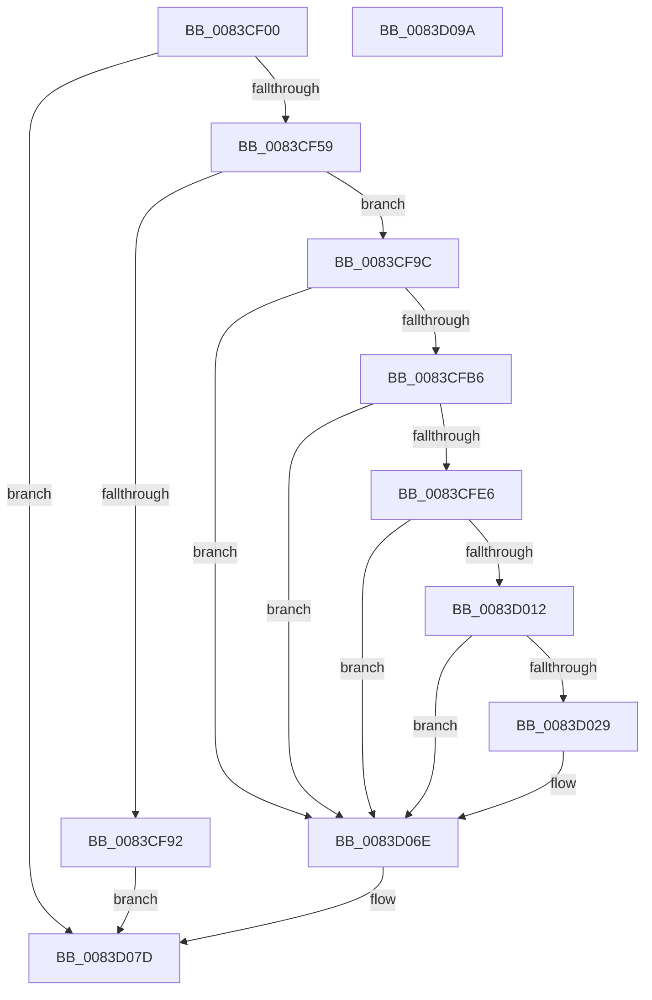

# ObpGetSilosRootDirectory

- RVA: `0x0083CF00`–`0x0083D09B` (길이 `411` bytes)
- VA: `0x000000014083CF00`
- 실행 섹션: `PAGE`
- PDB 이름 있음: `예`; PDB Function 태그: `아니요`
- unwind 정보 RVA: `0x0006EE68`
- 디코드: `105`개 명령, `411/411` bytes 표시
- 미해석 바이트: `0` (있으면 어셈블리에 `.byte`로 보존)

> 이 문서는 커널 이미지의 기계어와 PDB 기호를 분석해 생성했습니다. 4번과 5번은 함수 원형과 자료형을 바이너리 사용 방식에서 추정한 C 해석이며 원본 소스 복구 결과는 아닙니다.

## 1. Dependencies

- 직접 호출 지점: **10**; 고유 호출 대상: **8**
- 직접 호출자로 확인된 함수: **1**
- RIP 상대 이미지 참조: **3**

### Outgoing calls
- `0x0083CF49` → [RtlCreateSecurityDescriptor](../9F/RtlCreateSecurityDescriptor_function_009F1DF0.md) (function, `0x009F1DF0`)
- `0x0083CF60` → [RtlLengthSid](../../text/45/RtlLengthSid_function_0045D270.md) (function, `0x0045D270`)
- `0x0083CF6E` → [RtlLengthSid](../../text/45/RtlLengthSid_function_0045D270.md) (function, `0x0045D270`)
- `0x0083CF85` → [ExAllocatePool2](../../poolcode/B8/ExAllocatePool2_function_00B820F0.md) (function, `0x00B820F0`)
- `0x0083CFA7` → [RtlCreateAcl](../91/RtlCreateAcl_function_00916F00.md) (function, `0x00916F00`)
- `0x0083CFD7` → [RtlpAddKnownAce](../92/RtlpAddKnownAce_function_00929A20.md) (function, `0x00929A20`)
- `0x0083D007` → [RtlpAddKnownAce](../92/RtlpAddKnownAce_function_00929A20.md) (function, `0x00929A20`)
- `0x0083D01E` → [RtlSetDaclSecurityDescriptor](../9E/RtlSetDaclSecurityDescriptor_function_009EC210.md) (function, `0x009EC210`)
- `0x0083D05E` → [ZwCreateDirectoryObject](../../text/6A/ZwCreateDirectoryObject_function_006AE650.md) (function, `0x006AE650`)
- `0x0083D076` → [ExFreePoolWithTag](../../poolcode/B8/ExFreePoolWithTag_function_00B82870.md) (function, `0x00B82870`)

### Direct callers
- [ObCreateSiloRootDirectory](ObCreateSiloRootDirectory_function_0083CA34.md) at `0x0083CB25`

### Static image references
- `0x0083CF59` → RVA `0x00E67D48` (`.data`; read)
- `0x0083CF65` → RVA `0x00E67D58` (`.data`; read)
- `0x0083D029` → RVA `0x00B4B060` (`ObpSilosDirectoryName`; read)

## 2. Other-region calls and transfers

- 다른 실행 섹션으로 향하는 call: **5**
  - `0x0083CF60` → [RtlLengthSid](../../text/45/RtlLengthSid_function_0045D270.md) (`PAGE` → `.text`)
  - `0x0083CF6E` → [RtlLengthSid](../../text/45/RtlLengthSid_function_0045D270.md) (`PAGE` → `.text`)
  - `0x0083CF85` → [ExAllocatePool2](../../poolcode/B8/ExAllocatePool2_function_00B820F0.md) (`PAGE` → `POOLCODE`)
  - `0x0083D05E` → [ZwCreateDirectoryObject](../../text/6A/ZwCreateDirectoryObject_function_006AE650.md) (`PAGE` → `.text`)
  - `0x0083D076` → [ExFreePoolWithTag](../../poolcode/B8/ExFreePoolWithTag_function_00B82870.md) (`PAGE` → `POOLCODE`)
- 별도 외부 분기/꼬리 이동을 확인하지 못했습니다.

## 3. Assembly (complete function range)

```asm
0083CF00  48 8B C4                        mov rax, rsp
0083CF03  48 89 58 08                     mov qword ptr [rax + 8], rbx
0083CF07  48 89 70 10                     mov qword ptr [rax + 0x10], rsi
0083CF0B  48 89 78 18                     mov qword ptr [rax + 0x18], rdi
0083CF0F  4C 89 70 20                     mov qword ptr [rax + 0x20], r14
0083CF13  55                              push rbp
0083CF14  48 8D 68 A1                     lea rbp, [rax - 0x5f]
0083CF18  48 81 EC 90 00 00 00            sub rsp, 0x90
0083CF1F  33 C0                           xor eax, eax
0083CF21  0F 57 C0                        xorps xmm0, xmm0
0083CF24  48 8B F1                        mov rsi, rcx
0083CF27  48 89 45 3F                     mov qword ptr [rbp + 0x3f], rax
0083CF2B  48 8D 4D F7                     lea rcx, [rbp - 9]
0083CF2F  89 45 47                        mov dword ptr [rbp + 0x47], eax
0083CF32  0F 11 45 1F                     movups xmmword ptr [rbp + 0x1f], xmm0
0083CF36  8D 50 01                        lea edx, [rax + 1]
0083CF39  48 89 45 17                     mov qword ptr [rbp + 0x17], rax
0083CF3D  0F 11 45 2F                     movups xmmword ptr [rbp + 0x2f], xmm0
0083CF41  0F 11 45 F7                     movups xmmword ptr [rbp - 9], xmm0
0083CF45  0F 11 45 07                     movups xmmword ptr [rbp + 7], xmm0
0083CF49  E8 A2 4E 1B 00                  call 0x1409f1df0
0083CF4E  45 33 F6                        xor r14d, r14d
0083CF51  85 C0                           test eax, eax
0083CF53  0F 88 24 01 00 00               js 0x14083d07d
0083CF59  48 8B 0D E8 AD 62 00            mov rcx, qword ptr [rip + 0x62ade8]
0083CF60  E8 0B 03 C2 FF                  call 0x14045d270
0083CF65  48 8B 0D EC AD 62 00            mov rcx, qword ptr [rip + 0x62adec]
0083CF6C  8B D8                           mov ebx, eax
0083CF6E  E8 FD 02 C2 FF                  call 0x14045d270
0083CF73  83 C0 20                        add eax, 0x20
0083CF76  B9 00 01 00 00                  mov ecx, 0x100
0083CF7B  03 D8                           add ebx, eax
0083CF7D  41 B8 44 61 63 6C               mov r8d, 0x6c636144
0083CF83  8B D3                           mov edx, ebx
0083CF85  E8 66 51 34 00                  call 0x140b820f0
0083CF8A  48 8B F8                        mov rdi, rax
0083CF8D  48 85 C0                        test rax, rax
0083CF90  75 0A                           jne 0x14083cf9c
0083CF92  B8 9A 00 00 C0                  mov eax, 0xc000009a
0083CF97  E9 E1 00 00 00                  jmp 0x14083d07d
0083CF9C  41 B8 02 00 00 00               mov r8d, 2
0083CFA2  8B D3                           mov edx, ebx
0083CFA4  48 8B CF                        mov rcx, rdi
0083CFA7  E8 54 9F 0D 00                  call 0x140916f00
0083CFAC  8B D8                           mov ebx, eax
0083CFAE  85 C0                           test eax, eax
0083CFB0  0F 88 B8 00 00 00               js 0x14083d06e
0083CFB6  48 8B 05 8B AD 62 00            mov rax, qword ptr [rip + 0x62ad8b]
0083CFBD  45 33 C0                        xor r8d, r8d
0083CFC0  44 88 74 24 28                  mov byte ptr [rsp + 0x28], r14b
0083CFC5  41 B9 03 00 02 00               mov r9d, 0x20003
0083CFCB  48 8B CF                        mov rcx, rdi
0083CFCE  48 89 44 24 20                  mov qword ptr [rsp + 0x20], rax
0083CFD3  41 8D 50 02                     lea edx, [r8 + 2]
0083CFD7  E8 44 CA 0E 00                  call 0x140929a20
0083CFDC  8B D8                           mov ebx, eax
0083CFDE  85 C0                           test eax, eax
0083CFE0  0F 88 88 00 00 00               js 0x14083d06e
0083CFE6  48 8B 05 6B AD 62 00            mov rax, qword ptr [rip + 0x62ad6b]
0083CFED  45 33 C0                        xor r8d, r8d
0083CFF0  44 88 74 24 28                  mov byte ptr [rsp + 0x28], r14b
0083CFF5  41 B9 0F 00 0F 00               mov r9d, 0xf000f
0083CFFB  48 8B CF                        mov rcx, rdi
0083CFFE  48 89 44 24 20                  mov qword ptr [rsp + 0x20], rax
0083D003  41 8D 50 02                     lea edx, [r8 + 2]
0083D007  E8 14 CA 0E 00                  call 0x140929a20
0083D00C  8B D8                           mov ebx, eax
0083D00E  85 C0                           test eax, eax
0083D010  78 5C                           js 0x14083d06e
0083D012  45 33 C9                        xor r9d, r9d
0083D015  48 8D 4D F7                     lea rcx, [rbp - 9]
0083D019  4C 8B C7                        mov r8, rdi
0083D01C  B2 01                           mov dl, 1
0083D01E  E8 ED F1 1A 00                  call 0x1409ec210
0083D023  8B D8                           mov ebx, eax
0083D025  85 C0                           test eax, eax
0083D027  78 45                           js 0x14083d06e
0083D029  48 8D 05 30 E0 30 00            lea rax, [rip + 0x30e030]
0083D030  C7 45 1F 30 00 00 00            mov dword ptr [rbp + 0x1f], 0x30
0083D037  48 89 45 2F                     mov qword ptr [rbp + 0x2f], rax
0083D03B  4C 8D 45 1F                     lea r8, [rbp + 0x1f]
0083D03F  48 8D 45 F7                     lea rax, [rbp - 9]
0083D043  4C 89 75 27                     mov qword ptr [rbp + 0x27], r14
0083D047  BA 0F 00 0F 00                  mov edx, 0xf000f
0083D04C  48 89 45 3F                     mov qword ptr [rbp + 0x3f], rax
0083D050  48 8B CE                        mov rcx, rsi
0083D053  C7 45 37 D0 00 00 00            mov dword ptr [rbp + 0x37], 0xd0
0083D05A  4C 89 75 47                     mov qword ptr [rbp + 0x47], r14
0083D05E  E8 ED 15 E7 FF                  call 0x1406ae650
0083D063  3D 00 00 00 40                  cmp eax, 0x40000000
0083D068  8B D8                           mov ebx, eax
0083D06A  41 0F 44 DE                     cmove ebx, r14d
0083D06E  BA 44 61 63 6C                  mov edx, 0x6c636144
0083D073  48 8B CF                        mov rcx, rdi
0083D076  E8 F5 57 34 00                  call 0x140b82870
0083D07B  8B C3                           mov eax, ebx
0083D07D  4C 8D 9C 24 90 00 00 00         lea r11, [rsp + 0x90]
0083D085  49 8B 5B 10                     mov rbx, qword ptr [r11 + 0x10]
0083D089  49 8B 73 18                     mov rsi, qword ptr [r11 + 0x18]
0083D08D  49 8B 7B 20                     mov rdi, qword ptr [r11 + 0x20]
0083D091  4D 8B 73 28                     mov r14, qword ptr [r11 + 0x28]
0083D095  49 8B E3                        mov rsp, r11
0083D098  5D                              pop rbp
0083D099  C3                              ret
0083D09A  CC                              int3
```

## 4. C-style interpretation (structured pseudocode)

```c
__int64 __fastcall ObpGetSilosRootDirectory(__int64 a1)
{
    __int64 result;
    __int64 v_r14;
    __int64 v_rbx;
    __int64 v_rsp;
    unsigned __int8 v_stack_m70;
    unsigned __int64 v_stack_m78;
    unsigned __int64 v_stack_m8;

    *(unsigned __int64 *)(v_rsp + 8) = v_rbx;
    *(unsigned __int64 *)(v_rsp + 16) = v_rsi;
    *(unsigned __int64 *)(v_rsp + 24) = v_rdi;
    *(unsigned __int64 *)(v_rsp + 32) = v_r14;
    v_rsp = (v_rsp) - (144);
    result = 0;
    *(unsigned __int64 *)(v_rsp - 95 + 63) = 0;
    *(unsigned int *)(v_rsp - 95 + 71) = 0;
    *(unsigned __int64 *)(v_rsp - 95 + 31) = v_xmm0;
    *(unsigned __int64 *)(v_rsp - 95 + 23) = 0;
    *(unsigned __int64 *)(v_rsp - 95 + 47) = v_xmm0;
    *(unsigned __int64 *)(v_rsp - 95 - 9) = v_xmm0;
    *(unsigned __int64 *)(v_rsp - 95 + 7) = v_xmm0;
    result = RtlCreateSecurityDescriptor(v_rsp - 95 - 9, result + 1, a3, a4);
    v_r14 = 0;
    if (sign_flag) goto loc_0083D07D;
    result = RtlLengthSid(*(unsigned __int64 *)(v_rip + 6467048), result + 1, a3, a4);
    result = RtlLengthSid(*(unsigned __int64 *)(v_rip + 6467052), result + 1, a3, a4);
    result = (unsigned int)((result) + (32));
    v_rbx = (unsigned int)(((unsigned int)((unsigned int)(result))) + ((unsigned int)(result)));
    result = ExAllocatePool2(256, (unsigned int)((unsigned int)(v_rbx)), (unsigned int)(0x6C636144ULL), a4);
    if (result != 0) goto loc_0083CF9C;
    goto loc_0083D07D;
loc_0083CF9C:
    result = RtlCreateAcl(result, (unsigned int)((unsigned int)(v_rbx)), 2, a4);
    if (sign_flag) goto loc_0083D06E;
    a3 = 0;
    v_stack_m70 = 0;
    v_stack_m78 = *(unsigned __int64 *)(v_rip + 6466955);
    result = RtlpAddKnownAce(result, a3 + 2, a3, (unsigned int)(0x20003ULL));
    if (sign_flag) goto loc_0083D06E;
    a3 = 0;
    v_stack_m70 = 0;
    v_stack_m78 = *(unsigned __int64 *)(v_rip + 6466923);
    result = RtlpAddKnownAce(result, a3 + 2, a3, (unsigned int)(0xF000FULL));
    if (sign_flag) goto loc_0083D06E;
    a4 = 0;
    result = RtlSetDaclSecurityDescriptor(v_rsp - 95 - 9, 1, result, a4);
    v_rbx = (unsigned int)((unsigned int)(result));
    if (!(sign_flag)) {
        result = v_rip + 3203120;
        *(unsigned int *)(v_rsp - 95 + 31) = 48;
        *(unsigned __int64 *)(v_rsp - 95 + 47) = result;
        a3 = v_rsp - 95 + 31;
        result = v_rsp - 95 - 9;
        *(unsigned __int64 *)(v_rsp - 95 + 39) = 0;
        a2 = 0xF000FULL;
        *(unsigned __int64 *)(v_rsp - 95 + 63) = result;
        a1 = a1;
        *(unsigned int *)(v_rsp - 95 + 55) = 208;
        *(unsigned __int64 *)(v_rsp - 95 + 71) = 0;
        result = ZwCreateDirectoryObject(a1, a2, a3, a4);
        v_rbx = (unsigned int)(result);
        if (((unsigned int)(result)) == 0x40000000ULL) { v_rbx = 0; }
    }
    result = ExFreePoolWithTag(result, (unsigned int)(0x6C636144ULL), a3, a4);
loc_0083D07D:
    return (unsigned int)((unsigned int)(v_rbx));
}
```

## 5. (Beta) C Style

```c
int64_t ObpGetSilosRootDirectory(int64_t Arg1)
{
    int64_t result;
    int64_t local_r14;
    int64_t local_rbx;
    int64_t local_rsp;
    uint8_t v_stack_m70;
    uint64_t v_stack_m78;
    uint64_t v_stack_m8;

    *(uint64_t *)(local_rsp + 0x8) = local_rbx;
    *(uint64_t *)(local_rsp + 0x10) = local_rsi;
    *(uint64_t *)(local_rsp + 0x18) = local_rdi;
    *(uint64_t *)(local_rsp + 0x20) = local_r14;
    local_rsp = (local_rsp) - (144);
    result = 0;
    *(uint64_t *)(local_rsp - 0x5F + 0x3F) = 0;
    *(uint32_t *)(local_rsp - 0x5F + 0x47) = 0;
    *(uint64_t *)(local_rsp - 0x5F + 0x1F) = v_xmm0;
    *(uint64_t *)(local_rsp - 0x5F + 0x17) = 0;
    *(uint64_t *)(local_rsp - 0x5F + 0x2F) = v_xmm0;
    *(uint64_t *)(local_rsp - 0x5F - 0x9) = v_xmm0;
    *(uint64_t *)(local_rsp - 0x5F + 0x7) = v_xmm0;
    result = RtlCreateSecurityDescriptor(local_rsp - 95 - 9, result + 1, a3, a4);
    local_r14 = 0;
    if (sign_flag) goto loc_0083D07D;
    result = RtlLengthSid(*(uint64_t *)(v_rip + 0x62ADE8), result + 1, a3, a4);
    result = RtlLengthSid(*(uint64_t *)(v_rip + 0x62ADEC), result + 1, a3, a4);
    result = (uint32_t)((result) + (32));
    local_rbx = (uint32_t)(((uint32_t)((uint32_t)(result))) + ((uint32_t)(result)));
    result = ExAllocatePool2(256, (uint32_t)((uint32_t)(local_rbx)), (uint32_t)(0x6C636144ULL), a4);
    if (result != 0) goto loc_0083CF9C;
    goto loc_0083D07D;
loc_0083CF9C:
    result = RtlCreateAcl(result, (uint32_t)((uint32_t)(local_rbx)), 2, a4);
    if (sign_flag) goto loc_0083D06E;
    a3 = 0;
    v_stack_m70 = 0;
    v_stack_m78 = *(uint64_t *)(v_rip + 0x62AD8B);
    result = RtlpAddKnownAce(result, a3 + 2, a3, (uint32_t)(0x20003ULL));
    if (sign_flag) goto loc_0083D06E;
    a3 = 0;
    v_stack_m70 = 0;
    v_stack_m78 = *(uint64_t *)(v_rip + 0x62AD6B);
    result = RtlpAddKnownAce(result, a3 + 2, a3, (uint32_t)(0xF000FULL));
    if (sign_flag) goto loc_0083D06E;
    a4 = 0;
    result = RtlSetDaclSecurityDescriptor(local_rsp - 95 - 9, 1, result, a4);
    local_rbx = (uint32_t)((uint32_t)(result));
    if (!(sign_flag)) {
        result = v_rip + 3203120;
        *(uint32_t *)(local_rsp - 0x5F + 0x1F) = 48;
        *(uint64_t *)(local_rsp - 0x5F + 0x2F) = result;
        a3 = local_rsp - 95 + 31;
        result = local_rsp - 95 - 9;
        *(uint64_t *)(local_rsp - 0x5F + 0x27) = 0;
        a2 = 0xF000FULL;
        *(uint64_t *)(local_rsp - 0x5F + 0x3F) = result;
        Arg1 = Arg1;
        *(uint32_t *)(local_rsp - 0x5F + 0x37) = 208;
        *(uint64_t *)(local_rsp - 0x5F + 0x47) = 0;
        result = ZwCreateDirectoryObject(Arg1, a2, a3, a4);
        local_rbx = (uint32_t)(result);
        if (((uint32_t)(result)) == 0x40000000ULL) { local_rbx = 0; }
    }
    result = ExFreePoolWithTag(result, (uint32_t)(0x6C636144ULL), a3, a4);
loc_0083D07D:
    return (uint32_t)((uint32_t)(local_rbx));
}
```

## 6. Execution-region graph

[열기: 2D/3D 그래프와 함수 탐색 컨트롤 패널](../../../control-panel.html?section=page&rva=0x0083CF00&view=graph)

- 2D 그래프는 위에서 아래로 흐르고, 3D 그래프는 빈 공간을 드래그해 회전합니다. Shift+드래그는 이동, 휠은 확대·축소, 함수 노드 선택은 대상 보고서 이동입니다.

### Static fallback


