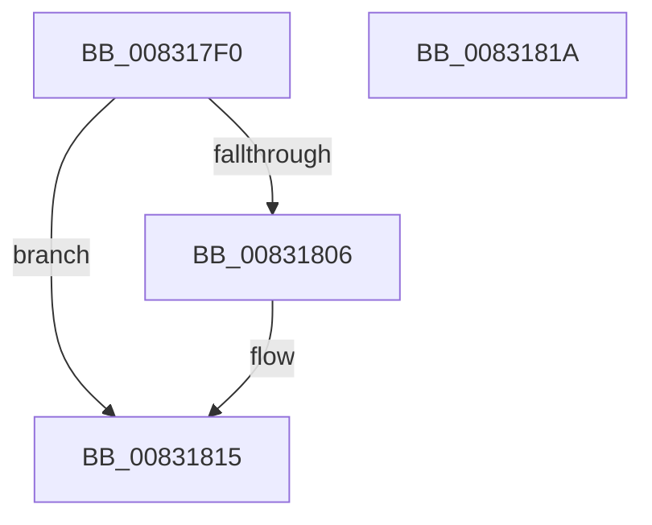

# PnpCmMatchCallbackRoutine

- RVA: `0x008317F0`–`0x0083181B` (길이 `43` bytes)
- VA: `0x00000001408317F0`
- 실행 섹션: `PAGE`
- PDB 이름 있음: `예`; PDB Function 태그: `아니요`
- unwind 정보 RVA: `0x0005D2F4`
- 디코드: `14`개 명령, `43/43` bytes 표시
- 미해석 바이트: `0` (있으면 어셈블리에 `.byte`로 보존)

> 이 문서는 커널 이미지의 기계어와 PDB 기호를 분석해 생성했습니다. 4번과 5번은 함수 원형과 자료형을 바이너리 사용 방식에서 추정한 C 해석이며 원본 소스 복구 결과는 아닙니다.

## 1. Dependencies

- 직접 호출 지점: **2**; 고유 호출 대상: **2**
- 직접 호출자로 확인된 함수: **0**
- RIP 상대 이미지 참조: **0**

### Outgoing calls
- `0x008317FA` → [_CmMapCmObjectTypeToPnpObjectType](../8F/_CmMapCmObjectTypeToPnpObjectType_function_008FF060.md) (function, `0x008FF060`)
- `0x00831810` → [guard_dispatch_icall](../../text/6B/guard_dispatch_icall_function_006BAAD0.md) (function, `0x006BAAD0`)

### Direct callers
- 이 함수 시작 RVA로 연결되는 직접 call은 확인되지 않았습니다. 간접 호출은 완전히 역산할 수 없습니다.

### Static image references
- 디코드된 RIP-relative 메모리 참조가 없습니다.

## 2. Other-region calls and transfers

- 다른 실행 섹션으로 향하는 call: **1**
  - `0x00831810` → [guard_dispatch_icall](../../text/6B/guard_dispatch_icall_function_006BAAD0.md) (`PAGE` → `.text`)
- 별도 외부 분기/꼬리 이동을 확인하지 못했습니다.

## 3. Assembly (complete function range)

```asm
008317F0  48 83 EC 38                     sub rsp, 0x38
008317F4  4C 8B D1                        mov r10, rcx
008317F7  41 8B C8                        mov ecx, r8d
008317FA  E8 61 D8 0C 00                  call 0x1408ff060
008317FF  44 8B C0                        mov r8d, eax
00831802  85 C0                           test eax, eax
00831804  74 0F                           je 0x140831815
00831806  49 8B 01                        mov rax, qword ptr [r9]
00831809  49 8B CA                        mov rcx, r10
0083180C  4D 8B 49 08                     mov r9, qword ptr [r9 + 8]
00831810  E8 BB 92 E8 FF                  call 0x1406baad0
00831815  48 83 C4 38                     add rsp, 0x38
00831819  C3                              ret
0083181A  CC                              int3
```

## 4. C-style interpretation (structured pseudocode)

```c
__int64 __fastcall PnpCmMatchCallbackRoutine(__int64 a1, __int64 a2, int a3, __int64 a4)
{
    __int64 result;
    __int64 v_rsp;

    v_rsp = (v_rsp) - (56);
    result = _CmMapCmObjectTypeToPnpObjectType((unsigned int)(a3), a2, a3, a4);
    if ((unsigned int)(result) != 0) {
        result = *(unsigned __int64 *)(a4);
        a1 = a1;
        a4 = *(unsigned __int64 *)(a4 + 8);
        result = guard_dispatch_icall(a1, a2, (unsigned int)((unsigned int)(result)), a4);
    }
    v_rsp = (v_rsp) + (56);
    return result;
}
```

## 5. (Beta) C Style

```c
int64_t PnpCmMatchCallbackRoutine(int64_t Arg1, int64_t Arg2, int32_t Arg3, int64_t Arg4)
{
    int64_t result;
    int64_t local_rsp;

    local_rsp = (local_rsp) - (56);
    result = _CmMapCmObjectTypeToPnpObjectType((uint32_t)(Arg3), Arg2, Arg3, Arg4);
    if ((uint32_t)(result) != 0) {
        result = *(uint64_t *)(Arg4);
        Arg1 = Arg1;
        Arg4 = *(uint64_t *)(Arg4 + 0x8);
        result = guard_dispatch_icall(Arg1, Arg2, (uint32_t)((uint32_t)(result)), Arg4);
    }
    local_rsp = (local_rsp) + (56);
    return result;
}
```

## 6. Execution-region graph

[열기: 2D/3D 그래프와 함수 탐색 컨트롤 패널](../../../control-panel.html?section=page&rva=0x008317F0&view=graph)

- 2D 그래프는 위에서 아래로 흐르고, 3D 그래프는 빈 공간을 드래그해 회전합니다. Shift+드래그는 이동, 휠은 확대·축소, 함수 노드 선택은 대상 보고서 이동입니다.

### Static fallback


