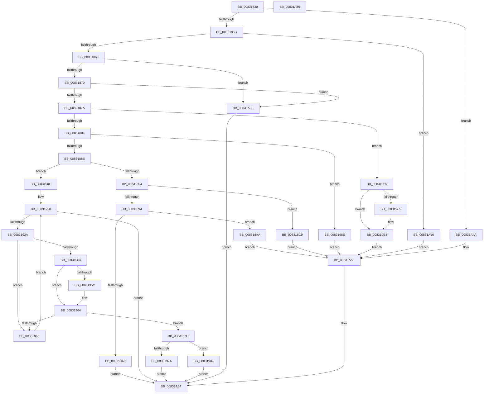

# PnpDispatchDevicePanel

- RVA: `0x00831830`–`0x00831A67` (길이 `567` bytes)
- VA: `0x0000000140831830`
- 실행 섹션: `PAGE`
- PDB 이름 있음: `예`; PDB Function 태그: `아니요`
- unwind 정보 RVA: `0x000D0050`
- 디코드: `139`개 명령, `567/567` bytes 표시
- 미해석 바이트: `0` (있으면 어셈블리에 `.byte`로 보존)

> 이 문서는 커널 이미지의 기계어와 PDB 기호를 분석해 생성했습니다. 4번과 5번은 함수 원형과 자료형을 바이너리 사용 방식에서 추정한 C 해석이며 원본 소스 복구 결과는 아닙니다.

## 1. Dependencies

- 직접 호출 지점: **6**; 고유 호출 대상: **6**
- 직접 호출자로 확인된 함수: **0**
- RIP 상대 이미지 참조: **2**

### Outgoing calls
- `0x008318BF` → [CmSetDevicePanelMappedProperty](../82/CmSetDevicePanelMappedProperty_function_0082F600.md) (function, `0x0082F600`)
- `0x00831904` → [CmGetDevicePanelMappedProperty](../82/CmGetDevicePanelMappedProperty_function_0082ECD0.md) (function, `0x0082ECD0`)
- `0x008319AF` → [CmGetDevicePanelMappedPropertyKeys](../82/CmGetDevicePanelMappedPropertyKeys_function_0082EDF0.md) (function, `0x0082EDF0`)
- `0x00831A08` → [CmGetMatchingDevicePanelList](../82/CmGetMatchingDevicePanelList_function_0082EF30.md) (function, `0x0082EF30`)
- `0x00831A43` → [CmOpenDevicePanelRegKey](../82/CmOpenDevicePanelRegKey_function_0082F1C0.md) (function, `0x0082F1C0`)
- `0x00831A4D` → [CmValidateDevicePanelName](../82/CmValidateDevicePanelName_function_0082F65C.md) (function, `0x0082F65C`)

### Direct callers
- 이 함수 시작 RVA로 연결되는 직접 call은 확인되지 않았습니다. 간접 호출은 완전히 역산할 수 없습니다.

### Static image references
- `0x0083193D` → RVA `0x0000C578` (`.rdata`; read)
- `0x008319CE` → RVA `0x008317F0` (`PnpCmMatchCallbackRoutine`; read)

## 2. Other-region calls and transfers

- 다른 실행 섹션으로 향하는 call: **0**
- 별도 외부 분기/꼬리 이동을 확인하지 못했습니다.

## 3. Assembly (complete function range)

```asm
00831830  48 89 5C 24 08                  mov qword ptr [rsp + 8], rbx
00831835  48 89 74 24 10                  mov qword ptr [rsp + 0x10], rsi
0083183A  57                              push rdi
0083183B  48 83 EC 60                     sub rsp, 0x60
0083183F  4C 8B C2                        mov r8, rdx
00831842  0F 57 C0                        xorps xmm0, xmm0
00831845  33 D2                           xor edx, edx
00831847  4C 8B D9                        mov r11, rcx
0083184A  44 8B D2                        mov r10d, edx
0083184D  0F 11 44 24 50                  movups xmmword ptr [rsp + 0x50], xmm0
00831852  41 83 E9 01                     sub r9d, 1
00831856  0F 84 EE 01 00 00               je 0x140831a4a
0083185C  41 83 E9 01                     sub r9d, 1
00831860  0F 84 B0 01 00 00               je 0x140831a16
00831866  41 83 E9 01                     sub r9d, 1
0083186A  0F 84 9F 01 00 00               je 0x140831a0f
00831870  41 83 E9 01                     sub r9d, 1
00831874  0F 84 95 01 00 00               je 0x140831a0f
0083187A  41 83 E9 01                     sub r9d, 1
0083187E  0F 84 35 01 00 00               je 0x1408319b9
00831884  41 83 E9 01                     sub r9d, 1
00831888  0F 84 00 01 00 00               je 0x14083198e
0083188E  41 83 E9 01                     sub r9d, 1
00831892  74 7A                           je 0x14083190e
00831894  41 83 E9 01                     sub r9d, 1
00831898  74 2F                           je 0x1408318c9
0083189A  41 83 F9 01                     cmp r9d, 1
0083189E  74 0A                           je 0x1408318aa
008318A0  B9 0D 00 00 C0                  mov ecx, 0xc000000d
008318A5  E9 AA 01 00 00                  jmp 0x140831a54
008318AA  4C 8B 8C 24 90 00 00 00         mov r9, qword ptr [rsp + 0x90]
008318B2  49 8B 41 10                     mov rax, qword ptr [r9 + 0x10]
008318B6  4D 8B 49 08                     mov r9, qword ptr [r9 + 8]
008318BA  48 89 44 24 20                  mov qword ptr [rsp + 0x20], rax
008318BF  E8 3C DD FF FF                  call 0x14082f600
008318C4  E9 89 01 00 00                  jmp 0x140831a52
008318C9  4C 8B 8C 24 90 00 00 00         mov r9, qword ptr [rsp + 0x90]
008318D1  49 8B D0                        mov rdx, r8
008318D4  49 8B 41 30                     mov rax, qword ptr [r9 + 0x30]
008318D8  48 89 44 24 40                  mov qword ptr [rsp + 0x40], rax
008318DD  41 8B 41 28                     mov eax, dword ptr [r9 + 0x28]
008318E1  89 44 24 38                     mov dword ptr [rsp + 0x38], eax
008318E5  49 8B 41 20                     mov rax, qword ptr [r9 + 0x20]
008318E9  48 89 44 24 30                  mov qword ptr [rsp + 0x30], rax
008318EE  49 8B 41 18                     mov rax, qword ptr [r9 + 0x18]
008318F2  48 89 44 24 28                  mov qword ptr [rsp + 0x28], rax
008318F7  49 8B 41 10                     mov rax, qword ptr [r9 + 0x10]
008318FB  4D 8B 49 08                     mov r9, qword ptr [r9 + 8]
008318FF  48 89 44 24 20                  mov qword ptr [rsp + 0x20], rax
00831904  E8 C7 D3 FF FF                  call 0x14082ecd0
00831909  E9 44 01 00 00                  jmp 0x140831a52
0083190E  48 8B 84 24 90 00 00 00         mov rax, qword ptr [rsp + 0x90]
00831916  B9 16 00 00 C0                  mov ecx, 0xc0000016
0083191B  44 8B CA                        mov r9d, edx
0083191E  4C 8B 50 20                     mov r10, qword ptr [rax + 0x20]
00831922  8B 70 18                        mov esi, dword ptr [rax + 0x18]
00831925  48 8B 78 10                     mov rdi, qword ptr [rax + 0x10]
00831929  48 8B 58 08                     mov rbx, qword ptr [rax + 8]
0083192D  41 89 12                        mov dword ptr [r10], edx
00831930  41 83 F9 03                     cmp r9d, 3
00831934  0F 83 1A 01 00 00               jae 0x140831a54
0083193A  41 8B C1                        mov eax, r9d
0083193D  4C 8D 1D 34 AC 7D FF            lea r11, [rip - 0x8253cc]
00831944  48 03 C0                        add rax, rax
00831947  4D 8B 1C C3                     mov r11, qword ptr [r11 + rax*8]
0083194B  41 8B 43 10                     mov eax, dword ptr [r11 + 0x10]
0083194F  39 43 10                        cmp dword ptr [rbx + 0x10], eax
00831952  75 15                           jne 0x140831969
00831954  4C 8B 03                        mov r8, qword ptr [rbx]
00831957  4D 2B 03                        sub r8, qword ptr [r11]
0083195A  75 08                           jne 0x140831964
0083195C  4C 8B 43 08                     mov r8, qword ptr [rbx + 8]
00831960  4D 2B 43 08                     sub r8, qword ptr [r11 + 8]
00831964  4D 85 C0                        test r8, r8
00831967  74 05                           je 0x14083196e
00831969  41 FF C1                        inc r9d
0083196C  EB C2                           jmp 0x140831930
0083196E  41 C7 02 01 00 00 00            mov dword ptr [r10], 1
00831975  83 FE 01                        cmp esi, 1
00831978  72 0A                           jb 0x140831984
0083197A  66 89 17                        mov word ptr [rdi], dx
0083197D  8B CA                           mov ecx, edx
0083197F  E9 D0 00 00 00                  jmp 0x140831a54
00831984  B9 23 00 00 C0                  mov ecx, 0xc0000023
00831989  E9 C6 00 00 00                  jmp 0x140831a54
0083198E  48 8B 8C 24 90 00 00 00         mov rcx, qword ptr [rsp + 0x90]
00831996  48 8B 41 28                     mov rax, qword ptr [rcx + 0x28]
0083199A  48 89 44 24 30                  mov qword ptr [rsp + 0x30], rax
0083199F  8B 41 20                        mov eax, dword ptr [rcx + 0x20]
008319A2  89 44 24 28                     mov dword ptr [rsp + 0x28], eax
008319A6  48 8B 41 18                     mov rax, qword ptr [rcx + 0x18]
008319AA  48 89 44 24 20                  mov qword ptr [rsp + 0x20], rax
008319AF  E8 3C D4 FF FF                  call 0x14082edf0
008319B4  E9 99 00 00 00                  jmp 0x140831a52
008319B9  4C 8B 8C 24 90 00 00 00         mov r9, qword ptr [rsp + 0x90]
008319C1  49 8B 01                        mov rax, qword ptr [r9]
008319C4  48 85 C0                        test rax, rax
008319C7  74 1A                           je 0x1408319e3
008319C9  48 89 44 24 50                  mov qword ptr [rsp + 0x50], rax
008319CE  48 8D 15 1B FE FF FF            lea rdx, [rip - 0x1e5]
008319D5  49 8B 41 08                     mov rax, qword ptr [r9 + 8]
008319D9  4C 8D 54 24 50                  lea r10, [rsp + 0x50]
008319DE  48 89 44 24 58                  mov qword ptr [rsp + 0x58], rax
008319E3  41 8B 41 28                     mov eax, dword ptr [r9 + 0x28]
008319E7  4D 8B C2                        mov r8, r10
008319EA  25 00 00 FF FF                  and eax, 0xffff0000
008319EF  89 44 24 30                     mov dword ptr [rsp + 0x30], eax
008319F3  49 8B 41 20                     mov rax, qword ptr [r9 + 0x20]
008319F7  48 89 44 24 28                  mov qword ptr [rsp + 0x28], rax
008319FC  41 8B 41 18                     mov eax, dword ptr [r9 + 0x18]
00831A00  4D 8B 49 10                     mov r9, qword ptr [r9 + 0x10]
00831A04  89 44 24 20                     mov dword ptr [rsp + 0x20], eax
00831A08  E8 23 D5 FF FF                  call 0x14082ef30
00831A0D  EB 43                           jmp 0x140831a52
00831A0F  B9 02 00 00 C0                  mov ecx, 0xc0000002
00831A14  EB 3E                           jmp 0x140831a54
00831A16  48 8B 8C 24 90 00 00 00         mov rcx, qword ptr [rsp + 0x90]
00831A1E  49 8B D0                        mov rdx, r8
00831A21  48 8D 41 10                     lea rax, [rcx + 0x10]
00831A25  48 89 44 24 38                  mov qword ptr [rsp + 0x38], rax
00831A2A  48 8B 41 08                     mov rax, qword ptr [rcx + 8]
00831A2E  48 89 44 24 30                  mov qword ptr [rsp + 0x30], rax
00831A33  8A 41 04                        mov al, byte ptr [rcx + 4]
00831A36  88 44 24 28                     mov byte ptr [rsp + 0x28], al
00831A3A  8B 01                           mov eax, dword ptr [rcx]
00831A3C  49 8B CB                        mov rcx, r11
00831A3F  89 44 24 20                     mov dword ptr [rsp + 0x20], eax
00831A43  E8 78 D7 FF FF                  call 0x14082f1c0
00831A48  EB 08                           jmp 0x140831a52
00831A4A  49 8B D0                        mov rdx, r8
00831A4D  E8 0A DC FF FF                  call 0x14082f65c
00831A52  8B C8                           mov ecx, eax
00831A54  48 8B 5C 24 70                  mov rbx, qword ptr [rsp + 0x70]
00831A59  8B C1                           mov eax, ecx
00831A5B  48 8B 74 24 78                  mov rsi, qword ptr [rsp + 0x78]
00831A60  48 83 C4 60                     add rsp, 0x60
00831A64  5F                              pop rdi
00831A65  C3                              ret
00831A66  CC                              int3
```

## 4. C-style interpretation (structured pseudocode)

```c
__int64 __fastcall PnpDispatchDevicePanel(__int64 a1, __int64 a2, __int64 a3, int a4, __int64 a5)
{
    __int64 result;
    __int64 v_r10;
    __int64 v_rsp;
    unsigned __int64 v_stack_m10;
    unsigned __int64 v_stack_m18;
    unsigned __int64 v_stack_m28;
    unsigned int v_stack_m30;
    unsigned __int64 v_stack_m38;
    unsigned __int64 v_stack_m40;
    unsigned __int64 v_stack_m48;
    unsigned __int64 v_stack_p10;
    unsigned __int64 v_stack_p8;

    v_stack_p8 = v_rbx;
    v_stack_p10 = v_rsi;
    v_rsp = (v_rsp) - (96);
    a2 = 0;
    v_stack_m18 = v_xmm0;
    a4 = (unsigned int)((a4) - (1));
    if (condition_is_equal) goto loc_00831A4A;
    a4 = (unsigned int)((a4) - (1));
    if (condition_is_equal) goto loc_00831A16;
    a4 = (unsigned int)((a4) - (1));
    if (condition_is_equal) goto loc_00831A0F;
    a4 = (unsigned int)((a4) - (1));
    if (condition_is_equal) goto loc_00831A0F;
    a4 = (unsigned int)((a4) - (1));
    if (condition_is_equal) goto loc_008319B9;
    a4 = (unsigned int)((a4) - (1));
    if (condition_is_equal) goto loc_0083198E;
    a4 = (unsigned int)((a4) - (1));
    if (condition_is_equal) goto loc_0083190E;
    a4 = (unsigned int)((a4) - (1));
    if (condition_is_equal) goto loc_008318C9;
    if (a4 == 1) goto loc_008318AA;
    goto loc_00831A54;
loc_008318AA:
    v_stack_m48 = *(unsigned __int64 *)(a5 + 16);
    result = CmSetDevicePanelMappedProperty((unsigned int)(0xC000000DULL), a2, a2, *(unsigned __int64 *)(a5 + 8));
    goto loc_00831A52;
loc_008318C9:
    v_stack_m28 = *(unsigned __int64 *)(a5 + 48);
    v_stack_m30 = (unsigned int)((unsigned int)(*(unsigned int *)(a5 + 40)));
    v_stack_m38 = *(unsigned __int64 *)(a5 + 32);
    v_stack_m40 = *(unsigned __int64 *)(a5 + 24);
    v_stack_m48 = *(unsigned __int64 *)(a5 + 16);
    result = CmGetDevicePanelMappedProperty((unsigned int)(0xC000000DULL), 0, a2, *(unsigned __int64 *)(a5 + 8));
    goto loc_00831A52;
loc_0083190E:
    *(unsigned int *)(*(unsigned __int64 *)(a5 + 32)) = 0;
loc_00831930:
    if (0 >= 3) goto loc_00831A54;
    result = (0) + (0);
    if ((*(unsigned int *)(*(unsigned __int64 *)(a5 + 8) + 16)) != ((unsigned int)((unsigned int)(*(unsigned int *)(*(unsigned __int64 *)(v_rip - 8541132 + result * 8) + 16))))) goto loc_00831969;
    a3 = (*(unsigned __int64 *)(*(unsigned __int64 *)(a5 + 8))) - (*(unsigned __int64 *)(*(unsigned __int64 *)(v_rip - 8541132 + result * 8)));
    if (!(condition_is_not_equal)) {
        a3 = *(unsigned __int64 *)(*(unsigned __int64 *)(a5 + 8) + 8);
        a3 = (a3) - (*(unsigned __int64 *)(*(unsigned __int64 *)(v_rip - 8541132 + result * 8) + 8));
    }
    if (a3 == 0) goto loc_0083196E;
loc_00831969:
    a4 = (unsigned int)((0) + 1);
    goto loc_00831930;
loc_0083196E:
    *(unsigned int *)(*(unsigned __int64 *)(a5 + 32)) = 1;
    if (((unsigned int)((unsigned int)(*(unsigned int *)(a5 + 24)))) < 1) goto loc_00831984;
    *(unsigned __int16 *)(*(unsigned __int64 *)(a5 + 16)) = 0;
    goto loc_00831A54;
loc_00831984:
    goto loc_00831A54;
loc_0083198E:
    v_stack_m38 = *(unsigned __int64 *)(a5 + 40);
    v_stack_m40 = (unsigned int)((unsigned int)(*(unsigned int *)(a5 + 32)));
    v_stack_m48 = *(unsigned __int64 *)(a5 + 24);
    result = CmGetDevicePanelMappedPropertyKeys(a5, 0, a3, a4);
    goto loc_00831A52;
loc_008319B9:
    result = *(unsigned __int64 *)(a5);
    v_r10 = *(unsigned __int64 *)(a5 + 32);
    if (*(unsigned __int64 *)(a5) != 0) {
        v_stack_m18 = *(unsigned __int64 *)(a5);
        a2 = v_rip - 485;
        result = *(unsigned __int64 *)(a5 + 8);
        v_r10 = v_stack_m18;
        v_stack_m10 = result;
    }
    result = (unsigned int)(((unsigned int)(*(unsigned int *)(a5 + 40))) & (0xFFFF0000ULL));
    v_stack_m38 = (unsigned int)(result);
    v_stack_m40 = *(unsigned __int64 *)(a5 + 32);
    v_stack_m48 = (unsigned int)((unsigned int)(*(unsigned int *)(a5 + 24)));
    result = CmGetMatchingDevicePanelList(a5, a2, v_r10, *(unsigned __int64 *)(a5 + 16));
    goto loc_00831A52;
loc_00831A0F:
    goto loc_00831A54;
loc_00831A16:
    v_stack_m30 = a5 + 16;
    v_stack_m38 = *(unsigned __int64 *)(a5 + 8);
    v_stack_m40 = (unsigned __int8)(*(unsigned __int8 *)(a5 + 4));
    v_stack_m48 = (unsigned int)((unsigned int)(*(unsigned int *)(a5)));
    result = CmOpenDevicePanelRegKey(*(unsigned __int64 *)(v_rip - 8541132 + result * 8), v_r10, v_r10, *(unsigned __int64 *)(a5 + 16));
    goto loc_00831A52;
loc_00831A4A:
    result = CmValidateDevicePanelName(*(unsigned __int64 *)(v_rip - 8541132 + result * 8), v_r10, v_r10, *(unsigned __int64 *)(a5 + 16));
loc_00831A52:
loc_00831A54:
    v_rsp = (v_rsp) + (96);
    return (unsigned int)((unsigned int)((unsigned int)((unsigned int)(result))));
}
```

## 5. (Beta) C Style

```c
int64_t PnpDispatchDevicePanel(int64_t Arg1, int64_t Arg2, int64_t Arg3, int32_t Arg4, void *Arg5)
{
    uint8_t *arg5 = (uint8_t *)Arg5;

    int64_t result;
    int64_t local_r10;
    int64_t local_rsp;
    uint64_t v_stack_m10;
    uint64_t v_stack_m18;
    uint64_t v_stack_m28;
    uint32_t v_stack_m30;
    uint64_t v_stack_m38;
    uint64_t v_stack_m40;
    uint64_t v_stack_m48;
    uint64_t v_stack_p10;
    uint64_t v_stack_p8;

    v_stack_p8 = local_rbx;
    v_stack_p10 = local_rsi;
    local_rsp = (local_rsp) - (96);
    Arg2 = 0;
    v_stack_m18 = v_xmm0;
    Arg4 = (uint32_t)((Arg4) - (1));
    if (condition_is_equal) goto loc_00831A4A;
    Arg4 = (uint32_t)((Arg4) - (1));
    if (condition_is_equal) goto loc_00831A16;
    Arg4 = (uint32_t)((Arg4) - (1));
    if (condition_is_equal) goto loc_00831A0F;
    Arg4 = (uint32_t)((Arg4) - (1));
    if (condition_is_equal) goto loc_00831A0F;
    Arg4 = (uint32_t)((Arg4) - (1));
    if (condition_is_equal) goto loc_008319B9;
    Arg4 = (uint32_t)((Arg4) - (1));
    if (condition_is_equal) goto loc_0083198E;
    Arg4 = (uint32_t)((Arg4) - (1));
    if (condition_is_equal) goto loc_0083190E;
    Arg4 = (uint32_t)((Arg4) - (1));
    if (condition_is_equal) goto loc_008318C9;
    if (Arg4 == 1) goto loc_008318AA;
    goto loc_00831A54;
loc_008318AA:
    v_stack_m48 = *(uint64_t *)(arg5 + 0x10);
    result = CmSetDevicePanelMappedProperty((uint32_t)(0xC000000DULL), Arg2, Arg2, *(uint64_t *)(arg5 + 0x8));
    goto loc_00831A52;
loc_008318C9:
    v_stack_m28 = *(uint64_t *)(arg5 + 0x30);
    v_stack_m30 = (uint32_t)((uint32_t)(*(uint32_t *)(arg5 + 0x28)));
    v_stack_m38 = *(uint64_t *)(arg5 + 0x20);
    v_stack_m40 = *(uint64_t *)(arg5 + 0x18);
    v_stack_m48 = *(uint64_t *)(arg5 + 0x10);
    result = CmGetDevicePanelMappedProperty((uint32_t)(0xC000000DULL), 0, Arg2, *(uint64_t *)(arg5 + 0x8));
    goto loc_00831A52;
loc_0083190E:
    *(uint32_t *)(*(uint64_t *)(arg5 + 0x20)) = 0;
loc_00831930:
    if (0 >= 3) goto loc_00831A54;
    result = (0) + (0);
    if ((*(uint32_t *)(*(uint64_t *)(arg5 + 0x8) + 0x10)) != ((uint32_t)((uint32_t)(*(uint32_t *)(*(uint64_t *)(v_rip - 0x8253CC + result * 8) + 0x10))))) goto loc_00831969;
    Arg3 = (*(uint64_t *)(*(uint64_t *)(arg5 + 0x8))) - (*(uint64_t *)(*(uint64_t *)(v_rip - 0x8253CC + result * 8)));
    if (!(condition_is_not_equal)) {
        Arg3 = *(uint64_t *)(*(uint64_t *)(arg5 + 0x8) + 0x8);
        Arg3 = (Arg3) - (*(uint64_t *)(*(uint64_t *)(v_rip - 0x8253CC + result * 8) + 0x8));
    }
    if (Arg3 == 0) goto loc_0083196E;
loc_00831969:
    Arg4 = (uint32_t)((0) + 1);
    goto loc_00831930;
loc_0083196E:
    *(uint32_t *)(*(uint64_t *)(arg5 + 0x20)) = 1;
    if (((uint32_t)((uint32_t)(*(uint32_t *)(arg5 + 0x18)))) < 1) goto loc_00831984;
    *(uint16_t *)(*(uint64_t *)(arg5 + 0x10)) = 0;
    goto loc_00831A54;
loc_00831984:
    goto loc_00831A54;
loc_0083198E:
    v_stack_m38 = *(uint64_t *)(arg5 + 0x28);
    v_stack_m40 = (uint32_t)((uint32_t)(*(uint32_t *)(arg5 + 0x20)));
    v_stack_m48 = *(uint64_t *)(arg5 + 0x18);
    result = CmGetDevicePanelMappedPropertyKeys(Arg5, 0, Arg3, Arg4);
    goto loc_00831A52;
loc_008319B9:
    result = *(uint64_t *)(arg5);
    local_r10 = *(uint64_t *)(arg5 + 0x20);
    if (*(uint64_t *)(arg5) != 0) {
        v_stack_m18 = *(uint64_t *)(arg5);
        Arg2 = v_rip - 485;
        result = *(uint64_t *)(arg5 + 0x8);
        local_r10 = v_stack_m18;
        v_stack_m10 = result;
    }
    result = (uint32_t)(((uint32_t)(*(uint32_t *)(arg5 + 0x28))) & (0xFFFF0000ULL));
    v_stack_m38 = (uint32_t)(result);
    v_stack_m40 = *(uint64_t *)(arg5 + 0x20);
    v_stack_m48 = (uint32_t)((uint32_t)(*(uint32_t *)(arg5 + 0x18)));
    result = CmGetMatchingDevicePanelList(Arg5, Arg2, local_r10, *(uint64_t *)(arg5 + 0x10));
    goto loc_00831A52;
loc_00831A0F:
    goto loc_00831A54;
loc_00831A16:
    v_stack_m30 = Arg5 + 16;
    v_stack_m38 = *(uint64_t *)(arg5 + 0x8);
    v_stack_m40 = (uint8_t)(*(uint8_t *)(arg5 + 0x4));
    v_stack_m48 = (uint32_t)((uint32_t)(*(uint32_t *)(arg5)));
    result = CmOpenDevicePanelRegKey(*(uint64_t *)(v_rip - 0x8253CC + result * 8), local_r10, local_r10, *(uint64_t *)(arg5 + 0x10));
    goto loc_00831A52;
loc_00831A4A:
    result = CmValidateDevicePanelName(*(uint64_t *)(v_rip - 0x8253CC + result * 8), local_r10, local_r10, *(uint64_t *)(arg5 + 0x10));
loc_00831A52:
loc_00831A54:
    local_rsp = (local_rsp) + (96);
    return (uint32_t)((uint32_t)((uint32_t)((uint32_t)(result))));
}
```

### 관측된 메모리 오프셋

구조체 형식이 확인되지 않은 접근은 인자 기준의 오프셋으로만 기록했습니다.

| 기준 인자 | 오프셋 표현 | 폭 (bit) | 접근 |
|---|---:|---:|---|
| `Arg5` | `+ 0x0` | `32` | `R` |
| `Arg5` | `+ 0x0` | `64` | `R` |
| `Arg5` | `+ 0x4` | `8` | `R` |
| `Arg5` | `+ 0x8` | `64` | `R` |
| `Arg5` | `+ 0x10` | `64` | `R` |
| `Arg5` | `+ 0x18` | `32` | `R` |
| `Arg5` | `+ 0x18` | `64` | `R` |
| `Arg5` | `+ 0x20` | `32` | `R` |
| `Arg5` | `+ 0x20` | `64` | `R` |
| `Arg5` | `+ 0x28` | `32` | `R` |
| `Arg5` | `+ 0x28` | `64` | `R` |
| `Arg5` | `+ 0x30` | `64` | `R` |

## 6. Execution-region graph

[열기: 2D/3D 그래프와 함수 탐색 컨트롤 패널](../../../control-panel.html?section=page&rva=0x00831830&view=graph)

- 2D 그래프는 위에서 아래로 흐르고, 3D 그래프는 빈 공간을 드래그해 회전합니다. Shift+드래그는 이동, 휠은 확대·축소, 함수 노드 선택은 대상 보고서 이동입니다.

### Static fallback


