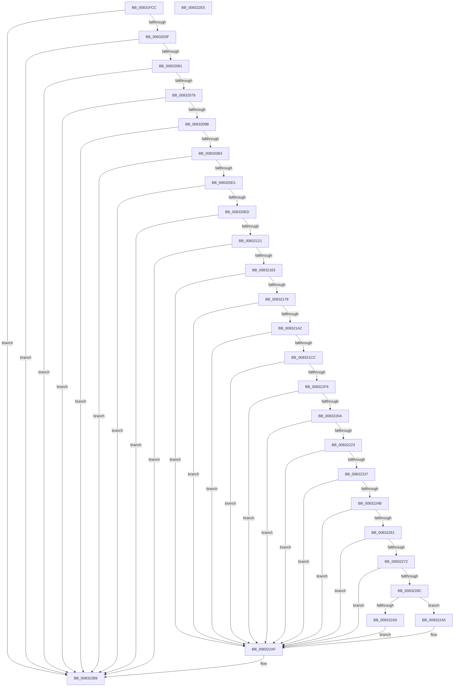

# PnpGetEnumSecurityDescriptor

- RVA: `0x00831FCC`–`0x008322E6` (길이 `794` bytes)
- VA: `0x0000000140831FCC`
- 실행 섹션: `PAGE`
- PDB 이름 있음: `예`; PDB Function 태그: `아니요`
- unwind 정보 RVA: `0x000DAB30`
- 디코드: `206`개 명령, `794/794` bytes 표시
- 미해석 바이트: `0` (있으면 어셈블리에 `.byte`로 보존)

> 이 문서는 커널 이미지의 기계어와 PDB 기호를 분석해 생성했습니다. 4번과 5번은 함수 원형과 자료형을 바이너리 사용 방식에서 추정한 C 해석이며 원본 소스 복구 결과는 아닙니다.

## 1. Dependencies

- 직접 호출 지점: **32**; 고유 호출 대상: **16**
- 직접 호출자로 확인된 함수: **1**
- RIP 상대 이미지 참조: **1**

### Outgoing calls
- `0x00832032` → [RtlInitializeSid](../9E/RtlInitializeSid_function_009EB720.md) (function, `0x009EB720`)
- `0x00832045` → [RtlSubAuthoritySid](../../text/45/RtlSubAuthoritySid_function_00456D10.md) (function, `0x00456D10`)
- `0x00832054` → [RtlValidSid](../92/RtlValidSid_function_00929710.md) (function, `0x00929710`)
- `0x0083206C` → [RtlInitializeSid](../9E/RtlInitializeSid_function_009EB720.md) (function, `0x009EB720`)
- `0x0083207F` → [RtlSubAuthoritySid](../../text/45/RtlSubAuthoritySid_function_00456D10.md) (function, `0x00456D10`)
- `0x0083208E` → [RtlValidSid](../92/RtlValidSid_function_00929710.md) (function, `0x00929710`)
- `0x008320A6` → [RtlInitializeSid](../9E/RtlInitializeSid_function_009EB720.md) (function, `0x009EB720`)
- `0x008320B9` → [RtlSubAuthoritySid](../../text/45/RtlSubAuthoritySid_function_00456D10.md) (function, `0x00456D10`)
- `0x008320C4` → [RtlValidSid](../92/RtlValidSid_function_00929710.md) (function, `0x00929710`)
- `0x008320E0` → [RtlInitializeSid](../9E/RtlInitializeSid_function_009EB720.md) (function, `0x009EB720`)
- `0x008320F3` → [RtlSubAuthoritySid](../../text/45/RtlSubAuthoritySid_function_00456D10.md) (function, `0x00456D10`)
- `0x00832105` → [RtlSubAuthoritySid](../../text/45/RtlSubAuthoritySid_function_00456D10.md) (function, `0x00456D10`)
- `0x00832114` → [RtlValidSid](../92/RtlValidSid_function_00929710.md) (function, `0x00929710`)
- `0x00832125` → [RtlLengthSid](../../text/45/RtlLengthSid_function_0045D270.md) (function, `0x0045D270`)
- `0x00832130` → [RtlLengthSid](../../text/45/RtlLengthSid_function_0045D270.md) (function, `0x0045D270`)
- `0x0083213B` → [RtlLengthSid](../../text/45/RtlLengthSid_function_0045D270.md) (function, `0x0045D270`)
- `0x00832152` → [ExAllocatePool2](../../poolcode/B8/ExAllocatePool2_function_00B820F0.md) (function, `0x00B820F0`)
- `0x0083216B` → [RtlCreateAcl](../91/RtlCreateAcl_function_00916F00.md) (function, `0x00916F00`)
- `0x00832195` → [RtlpAddKnownAce](../92/RtlpAddKnownAce_function_00929A20.md) (function, `0x00929A20`)
- `0x008321BF` → [RtlpAddKnownAce](../92/RtlpAddKnownAce_function_00929A20.md) (function, `0x00929A20`)
- `0x008321E9` → [RtlpAddKnownAce](../92/RtlpAddKnownAce_function_00929A20.md) (function, `0x00929A20`)
- `0x008321FD` → [RtlCreateSecurityDescriptor](../9F/RtlCreateSecurityDescriptor_function_009F1DF0.md) (function, `0x009F1DF0`)
- `0x00832216` → [RtlSetDaclSecurityDescriptor](../9E/RtlSetDaclSecurityDescriptor_function_009EC210.md) (function, `0x009EC210`)
- `0x0083222E` → [RtlSetOwnerSecurityDescriptor](../91/RtlSetOwnerSecurityDescriptor_function_00916F90.md) (function, `0x00916F90`)
- `0x00832242` → [RtlSetGroupSecurityDescriptor](../A2/RtlSetGroupSecurityDescriptor_function_00A2EB10.md) (function, `0x00A2EB10`)
- `0x00832258` → [RtlValidSecurityDescriptor](../8B/RtlValidSecurityDescriptor_function_008BD3F0.md) (function, `0x008BD3F0`)
- `0x00832265` → [RtlLengthSecurityDescriptor](../8B/RtlLengthSecurityDescriptor_function_008BC870.md) (function, `0x008BC870`)
- `0x0083227F` → [ExAllocatePool2](../../poolcode/B8/ExAllocatePool2_function_00B820F0.md) (function, `0x00B820F0`)
- `0x00832297` → [RtlAbsoluteToSelfRelativeSD](../A1/RtlAbsoluteToSelfRelativeSD_function_00A119B0.md) (function, `0x00A119B0`)
- `0x008322AA` → [ExFreePoolWithTag](../../poolcode/B8/ExFreePoolWithTag_function_00B82870.md) (function, `0x00B82870`)
- `0x008322B4` → [ExFreePoolWithTag](../../poolcode/B8/ExFreePoolWithTag_function_00B82870.md) (function, `0x00B82870`)
- `0x008322C3` → [_security_check_cookie](../../text/6A/_security_check_cookie_function_006AC640.md) (function, `0x006AC640`)

### Direct callers
- [sub_00B1E14D](../B1/Unknown_function_00B1E14D.md) at `0x00B1E172`

### Static image references
- `0x00831FEB` → RVA `0x00E0A740` (`.data`; read)

## 2. Other-region calls and transfers

- 다른 실행 섹션으로 향하는 call: **13**
  - `0x00832045` → [RtlSubAuthoritySid](../../text/45/RtlSubAuthoritySid_function_00456D10.md) (`PAGE` → `.text`)
  - `0x0083207F` → [RtlSubAuthoritySid](../../text/45/RtlSubAuthoritySid_function_00456D10.md) (`PAGE` → `.text`)
  - `0x008320B9` → [RtlSubAuthoritySid](../../text/45/RtlSubAuthoritySid_function_00456D10.md) (`PAGE` → `.text`)
  - `0x008320F3` → [RtlSubAuthoritySid](../../text/45/RtlSubAuthoritySid_function_00456D10.md) (`PAGE` → `.text`)
  - `0x00832105` → [RtlSubAuthoritySid](../../text/45/RtlSubAuthoritySid_function_00456D10.md) (`PAGE` → `.text`)
  - `0x00832125` → [RtlLengthSid](../../text/45/RtlLengthSid_function_0045D270.md) (`PAGE` → `.text`)
  - `0x00832130` → [RtlLengthSid](../../text/45/RtlLengthSid_function_0045D270.md) (`PAGE` → `.text`)
  - `0x0083213B` → [RtlLengthSid](../../text/45/RtlLengthSid_function_0045D270.md) (`PAGE` → `.text`)
  - `0x00832152` → [ExAllocatePool2](../../poolcode/B8/ExAllocatePool2_function_00B820F0.md) (`PAGE` → `POOLCODE`)
  - `0x0083227F` → [ExAllocatePool2](../../poolcode/B8/ExAllocatePool2_function_00B820F0.md) (`PAGE` → `POOLCODE`)
  - `0x008322AA` → [ExFreePoolWithTag](../../poolcode/B8/ExFreePoolWithTag_function_00B82870.md) (`PAGE` → `POOLCODE`)
  - `0x008322B4` → [ExFreePoolWithTag](../../poolcode/B8/ExFreePoolWithTag_function_00B82870.md) (`PAGE` → `POOLCODE`)
  - `0x008322C3` → [_security_check_cookie](../../text/6A/_security_check_cookie_function_006AC640.md) (`PAGE` → `.text`)
- 별도 외부 분기/꼬리 이동을 확인하지 못했습니다.

## 3. Assembly (complete function range)

```asm
00831FCC  48 8B C4                        mov rax, rsp
00831FCF  48 89 58 08                     mov qword ptr [rax + 8], rbx
00831FD3  48 89 70 10                     mov qword ptr [rax + 0x10], rsi
00831FD7  48 89 78 18                     mov qword ptr [rax + 0x18], rdi
00831FDB  4C 89 78 20                     mov qword ptr [rax + 0x20], r15
00831FDF  55                              push rbp
00831FE0  48 8D 68 A1                     lea rbp, [rax - 0x5f]
00831FE4  48 81 EC B0 00 00 00            sub rsp, 0xb0
00831FEB  48 8B 05 4E 87 5D 00            mov rax, qword ptr [rip + 0x5d874e]
00831FF2  48 33 C4                        xor rax, rsp
00831FF5  48 89 45 4F                     mov qword ptr [rbp + 0x4f], rax
00831FF9  33 FF                           xor edi, edi
00831FFB  66 C7 45 DB 00 05               mov word ptr [rbp - 0x25], 0x500
00832001  0F 57 C0                        xorps xmm0, xmm0
00832004  89 7D D7                        mov dword ptr [rbp - 0x29], edi
00832007  33 C0                           xor eax, eax
00832009  89 7D DF                        mov dword ptr [rbp - 0x21], edi
0083200C  41 B0 01                        mov r8b, 1
0083200F  89 7D E7                        mov dword ptr [rbp - 0x19], edi
00832012  48 8D 55 D7                     lea rdx, [rbp - 0x29]
00832016  48 89 45 0F                     mov qword ptr [rbp + 0xf], rax
0083201A  48 8D 4D 17                     lea rcx, [rbp + 0x17]
0083201E  66 C7 45 E3 00 03               mov word ptr [rbp - 0x1d], 0x300
00832024  0F 11 45 EF                     movups xmmword ptr [rbp - 0x11], xmm0
00832028  66 C7 45 EB 00 01               mov word ptr [rbp - 0x15], 0x100
0083202E  0F 11 45 FF                     movups xmmword ptr [rbp - 1], xmm0
00832032  E8 E9 96 1B 00                  call 0x1409eb720
00832037  85 C0                           test eax, eax
00832039  0F 88 7A 02 00 00               js 0x1408322b9
0083203F  33 D2                           xor edx, edx
00832041  48 8D 4D 17                     lea rcx, [rbp + 0x17]
00832045  E8 C6 4C C2 FF                  call 0x140456d10
0083204A  48 8D 4D 17                     lea rcx, [rbp + 0x17]
0083204E  C7 00 12 00 00 00               mov dword ptr [rax], 0x12
00832054  E8 B7 76 0F 00                  call 0x140929710
00832059  84 C0                           test al, al
0083205B  0F 84 58 02 00 00               je 0x1408322b9
00832061  41 B0 01                        mov r8b, 1
00832064  48 8D 55 DF                     lea rdx, [rbp - 0x21]
00832068  48 8D 4D 23                     lea rcx, [rbp + 0x23]
0083206C  E8 AF 96 1B 00                  call 0x1409eb720
00832071  85 C0                           test eax, eax
00832073  0F 88 40 02 00 00               js 0x1408322b9
00832079  33 D2                           xor edx, edx
0083207B  48 8D 4D 23                     lea rcx, [rbp + 0x23]
0083207F  E8 8C 4C C2 FF                  call 0x140456d10
00832084  48 8D 4D 23                     lea rcx, [rbp + 0x23]
00832088  C7 00 04 00 00 00               mov dword ptr [rax], 4
0083208E  E8 7D 76 0F 00                  call 0x140929710
00832093  84 C0                           test al, al
00832095  0F 84 1E 02 00 00               je 0x1408322b9
0083209B  41 B0 01                        mov r8b, 1
0083209E  48 8D 55 E7                     lea rdx, [rbp - 0x19]
008320A2  48 8D 4D 2F                     lea rcx, [rbp + 0x2f]
008320A6  E8 75 96 1B 00                  call 0x1409eb720
008320AB  85 C0                           test eax, eax
008320AD  0F 88 06 02 00 00               js 0x1408322b9
008320B3  33 D2                           xor edx, edx
008320B5  48 8D 4D 2F                     lea rcx, [rbp + 0x2f]
008320B9  E8 52 4C C2 FF                  call 0x140456d10
008320BE  48 8D 4D 2F                     lea rcx, [rbp + 0x2f]
008320C2  89 38                           mov dword ptr [rax], edi
008320C4  E8 47 76 0F 00                  call 0x140929710
008320C9  84 C0                           test al, al
008320CB  0F 84 E8 01 00 00               je 0x1408322b9
008320D1  44 8D 7F 02                     lea r15d, [rdi + 2]
008320D5  45 8A C7                        mov r8b, r15b
008320D8  48 8D 55 D7                     lea rdx, [rbp - 0x29]
008320DC  48 8D 4D 3B                     lea rcx, [rbp + 0x3b]
008320E0  E8 3B 96 1B 00                  call 0x1409eb720
008320E5  85 C0                           test eax, eax
008320E7  0F 88 CC 01 00 00               js 0x1408322b9
008320ED  33 D2                           xor edx, edx
008320EF  48 8D 4D 3B                     lea rcx, [rbp + 0x3b]
008320F3  E8 18 4C C2 FF                  call 0x140456d10
008320F8  8D 57 01                        lea edx, [rdi + 1]
008320FB  48 8D 4D 3B                     lea rcx, [rbp + 0x3b]
008320FF  C7 00 20 00 00 00               mov dword ptr [rax], 0x20
00832105  E8 06 4C C2 FF                  call 0x140456d10
0083210A  48 8D 4D 3B                     lea rcx, [rbp + 0x3b]
0083210E  C7 00 20 02 00 00               mov dword ptr [rax], 0x220
00832114  E8 F7 75 0F 00                  call 0x140929710
00832119  84 C0                           test al, al
0083211B  0F 84 98 01 00 00               je 0x1408322b9
00832121  48 8D 4D 2F                     lea rcx, [rbp + 0x2f]
00832125  E8 46 B1 C2 FF                  call 0x14045d270
0083212A  48 8D 4D 23                     lea rcx, [rbp + 0x23]
0083212E  8B D8                           mov ebx, eax
00832130  E8 3B B1 C2 FF                  call 0x14045d270
00832135  48 8D 4D 17                     lea rcx, [rbp + 0x17]
00832139  03 D8                           add ebx, eax
0083213B  E8 30 B1 C2 FF                  call 0x14045d270
00832140  83 C0 20                        add eax, 0x20
00832143  B9 00 01 00 00                  mov ecx, 0x100
00832148  03 D8                           add ebx, eax
0083214A  41 B8 50 4E 50 52               mov r8d, 0x52504e50
00832150  8B D3                           mov edx, ebx
00832152  E8 99 FF 34 00                  call 0x140b820f0
00832157  48 8B F0                        mov rsi, rax
0083215A  48 85 C0                        test rax, rax
0083215D  0F 84 56 01 00 00               je 0x1408322b9
00832163  45 8B C7                        mov r8d, r15d
00832166  8B D3                           mov edx, ebx
00832168  48 8B C8                        mov rcx, rax
0083216B  E8 90 4D 0E 00                  call 0x140916f00
00832170  85 C0                           test eax, eax
00832172  0F 88 37 01 00 00               js 0x1408322af
00832178  48 8D 45 17                     lea rax, [rbp + 0x17]
0083217C  40 88 7C 24 28                  mov byte ptr [rsp + 0x28], dil
00832181  41 B9 3F 00 0F 00               mov r9d, 0xf003f
00832187  48 89 44 24 20                  mov qword ptr [rsp + 0x20], rax
0083218C  45 8B C7                        mov r8d, r15d
0083218F  41 8B D7                        mov edx, r15d
00832192  48 8B CE                        mov rcx, rsi
00832195  E8 86 78 0F 00                  call 0x140929a20
0083219A  85 C0                           test eax, eax
0083219C  0F 88 0D 01 00 00               js 0x1408322af
008321A2  48 8D 45 23                     lea rax, [rbp + 0x23]
008321A6  40 88 7C 24 28                  mov byte ptr [rsp + 0x28], dil
008321AB  41 B9 00 00 02 00               mov r9d, 0x20000
008321B1  48 89 44 24 20                  mov qword ptr [rsp + 0x20], rax
008321B6  45 8B C7                        mov r8d, r15d
008321B9  41 8B D7                        mov edx, r15d
008321BC  48 8B CE                        mov rcx, rsi
008321BF  E8 5C 78 0F 00                  call 0x140929a20
008321C4  85 C0                           test eax, eax
008321C6  0F 88 E3 00 00 00               js 0x1408322af
008321CC  48 8D 45 2F                     lea rax, [rbp + 0x2f]
008321D0  40 88 7C 24 28                  mov byte ptr [rsp + 0x28], dil
008321D5  41 B9 19 00 02 00               mov r9d, 0x20019
008321DB  48 89 44 24 20                  mov qword ptr [rsp + 0x20], rax
008321E0  45 8B C7                        mov r8d, r15d
008321E3  41 8B D7                        mov edx, r15d
008321E6  48 8B CE                        mov rcx, rsi
008321E9  E8 32 78 0F 00                  call 0x140929a20
008321EE  85 C0                           test eax, eax
008321F0  0F 88 B9 00 00 00               js 0x1408322af
008321F6  8D 57 01                        lea edx, [rdi + 1]
008321F9  48 8D 4D EF                     lea rcx, [rbp - 0x11]
008321FD  E8 EE FB 1B 00                  call 0x1409f1df0
00832202  85 C0                           test eax, eax
00832204  0F 88 A5 00 00 00               js 0x1408322af
0083220A  45 33 C9                        xor r9d, r9d
0083220D  48 8D 4D EF                     lea rcx, [rbp - 0x11]
00832211  4C 8B C6                        mov r8, rsi
00832214  B2 01                           mov dl, 1
00832216  E8 F5 9F 1B 00                  call 0x1409ec210
0083221B  85 C0                           test eax, eax
0083221D  0F 88 8C 00 00 00               js 0x1408322af
00832223  41 B0 01                        mov r8b, 1
00832226  48 8D 55 3B                     lea rdx, [rbp + 0x3b]
0083222A  48 8D 4D EF                     lea rcx, [rbp - 0x11]
0083222E  E8 5D 4D 0E 00                  call 0x140916f90
00832233  85 C0                           test eax, eax
00832235  78 78                           js 0x1408322af
00832237  41 B0 01                        mov r8b, 1
0083223A  48 8D 55 3B                     lea rdx, [rbp + 0x3b]
0083223E  48 8D 4D EF                     lea rcx, [rbp - 0x11]
00832242  E8 C9 C8 1F 00                  call 0x140a2eb10
00832247  85 C0                           test eax, eax
00832249  78 64                           js 0x1408322af
0083224B  B8 00 14 00 00                  mov eax, 0x1400
00832250  48 8D 4D EF                     lea rcx, [rbp - 0x11]
00832254  66 09 45 F1                     or word ptr [rbp - 0xf], ax
00832258  E8 93 B1 08 00                  call 0x1408bd3f0
0083225D  84 C0                           test al, al
0083225F  74 4E                           je 0x1408322af
00832261  48 8D 4D EF                     lea rcx, [rbp - 0x11]
00832265  E8 06 A6 08 00                  call 0x1408bc870
0083226A  89 45 D7                        mov dword ptr [rbp - 0x29], eax
0083226D  83 F8 28                        cmp eax, 0x28
00832270  72 3D                           jb 0x1408322af
00832272  8B D0                           mov edx, eax
00832274  B9 00 01 00 00                  mov ecx, 0x100
00832279  41 B8 50 4E 50 52               mov r8d, 0x52504e50
0083227F  E8 6C FE 34 00                  call 0x140b820f0
00832284  48 8B D8                        mov rbx, rax
00832287  48 85 C0                        test rax, rax
0083228A  74 23                           je 0x1408322af
0083228C  4C 8D 45 D7                     lea r8, [rbp - 0x29]
00832290  48 8B D0                        mov rdx, rax
00832293  48 8D 4D EF                     lea rcx, [rbp - 0x11]
00832297  E8 14 F7 1D 00                  call 0x140a119b0
0083229C  85 C0                           test eax, eax
0083229E  78 05                           js 0x1408322a5
008322A0  48 8B FB                        mov rdi, rbx
008322A3  EB 0A                           jmp 0x1408322af
008322A5  33 D2                           xor edx, edx
008322A7  48 8B CB                        mov rcx, rbx
008322AA  E8 C1 05 35 00                  call 0x140b82870
008322AF  33 D2                           xor edx, edx
008322B1  48 8B CE                        mov rcx, rsi
008322B4  E8 B7 05 35 00                  call 0x140b82870
008322B9  48 8B C7                        mov rax, rdi
008322BC  48 8B 4D 4F                     mov rcx, qword ptr [rbp + 0x4f]
008322C0  48 33 CC                        xor rcx, rsp
008322C3  E8 78 A3 E7 FF                  call 0x1406ac640
008322C8  4C 8D 9C 24 B0 00 00 00         lea r11, [rsp + 0xb0]
008322D0  49 8B 5B 10                     mov rbx, qword ptr [r11 + 0x10]
008322D4  49 8B 73 18                     mov rsi, qword ptr [r11 + 0x18]
008322D8  49 8B 7B 20                     mov rdi, qword ptr [r11 + 0x20]
008322DC  4D 8B 7B 28                     mov r15, qword ptr [r11 + 0x28]
008322E0  49 8B E3                        mov rsp, r11
008322E3  5D                              pop rbp
008322E4  C3                              ret
008322E5  CC                              int3
```

## 4. C-style interpretation (structured pseudocode)

```c
__int64 __fastcall PnpGetEnumSecurityDescriptor(void)
{
    __int64 result;
    __int64 v_rbx;
    __int64 v_rdi;
    __int64 v_rsp;
    unsigned __int64 v_stack_m8;
    unsigned __int8 v_stack_m90;
    unsigned __int64 v_stack_m98;

    *(unsigned __int64 *)(v_rsp + 8) = v_rbx;
    *(unsigned __int64 *)(v_rsp + 16) = v_rsi;
    *(unsigned __int64 *)(v_rsp + 24) = v_rdi;
    *(unsigned __int64 *)(v_rsp + 32) = v_r15;
    v_rsp = (v_rsp) - (176);
    result = (*(unsigned __int64 *)(v_rip + 6129486)) ^ (v_rsp);
    *(unsigned __int64 *)(v_rsp - 95 + 79) = result;
    v_rdi = 0;
    *(unsigned __int16 *)(v_rsp - 95 - 37) = 0x500ULL;
    *(unsigned int *)(v_rsp - 95 - 41) = 0;
    result = 0;
    *(unsigned int *)(v_rsp - 95 - 33) = 0;
    *(unsigned int *)(v_rsp - 95 - 25) = 0;
    *(unsigned __int64 *)(v_rsp - 95 + 15) = 0;
    *(unsigned __int16 *)(v_rsp - 95 - 29) = 768;
    *(unsigned __int64 *)(v_rsp - 95 - 17) = v_xmm0;
    *(unsigned __int16 *)(v_rsp - 95 - 21) = 256;
    *(unsigned __int64 *)(v_rsp - 95 - 1) = v_xmm0;
    result = RtlInitializeSid(v_rsp - 95 + 23, v_rsp - 95 - 41, 1, a4);
    if (sign_flag) goto loc_008322B9;
    a2 = 0;
    result = RtlSubAuthoritySid(v_rsp - 95 + 23, a2, 1, a4);
    *(unsigned int *)(result) = 18;
    result = RtlValidSid(v_rsp - 95 + 23, a2, 1, a4);
    if ((unsigned __int8)(result) == 0) goto loc_008322B9;
    result = RtlInitializeSid(v_rsp - 95 + 35, v_rsp - 95 - 33, 1, a4);
    if (sign_flag) goto loc_008322B9;
    a2 = 0;
    result = RtlSubAuthoritySid(v_rsp - 95 + 35, a2, 1, a4);
    *(unsigned int *)(result) = 4;
    result = RtlValidSid(v_rsp - 95 + 35, a2, 1, a4);
    if ((unsigned __int8)(result) == 0) goto loc_008322B9;
    result = RtlInitializeSid(v_rsp - 95 + 47, v_rsp - 95 - 25, 1, a4);
    if (sign_flag) goto loc_008322B9;
    a2 = 0;
    result = RtlSubAuthoritySid(v_rsp - 95 + 47, a2, 1, a4);
    *(unsigned int *)(result) = 0;
    result = RtlValidSid(v_rsp - 95 + 47, a2, 1, a4);
    if ((unsigned __int8)(result) == 0) goto loc_008322B9;
    result = RtlInitializeSid(v_rsp - 95 + 59, v_rsp - 95 - 41, (unsigned __int8)(v_rdi + 2), a4);
    if (sign_flag) goto loc_008322B9;
    a2 = 0;
    result = RtlSubAuthoritySid(v_rsp - 95 + 59, a2, (unsigned __int8)(v_rdi + 2), a4);
    *(unsigned int *)(result) = 32;
    result = RtlSubAuthoritySid(v_rsp - 95 + 59, v_rdi + 1, (unsigned __int8)(v_rdi + 2), a4);
    *(unsigned int *)(result) = 544;
    result = RtlValidSid(v_rsp - 95 + 59, v_rdi + 1, (unsigned __int8)(v_rdi + 2), a4);
    if ((unsigned __int8)(result) == 0) goto loc_008322B9;
    result = RtlLengthSid(v_rsp - 95 + 47, v_rdi + 1, (unsigned __int8)(v_rdi + 2), a4);
    result = RtlLengthSid(v_rsp - 95 + 35, v_rdi + 1, (unsigned __int8)(v_rdi + 2), a4);
    v_rbx = (unsigned int)(((unsigned int)((unsigned int)(result))) + ((unsigned int)(result)));
    result = RtlLengthSid(v_rsp - 95 + 23, v_rdi + 1, (unsigned __int8)(v_rdi + 2), a4);
    result = (unsigned int)((result) + (32));
    v_rbx = (unsigned int)((v_rbx) + ((unsigned int)(result)));
    result = ExAllocatePool2(256, (unsigned int)((unsigned int)(v_rbx)), (unsigned int)(0x52504E50ULL), a4);
    if (result == 0) goto loc_008322B9;
    result = RtlCreateAcl(result, (unsigned int)((unsigned int)(v_rbx)), (unsigned int)((unsigned int)(v_rdi + 2)), a4);
    if (sign_flag) goto loc_008322AF;
    v_stack_m90 = 0;
    v_stack_m98 = v_rsp - 95 + 23;
    result = RtlpAddKnownAce(result, (unsigned int)((unsigned int)(v_rdi + 2)), (unsigned int)((unsigned int)(v_rdi + 2)), (unsigned int)(0xF003FULL));
    if (sign_flag) goto loc_008322AF;
    v_stack_m90 = 0;
    v_stack_m98 = v_rsp - 95 + 35;
    result = RtlpAddKnownAce(result, (unsigned int)((unsigned int)(v_rdi + 2)), (unsigned int)((unsigned int)(v_rdi + 2)), (unsigned int)(0x20000ULL));
    if (sign_flag) goto loc_008322AF;
    v_stack_m90 = 0;
    v_stack_m98 = v_rsp - 95 + 47;
    result = RtlpAddKnownAce(result, (unsigned int)((unsigned int)(v_rdi + 2)), (unsigned int)((unsigned int)(v_rdi + 2)), (unsigned int)(0x20019ULL));
    if (sign_flag) goto loc_008322AF;
    result = RtlCreateSecurityDescriptor(v_rsp - 95 - 17, v_rdi + 1, (unsigned int)((unsigned int)(v_rdi + 2)), (unsigned int)(0x20019ULL));
    if (sign_flag) goto loc_008322AF;
    a4 = 0;
    result = RtlSetDaclSecurityDescriptor(v_rsp - 95 - 17, 1, result, a4);
    if (sign_flag) goto loc_008322AF;
    result = RtlSetOwnerSecurityDescriptor(v_rsp - 95 - 17, v_rsp - 95 + 59, 1, a4);
    if (sign_flag) goto loc_008322AF;
    result = RtlSetGroupSecurityDescriptor(v_rsp - 95 - 17, v_rsp - 95 + 59, 1, a4);
    if (sign_flag) goto loc_008322AF;
    result = RtlValidSecurityDescriptor(v_rsp - 95 - 17, v_rsp - 95 + 59, 1, a4);
    if ((unsigned __int8)(result) == 0) goto loc_008322AF;
    result = RtlLengthSecurityDescriptor(v_rsp - 95 - 17, v_rsp - 95 + 59, 1, a4);
    *(unsigned int *)(v_rsp - 95 - 41) = (unsigned int)(result);
    if (((unsigned int)(result)) < 40) goto loc_008322AF;
    result = ExAllocatePool2(256, (unsigned int)((unsigned int)(result)), (unsigned int)(0x52504E50ULL), a4);
    if (result == 0) goto loc_008322AF;
    result = RtlAbsoluteToSelfRelativeSD(v_rsp - 95 - 17, result, v_rsp - 95 - 41, a4);
    if (sign_flag) goto loc_008322A5;
    goto loc_008322AF;
loc_008322A5:
    a2 = 0;
    result = ExFreePoolWithTag(result, a2, v_rsp - 95 - 41, a4);
loc_008322AF:
    a2 = 0;
    result = ExFreePoolWithTag(result, a2, v_rsp - 95 - 41, a4);
loc_008322B9:
    a1 = (*(unsigned __int64 *)(v_rsp - 95 + 79)) ^ (v_rsp);
    result = _security_check_cookie(a1, a2, v_rsp - 95 - 41, a4);
    return result;
}
```

## 5. (Beta) C Style

```c
void PnpGetEnumSecurityDescriptor(void)
{
    int64_t result;
    int64_t local_rbx;
    int64_t local_rdi;
    int64_t local_rsp;
    uint64_t v_stack_m8;
    uint8_t v_stack_m90;
    uint64_t v_stack_m98;

    *(uint64_t *)(local_rsp + 0x8) = local_rbx;
    *(uint64_t *)(local_rsp + 0x10) = local_rsi;
    *(uint64_t *)(local_rsp + 0x18) = local_rdi;
    *(uint64_t *)(local_rsp + 0x20) = local_r15;
    local_rsp = (local_rsp) - (176);
    result = (*(uint64_t *)(v_rip + 0x5D874E)) ^ (local_rsp);
    *(uint64_t *)(local_rsp - 0x5F + 0x4F) = result;
    local_rdi = 0;
    *(uint16_t *)(local_rsp - 0x5F - 0x25) = 0x500ULL;
    *(uint32_t *)(local_rsp - 0x5F - 0x29) = 0;
    result = 0;
    *(uint32_t *)(local_rsp - 0x5F - 0x21) = 0;
    *(uint32_t *)(local_rsp - 0x5F - 0x19) = 0;
    *(uint64_t *)(local_rsp - 0x5F + 0xF) = 0;
    *(uint16_t *)(local_rsp - 0x5F - 0x1D) = 768;
    *(uint64_t *)(local_rsp - 0x5F - 0x11) = v_xmm0;
    *(uint16_t *)(local_rsp - 0x5F - 0x15) = 256;
    *(uint64_t *)(local_rsp - 0x5F - 0x1) = v_xmm0;
    result = RtlInitializeSid(local_rsp - 95 + 23, local_rsp - 95 - 41, 1, a4);
    if (sign_flag) goto loc_008322B9;
    a2 = 0;
    result = RtlSubAuthoritySid(local_rsp - 95 + 23, a2, 1, a4);
    *(uint32_t *)(result) = 18;
    result = RtlValidSid(local_rsp - 95 + 23, a2, 1, a4);
    if ((uint8_t)(result) == 0) goto loc_008322B9;
    result = RtlInitializeSid(local_rsp - 95 + 35, local_rsp - 95 - 33, 1, a4);
    if (sign_flag) goto loc_008322B9;
    a2 = 0;
    result = RtlSubAuthoritySid(local_rsp - 95 + 35, a2, 1, a4);
    *(uint32_t *)(result) = 4;
    result = RtlValidSid(local_rsp - 95 + 35, a2, 1, a4);
    if ((uint8_t)(result) == 0) goto loc_008322B9;
    result = RtlInitializeSid(local_rsp - 95 + 47, local_rsp - 95 - 25, 1, a4);
    if (sign_flag) goto loc_008322B9;
    a2 = 0;
    result = RtlSubAuthoritySid(local_rsp - 95 + 47, a2, 1, a4);
    *(uint32_t *)(result) = 0;
    result = RtlValidSid(local_rsp - 95 + 47, a2, 1, a4);
    if ((uint8_t)(result) == 0) goto loc_008322B9;
    result = RtlInitializeSid(local_rsp - 95 + 59, local_rsp - 95 - 41, (uint8_t)(local_rdi + 2), a4);
    if (sign_flag) goto loc_008322B9;
    a2 = 0;
    result = RtlSubAuthoritySid(local_rsp - 95 + 59, a2, (uint8_t)(local_rdi + 2), a4);
    *(uint32_t *)(result) = 32;
    result = RtlSubAuthoritySid(local_rsp - 95 + 59, local_rdi + 1, (uint8_t)(local_rdi + 2), a4);
    *(uint32_t *)(result) = 544;
    result = RtlValidSid(local_rsp - 95 + 59, local_rdi + 1, (uint8_t)(local_rdi + 2), a4);
    if ((uint8_t)(result) == 0) goto loc_008322B9;
    result = RtlLengthSid(local_rsp - 95 + 47, local_rdi + 1, (uint8_t)(local_rdi + 2), a4);
    result = RtlLengthSid(local_rsp - 95 + 35, local_rdi + 1, (uint8_t)(local_rdi + 2), a4);
    local_rbx = (uint32_t)(((uint32_t)((uint32_t)(result))) + ((uint32_t)(result)));
    result = RtlLengthSid(local_rsp - 95 + 23, local_rdi + 1, (uint8_t)(local_rdi + 2), a4);
    result = (uint32_t)((result) + (32));
    local_rbx = (uint32_t)((local_rbx) + ((uint32_t)(result)));
    result = ExAllocatePool2(256, (uint32_t)((uint32_t)(local_rbx)), (uint32_t)(0x52504E50ULL), a4);
    if (result == 0) goto loc_008322B9;
    result = RtlCreateAcl(result, (uint32_t)((uint32_t)(local_rbx)), (uint32_t)((uint32_t)(local_rdi + 2)), a4);
    if (sign_flag) goto loc_008322AF;
    v_stack_m90 = 0;
    v_stack_m98 = local_rsp - 95 + 23;
    result = RtlpAddKnownAce(result, (uint32_t)((uint32_t)(local_rdi + 2)), (uint32_t)((uint32_t)(local_rdi + 2)), (uint32_t)(0xF003FULL));
    if (sign_flag) goto loc_008322AF;
    v_stack_m90 = 0;
    v_stack_m98 = local_rsp - 95 + 35;
    result = RtlpAddKnownAce(result, (uint32_t)((uint32_t)(local_rdi + 2)), (uint32_t)((uint32_t)(local_rdi + 2)), (uint32_t)(0x20000ULL));
    if (sign_flag) goto loc_008322AF;
    v_stack_m90 = 0;
    v_stack_m98 = local_rsp - 95 + 47;
    result = RtlpAddKnownAce(result, (uint32_t)((uint32_t)(local_rdi + 2)), (uint32_t)((uint32_t)(local_rdi + 2)), (uint32_t)(0x20019ULL));
    if (sign_flag) goto loc_008322AF;
    result = RtlCreateSecurityDescriptor(local_rsp - 95 - 17, local_rdi + 1, (uint32_t)((uint32_t)(local_rdi + 2)), (uint32_t)(0x20019ULL));
    if (sign_flag) goto loc_008322AF;
    a4 = 0;
    result = RtlSetDaclSecurityDescriptor(local_rsp - 95 - 17, 1, result, a4);
    if (sign_flag) goto loc_008322AF;
    result = RtlSetOwnerSecurityDescriptor(local_rsp - 95 - 17, local_rsp - 95 + 59, 1, a4);
    if (sign_flag) goto loc_008322AF;
    result = RtlSetGroupSecurityDescriptor(local_rsp - 95 - 17, local_rsp - 95 + 59, 1, a4);
    if (sign_flag) goto loc_008322AF;
    result = RtlValidSecurityDescriptor(local_rsp - 95 - 17, local_rsp - 95 + 59, 1, a4);
    if ((uint8_t)(result) == 0) goto loc_008322AF;
    result = RtlLengthSecurityDescriptor(local_rsp - 95 - 17, local_rsp - 95 + 59, 1, a4);
    *(uint32_t *)(local_rsp - 0x5F - 0x29) = (uint32_t)(result);
    if (((uint32_t)(result)) < 40) goto loc_008322AF;
    result = ExAllocatePool2(256, (uint32_t)((uint32_t)(result)), (uint32_t)(0x52504E50ULL), a4);
    if (result == 0) goto loc_008322AF;
    result = RtlAbsoluteToSelfRelativeSD(local_rsp - 95 - 17, result, local_rsp - 95 - 41, a4);
    if (sign_flag) goto loc_008322A5;
    goto loc_008322AF;
loc_008322A5:
    a2 = 0;
    result = ExFreePoolWithTag(result, a2, local_rsp - 95 - 41, a4);
loc_008322AF:
    a2 = 0;
    result = ExFreePoolWithTag(result, a2, local_rsp - 95 - 41, a4);
loc_008322B9:
    a1 = (*(uint64_t *)(local_rsp - 0x5F + 0x4F)) ^ (local_rsp);
    result = _security_check_cookie(a1, a2, local_rsp - 95 - 41, a4);
    return result;
}
```

## 6. Execution-region graph

[열기: 2D/3D 그래프와 함수 탐색 컨트롤 패널](../../../control-panel.html?section=page&rva=0x00831FCC&view=graph)

- 2D 그래프는 위에서 아래로 흐르고, 3D 그래프는 빈 공간을 드래그해 회전합니다. Shift+드래그는 이동, 휠은 확대·축소, 함수 노드 선택은 대상 보고서 이동입니다.

### Static fallback


