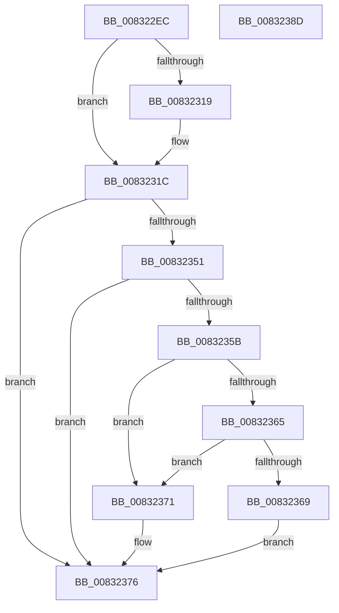

# PnpGetGenericObjectList

- RVA: `0x008322EC`–`0x0083238E` (길이 `162` bytes)
- VA: `0x00000001408322EC`
- 실행 섹션: `PAGE`
- PDB 이름 있음: `예`; PDB Function 태그: `아니요`
- unwind 정보 RVA: `0x0007D3C0`
- 디코드: `47`개 명령, `162/162` bytes 표시
- 미해석 바이트: `0` (있으면 어셈블리에 `.byte`로 보존)

> 이 문서는 커널 이미지의 기계어와 PDB 기호를 분석해 생성했습니다. 4번과 5번은 함수 원형과 자료형을 바이너리 사용 방식에서 추정한 C 해석이며 원본 소스 복구 결과는 아닙니다.

## 1. Dependencies

- 직접 호출 지점: **1**; 고유 호출 대상: **1**
- 직접 호출자로 확인된 함수: **1**
- RIP 상대 이미지 참조: **2**

### Outgoing calls
- `0x00832346` → [PnpCtxRegEnumKeyWithCallback](../AA/PnpCtxRegEnumKeyWithCallback_function_00AA146C.md) (function, `0x00AA146C`)

### Direct callers
- [CmGetMatchingDeviceContainerList](../82/CmGetMatchingDeviceContainerList_function_0082BCC4.md) at `0x0082BDC5`

### Static image references
- `0x0083231C` → RVA `0x0082AE90` (`CmContainerListGenericObjectCallback`; read)
- `0x00832332` → RVA `0x008323A0` (`PnpObjectListCallback`; read)

## 2. Other-region calls and transfers

- 다른 실행 섹션으로 향하는 call: **0**
- 별도 외부 분기/꼬리 이동을 확인하지 못했습니다.

## 3. Assembly (complete function range)

```asm
008322EC  48 89 5C 24 08                  mov qword ptr [rsp + 8], rbx
008322F1  48 89 6C 24 10                  mov qword ptr [rsp + 0x10], rbp
008322F6  48 89 74 24 18                  mov qword ptr [rsp + 0x18], rsi
008322FB  57                              push rdi
008322FC  48 83 EC 40                     sub rsp, 0x40
00832300  48 8B BC 24 80 00 00 00         mov rdi, qword ptr [rsp + 0x80]
00832308  33 ED                           xor ebp, ebp
0083230A  8B 74 24 78                     mov esi, dword ptr [rsp + 0x78]
0083230E  48 8B 5C 24 70                  mov rbx, qword ptr [rsp + 0x70]
00832313  89 2F                           mov dword ptr [rdi], ebp
00832315  85 F6                           test esi, esi
00832317  74 03                           je 0x14083231c
00832319  66 89 2B                        mov word ptr [rbx], bp
0083231C  48 8D 05 6D 8B FF FF            lea rax, [rip - 0x7493]
00832323  4C 89 4C 24 28                  mov qword ptr [rsp + 0x28], r9
00832328  4C 8D 4C 24 20                  lea r9, [rsp + 0x20]
0083232D  48 89 44 24 20                  mov qword ptr [rsp + 0x20], rax
00832332  4C 8D 05 67 00 00 00            lea r8, [rip + 0x67]
00832339  48 89 5C 24 30                  mov qword ptr [rsp + 0x30], rbx
0083233E  89 74 24 38                     mov dword ptr [rsp + 0x38], esi
00832342  89 6C 24 3C                     mov dword ptr [rsp + 0x3c], ebp
00832346  E8 21 F1 26 00                  call 0x140aa146c
0083234B  8B D0                           mov edx, eax
0083234D  85 C0                           test eax, eax
0083234F  78 25                           js 0x140832376
00832351  8B 4C 24 3C                     mov ecx, dword ptr [rsp + 0x3c]
00832355  89 0F                           mov dword ptr [rdi], ecx
00832357  85 C9                           test ecx, ecx
00832359  74 1B                           je 0x140832376
0083235B  8D 41 01                        lea eax, [rcx + 1]
0083235E  89 07                           mov dword ptr [rdi], eax
00832360  48 85 DB                        test rbx, rbx
00832363  74 0C                           je 0x140832371
00832365  3B F0                           cmp esi, eax
00832367  72 08                           jb 0x140832371
00832369  FF C8                           dec eax
0083236B  66 89 2C 43                     mov word ptr [rbx + rax*2], bp
0083236F  EB 05                           jmp 0x140832376
00832371  BA 23 00 00 C0                  mov edx, 0xc0000023
00832376  48 8B 5C 24 50                  mov rbx, qword ptr [rsp + 0x50]
0083237B  8B C2                           mov eax, edx
0083237D  48 8B 6C 24 58                  mov rbp, qword ptr [rsp + 0x58]
00832382  48 8B 74 24 60                  mov rsi, qword ptr [rsp + 0x60]
00832387  48 83 C4 40                     add rsp, 0x40
0083238B  5F                              pop rdi
0083238C  C3                              ret
0083238D  CC                              int3
```

## 4. C-style interpretation (structured pseudocode)

```c
__int64 __fastcall PnpGetGenericObjectList(__int64 a1, __int64 a2, __int64 a3, __int64 a4, __int64 a5, unsigned int a6, __int64 a7)
{
    __int64 result;
    __int64 v_rbp;
    __int64 v_rsp;
    unsigned int v_stack_m10;
    unsigned __int64 v_stack_m18;
    unsigned __int64 v_stack_m20;
    unsigned __int64 v_stack_m28;
    unsigned int v_stack_mC;
    unsigned __int64 v_stack_p10;
    unsigned __int64 v_stack_p18;
    unsigned __int64 v_stack_p8;

    v_stack_p8 = v_rbx;
    v_stack_p10 = v_rbp;
    v_stack_p18 = v_rsi;
    v_rsp = (v_rsp) - (64);
    v_rbp = 0;
    *(unsigned int *)(a7) = 0;
    if ((unsigned int)((unsigned int)(a6)) != 0) {
        *(unsigned __int16 *)(a5) = 0;
    }
    v_stack_m20 = a4;
    v_stack_m28 = v_rip - 29843;
    v_stack_m18 = a5;
    v_stack_m10 = (unsigned int)((unsigned int)(a6));
    v_stack_mC = 0;
    result = PnpCtxRegEnumKeyWithCallback(a1, a2, v_rip + 103, v_stack_m28);
    if (sign_flag) goto loc_00832376;
    *(unsigned int *)(a7) = (unsigned int)((unsigned int)(v_stack_mC));
    if ((unsigned int)((unsigned int)(v_stack_mC)) == 0) goto loc_00832376;
    *(unsigned int *)(a7) = (unsigned int)((unsigned int)(v_stack_mC) + 1);
    if (a5 == 0) goto loc_00832371;
    if (((unsigned int)((unsigned int)(a6))) < ((unsigned int)((unsigned int)(v_stack_mC) + 1))) goto loc_00832371;
    result = (unsigned int)(((unsigned int)(v_stack_mC) + 1) - 1);
    *(unsigned __int16 *)(a5 + result * 2) = 0;
    goto loc_00832376;
loc_00832371:
loc_00832376:
    v_rsp = (v_rsp) + (64);
    return (unsigned int)((unsigned int)((unsigned int)(0xC0000023ULL)));
}
```

## 5. (Beta) C Style

```c
int64_t PnpGetGenericObjectList(int64_t Arg1, int64_t Arg2, int64_t Arg3, int64_t Arg4, void *Arg5, uint32_t Arg6, void *Arg7)
{
    uint8_t *arg5 = (uint8_t *)Arg5;
    uint8_t *arg7 = (uint8_t *)Arg7;

    int64_t result;
    int64_t local_rbp;
    int64_t local_rsp;
    uint32_t v_stack_m10;
    uint64_t v_stack_m18;
    uint64_t v_stack_m20;
    uint64_t v_stack_m28;
    uint32_t v_stack_mC;
    uint64_t v_stack_p10;
    uint64_t v_stack_p18;
    uint64_t v_stack_p8;

    v_stack_p8 = local_rbx;
    v_stack_p10 = local_rbp;
    v_stack_p18 = local_rsi;
    local_rsp = (local_rsp) - (64);
    local_rbp = 0;
    *(uint32_t *)(arg7) = 0;
    if ((uint32_t)((uint32_t)(Arg6)) != 0) {
        *(uint16_t *)(arg5) = 0;
    }
    v_stack_m20 = Arg4;
    v_stack_m28 = v_rip - 29843;
    v_stack_m18 = Arg5;
    v_stack_m10 = (uint32_t)((uint32_t)(Arg6));
    v_stack_mC = 0;
    result = PnpCtxRegEnumKeyWithCallback(Arg1, Arg2, v_rip + 103, v_stack_m28);
    if (sign_flag) goto loc_00832376;
    *(uint32_t *)(arg7) = (uint32_t)((uint32_t)(v_stack_mC));
    if ((uint32_t)((uint32_t)(v_stack_mC)) == 0) goto loc_00832376;
    *(uint32_t *)(arg7) = (uint32_t)((uint32_t)(v_stack_mC) + 1);
    if (Arg5 == NULL) goto loc_00832371;
    if (((uint32_t)((uint32_t)(Arg6))) < ((uint32_t)((uint32_t)(v_stack_mC) + 1))) goto loc_00832371;
    result = (uint32_t)(((uint32_t)(v_stack_mC) + 1) - 1);
    *(uint16_t *)(arg5 + result * 2) = 0;
    goto loc_00832376;
loc_00832371:
loc_00832376:
    local_rsp = (local_rsp) + (64);
    return (uint32_t)((uint32_t)((uint32_t)(0xC0000023ULL)));
}
```

### 관측된 메모리 오프셋

구조체 형식이 확인되지 않은 접근은 인자 기준의 오프셋으로만 기록했습니다.

| 기준 인자 | 오프셋 표현 | 폭 (bit) | 접근 |
|---|---:|---:|---|
| `Arg5` | `+ 0x0` | `16` | `W` |
| `Arg7` | `+ 0x0` | `32` | `W` |

## 6. Execution-region graph

[열기: 2D/3D 그래프와 함수 탐색 컨트롤 패널](../../../control-panel.html?section=page&rva=0x008322EC&view=graph)

- 2D 그래프는 위에서 아래로 흐르고, 3D 그래프는 빈 공간을 드래그해 회전합니다. Shift+드래그는 이동, 휠은 확대·축소, 함수 노드 선택은 대상 보고서 이동입니다.

### Static fallback


