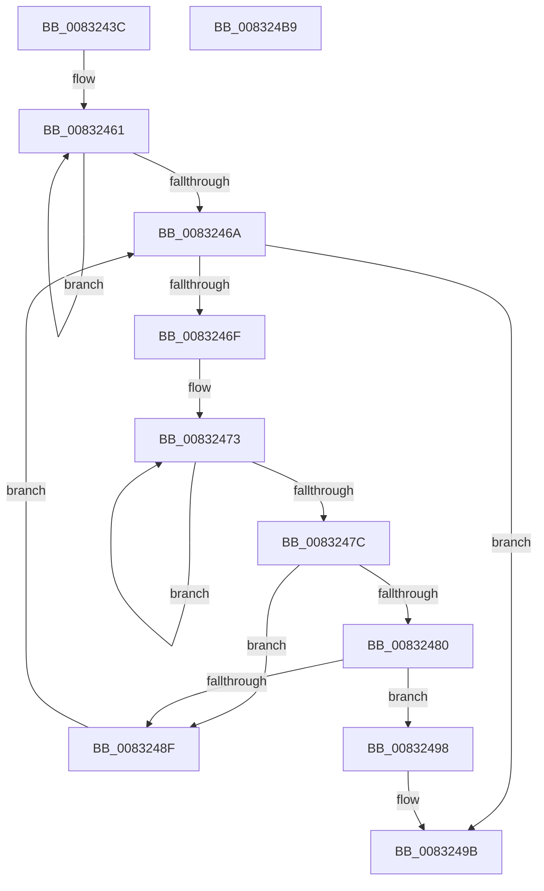

# PnpMultiSzFind

- RVA: `0x0083243C`–`0x008324BA` (길이 `126` bytes)
- VA: `0x000000014083243C`
- 실행 섹션: `PAGE`
- PDB 이름 있음: `예`; PDB Function 태그: `아니요`
- unwind 정보 RVA: `0x0005E6B4`
- 디코드: `40`개 명령, `126/126` bytes 표시
- 미해석 바이트: `0` (있으면 어셈블리에 `.byte`로 보존)

> 이 문서는 커널 이미지의 기계어와 PDB 기호를 분석해 생성했습니다. 4번과 5번은 함수 원형과 자료형을 바이너리 사용 방식에서 추정한 C 해석이며 원본 소스 복구 결과는 아닙니다.

## 1. Dependencies

- 직접 호출 지점: **1**; 고유 호출 대상: **1**
- 직접 호출자로 확인된 함수: **1**
- RIP 상대 이미지 참조: **0**

### Outgoing calls
- `0x00832486` → [wcsicmp](../../text/50/wcsicmp_function_00500080.md) (function, `0x00500080`)

### Direct callers
- [CmFindFilterListInflectionPoint](../AC/CmFindFilterListInflectionPoint_function_00ACC9D8.md) at `0x00ACCA21`

### Static image references
- 디코드된 RIP-relative 메모리 참조가 없습니다.

## 2. Other-region calls and transfers

- 다른 실행 섹션으로 향하는 call: **1**
  - `0x00832486` → [wcsicmp](../../text/50/wcsicmp_function_00500080.md) (`PAGE` → `.text`)
- 별도 외부 분기/꼬리 이동을 확인하지 못했습니다.

## 3. Assembly (complete function range)

```asm
0083243C  48 8B C4                        mov rax, rsp
0083243F  48 89 58 08                     mov qword ptr [rax + 8], rbx
00832443  48 89 68 10                     mov qword ptr [rax + 0x10], rbp
00832447  48 89 70 18                     mov qword ptr [rax + 0x18], rsi
0083244B  48 89 78 20                     mov qword ptr [rax + 0x20], rdi
0083244F  41 56                           push r14
00832451  48 83 EC 20                     sub rsp, 0x20
00832455  33 DB                           xor ebx, ebx
00832457  4C 8B F2                        mov r14, rdx
0083245A  48 83 CD FF                     or rbp, 0xffffffffffffffff
0083245E  48 8B F9                        mov rdi, rcx
00832461  48 FF C5                        inc rbp
00832464  66 39 1C 6A                     cmp word ptr [rdx + rbp*2], bx
00832468  75 F7                           jne 0x140832461
0083246A  66 39 1F                        cmp word ptr [rdi], bx
0083246D  74 2C                           je 0x14083249b
0083246F  48 83 CE FF                     or rsi, 0xffffffffffffffff
00832473  48 FF C6                        inc rsi
00832476  66 39 1C 77                     cmp word ptr [rdi + rsi*2], bx
0083247A  75 F7                           jne 0x140832473
0083247C  3B F5                           cmp esi, ebp
0083247E  75 0F                           jne 0x14083248f
00832480  49 8B D6                        mov rdx, r14
00832483  48 8B CF                        mov rcx, rdi
00832486  E8 F5 DB CC FF                  call 0x140500080
0083248B  85 C0                           test eax, eax
0083248D  74 09                           je 0x140832498
0083248F  8D 46 01                        lea eax, [rsi + 1]
00832492  48 8D 3C 47                     lea rdi, [rdi + rax*2]
00832496  EB D2                           jmp 0x14083246a
00832498  48 8B DF                        mov rbx, rdi
0083249B  48 8B 6C 24 38                  mov rbp, qword ptr [rsp + 0x38]
008324A0  48 8B C3                        mov rax, rbx
008324A3  48 8B 5C 24 30                  mov rbx, qword ptr [rsp + 0x30]
008324A8  48 8B 74 24 40                  mov rsi, qword ptr [rsp + 0x40]
008324AD  48 8B 7C 24 48                  mov rdi, qword ptr [rsp + 0x48]
008324B2  48 83 C4 20                     add rsp, 0x20
008324B6  41 5E                           pop r14
008324B8  C3                              ret
008324B9  CC                              int3
```

## 4. C-style interpretation (structured pseudocode)

```c
__int64 __fastcall PnpMultiSzFind(__int64 a1, __int64 a2)
{
    __int64 result;
    __int64 v_rbp;
    __int64 v_rbx;
    __int64 v_rsi;
    __int64 v_rsp;
    unsigned __int64 v_stack_p10;
    unsigned __int64 v_stack_p18;
    unsigned __int64 v_stack_p20;
    unsigned __int64 v_stack_p8;

    *(unsigned __int64 *)(v_rsp + 8) = v_rbx;
    *(unsigned __int64 *)(v_rsp + 16) = v_rbp;
    *(unsigned __int64 *)(v_rsp + 24) = v_rsi;
    *(unsigned __int64 *)(v_rsp + 32) = v_rdi;
    v_rsp = (v_rsp) - (32);
    v_rbx = 0;
    v_rbp = (v_rbp) | (-1);
loc_00832461:
    v_rbp = (v_rbp) + 1;
    if ((*(unsigned __int16 *)(a2 + v_rbp * 2)) != 0) goto loc_00832461;
loc_0083246A:
    if ((*(unsigned __int16 *)(a1)) == 0) goto loc_0083249B;
    v_rsi = (v_rsi) | (-1);
loc_00832473:
    v_rsi = (v_rsi) + 1;
    if ((*(unsigned __int16 *)(a1 + v_rsi * 2)) != 0) goto loc_00832473;
    if (((unsigned int)(v_rsi)) != ((unsigned int)(v_rbp))) goto loc_0083248F;
    result = wcsicmp(a1, a2, a3, a4);
    if ((unsigned int)(result) == 0) goto loc_00832498;
loc_0083248F:
    goto loc_0083246A;
loc_00832498:
loc_0083249B:
    v_rsp = (v_rsp) + (32);
    return a1 + v_rsi + 1 * 2;
}
```

## 5. (Beta) C Style

```c
int64_t PnpMultiSzFind(void *Arg1, void *Arg2)
{
    uint8_t *arg1 = (uint8_t *)Arg1;
    uint8_t *arg2 = (uint8_t *)Arg2;

    int64_t result;
    int64_t local_rbp;
    int64_t local_rbx;
    int64_t local_rsi;
    int64_t local_rsp;
    uint64_t v_stack_p10;
    uint64_t v_stack_p18;
    uint64_t v_stack_p20;
    uint64_t v_stack_p8;

    *(uint64_t *)(local_rsp + 0x8) = local_rbx;
    *(uint64_t *)(local_rsp + 0x10) = local_rbp;
    *(uint64_t *)(local_rsp + 0x18) = local_rsi;
    *(uint64_t *)(local_rsp + 0x20) = local_rdi;
    local_rsp = (local_rsp) - (32);
    local_rbx = 0;
    local_rbp = (local_rbp) | (-1);
loc_00832461:
    local_rbp = (local_rbp) + 1;
    if ((*(uint16_t *)(arg2 + local_rbp * 2)) != 0) goto loc_00832461;
loc_0083246A:
    if ((*(uint16_t *)(arg1)) == 0) goto loc_0083249B;
    local_rsi = (local_rsi) | (-1);
loc_00832473:
    local_rsi = (local_rsi) + 1;
    if ((*(uint16_t *)(arg1 + local_rsi * 2)) != 0) goto loc_00832473;
    if (((uint32_t)(local_rsi)) != ((uint32_t)(local_rbp))) goto loc_0083248F;
    result = wcsicmp(Arg1, Arg2, a3, a4);
    if ((uint32_t)(result) == 0) goto loc_00832498;
loc_0083248F:
    goto loc_0083246A;
loc_00832498:
loc_0083249B:
    local_rsp = (local_rsp) + (32);
    return Arg1 + local_rsi + 1 * 2;
}
```

### 관측된 메모리 오프셋

구조체 형식이 확인되지 않은 접근은 인자 기준의 오프셋으로만 기록했습니다.

| 기준 인자 | 오프셋 표현 | 폭 (bit) | 접근 |
|---|---:|---:|---|
| `Arg1` | `+ 0x0` | `16` | `R` |
| `Arg1` | `+ 0x0 + rax*2` | `64` | `R` |
| `Arg1` | `+ 0x0 + rsi*2` | `16` | `R` |
| `Arg2` | `+ 0x0 + rbp*2` | `16` | `R` |

## 6. Execution-region graph

[열기: 2D/3D 그래프와 함수 탐색 컨트롤 패널](../../../control-panel.html?section=page&rva=0x0083243C&view=graph)

- 2D 그래프는 위에서 아래로 흐르고, 3D 그래프는 빈 공간을 드래그해 회전합니다. Shift+드래그는 이동, 휠은 확대·축소, 함수 노드 선택은 대상 보고서 이동입니다.

### Static fallback


