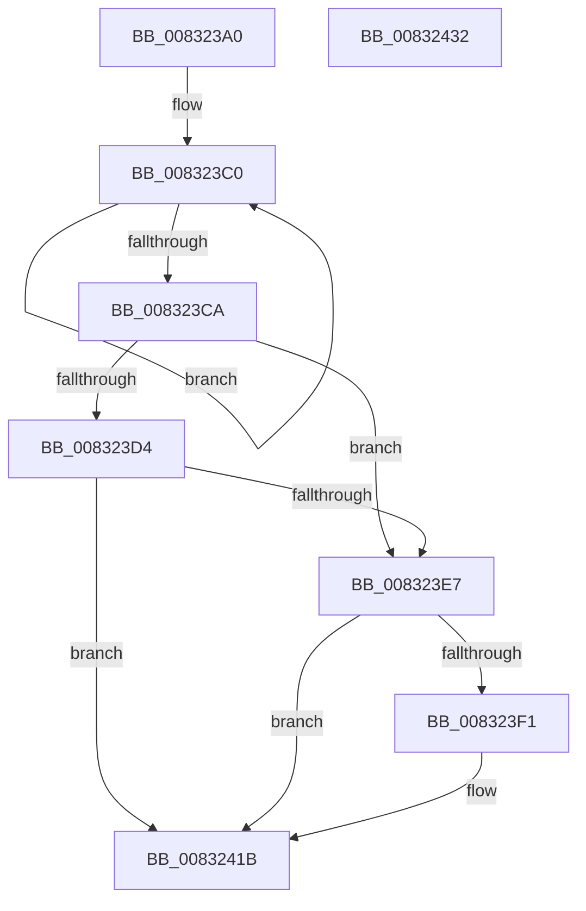

# PnpObjectListCallback

- RVA: `0x008323A0`–`0x00832433` (길이 `147` bytes)
- VA: `0x00000001408323A0`
- 실행 섹션: `PAGE`
- PDB 이름 있음: `예`; PDB Function 태그: `아니요`
- unwind 정보 RVA: `0x00066400`
- 디코드: `45`개 명령, `147/147` bytes 표시
- 미해석 바이트: `0` (있으면 어셈블리에 `.byte`로 보존)

> 이 문서는 커널 이미지의 기계어와 PDB 기호를 분석해 생성했습니다. 4번과 5번은 함수 원형과 자료형을 바이너리 사용 방식에서 추정한 C 해석이며 원본 소스 복구 결과는 아닙니다.

## 1. Dependencies

- 직접 호출 지점: **2**; 고유 호출 대상: **2**
- 직접 호출자로 확인된 함수: **0**
- RIP 상대 이미지 참조: **0**

### Outgoing calls
- `0x008323DE` → [guard_dispatch_icall](../../text/6B/guard_dispatch_icall_function_006BAAD0.md) (function, `0x006BAAD0`)
- `0x0083240A` → [RtlStringCchCopyExW](../../text/41/RtlStringCchCopyExW_function_0041E1C0.md) (function, `0x0041E1C0`)

### Direct callers
- 이 함수 시작 RVA로 연결되는 직접 call은 확인되지 않았습니다. 간접 호출은 완전히 역산할 수 없습니다.

### Static image references
- 디코드된 RIP-relative 메모리 참조가 없습니다.

## 2. Other-region calls and transfers

- 다른 실행 섹션으로 향하는 call: **2**
  - `0x008323DE` → [guard_dispatch_icall](../../text/6B/guard_dispatch_icall_function_006BAAD0.md) (`PAGE` → `.text`)
  - `0x0083240A` → [RtlStringCchCopyExW](../../text/41/RtlStringCchCopyExW_function_0041E1C0.md) (`PAGE` → `.text`)
- 별도 외부 분기/꼬리 이동을 확인하지 못했습니다.

## 3. Assembly (complete function range)

```asm
008323A0  48 89 5C 24 08                  mov qword ptr [rsp + 8], rbx
008323A5  48 89 6C 24 10                  mov qword ptr [rsp + 0x10], rbp
008323AA  48 89 74 24 18                  mov qword ptr [rsp + 0x18], rsi
008323AF  57                              push rdi
008323B0  48 83 EC 30                     sub rsp, 0x30
008323B4  48 83 CB FF                     or rbx, 0xffffffffffffffff
008323B8  49 8B F9                        mov rdi, r9
008323BB  33 ED                           xor ebp, ebp
008323BD  49 8B F0                        mov rsi, r8
008323C0  48 FF C3                        inc rbx
008323C3  66 41 39 2C 58                  cmp word ptr [r8 + rbx*2], bp
008323C8  75 F6                           jne 0x1408323c0
008323CA  49 8B 01                        mov rax, qword ptr [r9]
008323CD  FF C3                           inc ebx
008323CF  48 85 C0                        test rax, rax
008323D2  74 13                           je 0x1408323e7
008323D4  4D 8B 49 08                     mov r9, qword ptr [r9 + 8]
008323D8  45 33 C0                        xor r8d, r8d
008323DB  48 8B D6                        mov rdx, rsi
008323DE  E8 ED 86 E8 FF                  call 0x1406baad0
008323E3  84 C0                           test al, al
008323E5  74 34                           je 0x14083241b
008323E7  01 5F 1C                        add dword ptr [rdi + 0x1c], ebx
008323EA  8B 47 18                        mov eax, dword ptr [rdi + 0x18]
008323ED  3B C3                           cmp eax, ebx
008323EF  76 2A                           jbe 0x14083241b
008323F1  48 8B 4F 10                     mov rcx, qword ptr [rdi + 0x10]
008323F5  8B D0                           mov edx, eax
008323F7  C7 44 24 28 00 09 00 00         mov dword ptr [rsp + 0x28], 0x900
008323FF  45 33 C9                        xor r9d, r9d
00832402  4C 8B C6                        mov r8, rsi
00832405  48 89 6C 24 20                  mov qword ptr [rsp + 0x20], rbp
0083240A  E8 B1 BD BE FF                  call 0x14041e1c0
0083240F  8B C3                           mov eax, ebx
00832411  48 03 C0                        add rax, rax
00832414  48 01 47 10                     add qword ptr [rdi + 0x10], rax
00832418  29 5F 18                        sub dword ptr [rdi + 0x18], ebx
0083241B  48 8B 5C 24 40                  mov rbx, qword ptr [rsp + 0x40]
00832420  33 C0                           xor eax, eax
00832422  48 8B 6C 24 48                  mov rbp, qword ptr [rsp + 0x48]
00832427  48 8B 74 24 50                  mov rsi, qword ptr [rsp + 0x50]
0083242C  48 83 C4 30                     add rsp, 0x30
00832430  5F                              pop rdi
00832431  C3                              ret
00832432  CC                              int3
```

## 4. C-style interpretation (structured pseudocode)

```c
__int64 __fastcall PnpObjectListCallback(__int64 a1, __int64 a2, __int64 a3, __int64 a4)
{
    __int64 result;
    __int64 v_rbp;
    __int64 v_rbx;
    __int64 v_rsp;
    unsigned int v_stack_m10;
    unsigned __int64 v_stack_m18;
    unsigned __int64 v_stack_p10;
    unsigned __int64 v_stack_p18;
    unsigned __int64 v_stack_p8;

    v_stack_p8 = v_rbx;
    v_stack_p10 = v_rbp;
    v_stack_p18 = v_rsi;
    v_rsp = (v_rsp) - (48);
    v_rbx = (v_rbx) | (-1);
    v_rbp = 0;
loc_008323C0:
    v_rbx = (v_rbx) + 1;
    if ((*(unsigned __int16 *)(a3 + v_rbx * 2)) != 0) goto loc_008323C0;
    v_rbx = (unsigned int)((v_rbx) + 1);
    if (*(unsigned __int64 *)(a4) == 0) goto loc_008323E7;
    a3 = 0;
    result = guard_dispatch_icall(a1, 0, a3, *(unsigned __int64 *)(a4 + 8));
    if ((unsigned __int8)(result) == 0) goto loc_0083241B;
loc_008323E7:
    result = (unsigned int)(*(unsigned int *)(a4 + 24));
    if (((unsigned int)((unsigned int)(*(unsigned int *)(a4 + 24)))) >= = ((unsigned int)(v_rbx))) {
        a1 = *(unsigned __int64 *)(a4 + 16);
        a2 = (unsigned int)((unsigned int)(*(unsigned int *)(a4 + 24)));
        v_stack_m10 = 0x900ULL;
        a4 = 0;
        a3 = 0;
        v_stack_m18 = 0;
        result = RtlStringCchCopyExW(a1, a2, a3, a4);
        result = (unsigned int)(v_rbx);
        result = (result) + (result);
    }
    result = 0;
    v_rsp = (v_rsp) + (48);
    return result;
}
```

## 5. (Beta) C Style

```c
int64_t PnpObjectListCallback(int64_t Arg1, int64_t Arg2, void *Arg3, void *Arg4)
{
    uint8_t *arg3 = (uint8_t *)Arg3;
    uint8_t *arg4 = (uint8_t *)Arg4;

    int64_t result;
    int64_t local_rbp;
    int64_t local_rbx;
    int64_t local_rsp;
    uint32_t v_stack_m10;
    uint64_t v_stack_m18;
    uint64_t v_stack_p10;
    uint64_t v_stack_p18;
    uint64_t v_stack_p8;

    v_stack_p8 = local_rbx;
    v_stack_p10 = local_rbp;
    v_stack_p18 = local_rsi;
    local_rsp = (local_rsp) - (48);
    local_rbx = (local_rbx) | (-1);
    local_rbp = 0;
loc_008323C0:
    local_rbx = (local_rbx) + 1;
    if ((*(uint16_t *)(arg3 + local_rbx * 2)) != 0) goto loc_008323C0;
    local_rbx = (uint32_t)((local_rbx) + 1);
    if (*(uint64_t *)(arg4) == 0) goto loc_008323E7;
    Arg3 = 0;
    result = guard_dispatch_icall(Arg1, 0, Arg3, *(uint64_t *)(arg4 + 0x8));
    if ((uint8_t)(result) == 0) goto loc_0083241B;
loc_008323E7:
    result = (uint32_t)(*(uint32_t *)(arg4 + 0x18));
    if (((uint32_t)((uint32_t)(*(uint32_t *)(arg4 + 0x18)))) >= = ((uint32_t)(local_rbx))) {
        Arg1 = *(uint64_t *)(arg4 + 0x10);
        Arg2 = (uint32_t)((uint32_t)(*(uint32_t *)(arg4 + 0x18)));
        v_stack_m10 = 0x900ULL;
        Arg4 = 0;
        Arg3 = 0;
        v_stack_m18 = 0;
        result = RtlStringCchCopyExW(Arg1, Arg2, Arg3, Arg4);
        result = (uint32_t)(local_rbx);
        result = (result) + (result);
    }
    result = 0;
    local_rsp = (local_rsp) + (48);
    return result;
}
```

### 관측된 메모리 오프셋

구조체 형식이 확인되지 않은 접근은 인자 기준의 오프셋으로만 기록했습니다.

| 기준 인자 | 오프셋 표현 | 폭 (bit) | 접근 |
|---|---:|---:|---|
| `Arg3` | `+ 0x0 + rbx*2` | `16` | `R` |
| `Arg4` | `+ 0x0` | `64` | `R` |
| `Arg4` | `+ 0x8` | `64` | `R` |
| `Arg4` | `+ 0x10` | `64` | `R` |
| `Arg4` | `+ 0x10` | `64` | `R/W` |
| `Arg4` | `+ 0x18` | `32` | `R` |
| `Arg4` | `+ 0x18` | `32` | `R/W` |
| `Arg4` | `+ 0x1C` | `32` | `R/W` |

## 6. Execution-region graph

[열기: 2D/3D 그래프와 함수 탐색 컨트롤 패널](../../../control-panel.html?section=page&rva=0x008323A0&view=graph)

- 2D 그래프는 위에서 아래로 흐르고, 3D 그래프는 빈 공간을 드래그해 회전합니다. Shift+드래그는 이동, 휠은 확대·축소, 함수 노드 선택은 대상 보고서 이동입니다.

### Static fallback


