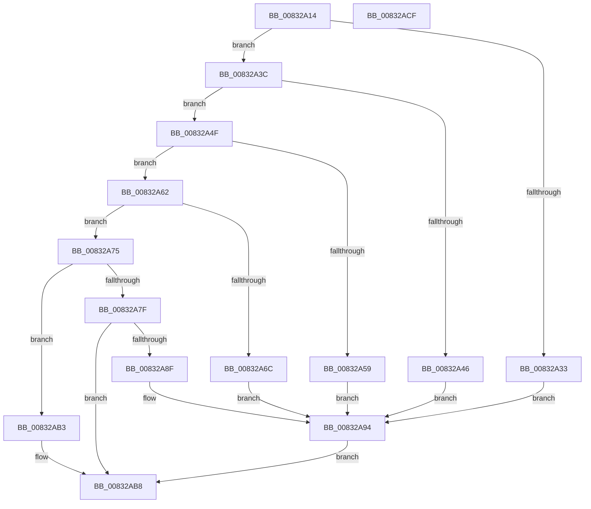

# RegRtlOpenPredefinedKey

- RVA: `0x00832A14`–`0x00832AD0` (길이 `188` bytes)
- VA: `0x0000000140832A14`
- 실행 섹션: `PAGE`
- PDB 이름 있음: `예`; PDB Function 태그: `아니요`
- unwind 정보 RVA: `0x00065960`
- 디코드: `52`개 명령, `188/188` bytes 표시
- 미해석 바이트: `0` (있으면 어셈블리에 `.byte`로 보존)

> 이 문서는 커널 이미지의 기계어와 PDB 기호를 분석해 생성했습니다. 4번과 5번은 함수 원형과 자료형을 바이너리 사용 방식에서 추정한 C 해석이며 원본 소스 복구 결과는 아닙니다.

## 1. Dependencies

- 직접 호출 지점: **3**; 고유 호출 대상: **3**
- 직접 호출자로 확인된 함수: **8**
- RIP 상대 이미지 참조: **4**

### Outgoing calls
- `0x00832A84` → [RtlFormatCurrentUserKeyPath](../92/RtlFormatCurrentUserKeyPath_function_00927820.md) (function, `0x00927820`)
- `0x00832AAA` → [_RegRtlOpenKeyTransacted](../8E/_RegRtlOpenKeyTransacted_function_008EF810.md) (function, `0x008EF810`)
- `0x00832ABD` → [RtlFreeAnsiString](../9C/RtlFreeAnsiString_function_009C0800.md) (function, `0x009C0800`)

### Direct callers
- [RegRtlQueryKeyPathName](RegRtlQueryKeyPathName_function_00832AD8.md) at `0x00832B23`
- [sub_008EF91D](../8E/Unknown_function_008EF91D.md) at `0x008EF994`
- [_CmAddDeviceToContainerWorker](../8F/_CmAddDeviceToContainerWorker_function_008FF2EC.md) at `0x008FF6AB`
- [_CmAddDeviceToContainerWorker](../8F/_CmAddDeviceToContainerWorker_function_008FF2EC.md) at `0x008FF6C3`
- [RegRtlCreateTreeTransacted](../93/RegRtlCreateTreeTransacted_function_00931D1C.md) at `0x00931FD2`
- [RegRtlCreateKeyTransacted](../93/RegRtlCreateKeyTransacted_function_0093207C.md) at `0x00932188`
- [PnpSetPropertyWorker](../99/PnpSetPropertyWorker_function_00991C08.md) at `0x00992096`
- [PnpSetPropertyWorker](../99/PnpSetPropertyWorker_function_00991C08.md) at `0x009920B9`
- [_CmSetDeviceInterfaceMappedPropertyFromRegValue](../A7/_CmSetDeviceInterfaceMappedPropertyFromRegValue_function_00A729E4.md) at `0x00A72D49`
- [_CmCreateOrdinalInstanceKey](../A7/_CmCreateOrdinalInstanceKey_function_00A77838.md) at `0x00A77AD8`

### Static image references
- `0x00832A33` → RVA `0x0000C5F0` (`.rdata`; read)
- `0x00832A46` → RVA `0x0000C5D0` (`.rdata`; read)
- `0x00832A59` → RVA `0x0000C5E0` (`.rdata`; read)
- `0x00832A6C` → RVA `0x0000C5C0` (`.rdata`; read)

## 2. Other-region calls and transfers

- 다른 실행 섹션으로 향하는 call: **0**
- 별도 외부 분기/꼬리 이동을 확인하지 못했습니다.

## 3. Assembly (complete function range)

```asm
00832A14  48 89 5C 24 08                  mov qword ptr [rsp + 8], rbx
00832A19  57                              push rdi
00832A1A  48 83 EC 40                     sub rsp, 0x40
00832A1E  B8 02 00 00 80                  mov eax, 0x80000002
00832A23  0F 57 C0                        xorps xmm0, xmm0
00832A26  48 8B FA                        mov rdi, rdx
00832A29  0F 11 44 24 30                  movups xmmword ptr [rsp + 0x30], xmm0
00832A2E  48 3B C8                        cmp rcx, rax
00832A31  75 09                           jne 0x140832a3c
00832A33  48 8B 15 B6 9B 7D FF            mov rdx, qword ptr [rip - 0x82644a]
00832A3A  EB 58                           jmp 0x140832a94
00832A3C  B8 00 00 00 80                  mov eax, 0x80000000
00832A41  48 3B C8                        cmp rcx, rax
00832A44  75 09                           jne 0x140832a4f
00832A46  48 8B 15 83 9B 7D FF            mov rdx, qword ptr [rip - 0x82647d]
00832A4D  EB 45                           jmp 0x140832a94
00832A4F  B8 03 00 00 80                  mov eax, 0x80000003
00832A54  48 3B C8                        cmp rcx, rax
00832A57  75 09                           jne 0x140832a62
00832A59  48 8B 15 80 9B 7D FF            mov rdx, qword ptr [rip - 0x826480]
00832A60  EB 32                           jmp 0x140832a94
00832A62  B8 05 00 00 80                  mov eax, 0x80000005
00832A67  48 3B C8                        cmp rcx, rax
00832A6A  75 09                           jne 0x140832a75
00832A6C  48 8B 15 4D 9B 7D FF            mov rdx, qword ptr [rip - 0x8264b3]
00832A73  EB 1F                           jmp 0x140832a94
00832A75  B8 01 00 00 80                  mov eax, 0x80000001
00832A7A  48 3B C8                        cmp rcx, rax
00832A7D  75 34                           jne 0x140832ab3
00832A7F  48 8D 4C 24 30                  lea rcx, [rsp + 0x30]
00832A84  E8 97 4D 0F 00                  call 0x140927820
00832A89  8B D8                           mov ebx, eax
00832A8B  85 C0                           test eax, eax
00832A8D  78 29                           js 0x140832ab8
00832A8F  48 8B 54 24 38                  mov rdx, qword ptr [rsp + 0x38]
00832A94  48 83 64 24 28 00               and qword ptr [rsp + 0x28], 0
00832A9A  41 B9 00 00 00 02               mov r9d, 0x2000000
00832AA0  45 33 C0                        xor r8d, r8d
00832AA3  48 89 7C 24 20                  mov qword ptr [rsp + 0x20], rdi
00832AA8  33 C9                           xor ecx, ecx
00832AAA  E8 61 CD 0B 00                  call 0x1408ef810
00832AAF  8B D8                           mov ebx, eax
00832AB1  EB 05                           jmp 0x140832ab8
00832AB3  BB 08 00 00 C0                  mov ebx, 0xc0000008
00832AB8  48 8D 4C 24 30                  lea rcx, [rsp + 0x30]
00832ABD  E8 3E DD 18 00                  call 0x1409c0800
00832AC2  8B C3                           mov eax, ebx
00832AC4  48 8B 5C 24 50                  mov rbx, qword ptr [rsp + 0x50]
00832AC9  48 83 C4 40                     add rsp, 0x40
00832ACD  5F                              pop rdi
00832ACE  C3                              ret
00832ACF  CC                              int3
```

## 4. C-style interpretation (structured pseudocode)

```c
__int64 __fastcall RegRtlOpenPredefinedKey(__int64 a1, __int64 a2, int a3)
{
    __int64 result;
    __int64 v_rsp;
    unsigned __int64 v_stack_m10;
    unsigned __int64 v_stack_m18;
    unsigned __int64 v_stack_m20;
    unsigned __int64 v_stack_m28;
    unsigned __int64 v_stack_p8;

    v_stack_p8 = v_rbx;
    v_rsp = (v_rsp) - (64);
    v_stack_m18 = v_xmm0;
    if (a1 != ((unsigned int)(0x80000002ULL))) goto loc_00832A3C;
    goto loc_00832A94;
loc_00832A3C:
    if (a1 != ((unsigned int)(0x80000000ULL))) goto loc_00832A4F;
    goto loc_00832A94;
loc_00832A4F:
    if (a1 != ((unsigned int)(0x80000003ULL))) goto loc_00832A62;
    goto loc_00832A94;
loc_00832A62:
    if (a1 != ((unsigned int)(0x80000005ULL))) goto loc_00832A75;
    goto loc_00832A94;
loc_00832A75:
    if (a1 != ((unsigned int)(0x80000001ULL))) goto loc_00832AB3;
    result = RtlFormatCurrentUserKeyPath(v_stack_m18, *(unsigned __int64 *)(v_rip - 8545459), a3, a4);
    if (sign_flag) goto loc_00832AB8;
loc_00832A94:
    a3 = 0;
    v_stack_m28 = a2;
    a1 = 0;
    result = _RegRtlOpenKeyTransacted(a1, v_stack_m10, a3, (unsigned int)(0x2000000ULL));
    goto loc_00832AB8;
loc_00832AB3:
loc_00832AB8:
    result = RtlFreeAnsiString(v_stack_m18, v_stack_m10, a3, (unsigned int)(0x2000000ULL));
    v_rsp = (v_rsp) + (64);
    return (unsigned int)((unsigned int)((unsigned int)(0xC0000008ULL)));
}
```

## 5. (Beta) C Style

```c
int64_t RegRtlOpenPredefinedKey(int64_t Arg1, int64_t Arg2, int32_t Arg3)
{
    int64_t result;
    int64_t local_rsp;
    uint64_t v_stack_m10;
    uint64_t v_stack_m18;
    uint64_t v_stack_m20;
    uint64_t v_stack_m28;
    uint64_t v_stack_p8;

    v_stack_p8 = local_rbx;
    local_rsp = (local_rsp) - (64);
    v_stack_m18 = v_xmm0;
    if (Arg1 != ((uint32_t)(0x80000002ULL))) goto loc_00832A3C;
    goto loc_00832A94;
loc_00832A3C:
    if (Arg1 != ((uint32_t)(0x80000000ULL))) goto loc_00832A4F;
    goto loc_00832A94;
loc_00832A4F:
    if (Arg1 != ((uint32_t)(0x80000003ULL))) goto loc_00832A62;
    goto loc_00832A94;
loc_00832A62:
    if (Arg1 != ((uint32_t)(0x80000005ULL))) goto loc_00832A75;
    goto loc_00832A94;
loc_00832A75:
    if (Arg1 != ((uint32_t)(0x80000001ULL))) goto loc_00832AB3;
    result = RtlFormatCurrentUserKeyPath(v_stack_m18, *(uint64_t *)(v_rip - 0x8264B3), Arg3, a4);
    if (sign_flag) goto loc_00832AB8;
loc_00832A94:
    Arg3 = 0;
    v_stack_m28 = Arg2;
    Arg1 = 0;
    result = _RegRtlOpenKeyTransacted(Arg1, v_stack_m10, Arg3, (uint32_t)(0x2000000ULL));
    goto loc_00832AB8;
loc_00832AB3:
loc_00832AB8:
    result = RtlFreeAnsiString(v_stack_m18, v_stack_m10, Arg3, (uint32_t)(0x2000000ULL));
    local_rsp = (local_rsp) + (64);
    return (uint32_t)((uint32_t)((uint32_t)(0xC0000008ULL)));
}
```

## 6. Execution-region graph

[열기: 2D/3D 그래프와 함수 탐색 컨트롤 패널](../../../control-panel.html?section=page&rva=0x00832A14&view=graph)

- 2D 그래프는 위에서 아래로 흐르고, 3D 그래프는 빈 공간을 드래그해 회전합니다. Shift+드래그는 이동, 휠은 확대·축소, 함수 노드 선택은 대상 보고서 이동입니다.

### Static fallback


