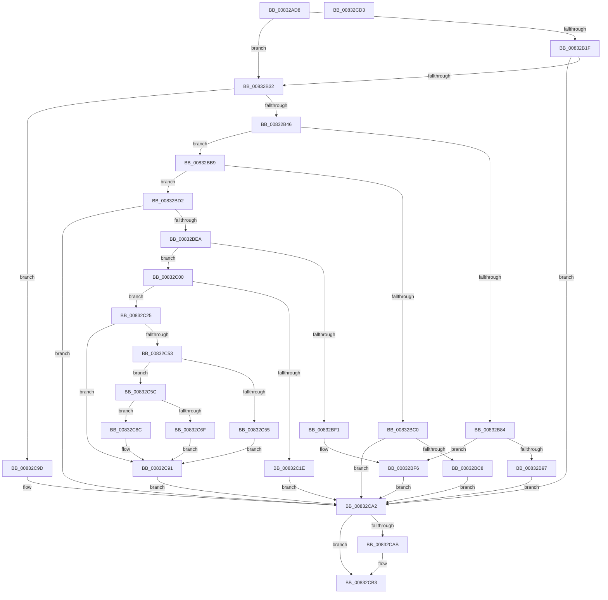

# RegRtlQueryKeyPathName

- RVA: `0x00832AD8`–`0x00832CD4` (길이 `508` bytes)
- VA: `0x0000000140832AD8`
- 실행 섹션: `PAGE`
- PDB 이름 있음: `예`; PDB Function 태그: `아니요`
- unwind 정보 RVA: `0x000A9A64`
- 디코드: `151`개 명령, `508/508` bytes 표시
- 미해석 바이트: `0` (있으면 어셈블리에 `.byte`로 보존)

> 이 문서는 커널 이미지의 기계어와 PDB 기호를 분석해 생성했습니다. 4번과 5번은 함수 원형과 자료형을 바이너리 사용 방식에서 추정한 C 해석이며 원본 소스 복구 결과는 아닙니다.

## 1. Dependencies

- 직접 호출 지점: **10**; 고유 호출 대상: **8**
- 직접 호출자로 확인된 함수: **1**
- RIP 상대 이미지 참조: **0**

### Outgoing calls
- `0x00832B16` → [RegRtlIsPredefinedKey](../93/RegRtlIsPredefinedKey_function_009321CC.md) (function, `0x009321CC`)
- `0x00832B23` → [RegRtlOpenPredefinedKey](RegRtlOpenPredefinedKey_function_00832A14.md) (function, `0x00832A14`)
- `0x00832B79` → [ZwQueryObject](../../text/6A/ZwQueryObject_function_006AD2D0.md) (function, `0x006AD2D0`)
- `0x00832BA1` → [memcpy](../../text/6C/memcpy_function_006C6840.md) (function, `0x006C6840`)
- `0x00832BDB` → [RtlULongSub](../../text/4A/RtlULongSub_function_004A1DA8.md) (function, `0x004A1DA8`)
- `0x00832C0E` → [ExAllocatePool2](../../poolcode/B8/ExAllocatePool2_function_00B820F0.md) (function, `0x00B820F0`)
- `0x00832C48` → [ZwQueryObject](../../text/6A/ZwQueryObject_function_006AD2D0.md) (function, `0x006AD2D0`)
- `0x00832C79` → [memcpy](../../text/6C/memcpy_function_006C6840.md) (function, `0x006C6840`)
- `0x00832C96` → [ExFreePoolWithTag](../../poolcode/B8/ExFreePoolWithTag_function_00B82870.md) (function, `0x00B82870`)
- `0x00832CAE` → [ZwClose](../../text/6A/ZwClose_function_006AD2B0.md) (function, `0x006AD2B0`)

### Direct callers
- [PnpCtxRegQueryKeyPathName](../82/PnpCtxRegQueryKeyPathName_function_00829278.md) at `0x00829288`

### Static image references
- 디코드된 RIP-relative 메모리 참조가 없습니다.

## 2. Other-region calls and transfers

- 다른 실행 섹션으로 향하는 call: **8**
  - `0x00832B79` → [ZwQueryObject](../../text/6A/ZwQueryObject_function_006AD2D0.md) (`PAGE` → `.text`)
  - `0x00832BA1` → [memcpy](../../text/6C/memcpy_function_006C6840.md) (`PAGE` → `.text`)
  - `0x00832BDB` → [RtlULongSub](../../text/4A/RtlULongSub_function_004A1DA8.md) (`PAGE` → `.text`)
  - `0x00832C0E` → [ExAllocatePool2](../../poolcode/B8/ExAllocatePool2_function_00B820F0.md) (`PAGE` → `POOLCODE`)
  - `0x00832C48` → [ZwQueryObject](../../text/6A/ZwQueryObject_function_006AD2D0.md) (`PAGE` → `.text`)
  - `0x00832C79` → [memcpy](../../text/6C/memcpy_function_006C6840.md) (`PAGE` → `.text`)
  - `0x00832C96` → [ExFreePoolWithTag](../../poolcode/B8/ExFreePoolWithTag_function_00B82870.md) (`PAGE` → `POOLCODE`)
  - `0x00832CAE` → [ZwClose](../../text/6A/ZwClose_function_006AD2B0.md) (`PAGE` → `.text`)
- 별도 외부 분기/꼬리 이동을 확인하지 못했습니다.

## 3. Assembly (complete function range)

```asm
00832AD8  48 89 5C 24 08                  mov qword ptr [rsp + 8], rbx
00832ADD  48 89 74 24 10                  mov qword ptr [rsp + 0x10], rsi
00832AE2  48 89 7C 24 18                  mov qword ptr [rsp + 0x18], rdi
00832AE7  55                              push rbp
00832AE8  41 54                           push r12
00832AEA  41 55                           push r13
00832AEC  41 56                           push r14
00832AEE  41 57                           push r15
00832AF0  48 8B EC                        mov rbp, rsp
00832AF3  48 83 EC 50                     sub rsp, 0x50
00832AF7  45 33 D2                        xor r10d, r10d
00832AFA  0F 57 C0                        xorps xmm0, xmm0
00832AFD  4C 89 55 E8                     mov qword ptr [rbp - 0x18], r10
00832B01  4D 8B F8                        mov r15, r8
00832B04  0F 11 45 F0                     movups xmmword ptr [rbp - 0x10], xmm0
00832B08  44 89 55 E0                     mov dword ptr [rbp - 0x20], r10d
00832B0C  4C 8B E2                        mov r12, rdx
00832B0F  44 89 55 48                     mov dword ptr [rbp + 0x48], r10d
00832B13  4C 8B F1                        mov r14, rcx
00832B16  E8 B1 F6 0F 00                  call 0x1409321cc
00832B1B  84 C0                           test al, al
00832B1D  74 13                           je 0x140832b32
00832B1F  48 8D 55 E8                     lea rdx, [rbp - 0x18]
00832B23  E8 EC FE FF FF                  call 0x140832a14
00832B28  8B D8                           mov ebx, eax
00832B2A  85 C0                           test eax, eax
00832B2C  0F 88 70 01 00 00               js 0x140832ca2
00832B32  41 8B 3F                        mov edi, dword ptr [r15]
00832B35  B8 FF FF FF FF                  mov eax, 0xffffffff
00832B3A  48 03 FF                        add rdi, rdi
00832B3D  48 3B F8                        cmp rdi, rax
00832B40  0F 87 57 01 00 00               ja 0x140832c9d
00832B46  48 8B 45 E8                     mov rax, qword ptr [rbp - 0x18]
00832B4A  4C 8D 6D F0                     lea r13, [rbp - 0x10]
00832B4E  BE 10 00 00 00                  mov esi, 0x10
00832B53  49 8B CE                        mov rcx, r14
00832B56  3B FE                           cmp edi, esi
00832B58  44 8B CE                        mov r9d, esi
00832B5B  4D 0F 43 EC                     cmovae r13, r12
00832B5F  44 0F 43 CF                     cmovae r9d, edi
00832B63  48 85 C0                        test rax, rax
00832B66  8D 56 F1                        lea edx, [rsi - 0xf]
00832B69  4D 8B C5                        mov r8, r13
00832B6C  48 0F 45 C8                     cmovne rcx, rax
00832B70  48 8D 45 48                     lea rax, [rbp + 0x48]
00832B74  48 89 44 24 20                  mov qword ptr [rsp + 0x20], rax
00832B79  E8 52 A7 E7 FF                  call 0x1406ad2d0
00832B7E  8B D8                           mov ebx, eax
00832B80  85 C0                           test eax, eax
00832B82  75 35                           jne 0x140832bb9
00832B84  41 0F B7 4D 00                  movzx ecx, word ptr [r13]
00832B89  8D 41 02                        lea eax, [rcx + 2]
00832B8C  8B F0                           mov esi, eax
00832B8E  D1 E8                           shr eax, 1
00832B90  41 89 07                        mov dword ptr [r15], eax
00832B93  3B FE                           cmp edi, esi
00832B95  72 5F                           jb 0x140832bf6
00832B97  49 8B 55 08                     mov rdx, qword ptr [r13 + 8]
00832B9B  44 8B C1                        mov r8d, ecx
00832B9E  49 8B CC                        mov rcx, r12
00832BA1  E8 9A 3C E9 FF                  call 0x1406c6840
00832BA6  8B C6                           mov eax, esi
00832BA8  48 D1 E8                        shr rax, 1
00832BAB  45 33 ED                        xor r13d, r13d
00832BAE  66 45 89 6C 44 FE               mov word ptr [r12 + rax*2 - 2], r13w
00832BB4  E9 E9 00 00 00                  jmp 0x140832ca2
00832BB9  3D 04 00 00 C0                  cmp eax, 0xc0000004
00832BBE  74 12                           je 0x140832bd2
00832BC0  85 C0                           test eax, eax
00832BC2  0F 88 DA 00 00 00               js 0x140832ca2
00832BC8  BB E5 00 00 C0                  mov ebx, 0xc00000e5
00832BCD  E9 D0 00 00 00                  jmp 0x140832ca2
00832BD2  8B 4D 48                        mov ecx, dword ptr [rbp + 0x48]
00832BD5  4C 8D 45 E0                     lea r8, [rbp - 0x20]
00832BD9  8B D6                           mov edx, esi
00832BDB  E8 C8 F1 C6 FF                  call 0x1404a1da8
00832BE0  8B D8                           mov ebx, eax
00832BE2  85 C0                           test eax, eax
00832BE4  0F 88 B8 00 00 00               js 0x140832ca2
00832BEA  8B 45 E0                        mov eax, dword ptr [rbp - 0x20]
00832BED  3B F8                           cmp edi, eax
00832BEF  73 0F                           jae 0x140832c00
00832BF1  D1 E8                           shr eax, 1
00832BF3  41 89 07                        mov dword ptr [r15], eax
00832BF6  BB 23 00 00 C0                  mov ebx, 0xc0000023
00832BFB  E9 A2 00 00 00                  jmp 0x140832ca2
00832C00  48 8B D1                        mov rdx, rcx
00832C03  41 B8 52 45 47 4C               mov r8d, 0x4c474552
00832C09  B9 00 01 00 00                  mov ecx, 0x100
00832C0E  E8 DD F4 34 00                  call 0x140b820f0
00832C13  45 33 ED                        xor r13d, r13d
00832C16  48 8B F0                        mov rsi, rax
00832C19  48 85 C0                        test rax, rax
00832C1C  75 07                           jne 0x140832c25
00832C1E  BB 17 00 00 C0                  mov ebx, 0xc0000017
00832C23  EB 7D                           jmp 0x140832ca2
00832C25  48 8B 45 E8                     mov rax, qword ptr [rbp - 0x18]
00832C29  4C 8B C6                        mov r8, rsi
00832C2C  44 8B 4D 48                     mov r9d, dword ptr [rbp + 0x48]
00832C30  48 85 C0                        test rax, rax
00832C33  BA 01 00 00 00                  mov edx, 1
00832C38  4C 0F 45 F0                     cmovne r14, rax
00832C3C  48 8D 45 48                     lea rax, [rbp + 0x48]
00832C40  49 8B CE                        mov rcx, r14
00832C43  48 89 44 24 20                  mov qword ptr [rsp + 0x20], rax
00832C48  E8 83 A6 E7 FF                  call 0x1406ad2d0
00832C4D  8B D8                           mov ebx, eax
00832C4F  85 C0                           test eax, eax
00832C51  78 3E                           js 0x140832c91
00832C53  74 07                           je 0x140832c5c
00832C55  BB E5 00 00 C0                  mov ebx, 0xc00000e5
00832C5A  EB 35                           jmp 0x140832c91
00832C5C  0F B7 0E                        movzx ecx, word ptr [rsi]
00832C5F  8D 41 02                        lea eax, [rcx + 2]
00832C62  44 8B F0                        mov r14d, eax
00832C65  D1 E8                           shr eax, 1
00832C67  41 89 07                        mov dword ptr [r15], eax
00832C6A  41 3B FE                        cmp edi, r14d
00832C6D  72 1D                           jb 0x140832c8c
00832C6F  48 8B 56 08                     mov rdx, qword ptr [rsi + 8]
00832C73  44 8B C1                        mov r8d, ecx
00832C76  49 8B CC                        mov rcx, r12
00832C79  E8 C2 3B E9 FF                  call 0x1406c6840
00832C7E  41 8B C6                        mov eax, r14d
00832C81  48 D1 E8                        shr rax, 1
00832C84  66 45 89 6C 44 FE               mov word ptr [r12 + rax*2 - 2], r13w
00832C8A  EB 05                           jmp 0x140832c91
00832C8C  BB 23 00 00 C0                  mov ebx, 0xc0000023
00832C91  33 D2                           xor edx, edx
00832C93  48 8B CE                        mov rcx, rsi
00832C96  E8 D5 FB 34 00                  call 0x140b82870
00832C9B  EB 05                           jmp 0x140832ca2
00832C9D  BB 95 00 00 C0                  mov ebx, 0xc0000095
00832CA2  48 8B 45 E8                     mov rax, qword ptr [rbp - 0x18]
00832CA6  48 85 C0                        test rax, rax
00832CA9  74 08                           je 0x140832cb3
00832CAB  48 8B C8                        mov rcx, rax
00832CAE  E8 FD A5 E7 FF                  call 0x1406ad2b0
00832CB3  4C 8D 5C 24 50                  lea r11, [rsp + 0x50]
00832CB8  8B C3                           mov eax, ebx
00832CBA  49 8B 5B 30                     mov rbx, qword ptr [r11 + 0x30]
00832CBE  49 8B 73 38                     mov rsi, qword ptr [r11 + 0x38]
00832CC2  49 8B 7B 40                     mov rdi, qword ptr [r11 + 0x40]
00832CC6  49 8B E3                        mov rsp, r11
00832CC9  41 5F                           pop r15
00832CCB  41 5E                           pop r14
00832CCD  41 5D                           pop r13
00832CCF  41 5C                           pop r12
00832CD1  5D                              pop rbp
00832CD2  C3                              ret
00832CD3  CC                              int3
```

## 4. C-style interpretation (structured pseudocode)

```c
__int64 __fastcall RegRtlQueryKeyPathName(__int64 a1, __int64 a2, __int64 a3)
{
    __int64 result;
    __int64 v_r10;
    __int64 v_r13;
    __int64 v_rdi;
    __int64 v_rsp;
    unsigned __int64 v_stack_m28;
    unsigned __int64 v_stack_m38;
    unsigned __int64 v_stack_m40;
    unsigned int v_stack_m48;
    unsigned __int64 v_stack_m58;
    unsigned __int64 v_stack_p10;
    unsigned __int64 v_stack_p18;
    unsigned int v_stack_p20;
    unsigned __int64 v_stack_p8;

    v_stack_p8 = v_rbx;
    v_stack_p10 = v_rsi;
    v_stack_p18 = v_rdi;
    v_rsp = (v_rsp) - (80);
    v_r10 = 0;
    v_stack_m40 = 0;
    v_stack_m38 = v_xmm0;
    v_stack_m48 = 0;
    v_stack_p20 = 0;
    result = RegRtlIsPredefinedKey(a1, a2, a3, a4);
    if ((unsigned __int8)(result) == 0) goto loc_00832B32;
    result = RegRtlOpenPredefinedKey(a1, v_stack_m40, a3, a4);
    if (sign_flag) goto loc_00832CA2;
loc_00832B32:
    v_rdi = ((unsigned int)(*(unsigned int *)(a3))) + ((unsigned int)(*(unsigned int *)(a3)));
    if (v_rdi > ((unsigned int)(0xFFFFFFFFULL))) goto loc_00832C9D;
    v_r13 = v_stack_m38;
    if (((unsigned int)(v_rdi)) >= 16) { v_r13 = a2; }
    a4 = 16;
    if (((unsigned int)(v_rdi)) >= 16) { a4 = (unsigned int)(v_rdi); }
    if (v_stack_m40 != 0) { a1 = v_stack_m40; }
    v_stack_m58 = v_stack_p20;
    result = ZwQueryObject(a1, 16 - 15, v_r13, a4);
    if ((unsigned int)(result) != 0) goto loc_00832BB9;
    result = (unsigned int)((*(unsigned __int16 *)(v_r13) + 2) >> (1));
    *(unsigned int *)(a3) = (unsigned int)(result);
    if (((unsigned int)(v_rdi)) < ((unsigned int)((unsigned int)((unsigned int)(*(unsigned __int16 *)(v_r13) + 2))))) goto loc_00832BF6;
    result = memcpy(a2, *(unsigned __int64 *)(v_r13 + 8), (unsigned int)((unsigned int)(*(unsigned __int16 *)(v_r13))), a4);
    result = ((unsigned int)((unsigned int)((unsigned int)((unsigned int)(*(unsigned __int16 *)(v_r13) + 2))))) >> (1);
    v_r13 = 0;
    *(unsigned __int16 *)(a2 + result * 2 - 2) = 0;
    goto loc_00832CA2;
loc_00832BB9:
    if (((unsigned int)(result)) == 0xC0000004ULL) goto loc_00832BD2;
    if (sign_flag) goto loc_00832CA2;
    goto loc_00832CA2;
loc_00832BD2:
    result = RtlULongSub((unsigned int)(v_stack_p20), (unsigned int)((unsigned int)((unsigned int)((unsigned int)(*(unsigned __int16 *)(v_r13) + 2)))), v_stack_m48, a4);
    if (sign_flag) goto loc_00832CA2;
    if (((unsigned int)(v_rdi)) >= ((unsigned int)((unsigned int)(v_stack_m48)))) goto loc_00832C00;
    result = (unsigned int)(((unsigned int)(v_stack_m48)) >> (1));
    *(unsigned int *)(a3) = (unsigned int)(result);
loc_00832BF6:
    goto loc_00832CA2;
loc_00832C00:
    result = ExAllocatePool2(256, (unsigned int)(v_stack_p20), (unsigned int)(0x4C474552ULL), a4);
    v_r13 = 0;
    if (result != 0) goto loc_00832C25;
    goto loc_00832CA2;
loc_00832C25:
    if (v_stack_m40 != 0) { a1 = v_stack_m40; }
    v_stack_m58 = v_stack_p20;
    result = ZwQueryObject(a1, 1, result, (unsigned int)(v_stack_p20));
    if (sign_flag) goto loc_00832C91;
    if ((unsigned int)(result) == 0) goto loc_00832C5C;
    goto loc_00832C91;
loc_00832C5C:
    result = (unsigned int)((*(unsigned __int16 *)(result) + 2) >> (1));
    *(unsigned int *)(a3) = (unsigned int)(result);
    if (((unsigned int)(v_rdi)) < ((unsigned int)((unsigned int)((unsigned int)(*(unsigned __int16 *)(result) + 2))))) goto loc_00832C8C;
    result = memcpy(a2, *(unsigned __int64 *)(result + 8), (unsigned int)((unsigned int)(*(unsigned __int16 *)(result))), (unsigned int)(v_stack_p20));
    result = ((unsigned int)((unsigned int)((unsigned int)((unsigned int)(*(unsigned __int16 *)(result) + 2))))) >> (1);
    *(unsigned __int16 *)(a2 + result * 2 - 2) = 0;
    goto loc_00832C91;
loc_00832C8C:
loc_00832C91:
    a2 = 0;
    result = ExFreePoolWithTag(result, a2, (unsigned int)((unsigned int)(*(unsigned __int16 *)(result))), (unsigned int)(v_stack_p20));
    goto loc_00832CA2;
loc_00832C9D:
loc_00832CA2:
    result = v_stack_m40;
    if (v_stack_m40 != 0) {
        a1 = v_stack_m40;
        result = ZwClose(a1, a2, (unsigned int)((unsigned int)(*(unsigned __int16 *)(result))), (unsigned int)(v_stack_p20));
    }
    return (unsigned int)((unsigned int)((unsigned int)(0xC0000095ULL)));
}
```

## 5. (Beta) C Style

```c
int64_t RegRtlQueryKeyPathName(int64_t Arg1, void *Arg2, void *Arg3)
{
    uint8_t *arg2 = (uint8_t *)Arg2;
    uint8_t *arg3 = (uint8_t *)Arg3;

    int64_t result;
    int64_t local_r10;
    int64_t local_r13;
    int64_t local_rdi;
    int64_t local_rsp;
    uint64_t v_stack_m28;
    uint64_t v_stack_m38;
    uint64_t v_stack_m40;
    uint32_t v_stack_m48;
    uint64_t v_stack_m58;
    uint64_t v_stack_p10;
    uint64_t v_stack_p18;
    uint32_t v_stack_p20;
    uint64_t v_stack_p8;

    v_stack_p8 = local_rbx;
    v_stack_p10 = local_rsi;
    v_stack_p18 = local_rdi;
    local_rsp = (local_rsp) - (80);
    local_r10 = 0;
    v_stack_m40 = 0;
    v_stack_m38 = v_xmm0;
    v_stack_m48 = 0;
    v_stack_p20 = 0;
    result = RegRtlIsPredefinedKey(Arg1, Arg2, Arg3, a4);
    if ((uint8_t)(result) == 0) goto loc_00832B32;
    result = RegRtlOpenPredefinedKey(Arg1, v_stack_m40, Arg3, a4);
    if (sign_flag) goto loc_00832CA2;
loc_00832B32:
    local_rdi = ((uint32_t)(*(uint32_t *)(arg3))) + ((uint32_t)(*(uint32_t *)(arg3)));
    if (local_rdi > ((uint32_t)(0xFFFFFFFFULL))) goto loc_00832C9D;
    local_r13 = v_stack_m38;
    if (((uint32_t)(local_rdi)) >= 16) { local_r13 = Arg2; }
    a4 = 16;
    if (((uint32_t)(local_rdi)) >= 16) { a4 = (uint32_t)(local_rdi); }
    if (v_stack_m40 != 0) { Arg1 = v_stack_m40; }
    v_stack_m58 = v_stack_p20;
    result = ZwQueryObject(Arg1, 16 - 15, local_r13, a4);
    if ((uint32_t)(result) != 0) goto loc_00832BB9;
    result = (uint32_t)((*(uint16_t *)(local_r13) + 2) >> (1));
    *(uint32_t *)(arg3) = (uint32_t)(result);
    if (((uint32_t)(local_rdi)) < ((uint32_t)((uint32_t)((uint32_t)(*(uint16_t *)(local_r13) + 2))))) goto loc_00832BF6;
    result = memcpy(Arg2, *(uint64_t *)(local_r13 + 0x8), (uint32_t)((uint32_t)(*(uint16_t *)(local_r13))), a4);
    result = ((uint32_t)((uint32_t)((uint32_t)((uint32_t)(*(uint16_t *)(local_r13) + 2))))) >> (1);
    local_r13 = 0;
    *(uint16_t *)(arg2 + result * 2 - 0x2) = 0;
    goto loc_00832CA2;
loc_00832BB9:
    if (((uint32_t)(result)) == 0xC0000004ULL) goto loc_00832BD2;
    if (sign_flag) goto loc_00832CA2;
    goto loc_00832CA2;
loc_00832BD2:
    result = RtlULongSub((uint32_t)(v_stack_p20), (uint32_t)((uint32_t)((uint32_t)((uint32_t)(*(uint16_t *)(local_r13) + 2)))), v_stack_m48, a4);
    if (sign_flag) goto loc_00832CA2;
    if (((uint32_t)(local_rdi)) >= ((uint32_t)((uint32_t)(v_stack_m48)))) goto loc_00832C00;
    result = (uint32_t)(((uint32_t)(v_stack_m48)) >> (1));
    *(uint32_t *)(arg3) = (uint32_t)(result);
loc_00832BF6:
    goto loc_00832CA2;
loc_00832C00:
    result = ExAllocatePool2(256, (uint32_t)(v_stack_p20), (uint32_t)(0x4C474552ULL), a4);
    local_r13 = 0;
    if (result != 0) goto loc_00832C25;
    goto loc_00832CA2;
loc_00832C25:
    if (v_stack_m40 != 0) { Arg1 = v_stack_m40; }
    v_stack_m58 = v_stack_p20;
    result = ZwQueryObject(Arg1, 1, result, (uint32_t)(v_stack_p20));
    if (sign_flag) goto loc_00832C91;
    if ((uint32_t)(result) == 0) goto loc_00832C5C;
    goto loc_00832C91;
loc_00832C5C:
    result = (uint32_t)((*(uint16_t *)(result) + 2) >> (1));
    *(uint32_t *)(arg3) = (uint32_t)(result);
    if (((uint32_t)(local_rdi)) < ((uint32_t)((uint32_t)((uint32_t)(*(uint16_t *)(result) + 2))))) goto loc_00832C8C;
    result = memcpy(Arg2, *(uint64_t *)(result + 0x8), (uint32_t)((uint32_t)(*(uint16_t *)(result))), (uint32_t)(v_stack_p20));
    result = ((uint32_t)((uint32_t)((uint32_t)((uint32_t)(*(uint16_t *)(result) + 2))))) >> (1);
    *(uint16_t *)(arg2 + result * 2 - 0x2) = 0;
    goto loc_00832C91;
loc_00832C8C:
loc_00832C91:
    Arg2 = 0;
    result = ExFreePoolWithTag(result, Arg2, (uint32_t)((uint32_t)(*(uint16_t *)(result))), (uint32_t)(v_stack_p20));
    goto loc_00832CA2;
loc_00832C9D:
loc_00832CA2:
    result = v_stack_m40;
    if (v_stack_m40 != 0) {
        Arg1 = v_stack_m40;
        result = ZwClose(Arg1, Arg2, (uint32_t)((uint32_t)(*(uint16_t *)(result))), (uint32_t)(v_stack_p20));
    }
    return (uint32_t)((uint32_t)((uint32_t)(0xC0000095ULL)));
}
```

### 관측된 메모리 오프셋

구조체 형식이 확인되지 않은 접근은 인자 기준의 오프셋으로만 기록했습니다.

| 기준 인자 | 오프셋 표현 | 폭 (bit) | 접근 |
|---|---:|---:|---|
| `Arg2` | `- 0x2 + rax*2` | `16` | `W` |
| `Arg3` | `+ 0x0` | `32` | `R` |
| `Arg3` | `+ 0x0` | `32` | `W` |

## 6. Execution-region graph

[열기: 2D/3D 그래프와 함수 탐색 컨트롤 패널](../../../control-panel.html?section=page&rva=0x00832AD8&view=graph)

- 2D 그래프는 위에서 아래로 흐르고, 3D 그래프는 빈 공간을 드래그해 회전합니다. Shift+드래그는 이동, 휠은 확대·축소, 함수 노드 선택은 대상 보고서 이동입니다.

### Static fallback


