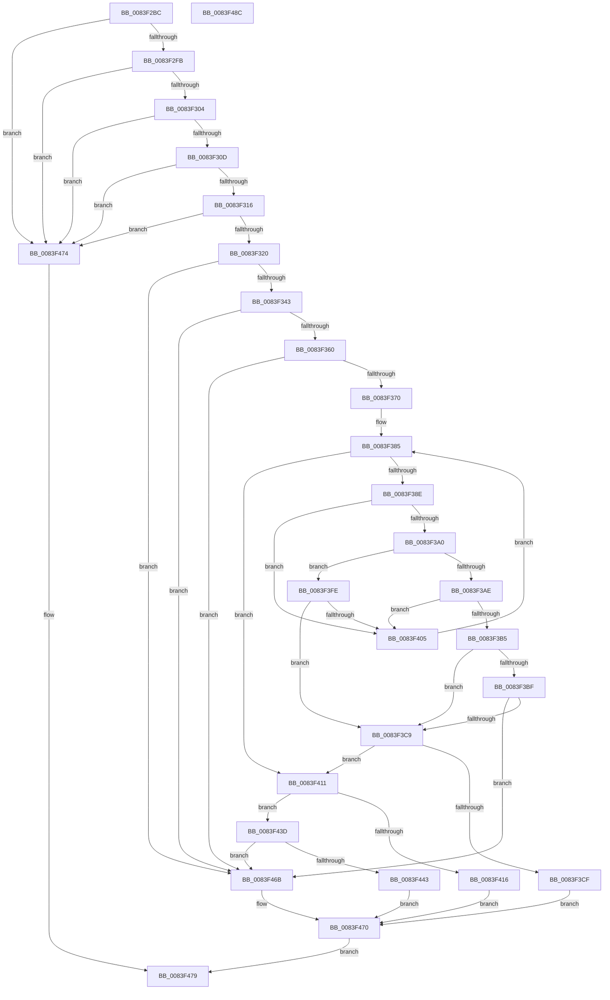

# RtlMuiRegAddLIPParent

- RVA: `0x0083F2BC`–`0x0083F48D` (길이 `465` bytes)
- VA: `0x000000014083F2BC`
- 실행 섹션: `PAGE`
- PDB 이름 있음: `예`; PDB Function 태그: `아니요`
- unwind 정보 RVA: `0x00099F28`
- 디코드: `122`개 명령, `465/465` bytes 표시
- 미해석 바이트: `0` (있으면 어셈블리에 `.byte`로 보존)

> 이 문서는 커널 이미지의 기계어와 PDB 기호를 분석해 생성했습니다. 4번과 5번은 함수 원형과 자료형을 바이너리 사용 방식에서 추정한 C 해석이며 원본 소스 복구 결과는 아닙니다.

## 1. Dependencies

- 직접 호출 지점: **3**; 고유 호출 대상: **3**
- 직접 호출자로 확인된 함수: **1**
- RIP 상대 이미지 참조: **0**

### Outgoing calls
- `0x0083F327` → [RtlInitUnicodeString](../../text/42/RtlInitUnicodeString_function_0042A780.md) (function, `0x0042A780`)
- `0x0083F336` → [RtlCultureNameToLCID](../AA/RtlCultureNameToLCID_function_00AACEF0.md) (function, `0x00AACEF0`)
- `0x0083F351` → [RtlpMuiRegGetOrAddString](RtlpMuiRegGetOrAddString_function_0083E830.md) (function, `0x0083E830`)

### Direct callers
- [RtlpMuiRegInitLIPLanguage](RtlpMuiRegInitLIPLanguage_function_0083F8D8.md) at `0x0083F9F4`
- [RtlpMuiRegInitLIPLanguage](RtlpMuiRegInitLIPLanguage_function_0083F8D8.md) at `0x0083FACD`

### Static image references
- 디코드된 RIP-relative 메모리 참조가 없습니다.

## 2. Other-region calls and transfers

- 다른 실행 섹션으로 향하는 call: **1**
  - `0x0083F327` → [RtlInitUnicodeString](../../text/42/RtlInitUnicodeString_function_0042A780.md) (`PAGE` → `.text`)
- 별도 외부 분기/꼬리 이동을 확인하지 못했습니다.

## 3. Assembly (complete function range)

```asm
0083F2BC  4C 8B DC                        mov r11, rsp
0083F2BF  49 89 5B 10                     mov qword ptr [r11 + 0x10], rbx
0083F2C3  49 89 6B 18                     mov qword ptr [r11 + 0x18], rbp
0083F2C7  56                              push rsi
0083F2C8  57                              push rdi
0083F2C9  41 56                           push r14
0083F2CB  48 83 EC 40                     sub rsp, 0x40
0083F2CF  45 33 F6                        xor r14d, r14d
0083F2D2  41 8B F0                        mov esi, r8d
0083F2D5  83 C8 FF                        or eax, 0xffffffff
0083F2D8  45 89 73 C8                     mov dword ptr [r11 - 0x38], r14d
0083F2DC  66 89 44 24 60                  mov word ptr [rsp + 0x60], ax
0083F2E1  0F 57 C0                        xorps xmm0, xmm0
0083F2E4  49 8B D9                        mov rbx, r9
0083F2E7  48 8B FA                        mov rdi, rdx
0083F2EA  48 8B E9                        mov rbp, rcx
0083F2ED  0F 11 44 24 28                  movups xmmword ptr [rsp + 0x28], xmm0
0083F2F2  48 85 C9                        test rcx, rcx
0083F2F5  0F 84 79 01 00 00               je 0x14083f474
0083F2FB  48 85 D2                        test rdx, rdx
0083F2FE  0F 84 70 01 00 00               je 0x14083f474
0083F304  83 FE 04                        cmp esi, 4
0083F307  0F 83 67 01 00 00               jae 0x14083f474
0083F30D  48 85 DB                        test rbx, rbx
0083F310  0F 84 5E 01 00 00               je 0x14083f474
0083F316  66 45 39 31                     cmp word ptr [r9], r14w
0083F31A  0F 84 54 01 00 00               je 0x14083f474
0083F320  48 8B D3                        mov rdx, rbx
0083F323  49 8D 4B D0                     lea rcx, [r11 - 0x30]
0083F327  E8 54 B4 BE FF                  call 0x14042a780
0083F32C  48 8D 54 24 20                  lea rdx, [rsp + 0x20]
0083F331  48 8D 4C 24 28                  lea rcx, [rsp + 0x28]
0083F336  E8 B5 DB 26 00                  call 0x140aacef0
0083F33B  84 C0                           test al, al
0083F33D  0F 84 28 01 00 00               je 0x14083f46b
0083F343  4C 8D 4C 24 60                  lea r9, [rsp + 0x60]
0083F348  41 B0 01                        mov r8b, 1
0083F34B  48 8B D3                        mov rdx, rbx
0083F34E  48 8B CD                        mov rcx, rbp
0083F351  E8 DA F4 FF FF                  call 0x14083e830
0083F356  8B D0                           mov edx, eax
0083F358  85 C0                           test eax, eax
0083F35A  0F 88 0B 01 00 00               js 0x14083f46b
0083F360  44 0F B7 54 24 60               movzx r10d, word ptr [rsp + 0x60]
0083F366  66 45 85 D2                     test r10w, r10w
0083F36A  0F 88 FB 00 00 00               js 0x14083f46b
0083F370  48 8B 4D 18                     mov rcx, qword ptr [rbp + 0x18]
0083F374  45 8B CE                        mov r9d, r14d
0083F377  44 0F B7 5C 24 20               movzx r11d, word ptr [rsp + 0x20]
0083F37D  4C 8B 41 10                     mov r8, qword ptr [rcx + 0x10]
0083F381  0F B7 49 06                     movzx ecx, word ptr [rcx + 6]
0083F385  44 3B C9                        cmp r9d, ecx
0083F388  0F 8D 83 00 00 00               jge 0x14083f411
0083F38E  41 0F B7 00                     movzx eax, word ptr [r8]
0083F392  BB 24 30 00 00                  mov ebx, 0x3024
0083F397  66 23 C3                        and ax, bx
0083F39A  66 83 F8 20                     cmp ax, 0x20
0083F39E  75 65                           jne 0x14083f405
0083F3A0  41 8D 83 00 F0 FF FF            lea eax, [r11 - 0x1000]
0083F3A7  A9 FF FB FF FF                  test eax, 0xfffffbff
0083F3AC  74 50                           je 0x14083f3fe
0083F3AE  66 45 39 58 04                  cmp word ptr [r8 + 4], r11w
0083F3B3  75 50                           jne 0x14083f405
0083F3B5  41 0F B7 40 06                  movzx eax, word ptr [r8 + 6]
0083F3BA  66 85 C0                        test ax, ax
0083F3BD  78 0A                           js 0x14083f3c9
0083F3BF  66 41 3B C2                     cmp ax, r10w
0083F3C3  0F 85 A2 00 00 00               jne 0x14083f46b
0083F3C9  66 45 85 C9                     test r9w, r9w
0083F3CD  78 42                           js 0x14083f411
0083F3CF  8D 0C 36                        lea ecx, [rsi + rsi]
0083F3D2  41 B8 03 00 00 00               mov r8d, 3
0083F3D8  66 41 D3 E0                     shl r8w, cl
0083F3DC  B8 02 00 00 00                  mov eax, 2
0083F3E1  66 41 F7 D0                     not r8w
0083F3E5  66 D3 E0                        shl ax, cl
0083F3E8  66 44 23 47 08                  and r8w, word ptr [rdi + 8]
0083F3ED  66 44 0B C0                     or r8w, ax
0083F3F1  66 44 89 47 08                  mov word ptr [rdi + 8], r8w
0083F3F6  66 44 89 4C 77 0C               mov word ptr [rdi + rsi*2 + 0xc], r9w
0083F3FC  EB 72                           jmp 0x14083f470
0083F3FE  66 45 39 50 06                  cmp word ptr [r8 + 6], r10w
0083F403  74 C4                           je 0x14083f3c9
0083F405  41 FF C1                        inc r9d
0083F408  49 83 C0 1C                     add r8, 0x1c
0083F40C  E9 74 FF FF FF                  jmp 0x14083f385
0083F411  45 85 DB                        test r11d, r11d
0083F414  74 27                           je 0x14083f43d
0083F416  0F B7 47 08                     movzx eax, word ptr [rdi + 8]
0083F41A  8D 0C 36                        lea ecx, [rsi + rsi]
0083F41D  41 B8 03 00 00 00               mov r8d, 3
0083F423  41 D3 E0                        shl r8d, cl
0083F426  41 F7 D0                        not r8d
0083F429  44 23 C0                        and r8d, eax
0083F42C  41 0F AB C8                     bts r8d, ecx
0083F430  66 44 89 47 08                  mov word ptr [rdi + 8], r8w
0083F435  66 44 89 5C 77 0C               mov word ptr [rdi + rsi*2 + 0xc], r11w
0083F43B  EB 33                           jmp 0x14083f470
0083F43D  66 45 85 D2                     test r10w, r10w
0083F441  7E 28                           jle 0x14083f46b
0083F443  8D 0C 36                        lea ecx, [rsi + rsi]
0083F446  41 B8 03 00 00 00               mov r8d, 3
0083F44C  66 41 D3 E0                     shl r8w, cl
0083F450  41 0F B7 C0                     movzx eax, r8w
0083F454  66 F7 D0                        not ax
0083F457  66 23 47 08                     and ax, word ptr [rdi + 8]
0083F45B  66 41 0B C0                     or ax, r8w
0083F45F  66 89 47 08                     mov word ptr [rdi + 8], ax
0083F463  66 44 89 54 77 0C               mov word ptr [rdi + rsi*2 + 0xc], r10w
0083F469  EB 05                           jmp 0x14083f470
0083F46B  BA 01 00 00 C0                  mov edx, 0xc0000001
0083F470  8B C2                           mov eax, edx
0083F472  EB 05                           jmp 0x14083f479
0083F474  B8 0D 00 00 C0                  mov eax, 0xc000000d
0083F479  48 8B 5C 24 68                  mov rbx, qword ptr [rsp + 0x68]
0083F47E  48 8B 6C 24 70                  mov rbp, qword ptr [rsp + 0x70]
0083F483  48 83 C4 40                     add rsp, 0x40
0083F487  41 5E                           pop r14
0083F489  5F                              pop rdi
0083F48A  5E                              pop rsi
0083F48B  C3                              ret
0083F48C  CC                              int3
```

## 4. C-style interpretation (structured pseudocode)

```c
__int64 __fastcall RtlMuiRegAddLIPParent(__int64 a1, __int64 a2, int a3, __int64 a4)
{
    __int64 result;
    __int64 v_r14;
    __int64 v_rsp;
    unsigned __int64 v_stack_m30;
    unsigned __int64 v_stack_m38;
    unsigned __int64 v_stack_p10;
    unsigned __int64 v_stack_p18;
    unsigned __int16 v_stack_p8;

    *(unsigned __int64 *)(v_rsp + 16) = v_rbx;
    *(unsigned __int64 *)(v_rsp + 24) = v_rbp;
    v_rsp = (v_rsp) - (64);
    v_r14 = 0;
    result = (unsigned int)((result) | (0xFFFFFFFFULL));
    *(unsigned int *)(v_rsp - 56) = 0;
    v_stack_p8 = (unsigned __int16)(result);
    v_stack_m30 = v_xmm0;
    if (a1 == 0) goto loc_0083F474;
    if (a2 == 0) goto loc_0083F474;
    if (((unsigned int)((unsigned int)(a3))) >= 4) goto loc_0083F474;
    if (a4 == 0) goto loc_0083F474;
    if ((*(unsigned __int16 *)(a4)) == 0) goto loc_0083F474;
    result = RtlInitUnicodeString(v_rsp - 48, a4, a3, a4);
    result = RtlCultureNameToLCID(v_stack_m30, v_stack_m38, a3, a4);
    if ((unsigned __int8)(result) == 0) goto loc_0083F46B;
    result = RtlpMuiRegGetOrAddString(a1, a4, 1, v_stack_p8);
    if (sign_flag) goto loc_0083F46B;
    if (sign_flag) goto loc_0083F46B;
loc_0083F385:
    if (0 >= ((unsigned int)(*(unsigned __int16 *)(*(unsigned __int64 *)(a1 + 24) + 6)))) goto loc_0083F411;
    result = (unsigned __int16)((*(unsigned __int16 *)(*(unsigned __int64 *)(*(unsigned __int64 *)(a1 + 24) + 16))) & ((unsigned __int16)((unsigned int)(0x3024ULL))));
    if (((unsigned __int16)(result)) != 32) goto loc_0083F405;
    if ((((unsigned int)(v_stack_m38 - 4096)) & (0xFFFFFBFFULL)) == 0) goto loc_0083F3FE;
    if ((*(unsigned __int16 *)(*(unsigned __int64 *)(*(unsigned __int64 *)(a1 + 24) + 16) + 4)) != ((unsigned __int16)(v_stack_m38))) goto loc_0083F405;
    if (sign_flag) goto loc_0083F3C9;
    if (((unsigned __int16)(*(unsigned __int16 *)(*(unsigned __int64 *)(*(unsigned __int64 *)(a1 + 24) + 16) + 6))) != ((unsigned __int16)(v_stack_p8))) goto loc_0083F46B;
loc_0083F3C9:
    if (sign_flag) goto loc_0083F411;
    a3 = (unsigned __int16)((3) << ((unsigned __int8)((unsigned int)(a3) + (unsigned int)(a3) * 1)));
    a3 = (unsigned __int16)(~(a3));
    result = (unsigned __int16)((2) << ((unsigned __int8)((unsigned int)(a3) + (unsigned int)(a3) * 1)));
    a3 = (unsigned __int16)((a3) & (*(unsigned __int16 *)(a2 + 8)));
    a3 = (unsigned __int16)((a3) | ((unsigned __int16)(result)));
    *(unsigned __int16 *)(a2 + 8) = (unsigned __int16)(a3);
    *(unsigned __int16 *)(a2 + (unsigned int)(a3) * 2 + 12) = 0;
    goto loc_0083F470;
loc_0083F3FE:
    if ((*(unsigned __int16 *)(a3 + 6)) == ((unsigned __int16)(v_stack_p8))) goto loc_0083F3C9;
loc_0083F405:
    a4 = (unsigned int)((0) + 1);
    a3 = (a3) + (28);
    goto loc_0083F385;
loc_0083F411:
    if ((unsigned int)(v_stack_m38) == 0) goto loc_0083F43D;
    a3 = (unsigned int)((3) << ((unsigned __int8)((unsigned int)(a3) + (unsigned int)(a3) * 1)));
    a3 = (unsigned int)(~(a3));
    a3 = (unsigned int)((a3) & ((unsigned int)(*(unsigned __int16 *)(a2 + 8))));
    *(unsigned __int16 *)(a2 + 8) = (unsigned __int16)(a3);
    *(unsigned __int16 *)(a2 + (unsigned int)(a3) * 2 + 12) = (unsigned __int16)(v_stack_m38);
    goto loc_0083F470;
loc_0083F43D:
    if (condition_is_less_or_equal) goto loc_0083F46B;
    a3 = (unsigned __int16)((3) << ((unsigned __int8)((unsigned int)(a3) + (unsigned int)(a3) * 1)));
    result = (unsigned __int16)(~((unsigned __int16)(a3)));
    result = (unsigned __int16)((result) & (*(unsigned __int16 *)(a2 + 8)));
    result = (unsigned __int16)((result) | ((unsigned __int16)(a3)));
    *(unsigned __int16 *)(a2 + 8) = (unsigned __int16)(result);
    *(unsigned __int16 *)(a2 + (unsigned int)(a3) * 2 + 12) = (unsigned __int16)(v_stack_p8);
    goto loc_0083F470;
loc_0083F46B:
loc_0083F470:
    goto loc_0083F479;
loc_0083F474:
loc_0083F479:
    v_rsp = (v_rsp) + (64);
    return (unsigned int)(0xC000000DULL);
}
```

## 5. (Beta) C Style

```c
int64_t RtlMuiRegAddLIPParent(void *Arg1, void *Arg2, int32_t Arg3, void *Arg4)
{
    uint8_t *arg1 = (uint8_t *)Arg1;
    uint8_t *arg2 = (uint8_t *)Arg2;
    uint8_t *arg4 = (uint8_t *)Arg4;

    int64_t result;
    int64_t local_r14;
    int64_t local_rsp;
    uint64_t v_stack_m30;
    uint64_t v_stack_m38;
    uint64_t v_stack_p10;
    uint64_t v_stack_p18;
    uint16_t v_stack_p8;

    *(uint64_t *)(local_rsp + 0x10) = local_rbx;
    *(uint64_t *)(local_rsp + 0x18) = local_rbp;
    local_rsp = (local_rsp) - (64);
    local_r14 = 0;
    result = (uint32_t)((result) | (0xFFFFFFFFULL));
    *(uint32_t *)(local_rsp - 0x38) = 0;
    v_stack_p8 = (uint16_t)(result);
    v_stack_m30 = v_xmm0;
    if (Arg1 == NULL) goto loc_0083F474;
    if (Arg2 == NULL) goto loc_0083F474;
    if (((uint32_t)((uint32_t)(Arg3))) >= 4) goto loc_0083F474;
    if (Arg4 == NULL) goto loc_0083F474;
    if ((*(uint16_t *)(arg4)) == 0) goto loc_0083F474;
    result = RtlInitUnicodeString(local_rsp - 48, Arg4, Arg3, Arg4);
    result = RtlCultureNameToLCID(v_stack_m30, v_stack_m38, Arg3, Arg4);
    if ((uint8_t)(result) == 0) goto loc_0083F46B;
    result = RtlpMuiRegGetOrAddString(Arg1, Arg4, 1, v_stack_p8);
    if (sign_flag) goto loc_0083F46B;
    if (sign_flag) goto loc_0083F46B;
loc_0083F385:
    if (0 >= ((uint32_t)(*(uint16_t *)(*(uint64_t *)(arg1 + 0x18) + 0x6)))) goto loc_0083F411;
    result = (uint16_t)((*(uint16_t *)(*(uint64_t *)(*(uint64_t *)(arg1 + 0x18) + 0x10))) & ((uint16_t)((uint32_t)(0x3024ULL))));
    if (((uint16_t)(result)) != 32) goto loc_0083F405;
    if ((((uint32_t)(v_stack_m38 - 4096)) & (0xFFFFFBFFULL)) == 0) goto loc_0083F3FE;
    if ((*(uint16_t *)(*(uint64_t *)(*(uint64_t *)(arg1 + 0x18) + 0x10) + 0x4)) != ((uint16_t)(v_stack_m38))) goto loc_0083F405;
    if (sign_flag) goto loc_0083F3C9;
    if (((uint16_t)(*(uint16_t *)(*(uint64_t *)(*(uint64_t *)(arg1 + 0x18) + 0x10) + 0x6))) != ((uint16_t)(v_stack_p8))) goto loc_0083F46B;
loc_0083F3C9:
    if (sign_flag) goto loc_0083F411;
    Arg3 = (uint16_t)((3) << ((uint8_t)((uint32_t)(Arg3) + (uint32_t)(Arg3) * 1)));
    Arg3 = (uint16_t)(~(Arg3));
    result = (uint16_t)((2) << ((uint8_t)((uint32_t)(Arg3) + (uint32_t)(Arg3) * 1)));
    Arg3 = (uint16_t)((Arg3) & (*(uint16_t *)(arg2 + 0x8)));
    Arg3 = (uint16_t)((Arg3) | ((uint16_t)(result)));
    *(uint16_t *)(arg2 + 0x8) = (uint16_t)(Arg3);
    *(uint16_t *)(arg2 + (uint32_t)(Arg3) * 2 + 0xC) = 0;
    goto loc_0083F470;
loc_0083F3FE:
    if ((*(uint16_t *)(Arg3 + 0x6)) == ((uint16_t)(v_stack_p8))) goto loc_0083F3C9;
loc_0083F405:
    Arg4 = (uint32_t)((0) + 1);
    Arg3 = (Arg3) + (28);
    goto loc_0083F385;
loc_0083F411:
    if ((uint32_t)(v_stack_m38) == 0) goto loc_0083F43D;
    Arg3 = (uint32_t)((3) << ((uint8_t)((uint32_t)(Arg3) + (uint32_t)(Arg3) * 1)));
    Arg3 = (uint32_t)(~(Arg3));
    Arg3 = (uint32_t)((Arg3) & ((uint32_t)(*(uint16_t *)(arg2 + 0x8))));
    *(uint16_t *)(arg2 + 0x8) = (uint16_t)(Arg3);
    *(uint16_t *)(arg2 + (uint32_t)(Arg3) * 2 + 0xC) = (uint16_t)(v_stack_m38);
    goto loc_0083F470;
loc_0083F43D:
    if (condition_is_less_or_equal) goto loc_0083F46B;
    Arg3 = (uint16_t)((3) << ((uint8_t)((uint32_t)(Arg3) + (uint32_t)(Arg3) * 1)));
    result = (uint16_t)(~((uint16_t)(Arg3)));
    result = (uint16_t)((result) & (*(uint16_t *)(arg2 + 0x8)));
    result = (uint16_t)((result) | ((uint16_t)(Arg3)));
    *(uint16_t *)(arg2 + 0x8) = (uint16_t)(result);
    *(uint16_t *)(arg2 + (uint32_t)(Arg3) * 2 + 0xC) = (uint16_t)(v_stack_p8);
    goto loc_0083F470;
loc_0083F46B:
loc_0083F470:
    goto loc_0083F479;
loc_0083F474:
loc_0083F479:
    local_rsp = (local_rsp) + (64);
    return (uint32_t)(0xC000000DULL);
}
```

### 관측된 메모리 오프셋

구조체 형식이 확인되지 않은 접근은 인자 기준의 오프셋으로만 기록했습니다.

| 기준 인자 | 오프셋 표현 | 폭 (bit) | 접근 |
|---|---:|---:|---|
| `Arg1` | `+ 0x18` | `64` | `R` |
| `Arg2` | `+ 0x8` | `16` | `R` |
| `Arg2` | `+ 0x8` | `16` | `W` |
| `Arg2` | `+ 0xC + rsi*2` | `16` | `W` |
| `Arg4` | `+ 0x0` | `16` | `R` |

## 6. Execution-region graph

[열기: 2D/3D 그래프와 함수 탐색 컨트롤 패널](../../../control-panel.html?section=page&rva=0x0083F2BC&view=graph)

- 2D 그래프는 위에서 아래로 흐르고, 3D 그래프는 빈 공간을 드래그해 회전합니다. Shift+드래그는 이동, 휠은 확대·축소, 함수 노드 선택은 대상 보고서 이동입니다.

### Static fallback


