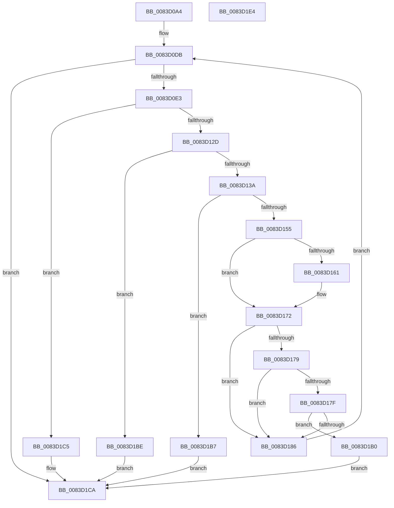

# RtlParseLeapSecondData

- RVA: `0x0083D0A4`–`0x0083D1E5` (길이 `321` bytes)
- VA: `0x000000014083D0A4`
- 실행 섹션: `PAGE`
- PDB 이름 있음: `예`; PDB Function 태그: `아니요`
- unwind 정보 RVA: `0x000DB440`
- 디코드: `92`개 명령, `321/321` bytes 표시
- 미해석 바이트: `0` (있으면 어셈블리에 `.byte`로 보존)

> 이 문서는 커널 이미지의 기계어와 PDB 기호를 분석해 생성했습니다. 4번과 5번은 함수 원형과 자료형을 바이너리 사용 방식에서 추정한 C 해석이며 원본 소스 복구 결과는 아닙니다.

## 1. Dependencies

- 직접 호출 지점: **2**; 고유 호출 대상: **2**
- 직접 호출자로 확인된 함수: **1**
- RIP 상대 이미지 참조: **0**

### Outgoing calls
- `0x0083D120` → [RtlpTimeFieldsToTimeNoLeapSeconds](../../text/42/RtlpTimeFieldsToTimeNoLeapSeconds_function_0042E768.md) (function, `0x0042E768`)
- `0x0083D14C` → [RtlLongLongAdd](../../text/5D/RtlLongLongAdd_function_005D5128.md) (function, `0x005D5128`)

### Direct callers
- [ExpParseAndUpdateLeapSecondData](../7C/ExpParseAndUpdateLeapSecondData_function_007C5DB0.md) at `0x007C5E52`

### Static image references
- 디코드된 RIP-relative 메모리 참조가 없습니다.

## 2. Other-region calls and transfers

- 다른 실행 섹션으로 향하는 call: **2**
  - `0x0083D120` → [RtlpTimeFieldsToTimeNoLeapSeconds](../../text/42/RtlpTimeFieldsToTimeNoLeapSeconds_function_0042E768.md) (`PAGE` → `.text`)
  - `0x0083D14C` → [RtlLongLongAdd](../../text/5D/RtlLongLongAdd_function_005D5128.md) (`PAGE` → `.text`)
- 별도 외부 분기/꼬리 이동을 확인하지 못했습니다.

## 3. Assembly (complete function range)

```asm
0083D0A4  48 89 5C 24 08                  mov qword ptr [rsp + 8], rbx
0083D0A9  89 54 24 10                     mov dword ptr [rsp + 0x10], edx
0083D0AD  55                              push rbp
0083D0AE  56                              push rsi
0083D0AF  57                              push rdi
0083D0B0  41 54                           push r12
0083D0B2  41 55                           push r13
0083D0B4  41 56                           push r14
0083D0B6  41 57                           push r15
0083D0B8  48 8B EC                        mov rbp, rsp
0083D0BB  48 83 EC 40                     sub rsp, 0x40
0083D0BF  33 FF                           xor edi, edi
0083D0C1  4D 8B F1                        mov r14, r9
0083D0C4  48 89 7D E0                     mov qword ptr [rbp - 0x20], rdi
0083D0C8  8B DF                           mov ebx, edi
0083D0CA  41 89 79 04                     mov dword ptr [r9 + 4], edi
0083D0CE  8B F7                           mov esi, edi
0083D0D0  89 7D 58                        mov dword ptr [rbp + 0x58], edi
0083D0D3  4D 8B F8                        mov r15, r8
0083D0D6  8B C2                           mov eax, edx
0083D0D8  4C 8B E1                        mov r12, rcx
0083D0DB  3B F0                           cmp esi, eax
0083D0DD  0F 83 E7 00 00 00               jae 0x14083d1ca
0083D0E3  8B C6                           mov eax, esi
0083D0E5  48 8D 55 E0                     lea rdx, [rbp - 0x20]
0083D0E9  48 8D 4D E8                     lea rcx, [rbp - 0x18]
0083D0ED  48 C7 45 F0 3B 00 3B 00         mov qword ptr [rbp - 0x10], 0x3b003b
0083D0F5  4C 8D 2C 40                     lea r13, [rax + rax*2]
0083D0F9  43 0F B7 04 AC                  movzx eax, word ptr [r12 + r13*4]
0083D0FE  66 89 45 E8                     mov word ptr [rbp - 0x18], ax
0083D102  43 0F B7 44 AC 02               movzx eax, word ptr [r12 + r13*4 + 2]
0083D108  66 89 45 EA                     mov word ptr [rbp - 0x16], ax
0083D10C  43 0F B7 44 AC 04               movzx eax, word ptr [r12 + r13*4 + 4]
0083D112  66 89 45 EC                     mov word ptr [rbp - 0x14], ax
0083D116  43 0F B7 44 AC 06               movzx eax, word ptr [r12 + r13*4 + 6]
0083D11C  66 89 45 EE                     mov word ptr [rbp - 0x12], ax
0083D120  E8 43 16 BF FF                  call 0x14042e768
0083D125  84 C0                           test al, al
0083D127  0F 84 98 00 00 00               je 0x14083d1c5
0083D12D  48 8B 4D E0                     mov rcx, qword ptr [rbp - 0x20]
0083D131  48 3B CB                        cmp rcx, rbx
0083D134  0F 8E 84 00 00 00               jle 0x14083d1be
0083D13A  4C 63 5D 58                     movsxd r11, dword ptr [rbp + 0x58]
0083D13E  4C 8D 45 E0                     lea r8, [rbp - 0x20]
0083D142  49 69 D3 80 96 98 00            imul rdx, r11, 0x989680
0083D149  48 8B D9                        mov rbx, rcx
0083D14C  E8 D7 7F D9 FF                  call 0x1405d5128
0083D151  85 C0                           test eax, eax
0083D153  78 62                           js 0x14083d1b7
0083D155  43 F6 44 AC 08 01               test byte ptr [r12 + r13*4 + 8], 1
0083D15B  48 8B 45 E0                     mov rax, qword ptr [rbp - 0x20]
0083D15F  74 11                           je 0x14083d172
0083D161  48 B9 00 00 00 00 00 00 00 80   movabs rcx, 0x8000000000000000
0083D16B  48 0B C1                        or rax, rcx
0083D16E  48 89 45 E0                     mov qword ptr [rbp - 0x20], rax
0083D172  8B CE                           mov ecx, esi
0083D174  4D 85 FF                        test r15, r15
0083D177  74 0D                           je 0x14083d186
0083D179  41 3B 77 04                     cmp esi, dword ptr [r15 + 4]
0083D17D  73 07                           jae 0x14083d186
0083D17F  49 3B 44 CF 08                  cmp rax, qword ptr [r15 + rcx*8 + 8]
0083D184  75 2A                           jne 0x14083d1b0
0083D186  49 89 44 CE 08                  mov qword ptr [r14 + rcx*8 + 8], rax
0083D18B  FF C6                           inc esi
0083D18D  41 FF 46 04                     inc dword ptr [r14 + 4]
0083D191  43 0F B7 44 AC 08               movzx eax, word ptr [r12 + r13*4 + 8]
0083D197  66 F7 D0                        not ax
0083D19A  83 E0 01                        and eax, 1
0083D19D  45 8D 1C 43                     lea r11d, [r11 + rax*2]
0083D1A1  8B 45 48                        mov eax, dword ptr [rbp + 0x48]
0083D1A4  41 FF CB                        dec r11d
0083D1A7  44 89 5D 58                     mov dword ptr [rbp + 0x58], r11d
0083D1AB  E9 2B FF FF FF                  jmp 0x14083d0db
0083D1B0  BF 06 00 00 00                  mov edi, 6
0083D1B5  EB 13                           jmp 0x14083d1ca
0083D1B7  BF 07 00 00 00                  mov edi, 7
0083D1BC  EB 0C                           jmp 0x14083d1ca
0083D1BE  BF 05 00 00 00                  mov edi, 5
0083D1C3  EB 05                           jmp 0x14083d1ca
0083D1C5  BF 04 00 00 00                  mov edi, 4
0083D1CA  48 8B 9C 24 80 00 00 00         mov rbx, qword ptr [rsp + 0x80]
0083D1D2  8B C7                           mov eax, edi
0083D1D4  48 83 C4 40                     add rsp, 0x40
0083D1D8  41 5F                           pop r15
0083D1DA  41 5E                           pop r14
0083D1DC  41 5D                           pop r13
0083D1DE  41 5C                           pop r12
0083D1E0  5F                              pop rdi
0083D1E1  5E                              pop rsi
0083D1E2  5D                              pop rbp
0083D1E3  C3                              ret
0083D1E4  CC                              int3
```

## 4. C-style interpretation (structured pseudocode)

```c
__int64 __fastcall RtlParseLeapSecondData(__int64 a1, int a2, __int64 a3, __int64 a4)
{
    __int64 result;
    __int64 v_r11;
    __int64 v_rdi;
    __int64 v_rsi;
    __int64 v_rsp;
    unsigned __int64 v_stack_m48;
    unsigned __int16 v_stack_m4A;
    unsigned __int16 v_stack_m4C;
    unsigned __int16 v_stack_m4E;
    unsigned __int64 v_stack_m50;
    unsigned __int64 v_stack_m58;
    unsigned int v_stack_p10;
    unsigned int v_stack_p20;
    unsigned __int64 v_stack_p8;

    v_stack_p8 = v_rbx;
    v_stack_p10 = a2;
    v_rsp = (v_rsp) - (64);
    v_rdi = 0;
    v_stack_m58 = 0;
    *(unsigned int *)(a4 + 4) = 0;
    v_stack_p20 = 0;
loc_0083D0DB:
    if (0 >= ((unsigned int)((unsigned int)(a2)))) goto loc_0083D1CA;
    v_stack_m48 = 0x3B003BULL;
    v_stack_m50 = (unsigned __int16)(*(unsigned __int16 *)(a1 + 0 + 0 * 2 * 4));
    v_stack_m4E = (unsigned __int16)(*(unsigned __int16 *)(a1 + 0 + 0 * 2 * 4 + 2));
    v_stack_m4C = (unsigned __int16)(*(unsigned __int16 *)(a1 + 0 + 0 * 2 * 4 + 4));
    v_stack_m4A = (unsigned __int16)(*(unsigned __int16 *)(a1 + 0 + 0 * 2 * 4 + 6));
    result = RtlpTimeFieldsToTimeNoLeapSeconds(v_stack_m50, v_stack_m58, a3, a4);
    if ((unsigned __int8)(result) == 0) goto loc_0083D1C5;
    if (v_stack_m58 <= 0) goto loc_0083D1BE;
    a2 = (v_stack_m58) * ((int)(v_stack_p20));
    result = RtlLongLongAdd(v_stack_m58, a2, v_stack_m58, a4);
    if (sign_flag) goto loc_0083D1B7;
    result = v_stack_m58;
    if (((*(unsigned __int8 *)(a1 + 0 + 0 * 2 * 4 + 8)) & (1)) != 0) {
        result = (v_stack_m58) | (v_stack_m58);
        v_stack_m58 = result;
    }
    if (a3 == 0) goto loc_0083D186;
    if (0 >= (*(unsigned int *)(a3 + 4))) goto loc_0083D186;
    if (result != (*(unsigned __int64 *)(a3 + 0 * 8 + 8))) goto loc_0083D1B0;
loc_0083D186:
    *(unsigned __int64 *)(a4 + 0 * 8 + 8) = result;
    v_rsi = (unsigned int)((0) + 1);
    result = (unsigned __int16)(~(*(unsigned __int16 *)(a1 + 0 + 0 * 2 * 4 + 8)));
    result = (unsigned int)((result) & (1));
    v_r11 = (unsigned int)(((int)(v_stack_p20) + result * 2) - 1);
    v_stack_p20 = (unsigned int)(v_r11);
    goto loc_0083D0DB;
loc_0083D1B0:
    goto loc_0083D1CA;
loc_0083D1B7:
    goto loc_0083D1CA;
loc_0083D1BE:
    goto loc_0083D1CA;
loc_0083D1C5:
loc_0083D1CA:
    v_rsp = (v_rsp) + (64);
    return 4;
}
```

## 5. (Beta) C Style

```c
int64_t RtlParseLeapSecondData(void *Arg1, int32_t Arg2, int64_t Arg3, void *Arg4)
{
    uint8_t *arg1 = (uint8_t *)Arg1;
    uint8_t *arg4 = (uint8_t *)Arg4;

    int64_t result;
    int64_t local_r11;
    int64_t local_rdi;
    int64_t local_rsi;
    int64_t local_rsp;
    uint64_t v_stack_m48;
    uint16_t v_stack_m4A;
    uint16_t v_stack_m4C;
    uint16_t v_stack_m4E;
    uint64_t v_stack_m50;
    uint64_t v_stack_m58;
    uint32_t v_stack_p10;
    uint32_t v_stack_p20;
    uint64_t v_stack_p8;

    v_stack_p8 = local_rbx;
    v_stack_p10 = Arg2;
    local_rsp = (local_rsp) - (64);
    local_rdi = 0;
    v_stack_m58 = 0;
    *(uint32_t *)(arg4 + 0x4) = 0;
    v_stack_p20 = 0;
loc_0083D0DB:
    if (0 >= ((uint32_t)((uint32_t)(Arg2)))) goto loc_0083D1CA;
    v_stack_m48 = 0x3B003BULL;
    v_stack_m50 = (uint16_t)(*(uint16_t *)(arg1 + 0x0 + 0x0 * 2 * 4));
    v_stack_m4E = (uint16_t)(*(uint16_t *)(arg1 + 0x0 + 0x0 * 2 * 4 + 0x2));
    v_stack_m4C = (uint16_t)(*(uint16_t *)(arg1 + 0x0 + 0x0 * 2 * 4 + 0x4));
    v_stack_m4A = (uint16_t)(*(uint16_t *)(arg1 + 0x0 + 0x0 * 2 * 4 + 0x6));
    result = RtlpTimeFieldsToTimeNoLeapSeconds(v_stack_m50, v_stack_m58, Arg3, Arg4);
    if ((uint8_t)(result) == 0) goto loc_0083D1C5;
    if (v_stack_m58 <= 0) goto loc_0083D1BE;
    Arg2 = (v_stack_m58) * ((int32_t)(v_stack_p20));
    result = RtlLongLongAdd(v_stack_m58, Arg2, v_stack_m58, Arg4);
    if (sign_flag) goto loc_0083D1B7;
    result = v_stack_m58;
    if (((*(uint8_t *)(arg1 + 0x0 + 0x0 * 2 * 4 + 0x8)) & (1)) != 0) {
        result = (v_stack_m58) | (v_stack_m58);
        v_stack_m58 = result;
    }
    if (Arg3 == 0) goto loc_0083D186;
    if (0 >= (*(uint32_t *)(Arg3 + 0x4))) goto loc_0083D186;
    if (result != (*(uint64_t *)(Arg3 + 0x0 * 8 + 0x8))) goto loc_0083D1B0;
loc_0083D186:
    *(uint64_t *)(arg4 + 0x0 * 8 + 0x8) = result;
    local_rsi = (uint32_t)((0) + 1);
    result = (uint16_t)(~(*(uint16_t *)(arg1 + 0x0 + 0x0 * 2 * 4 + 0x8)));
    result = (uint32_t)((result) & (1));
    local_r11 = (uint32_t)(((int32_t)(v_stack_p20) + result * 2) - 1);
    v_stack_p20 = (uint32_t)(local_r11);
    goto loc_0083D0DB;
loc_0083D1B0:
    goto loc_0083D1CA;
loc_0083D1B7:
    goto loc_0083D1CA;
loc_0083D1BE:
    goto loc_0083D1CA;
loc_0083D1C5:
loc_0083D1CA:
    local_rsp = (local_rsp) + (64);
    return 4;
}
```

### 관측된 메모리 오프셋

구조체 형식이 확인되지 않은 접근은 인자 기준의 오프셋으로만 기록했습니다.

| 기준 인자 | 오프셋 표현 | 폭 (bit) | 접근 |
|---|---:|---:|---|
| `Arg1` | `+ 0x0 + r13*4` | `16` | `R` |
| `Arg1` | `+ 0x2 + r13*4` | `16` | `R` |
| `Arg1` | `+ 0x4 + r13*4` | `16` | `R` |
| `Arg1` | `+ 0x6 + r13*4` | `16` | `R` |
| `Arg1` | `+ 0x8 + r13*4` | `8` | `R` |
| `Arg1` | `+ 0x8 + r13*4` | `16` | `R` |
| `Arg4` | `+ 0x4` | `32` | `R/W` |
| `Arg4` | `+ 0x4` | `32` | `W` |
| `Arg4` | `+ 0x8 + rcx*8` | `64` | `W` |

## 6. Execution-region graph

[열기: 2D/3D 그래프와 함수 탐색 컨트롤 패널](../../../control-panel.html?section=page&rva=0x0083D0A4&view=graph)

- 2D 그래프는 위에서 아래로 흐르고, 3D 그래프는 빈 공간을 드래그해 회전합니다. Shift+드래그는 이동, 휠은 확대·축소, 함수 노드 선택은 대상 보고서 이동입니다.

### Static fallback


