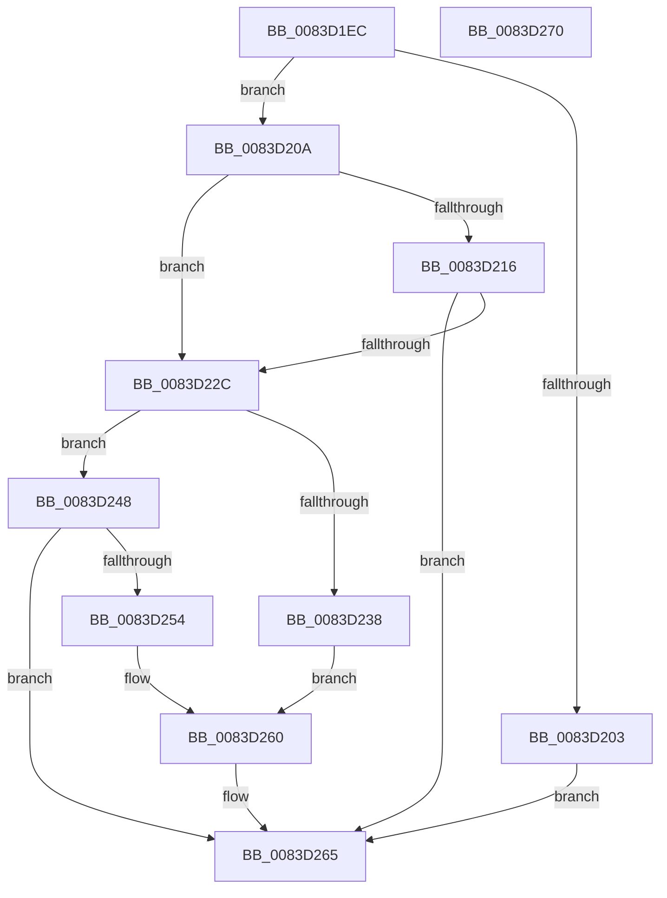

# RtlpIsALicensedRegularLanguage

- RVA: `0x0083D1EC`–`0x0083D271` (길이 `133` bytes)
- VA: `0x000000014083D1EC`
- 실행 섹션: `PAGE`
- PDB 이름 있음: `예`; PDB Function 태그: `아니요`
- unwind 정보 RVA: `0x000C8D8C`
- 디코드: `43`개 명령, `133/133` bytes 표시
- 미해석 바이트: `0` (있으면 어셈블리에 `.byte`로 보존)

> 이 문서는 커널 이미지의 기계어와 PDB 기호를 분석해 생성했습니다. 4번과 5번은 함수 원형과 자료형을 바이너리 사용 방식에서 추정한 C 해석이며 원본 소스 복구 결과는 아닙니다.

## 1. Dependencies

- 직접 호출 지점: **3**; 고유 호출 대상: **1**
- 직접 호출자로 확인된 함수: **2**
- RIP 상대 이미지 참조: **0**

### Outgoing calls
- `0x0083D216` → [RtlpLangNameInMultiSzString](../79/RtlpLangNameInMultiSzString_function_00791AE8.md) (function, `0x00791AE8`)
- `0x0083D23B` → [RtlpLangNameInMultiSzString](../79/RtlpLangNameInMultiSzString_function_00791AE8.md) (function, `0x00791AE8`)
- `0x0083D257` → [RtlpLangNameInMultiSzString](../79/RtlpLangNameInMultiSzString_function_00791AE8.md) (function, `0x00791AE8`)

### Direct callers
- [RtlpMuiRegAddLanguageByName](RtlpMuiRegAddLanguageByName_function_0083D748.md) at `0x0083D86D`
- [RtlpMuiRegValidateInstalled](../84/RtlpMuiRegValidateInstalled_function_008404D4.md) at `0x008406C2`

### Static image references
- 디코드된 RIP-relative 메모리 참조가 없습니다.

## 2. Other-region calls and transfers

- 다른 실행 섹션으로 향하는 call: **0**
- 별도 외부 분기/꼬리 이동을 확인하지 못했습니다.

## 3. Assembly (complete function range)

```asm
0083D1EC  48 89 74 24 08                  mov qword ptr [rsp + 8], rsi
0083D1F1  57                              push rdi
0083D1F2  48 83 EC 20                     sub rsp, 0x20
0083D1F6  33 C0                           xor eax, eax
0083D1F8  48 8B F2                        mov rsi, rdx
0083D1FB  48 8B F9                        mov rdi, rcx
0083D1FE  48 85 C9                        test rcx, rcx
0083D201  75 07                           jne 0x14083d20a
0083D203  B8 34 00 00 C0                  mov eax, 0xc0000034
0083D208  EB 5B                           jmp 0x14083d265
0083D20A  48 8B 89 88 00 00 00            mov rcx, qword ptr [rcx + 0x88]
0083D211  48 85 C9                        test rcx, rcx
0083D214  74 16                           je 0x14083d22c
0083D216  E8 CD 48 F5 FF                  call 0x140791ae8
0083D21B  8A C8                           mov cl, al
0083D21D  F6 D8                           neg al
0083D21F  1B C0                           sbb eax, eax
0083D221  F7 D0                           not eax
0083D223  25 34 00 00 C0                  and eax, 0xc0000034
0083D228  84 C9                           test cl, cl
0083D22A  74 39                           je 0x14083d265
0083D22C  48 8B 8F 80 00 00 00            mov rcx, qword ptr [rdi + 0x80]
0083D233  48 85 C9                        test rcx, rcx
0083D236  74 10                           je 0x14083d248
0083D238  48 8B D6                        mov rdx, rsi
0083D23B  E8 A8 48 F5 FF                  call 0x140791ae8
0083D240  F6 D8                           neg al
0083D242  1B C0                           sbb eax, eax
0083D244  F7 D0                           not eax
0083D246  EB 18                           jmp 0x14083d260
0083D248  48 8B 8F 98 00 00 00            mov rcx, qword ptr [rdi + 0x98]
0083D24F  48 85 C9                        test rcx, rcx
0083D252  74 11                           je 0x14083d265
0083D254  48 8B D6                        mov rdx, rsi
0083D257  E8 8C 48 F5 FF                  call 0x140791ae8
0083D25C  F6 D8                           neg al
0083D25E  1B C0                           sbb eax, eax
0083D260  25 34 00 00 C0                  and eax, 0xc0000034
0083D265  48 8B 74 24 30                  mov rsi, qword ptr [rsp + 0x30]
0083D26A  48 83 C4 20                     add rsp, 0x20
0083D26E  5F                              pop rdi
0083D26F  C3                              ret
0083D270  CC                              int3
```

## 4. C-style interpretation (structured pseudocode)

```c
__int64 __fastcall RtlpIsALicensedRegularLanguage(__int64 a1, __int64 a2)
{
    __int64 result;
    __int64 v_rsp;
    unsigned __int64 v_stack_p8;

    v_stack_p8 = v_rsi;
    v_rsp = (v_rsp) - (32);
    result = 0;
    if (a1 != 0) goto loc_0083D20A;
    goto loc_0083D265;
loc_0083D20A:
    if (*(unsigned __int64 *)(a1 + 136) == 0) goto loc_0083D22C;
    result = RtlpLangNameInMultiSzString(*(unsigned __int64 *)(a1 + 136), a2, a3, a4);
    result = (unsigned __int8)(-(result));
    result = (unsigned int)(~(result));
    result = (unsigned int)((result) & (0xC0000034ULL));
    if ((unsigned __int8)((unsigned __int8)(result)) == 0) goto loc_0083D265;
loc_0083D22C:
    if (*(unsigned __int64 *)(a1 + 128) == 0) goto loc_0083D248;
    result = RtlpLangNameInMultiSzString(*(unsigned __int64 *)(a1 + 128), a2, a3, a4);
    result = (unsigned __int8)(-(result));
    result = (unsigned int)(~(result));
    goto loc_0083D260;
loc_0083D248:
    if (*(unsigned __int64 *)(a1 + 152) == 0) goto loc_0083D265;
    result = RtlpLangNameInMultiSzString(*(unsigned __int64 *)(a1 + 152), a2, a3, a4);
    result = (unsigned __int8)(-(result));
loc_0083D260:
    result = (unsigned int)((result) & (0xC0000034ULL));
loc_0083D265:
    v_rsp = (v_rsp) + (32);
    return result;
}
```

## 5. (Beta) C Style

```c
int64_t RtlpIsALicensedRegularLanguage(void *Arg1, int64_t Arg2)
{
    uint8_t *arg1 = (uint8_t *)Arg1;

    int64_t result;
    int64_t local_rsp;
    uint64_t v_stack_p8;

    v_stack_p8 = local_rsi;
    local_rsp = (local_rsp) - (32);
    result = 0;
    if (Arg1 != NULL) goto loc_0083D20A;
    goto loc_0083D265;
loc_0083D20A:
    if (*(uint64_t *)(arg1 + 0x88) == 0) goto loc_0083D22C;
    result = RtlpLangNameInMultiSzString(*(uint64_t *)(arg1 + 0x88), Arg2, a3, a4);
    result = (uint8_t)(-(result));
    result = (uint32_t)(~(result));
    result = (uint32_t)((result) & (0xC0000034ULL));
    if ((uint8_t)((uint8_t)(result)) == 0) goto loc_0083D265;
loc_0083D22C:
    if (*(uint64_t *)(arg1 + 0x80) == 0) goto loc_0083D248;
    result = RtlpLangNameInMultiSzString(*(uint64_t *)(arg1 + 0x80), Arg2, a3, a4);
    result = (uint8_t)(-(result));
    result = (uint32_t)(~(result));
    goto loc_0083D260;
loc_0083D248:
    if (*(uint64_t *)(arg1 + 0x98) == 0) goto loc_0083D265;
    result = RtlpLangNameInMultiSzString(*(uint64_t *)(arg1 + 0x98), Arg2, a3, a4);
    result = (uint8_t)(-(result));
loc_0083D260:
    result = (uint32_t)((result) & (0xC0000034ULL));
loc_0083D265:
    local_rsp = (local_rsp) + (32);
    return result;
}
```

### 관측된 메모리 오프셋

구조체 형식이 확인되지 않은 접근은 인자 기준의 오프셋으로만 기록했습니다.

| 기준 인자 | 오프셋 표현 | 폭 (bit) | 접근 |
|---|---:|---:|---|
| `Arg1` | `+ 0x80` | `64` | `R` |
| `Arg1` | `+ 0x98` | `64` | `R` |

## 6. Execution-region graph

[열기: 2D/3D 그래프와 함수 탐색 컨트롤 패널](../../../control-panel.html?section=page&rva=0x0083D1EC&view=graph)

- 2D 그래프는 위에서 아래로 흐르고, 3D 그래프는 빈 공간을 드래그해 회전합니다. Shift+드래그는 이동, 휠은 확대·축소, 함수 노드 선택은 대상 보고서 이동입니다.

### Static fallback


