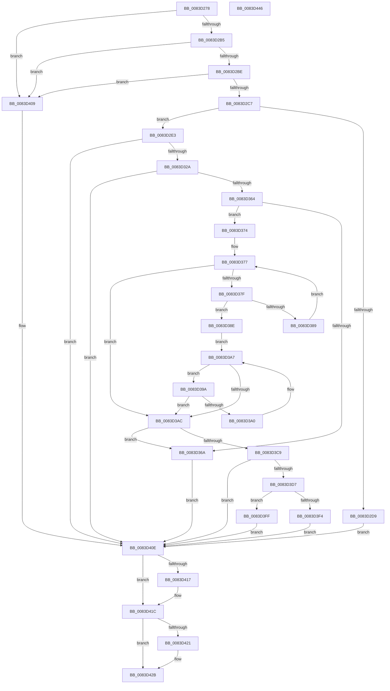

# RtlpLoadInstallLanguageFallback

- RVA: `0x0083D278`–`0x0083D447` (길이 `463` bytes)
- VA: `0x000000014083D278`
- 실행 섹션: `PAGE`
- PDB 이름 있음: `예`; PDB Function 태그: `아니요`
- unwind 정보 RVA: `0x000C3D9C`
- 디코드: `133`개 명령, `463/463` bytes 표시
- 미해석 바이트: `0` (있으면 어셈블리에 `.byte`로 보존)

> 이 문서는 커널 이미지의 기계어와 PDB 기호를 분석해 생성했습니다. 4번과 5번은 함수 원형과 자료형을 바이너리 사용 방식에서 추정한 C 해석이며 원본 소스 복구 결과는 아닙니다.

## 1. Dependencies

- 직접 호출 지점: **12**; 고유 호출 대상: **8**
- 직접 호출자로 확인된 함수: **2**
- RIP 상대 이미지 참조: **2**

### Outgoing calls
- `0x0083D2CC` → [_MuiRegAllocArray](../../text/6A/_MuiRegAllocArray_function_006A9418.md) (function, `0x006A9418`)
- `0x0083D2F0` → [memset](../../text/6C/memset_function_006C6C40.md) (function, `0x006C6C40`)
- `0x0083D30C` → [RtlInitUnicodeString](../../text/42/RtlInitUnicodeString_function_0042A780.md) (function, `0x0042A780`)
- `0x0083D31B` → [LdrpOpenKey](../79/LdrpOpenKey_function_00791984.md) (function, `0x00791984`)
- `0x0083D335` → [RtlInitUnicodeString](../../text/42/RtlInitUnicodeString_function_0042A780.md) (function, `0x0042A780`)
- `0x0083D355` → [LdrpQueryValueKey](../79/LdrpQueryValueKey_function_007919D0.md) (function, `0x007919D0`)
- `0x0083D3B3` → [RtlInitUnicodeString](../../text/42/RtlInitUnicodeString_function_0042A780.md) (function, `0x0042A780`)
- `0x0083D3C0` → [RtlCultureNameToLCID](../AA/RtlCultureNameToLCID_function_00AACEF0.md) (function, `0x00AACEF0`)
- `0x0083D3DE` → [RtlInitUnicodeString](../../text/42/RtlInitUnicodeString_function_0042A780.md) (function, `0x0042A780`)
- `0x0083D3EB` → [RtlCultureNameToLCID](../AA/RtlCultureNameToLCID_function_00AACEF0.md) (function, `0x00AACEF0`)
- `0x0083D417` → [ZwClose](../../text/6A/ZwClose_function_006AD2B0.md) (function, `0x006AD2B0`)
- `0x0083D426` → [ExFreePoolWithTag](../../poolcode/B8/ExFreePoolWithTag_function_00B82870.md) (function, `0x00B82870`)

### Direct callers
- [RtlpMuiRegLoadInstalled](RtlpMuiRegLoadInstalled_function_0083FB1C.md) at `0x0083FB8A`
- [RtlpMuiRegPopulateBaseLanguages](RtlpMuiRegPopulateBaseLanguages_function_0083FC4C.md) at `0x0083FD2E`

### Static image references
- `0x0083D2F9` → RVA `0x00B0E470` (` ?? ::NNGAKEGL::`string'`; read)
- `0x0083D32A` → RVA `0x00B0E440` (` ?? ::NNGAKEGL::`string'`; read)

## 2. Other-region calls and transfers

- 다른 실행 섹션으로 향하는 call: **8**
  - `0x0083D2CC` → [_MuiRegAllocArray](../../text/6A/_MuiRegAllocArray_function_006A9418.md) (`PAGE` → `.text`)
  - `0x0083D2F0` → [memset](../../text/6C/memset_function_006C6C40.md) (`PAGE` → `.text`)
  - `0x0083D30C` → [RtlInitUnicodeString](../../text/42/RtlInitUnicodeString_function_0042A780.md) (`PAGE` → `.text`)
  - `0x0083D335` → [RtlInitUnicodeString](../../text/42/RtlInitUnicodeString_function_0042A780.md) (`PAGE` → `.text`)
  - `0x0083D3B3` → [RtlInitUnicodeString](../../text/42/RtlInitUnicodeString_function_0042A780.md) (`PAGE` → `.text`)
  - `0x0083D3DE` → [RtlInitUnicodeString](../../text/42/RtlInitUnicodeString_function_0042A780.md) (`PAGE` → `.text`)
  - `0x0083D417` → [ZwClose](../../text/6A/ZwClose_function_006AD2B0.md) (`PAGE` → `.text`)
  - `0x0083D426` → [ExFreePoolWithTag](../../poolcode/B8/ExFreePoolWithTag_function_00B82870.md) (`PAGE` → `POOLCODE`)
- 별도 외부 분기/꼬리 이동을 확인하지 못했습니다.

## 3. Assembly (complete function range)

```asm
0083D278  48 89 5C 24 10                  mov qword ptr [rsp + 0x10], rbx
0083D27D  48 89 74 24 18                  mov qword ptr [rsp + 0x18], rsi
0083D282  55                              push rbp
0083D283  57                              push rdi
0083D284  41 54                           push r12
0083D286  41 56                           push r14
0083D288  41 57                           push r15
0083D28A  48 8B EC                        mov rbp, rsp
0083D28D  48 83 EC 50                     sub rsp, 0x50
0083D291  45 33 E4                        xor r12d, r12d
0083D294  0F 57 C0                        xorps xmm0, xmm0
0083D297  4C 89 65 E8                     mov qword ptr [rbp - 0x18], r12
0083D29B  4D 8B F8                        mov r15, r8
0083D29E  44 89 65 30                     mov dword ptr [rbp + 0x30], r12d
0083D2A2  4C 8B F2                        mov r14, rdx
0083D2A5  41 8B F4                        mov esi, r12d
0083D2A8  0F 11 45 F0                     movups xmmword ptr [rbp - 0x10], xmm0
0083D2AC  48 85 C9                        test rcx, rcx
0083D2AF  0F 84 54 01 00 00               je 0x14083d409
0083D2B5  48 85 D2                        test rdx, rdx
0083D2B8  0F 84 4B 01 00 00               je 0x14083d409
0083D2BE  4D 85 C0                        test r8, r8
0083D2C1  0F 84 42 01 00 00               je 0x14083d409
0083D2C7  BA AC 00 00 00                  mov edx, 0xac
0083D2CC  E8 47 C1 E6 FF                  call 0x1406a9418
0083D2D1  48 8B F0                        mov rsi, rax
0083D2D4  48 85 C0                        test rax, rax
0083D2D7  75 0A                           jne 0x14083d2e3
0083D2D9  BB 17 00 00 C0                  mov ebx, 0xc0000017
0083D2DE  E9 2B 01 00 00                  jmp 0x14083d40e
0083D2E3  BF 58 01 00 00                  mov edi, 0x158
0083D2E8  33 D2                           xor edx, edx
0083D2EA  44 8B C7                        mov r8d, edi
0083D2ED  48 8B CE                        mov rcx, rsi
0083D2F0  E8 4B 99 E8 FF                  call 0x1406c6c40
0083D2F5  66 45 89 26                     mov word ptr [r14], r12w
0083D2F9  48 8D 15 70 11 2D 00            lea rdx, [rip + 0x2d1170]
0083D300  48 8D 4D F0                     lea rcx, [rbp - 0x10]
0083D304  44 89 65 48                     mov dword ptr [rbp + 0x48], r12d
0083D308  66 45 89 27                     mov word ptr [r15], r12w
0083D30C  E8 6F D4 BE FF                  call 0x14042a780
0083D311  4C 8D 4D E8                     lea r9, [rbp - 0x18]
0083D315  33 D2                           xor edx, edx
0083D317  48 8D 4D F0                     lea rcx, [rbp - 0x10]
0083D31B  E8 64 46 F5 FF                  call 0x140791984
0083D320  8B D8                           mov ebx, eax
0083D322  85 C0                           test eax, eax
0083D324  0F 88 E4 00 00 00               js 0x14083d40e
0083D32A  48 8D 15 0F 11 2D 00            lea rdx, [rip + 0x2d110f]
0083D331  48 8D 4D F0                     lea rcx, [rbp - 0x10]
0083D335  E8 46 D4 BE FF                  call 0x14042a780
0083D33A  48 8B 4D E8                     mov rcx, qword ptr [rbp - 0x18]
0083D33E  48 8D 45 E0                     lea rax, [rbp - 0x20]
0083D342  4C 8B CE                        mov r9, rsi
0083D345  48 89 44 24 20                  mov qword ptr [rsp + 0x20], rax
0083D34A  4C 8D 45 48                     lea r8, [rbp + 0x48]
0083D34E  89 7D E0                        mov dword ptr [rbp - 0x20], edi
0083D351  48 8D 55 F0                     lea rdx, [rbp - 0x10]
0083D355  E8 76 46 F5 FF                  call 0x1407919d0
0083D35A  8B D8                           mov ebx, eax
0083D35C  85 C0                           test eax, eax
0083D35E  0F 88 AA 00 00 00               js 0x14083d40e
0083D364  83 7D 48 01                     cmp dword ptr [rbp + 0x48], 1
0083D368  74 0A                           je 0x14083d374
0083D36A  BB 01 00 00 C0                  mov ebx, 0xc0000001
0083D36F  E9 9A 00 00 00                  jmp 0x14083d40e
0083D374  48 8B FE                        mov rdi, rsi
0083D377  0F B7 07                        movzx eax, word ptr [rdi]
0083D37A  66 85 C0                        test ax, ax
0083D37D  74 2D                           je 0x14083d3ac
0083D37F  48 8D 4F 02                     lea rcx, [rdi + 2]
0083D383  66 83 F8 2C                     cmp ax, 0x2c
0083D387  74 05                           je 0x14083d38e
0083D389  48 8B F9                        mov rdi, rcx
0083D38C  EB E9                           jmp 0x14083d377
0083D38E  66 44 89 27                     mov word ptr [rdi], r12w
0083D392  48 8B F9                        mov rdi, rcx
0083D395  0F B7 01                        movzx eax, word ptr [rcx]
0083D398  EB 0D                           jmp 0x14083d3a7
0083D39A  66 83 F8 20                     cmp ax, 0x20
0083D39E  75 0C                           jne 0x14083d3ac
0083D3A0  48 83 C7 02                     add rdi, 2
0083D3A4  0F B7 07                        movzx eax, word ptr [rdi]
0083D3A7  66 85 C0                        test ax, ax
0083D3AA  75 EE                           jne 0x14083d39a
0083D3AC  48 8B D6                        mov rdx, rsi
0083D3AF  48 8D 4D F0                     lea rcx, [rbp - 0x10]
0083D3B3  E8 C8 D3 BE FF                  call 0x14042a780
0083D3B8  48 8D 55 30                     lea rdx, [rbp + 0x30]
0083D3BC  48 8D 4D F0                     lea rcx, [rbp - 0x10]
0083D3C0  E8 2B FB 26 00                  call 0x140aacef0
0083D3C5  84 C0                           test al, al
0083D3C7  74 A1                           je 0x14083d36a
0083D3C9  0F B7 45 30                     movzx eax, word ptr [rbp + 0x30]
0083D3CD  66 41 89 06                     mov word ptr [r14], ax
0083D3D1  66 44 39 27                     cmp word ptr [rdi], r12w
0083D3D5  74 37                           je 0x14083d40e
0083D3D7  48 8B D7                        mov rdx, rdi
0083D3DA  48 8D 4D F0                     lea rcx, [rbp - 0x10]
0083D3DE  E8 9D D3 BE FF                  call 0x14042a780
0083D3E3  48 8D 55 30                     lea rdx, [rbp + 0x30]
0083D3E7  48 8D 4D F0                     lea rcx, [rbp - 0x10]
0083D3EB  E8 00 FB 26 00                  call 0x140aacef0
0083D3F0  84 C0                           test al, al
0083D3F2  75 0B                           jne 0x14083d3ff
0083D3F4  BB 01 00 00 C0                  mov ebx, 0xc0000001
0083D3F9  66 45 89 26                     mov word ptr [r14], r12w
0083D3FD  EB 0F                           jmp 0x14083d40e
0083D3FF  0F B7 45 30                     movzx eax, word ptr [rbp + 0x30]
0083D403  66 41 89 07                     mov word ptr [r15], ax
0083D407  EB 05                           jmp 0x14083d40e
0083D409  BB 0D 00 00 C0                  mov ebx, 0xc000000d
0083D40E  48 8B 4D E8                     mov rcx, qword ptr [rbp - 0x18]
0083D412  48 85 C9                        test rcx, rcx
0083D415  74 05                           je 0x14083d41c
0083D417  E8 94 FE E6 FF                  call 0x1406ad2b0
0083D41C  48 85 F6                        test rsi, rsi
0083D41F  74 0A                           je 0x14083d42b
0083D421  33 D2                           xor edx, edx
0083D423  48 8B CE                        mov rcx, rsi
0083D426  E8 45 54 34 00                  call 0x140b82870
0083D42B  4C 8D 5C 24 50                  lea r11, [rsp + 0x50]
0083D430  8B C3                           mov eax, ebx
0083D432  49 8B 5B 38                     mov rbx, qword ptr [r11 + 0x38]
0083D436  49 8B 73 40                     mov rsi, qword ptr [r11 + 0x40]
0083D43A  49 8B E3                        mov rsp, r11
0083D43D  41 5F                           pop r15
0083D43F  41 5E                           pop r14
0083D441  41 5C                           pop r12
0083D443  5F                              pop rdi
0083D444  5D                              pop rbp
0083D445  C3                              ret
0083D446  CC                              int3
```

## 4. C-style interpretation (structured pseudocode)

```c
__int64 __fastcall RtlpLoadInstallLanguageFallback(__int64 a1, __int64 a2, __int64 a3)
{
    __int64 result;
    __int64 v_r12;
    __int64 v_rdi;
    __int64 v_rsp;
    unsigned __int64 v_stack_m28;
    unsigned __int64 v_stack_m38;
    unsigned __int64 v_stack_m40;
    unsigned __int64 v_stack_m48;
    unsigned __int64 v_stack_m58;
    unsigned __int64 v_stack_p10;
    unsigned __int64 v_stack_p18;
    unsigned int v_stack_p20;
    unsigned int v_stack_p8;

    v_stack_p10 = v_rbx;
    v_stack_p18 = v_rsi;
    v_rsp = (v_rsp) - (80);
    v_r12 = 0;
    v_stack_m40 = 0;
    v_stack_p8 = 0;
    v_stack_m38 = v_xmm0;
    if (a1 == 0) goto loc_0083D409;
    if (a2 == 0) goto loc_0083D409;
    if (a3 == 0) goto loc_0083D409;
    result = _MuiRegAllocArray(a1, 172, a3, a4);
    if (result != 0) goto loc_0083D2E3;
    goto loc_0083D40E;
loc_0083D2E3:
    a2 = 0;
    result = memset(result, a2, 344, a4);
    *(unsigned __int16 *)(a2) = 0;
    v_stack_p20 = 0;
    *(unsigned __int16 *)(a3) = 0;
    result = RtlInitUnicodeString(v_stack_m38, v_rip + 2953584, 344, a4);
    a2 = 0;
    result = LdrpOpenKey(v_stack_m38, a2, 344, v_stack_m40);
    if (sign_flag) goto loc_0083D40E;
    result = RtlInitUnicodeString(v_stack_m38, v_rip + 2953487, 344, v_stack_m40);
    v_stack_m58 = v_stack_m48;
    v_stack_m48 = 344;
    result = LdrpQueryValueKey(v_stack_m40, v_stack_m38, v_stack_p20, result);
    if (sign_flag) goto loc_0083D40E;
    if (v_stack_p20 == 1) goto loc_0083D374;
loc_0083D36A:
    goto loc_0083D40E;
loc_0083D374:
loc_0083D377:
    if ((unsigned __int16)(*(unsigned __int16 *)(result)) == 0) goto loc_0083D3AC;
    if (((unsigned __int16)(*(unsigned __int16 *)(result))) == 44) goto loc_0083D38E;
    goto loc_0083D377;
loc_0083D38E:
    *(unsigned __int16 *)(result + 2) = 0;
    goto loc_0083D3A7;
loc_0083D39A:
    if (((unsigned __int16)(*(unsigned __int16 *)(result + 2))) != 32) goto loc_0083D3AC;
    v_rdi = (result + 2) + (2);
loc_0083D3A7:
    if ((unsigned __int16)(*(unsigned __int16 *)(v_rdi)) != 0) goto loc_0083D39A;
loc_0083D3AC:
    result = RtlInitUnicodeString(v_stack_m38, result, v_stack_p20, result);
    result = RtlCultureNameToLCID(v_stack_m38, v_stack_p8, v_stack_p20, result);
    if ((unsigned __int8)(result) == 0) goto loc_0083D36A;
    *(unsigned __int16 *)(a2) = (unsigned __int16)(v_stack_p8);
    if ((*(unsigned __int16 *)(v_rdi)) == 0) goto loc_0083D40E;
    result = RtlInitUnicodeString(v_stack_m38, v_rdi, v_stack_p20, result);
    result = RtlCultureNameToLCID(v_stack_m38, v_stack_p8, v_stack_p20, result);
    if ((unsigned __int8)(result) != 0) goto loc_0083D3FF;
    *(unsigned __int16 *)(a2) = 0;
    goto loc_0083D40E;
loc_0083D3FF:
    *(unsigned __int16 *)(a3) = (unsigned __int16)(v_stack_p8);
    goto loc_0083D40E;
loc_0083D409:
loc_0083D40E:
    result = v_stack_p8;
    if (v_stack_m40 != 0) {
        result = ZwClose(v_stack_m40, v_stack_p8, v_stack_p20, result);
    }
    if (result != 0) {
        a2 = 0;
        a1 = result;
        result = ExFreePoolWithTag(a1, a2, v_stack_p20, result);
    }
    return (unsigned int)((unsigned int)((unsigned int)(0xC000000DULL)));
}
```

## 5. (Beta) C Style

```c
int64_t RtlpLoadInstallLanguageFallback(int64_t Arg1, void *Arg2, void *Arg3)
{
    uint8_t *arg2 = (uint8_t *)Arg2;
    uint8_t *arg3 = (uint8_t *)Arg3;

    int64_t result;
    int64_t local_r12;
    int64_t local_rdi;
    int64_t local_rsp;
    uint64_t v_stack_m28;
    uint64_t v_stack_m38;
    uint64_t v_stack_m40;
    uint64_t v_stack_m48;
    uint64_t v_stack_m58;
    uint64_t v_stack_p10;
    uint64_t v_stack_p18;
    uint32_t v_stack_p20;
    uint32_t v_stack_p8;

    v_stack_p10 = local_rbx;
    v_stack_p18 = local_rsi;
    local_rsp = (local_rsp) - (80);
    local_r12 = 0;
    v_stack_m40 = 0;
    v_stack_p8 = 0;
    v_stack_m38 = v_xmm0;
    if (Arg1 == 0) goto loc_0083D409;
    if (Arg2 == NULL) goto loc_0083D409;
    if (Arg3 == NULL) goto loc_0083D409;
    result = _MuiRegAllocArray(Arg1, 172, Arg3, a4);
    if (result != 0) goto loc_0083D2E3;
    goto loc_0083D40E;
loc_0083D2E3:
    Arg2 = 0;
    result = memset(result, Arg2, 344, a4);
    *(uint16_t *)(arg2) = 0;
    v_stack_p20 = 0;
    *(uint16_t *)(arg3) = 0;
    result = RtlInitUnicodeString(v_stack_m38, v_rip + 2953584, 344, a4);
    Arg2 = 0;
    result = LdrpOpenKey(v_stack_m38, Arg2, 344, v_stack_m40);
    if (sign_flag) goto loc_0083D40E;
    result = RtlInitUnicodeString(v_stack_m38, v_rip + 2953487, 344, v_stack_m40);
    v_stack_m58 = v_stack_m48;
    v_stack_m48 = 344;
    result = LdrpQueryValueKey(v_stack_m40, v_stack_m38, v_stack_p20, result);
    if (sign_flag) goto loc_0083D40E;
    if (v_stack_p20 == 1) goto loc_0083D374;
loc_0083D36A:
    goto loc_0083D40E;
loc_0083D374:
loc_0083D377:
    if ((uint16_t)(*(uint16_t *)(result)) == 0) goto loc_0083D3AC;
    if (((uint16_t)(*(uint16_t *)(result))) == 44) goto loc_0083D38E;
    goto loc_0083D377;
loc_0083D38E:
    *(uint16_t *)(result + 0x2) = 0;
    goto loc_0083D3A7;
loc_0083D39A:
    if (((uint16_t)(*(uint16_t *)(result + 0x2))) != 32) goto loc_0083D3AC;
    local_rdi = (result + 2) + (2);
loc_0083D3A7:
    if ((uint16_t)(*(uint16_t *)(local_rdi)) != 0) goto loc_0083D39A;
loc_0083D3AC:
    result = RtlInitUnicodeString(v_stack_m38, result, v_stack_p20, result);
    result = RtlCultureNameToLCID(v_stack_m38, v_stack_p8, v_stack_p20, result);
    if ((uint8_t)(result) == 0) goto loc_0083D36A;
    *(uint16_t *)(arg2) = (uint16_t)(v_stack_p8);
    if ((*(uint16_t *)(local_rdi)) == 0) goto loc_0083D40E;
    result = RtlInitUnicodeString(v_stack_m38, local_rdi, v_stack_p20, result);
    result = RtlCultureNameToLCID(v_stack_m38, v_stack_p8, v_stack_p20, result);
    if ((uint8_t)(result) != 0) goto loc_0083D3FF;
    *(uint16_t *)(arg2) = 0;
    goto loc_0083D40E;
loc_0083D3FF:
    *(uint16_t *)(arg3) = (uint16_t)(v_stack_p8);
    goto loc_0083D40E;
loc_0083D409:
loc_0083D40E:
    result = v_stack_p8;
    if (v_stack_m40 != 0) {
        result = ZwClose(v_stack_m40, v_stack_p8, v_stack_p20, result);
    }
    if (result != 0) {
        Arg2 = 0;
        Arg1 = result;
        result = ExFreePoolWithTag(Arg1, Arg2, v_stack_p20, result);
    }
    return (uint32_t)((uint32_t)((uint32_t)(0xC000000DULL)));
}
```

### 관측된 메모리 오프셋

구조체 형식이 확인되지 않은 접근은 인자 기준의 오프셋으로만 기록했습니다.

| 기준 인자 | 오프셋 표현 | 폭 (bit) | 접근 |
|---|---:|---:|---|
| `Arg2` | `+ 0x0` | `16` | `W` |
| `Arg3` | `+ 0x0` | `16` | `W` |

## 6. Execution-region graph

[열기: 2D/3D 그래프와 함수 탐색 컨트롤 패널](../../../control-panel.html?section=page&rva=0x0083D278&view=graph)

- 2D 그래프는 위에서 아래로 흐르고, 3D 그래프는 빈 공간을 드래그해 회전합니다. Shift+드래그는 이동, 휠은 확대·축소, 함수 노드 선택은 대상 보고서 이동입니다.

### Static fallback


