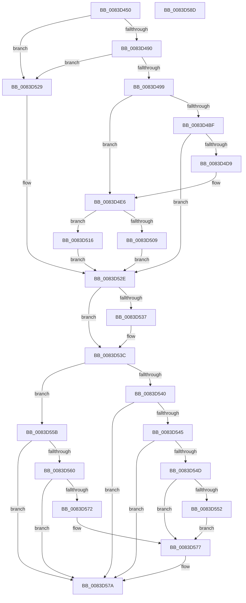

# RtlpLoadLanguageConfigList

- RVA: `0x0083D450`–`0x0083D58E` (길이 `318` bytes)
- VA: `0x000000014083D450`
- 실행 섹션: `PAGE`
- PDB 이름 있음: `예`; PDB Function 태그: `아니요`
- unwind 정보 RVA: `0x000DB548`
- 디코드: `98`개 명령, `318/318` bytes 표시
- 미해석 바이트: `0` (있으면 어셈블리에 `.byte`로 보존)

> 이 문서는 커널 이미지의 기계어와 PDB 기호를 분석해 생성했습니다. 4번과 5번은 함수 원형과 자료형을 바이너리 사용 방식에서 추정한 C 해석이며 원본 소스 복구 결과는 아닙니다.

## 1. Dependencies

- 직접 호출 지점: **10**; 고유 호출 대상: **7**
- 직접 호출자로 확인된 함수: **1**
- RIP 상대 이미지 참조: **2**

### Outgoing calls
- `0x0083D4A7` → [RtlInitUnicodeString](../../text/42/RtlInitUnicodeString_function_0042A780.md) (function, `0x0042A780`)
- `0x0083D4B6` → [LdrpOpenKey](../79/LdrpOpenKey_function_00791984.md) (function, `0x00791984`)
- `0x0083D4CE` → [RtlpLoadPolicyLanguageSpec](RtlpLoadPolicyLanguageSpec_function_0083D594.md) (function, `0x0083D594`)
- `0x0083D4DD` → [NtClose](../86/NtClose_function_00868870.md) (function, `0x00868870`)
- `0x0083D4F1` → [RtlInitUnicodeString](../../text/42/RtlInitUnicodeString_function_0042A780.md) (function, `0x0042A780`)
- `0x0083D500` → [LdrpOpenKey](../79/LdrpOpenKey_function_00791984.md) (function, `0x00791984`)
- `0x0083D520` → [RtlpPopulateLanguageConfigList](RtlpPopulateLanguageConfigList_function_0083EF20.md) (function, `0x0083EF20`)
- `0x0083D537` → [NtClose](../86/NtClose_function_00868870.md) (function, `0x00868870`)
- `0x0083D554` → [ExFreePoolWithTag](../../poolcode/B8/ExFreePoolWithTag_function_00B82870.md) (function, `0x00B82870`)
- `0x0083D565` → [RtlpMuiRegCreateLanguageConfigList](RtlpMuiRegCreateLanguageConfigList_function_0083DCD4.md) (function, `0x0083DCD4`)

### Direct callers
- [RtlpMuiRegLoadRegistryInfo](RtlpMuiRegLoadRegistryInfo_function_0083EDC4.md) at `0x0083EE17`

### Static image references
- `0x0083D4A0` → RVA `0x00B0E310` (` ?? ::NNGAKEGL::`string'`; read)
- `0x0083D4E6` → RVA `0x00B08480` (` ?? ::NNGAKEGL::`string'`; read)

## 2. Other-region calls and transfers

- 다른 실행 섹션으로 향하는 call: **3**
  - `0x0083D4A7` → [RtlInitUnicodeString](../../text/42/RtlInitUnicodeString_function_0042A780.md) (`PAGE` → `.text`)
  - `0x0083D4F1` → [RtlInitUnicodeString](../../text/42/RtlInitUnicodeString_function_0042A780.md) (`PAGE` → `.text`)
  - `0x0083D554` → [ExFreePoolWithTag](../../poolcode/B8/ExFreePoolWithTag_function_00B82870.md) (`PAGE` → `POOLCODE`)
- 별도 외부 분기/꼬리 이동을 확인하지 못했습니다.

## 3. Assembly (complete function range)

```asm
0083D450  48 89 5C 24 18                  mov qword ptr [rsp + 0x18], rbx
0083D455  89 4C 24 08                     mov dword ptr [rsp + 8], ecx
0083D459  55                              push rbp
0083D45A  56                              push rsi
0083D45B  57                              push rdi
0083D45C  41 56                           push r14
0083D45E  41 57                           push r15
0083D460  48 8B EC                        mov rbp, rsp
0083D463  48 83 EC 30                     sub rsp, 0x30
0083D467  45 33 FF                        xor r15d, r15d
0083D46A  0F 57 C0                        xorps xmm0, xmm0
0083D46D  44 88 7D 30                     mov byte ptr [rbp + 0x30], r15b
0083D471  4D 8B F0                        mov r14, r8
0083D474  66 44 89 7D 38                  mov word ptr [rbp + 0x38], r15w
0083D479  48 8B FA                        mov rdi, rdx
0083D47C  4C 89 7D 48                     mov qword ptr [rbp + 0x48], r15
0083D480  41 8B F7                        mov esi, r15d
0083D483  0F 11 45 F0                     movups xmmword ptr [rbp - 0x10], xmm0
0083D487  48 85 D2                        test rdx, rdx
0083D48A  0F 84 99 00 00 00               je 0x14083d529
0083D490  4D 85 C0                        test r8, r8
0083D493  0F 84 90 00 00 00               je 0x14083d529
0083D499  48 8B 32                        mov rsi, qword ptr [rdx]
0083D49C  48 8D 4D F0                     lea rcx, [rbp - 0x10]
0083D4A0  48 8D 15 69 0E 2D 00            lea rdx, [rip + 0x2d0e69]
0083D4A7  E8 D4 D2 BE FF                  call 0x14042a780
0083D4AC  4C 8D 4D 48                     lea r9, [rbp + 0x48]
0083D4B0  33 D2                           xor edx, edx
0083D4B2  48 8D 4D F0                     lea rcx, [rbp - 0x10]
0083D4B6  E8 C9 44 F5 FF                  call 0x140791984
0083D4BB  85 C0                           test eax, eax
0083D4BD  78 27                           js 0x14083d4e6
0083D4BF  48 8B 4D 48                     mov rcx, qword ptr [rbp + 0x48]
0083D4C3  4C 8D 4D 38                     lea r9, [rbp + 0x38]
0083D4C7  4C 8D 45 30                     lea r8, [rbp + 0x30]
0083D4CB  49 8B D6                        mov rdx, r14
0083D4CE  E8 C1 00 00 00                  call 0x14083d594
0083D4D3  8B D8                           mov ebx, eax
0083D4D5  85 C0                           test eax, eax
0083D4D7  79 55                           jns 0x14083d52e
0083D4D9  48 8B 4D 48                     mov rcx, qword ptr [rbp + 0x48]
0083D4DD  E8 8E B3 02 00                  call 0x140868870
0083D4E2  4C 89 7D 48                     mov qword ptr [rbp + 0x48], r15
0083D4E6  48 8D 15 93 AF 2C 00            lea rdx, [rip + 0x2caf93]
0083D4ED  48 8D 4D F0                     lea rcx, [rbp - 0x10]
0083D4F1  E8 8A D2 BE FF                  call 0x14042a780
0083D4F6  4C 8D 4D 48                     lea r9, [rbp + 0x48]
0083D4FA  33 D2                           xor edx, edx
0083D4FC  48 8D 4D F0                     lea rcx, [rbp - 0x10]
0083D500  E8 7F 44 F5 FF                  call 0x140791984
0083D505  85 C0                           test eax, eax
0083D507  79 0D                           jns 0x14083d516
0083D509  3D 34 00 00 C0                  cmp eax, 0xc0000034
0083D50E  41 8B DF                        mov ebx, r15d
0083D511  0F 45 D8                        cmovne ebx, eax
0083D514  EB 18                           jmp 0x14083d52e
0083D516  48 8B 4D 48                     mov rcx, qword ptr [rbp + 0x48]
0083D51A  4D 8B C6                        mov r8, r14
0083D51D  48 8B D7                        mov rdx, rdi
0083D520  E8 FB 19 00 00                  call 0x14083ef20
0083D525  8B D8                           mov ebx, eax
0083D527  EB 05                           jmp 0x14083d52e
0083D529  BB 0D 00 00 C0                  mov ebx, 0xc000000d
0083D52E  48 8B 4D 48                     mov rcx, qword ptr [rbp + 0x48]
0083D532  48 85 C9                        test rcx, rcx
0083D535  74 05                           je 0x14083d53c
0083D537  E8 34 B3 02 00                  call 0x140868870
0083D53C  85 DB                           test ebx, ebx
0083D53E  79 1B                           jns 0x14083d55b
0083D540  48 85 FF                        test rdi, rdi
0083D543  74 35                           je 0x14083d57a
0083D545  48 8B 0F                        mov rcx, qword ptr [rdi]
0083D548  48 3B CE                        cmp rcx, rsi
0083D54B  74 2D                           je 0x14083d57a
0083D54D  48 85 C9                        test rcx, rcx
0083D550  74 25                           je 0x14083d577
0083D552  33 D2                           xor edx, edx
0083D554  E8 17 53 34 00                  call 0x140b82870
0083D559  EB 1C                           jmp 0x14083d577
0083D55B  4C 39 3F                        cmp qword ptr [rdi], r15
0083D55E  75 1A                           jne 0x14083d57a
0083D560  B9 01 00 00 00                  mov ecx, 1
0083D565  E8 6A 07 00 00                  call 0x14083dcd4
0083D56A  48 89 07                        mov qword ptr [rdi], rax
0083D56D  48 85 C0                        test rax, rax
0083D570  75 08                           jne 0x14083d57a
0083D572  BB 17 00 00 C0                  mov ebx, 0xc0000017
0083D577  48 89 37                        mov qword ptr [rdi], rsi
0083D57A  8B C3                           mov eax, ebx
0083D57C  48 8B 5C 24 70                  mov rbx, qword ptr [rsp + 0x70]
0083D581  48 83 C4 30                     add rsp, 0x30
0083D585  41 5F                           pop r15
0083D587  41 5E                           pop r14
0083D589  5F                              pop rdi
0083D58A  5E                              pop rsi
0083D58B  5D                              pop rbp
0083D58C  C3                              ret
0083D58D  CC                              int3
```

## 4. C-style interpretation (structured pseudocode)

```c
__int64 __fastcall RtlpLoadLanguageConfigList(int a1, __int64 a2, __int64 a3)
{
    __int64 result;
    __int64 v_r15;
    __int64 v_rbx;
    __int64 v_rsp;
    unsigned __int64 v_stack_m38;
    unsigned __int16 v_stack_p10;
    unsigned __int64 v_stack_p18;
    unsigned __int64 v_stack_p20;
    unsigned int v_stack_p8;

    v_stack_p18 = v_rbx;
    v_stack_p8 = a1;
    v_rsp = (v_rsp) - (48);
    v_r15 = 0;
    v_stack_p8 = 0;
    v_stack_p10 = 0;
    v_stack_p20 = 0;
    v_stack_m38 = v_xmm0;
    if (a2 == 0) goto loc_0083D529;
    if (a3 == 0) goto loc_0083D529;
    result = RtlInitUnicodeString(v_stack_m38, v_rip + 2952809, a3, a4);
    a2 = 0;
    result = LdrpOpenKey(v_stack_m38, a2, a3, v_stack_p20);
    if (sign_flag) goto loc_0083D4E6;
    result = RtlpLoadPolicyLanguageSpec(v_stack_p20, a3, v_stack_p8, v_stack_p10);
    if (!sign_flag) goto loc_0083D52E;
    result = NtClose(v_stack_p20, a3, v_stack_p8, v_stack_p10);
    v_stack_p20 = 0;
loc_0083D4E6:
    result = RtlInitUnicodeString(v_stack_m38, v_rip + 2928531, v_stack_p8, v_stack_p10);
    a2 = 0;
    result = LdrpOpenKey(v_stack_m38, a2, v_stack_p8, v_stack_p20);
    if (!sign_flag) goto loc_0083D516;
    v_rbx = 0;
    if (((unsigned int)(result)) != 0xC0000034ULL) { v_rbx = (unsigned int)(result); }
    goto loc_0083D52E;
loc_0083D516:
    result = RtlpPopulateLanguageConfigList(v_stack_p20, 0, a3, v_stack_p20);
    goto loc_0083D52E;
loc_0083D529:
loc_0083D52E:
    if (v_stack_p20 != 0) {
        result = NtClose(v_stack_p20, 0, a3, v_stack_p20);
    }
    if (!sign_flag) goto loc_0083D55B;
    if (0 == 0) goto loc_0083D57A;
    if ((*(unsigned __int64 *)(a2)) == (*(unsigned __int64 *)(a2))) goto loc_0083D57A;
    if (*(unsigned __int64 *)(a2) == 0) goto loc_0083D577;
    a2 = 0;
    result = ExFreePoolWithTag(*(unsigned __int64 *)(a2), a2, a3, v_stack_p20);
    goto loc_0083D577;
loc_0083D55B:
    if ((*(unsigned __int64 *)(a2)) != 0) goto loc_0083D57A;
    result = RtlpMuiRegCreateLanguageConfigList(1, a2, a3, v_stack_p20);
    *(unsigned __int64 *)(a2) = result;
    if (result != 0) goto loc_0083D57A;
loc_0083D577:
    *(unsigned __int64 *)(a2) = *(unsigned __int64 *)(a2);
loc_0083D57A:
    v_rsp = (v_rsp) + (48);
    return (unsigned int)((unsigned int)((unsigned int)(0xC0000017ULL)));
}
```

## 5. (Beta) C Style

```c
int64_t RtlpLoadLanguageConfigList(int32_t Arg1, void *Arg2, int64_t Arg3)
{
    uint8_t *arg2 = (uint8_t *)Arg2;

    int64_t result;
    int64_t local_r15;
    int64_t local_rbx;
    int64_t local_rsp;
    uint64_t v_stack_m38;
    uint16_t v_stack_p10;
    uint64_t v_stack_p18;
    uint64_t v_stack_p20;
    uint32_t v_stack_p8;

    v_stack_p18 = local_rbx;
    v_stack_p8 = Arg1;
    local_rsp = (local_rsp) - (48);
    local_r15 = 0;
    v_stack_p8 = 0;
    v_stack_p10 = 0;
    v_stack_p20 = 0;
    v_stack_m38 = v_xmm0;
    if (Arg2 == NULL) goto loc_0083D529;
    if (Arg3 == 0) goto loc_0083D529;
    result = RtlInitUnicodeString(v_stack_m38, v_rip + 2952809, Arg3, a4);
    Arg2 = 0;
    result = LdrpOpenKey(v_stack_m38, Arg2, Arg3, v_stack_p20);
    if (sign_flag) goto loc_0083D4E6;
    result = RtlpLoadPolicyLanguageSpec(v_stack_p20, Arg3, v_stack_p8, v_stack_p10);
    if (!sign_flag) goto loc_0083D52E;
    result = NtClose(v_stack_p20, Arg3, v_stack_p8, v_stack_p10);
    v_stack_p20 = 0;
loc_0083D4E6:
    result = RtlInitUnicodeString(v_stack_m38, v_rip + 2928531, v_stack_p8, v_stack_p10);
    Arg2 = 0;
    result = LdrpOpenKey(v_stack_m38, Arg2, v_stack_p8, v_stack_p20);
    if (!sign_flag) goto loc_0083D516;
    local_rbx = 0;
    if (((uint32_t)(result)) != 0xC0000034ULL) { local_rbx = (uint32_t)(result); }
    goto loc_0083D52E;
loc_0083D516:
    result = RtlpPopulateLanguageConfigList(v_stack_p20, 0, Arg3, v_stack_p20);
    goto loc_0083D52E;
loc_0083D529:
loc_0083D52E:
    if (v_stack_p20 != 0) {
        result = NtClose(v_stack_p20, 0, Arg3, v_stack_p20);
    }
    if (!sign_flag) goto loc_0083D55B;
    if (0 == 0) goto loc_0083D57A;
    if ((*(uint64_t *)(arg2)) == (*(uint64_t *)(arg2))) goto loc_0083D57A;
    if (*(uint64_t *)(arg2) == 0) goto loc_0083D577;
    Arg2 = 0;
    result = ExFreePoolWithTag(*(uint64_t *)(arg2), Arg2, Arg3, v_stack_p20);
    goto loc_0083D577;
loc_0083D55B:
    if ((*(uint64_t *)(arg2)) != 0) goto loc_0083D57A;
    result = RtlpMuiRegCreateLanguageConfigList(1, Arg2, Arg3, v_stack_p20);
    *(uint64_t *)(arg2) = result;
    if (result != 0) goto loc_0083D57A;
loc_0083D577:
    *(uint64_t *)(arg2) = *(uint64_t *)(arg2);
loc_0083D57A:
    local_rsp = (local_rsp) + (48);
    return (uint32_t)((uint32_t)((uint32_t)(0xC0000017ULL)));
}
```

### 관측된 메모리 오프셋

구조체 형식이 확인되지 않은 접근은 인자 기준의 오프셋으로만 기록했습니다.

| 기준 인자 | 오프셋 표현 | 폭 (bit) | 접근 |
|---|---:|---:|---|
| `Arg2` | `+ 0x0` | `64` | `R` |
| `Arg2` | `+ 0x0` | `64` | `W` |

## 6. Execution-region graph

[열기: 2D/3D 그래프와 함수 탐색 컨트롤 패널](../../../control-panel.html?section=page&rva=0x0083D450&view=graph)

- 2D 그래프는 위에서 아래로 흐르고, 3D 그래프는 빈 공간을 드래그해 회전합니다. Shift+드래그는 이동, 휠은 확대·축소, 함수 노드 선택은 대상 보고서 이동입니다.

### Static fallback


