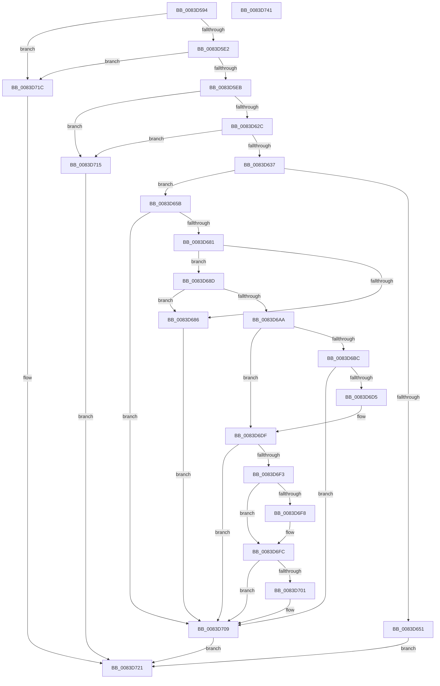

# RtlpLoadPolicyLanguageSpec

- RVA: `0x0083D594`–`0x0083D742` (길이 `430` bytes)
- VA: `0x000000014083D594`
- 실행 섹션: `PAGE`
- PDB 이름 있음: `예`; PDB Function 태그: `아니요`
- unwind 정보 RVA: `0x000DB560`
- 디코드: `122`개 명령, `430/430` bytes 표시
- 미해석 바이트: `0` (있으면 어셈블리에 `.byte`로 보존)

> 이 문서는 커널 이미지의 기계어와 PDB 기호를 분석해 생성했습니다. 4번과 5번은 함수 원형과 자료형을 바이너리 사용 방식에서 추정한 C 해석이며 원본 소스 복구 결과는 아닙니다.

## 1. Dependencies

- 직접 호출 지점: **9**; 고유 호출 대상: **7**
- 직접 호출자로 확인된 함수: **1**
- RIP 상대 이미지 참조: **1**

### Outgoing calls
- `0x0083D600` → [RtlInitUnicodeString](../../text/42/RtlInitUnicodeString_function_0042A780.md) (function, `0x0042A780`)
- `0x0083D61C` → [LdrpQueryValueKey](../79/LdrpQueryValueKey_function_007919D0.md) (function, `0x007919D0`)
- `0x0083D644` → [ExAllocatePool2](../../poolcode/B8/ExAllocatePool2_function_00B820F0.md) (function, `0x00B820F0`)
- `0x0083D672` → [LdrpQueryValueKey](../79/LdrpQueryValueKey_function_007919D0.md) (function, `0x007919D0`)
- `0x0083D694` → [RtlInitUnicodeString](../../text/42/RtlInitUnicodeString_function_0042A780.md) (function, `0x0042A780`)
- `0x0083D6A1` → [RtlCultureNameToLCID](../AA/RtlCultureNameToLCID_function_00AACEF0.md) (function, `0x00AACEF0`)
- `0x0083D6CA` → [RtlpMuiRegGetOrAddString](RtlpMuiRegGetOrAddString_function_0083E830.md) (function, `0x0083E830`)
- `0x0083D6E8` → [RtlpMuiRegGetInstalledLanguageIndex](RtlpMuiRegGetInstalledLanguageIndex_function_0083E1CC.md) (function, `0x0083E1CC`)
- `0x0083D70E` → [ExFreePoolWithTag](../../poolcode/B8/ExFreePoolWithTag_function_00B82870.md) (function, `0x00B82870`)

### Direct callers
- [RtlpLoadLanguageConfigList](RtlpLoadLanguageConfigList_function_0083D450.md) at `0x0083D4CE`

### Static image references
- `0x0083D5F2` → RVA `0x00B08330` (` ?? ::NNGAKEGL::`string'`; read)

## 2. Other-region calls and transfers

- 다른 실행 섹션으로 향하는 call: **4**
  - `0x0083D600` → [RtlInitUnicodeString](../../text/42/RtlInitUnicodeString_function_0042A780.md) (`PAGE` → `.text`)
  - `0x0083D644` → [ExAllocatePool2](../../poolcode/B8/ExAllocatePool2_function_00B820F0.md) (`PAGE` → `POOLCODE`)
  - `0x0083D694` → [RtlInitUnicodeString](../../text/42/RtlInitUnicodeString_function_0042A780.md) (`PAGE` → `.text`)
  - `0x0083D70E` → [ExFreePoolWithTag](../../poolcode/B8/ExFreePoolWithTag_function_00B82870.md) (`PAGE` → `POOLCODE`)
- 별도 외부 분기/꼬리 이동을 확인하지 못했습니다.

## 3. Assembly (complete function range)

```asm
0083D594  48 89 5C 24 08                  mov qword ptr [rsp + 8], rbx
0083D599  48 89 74 24 18                  mov qword ptr [rsp + 0x18], rsi
0083D59E  48 89 7C 24 20                  mov qword ptr [rsp + 0x20], rdi
0083D5A3  55                              push rbp
0083D5A4  41 54                           push r12
0083D5A6  41 55                           push r13
0083D5A8  41 56                           push r14
0083D5AA  41 57                           push r15
0083D5AC  48 8B EC                        mov rbp, rsp
0083D5AF  48 83 EC 50                     sub rsp, 0x50
0083D5B3  45 33 ED                        xor r13d, r13d
0083D5B6  83 C8 FF                        or eax, 0xffffffff
0083D5B9  44 89 6D EC                     mov dword ptr [rbp - 0x14], r13d
0083D5BD  0F 57 C0                        xorps xmm0, xmm0
0083D5C0  66 44 89 6D 38                  mov word ptr [rbp + 0x38], r13w
0083D5C5  4D 8B F1                        mov r14, r9
0083D5C8  66 89 45 E0                     mov word ptr [rbp - 0x20], ax
0083D5CC  4D 8B F8                        mov r15, r8
0083D5CF  4C 8B E2                        mov r12, rdx
0083D5D2  48 8B D9                        mov rbx, rcx
0083D5D5  0F 11 45 F0                     movups xmmword ptr [rbp - 0x10], xmm0
0083D5D9  48 85 D2                        test rdx, rdx
0083D5DC  0F 84 3A 01 00 00               je 0x14083d71c
0083D5E2  48 85 C9                        test rcx, rcx
0083D5E5  0F 84 31 01 00 00               je 0x14083d71c
0083D5EB  8D 70 02                        lea esi, [rax + 2]
0083D5EE  44 89 6D E4                     mov dword ptr [rbp - 0x1c], r13d
0083D5F2  48 8D 15 37 AD 2C 00            lea rdx, [rip + 0x2cad37]
0083D5F9  89 75 E8                        mov dword ptr [rbp - 0x18], esi
0083D5FC  48 8D 4D F0                     lea rcx, [rbp - 0x10]
0083D600  E8 7B D1 BE FF                  call 0x14042a780
0083D605  48 8D 45 E4                     lea rax, [rbp - 0x1c]
0083D609  45 33 C9                        xor r9d, r9d
0083D60C  4C 8D 45 E8                     lea r8, [rbp - 0x18]
0083D610  48 89 44 24 20                  mov qword ptr [rsp + 0x20], rax
0083D615  48 8D 55 F0                     lea rdx, [rbp - 0x10]
0083D619  48 8B CB                        mov rcx, rbx
0083D61C  E8 AF 43 F5 FF                  call 0x1407919d0
0083D621  8B 4D E4                        mov ecx, dword ptr [rbp - 0x1c]
0083D624  85 C9                           test ecx, ecx
0083D626  0F 84 E9 00 00 00               je 0x14083d715
0083D62C  3D 34 00 00 C0                  cmp eax, 0xc0000034
0083D631  0F 84 DE 00 00 00               je 0x14083d715
0083D637  8B D1                           mov edx, ecx
0083D639  41 B8 6D 6C 74 72               mov r8d, 0x72746c6d
0083D63F  B9 00 01 00 00                  mov ecx, 0x100
0083D644  E8 A7 4A 34 00                  call 0x140b820f0
0083D649  48 8B F8                        mov rdi, rax
0083D64C  48 85 C0                        test rax, rax
0083D64F  75 0A                           jne 0x14083d65b
0083D651  BB 17 00 00 C0                  mov ebx, 0xc0000017
0083D656  E9 C6 00 00 00                  jmp 0x14083d721
0083D65B  48 8D 45 E4                     lea rax, [rbp - 0x1c]
0083D65F  4C 8B CF                        mov r9, rdi
0083D662  4C 8D 45 E8                     lea r8, [rbp - 0x18]
0083D666  48 89 44 24 20                  mov qword ptr [rsp + 0x20], rax
0083D66B  48 8D 55 F0                     lea rdx, [rbp - 0x10]
0083D66F  48 8B CB                        mov rcx, rbx
0083D672  E8 59 43 F5 FF                  call 0x1407919d0
0083D677  8B D8                           mov ebx, eax
0083D679  85 C0                           test eax, eax
0083D67B  0F 88 88 00 00 00               js 0x14083d709
0083D681  39 75 E8                        cmp dword ptr [rbp - 0x18], esi
0083D684  74 07                           je 0x14083d68d
0083D686  BB 01 00 00 C0                  mov ebx, 0xc0000001
0083D68B  EB 7C                           jmp 0x14083d709
0083D68D  48 8B D7                        mov rdx, rdi
0083D690  48 8D 4D F0                     lea rcx, [rbp - 0x10]
0083D694  E8 E7 D0 BE FF                  call 0x14042a780
0083D699  48 8D 55 EC                     lea rdx, [rbp - 0x14]
0083D69D  48 8D 4D F0                     lea rcx, [rbp - 0x10]
0083D6A1  E8 4A F8 26 00                  call 0x140aacef0
0083D6A6  84 C0                           test al, al
0083D6A8  74 DC                           je 0x14083d686
0083D6AA  44 8B 45 EC                     mov r8d, dword ptr [rbp - 0x14]
0083D6AE  41 8D 80 00 F0 FF FF            lea eax, [r8 - 0x1000]
0083D6B5  A9 FF FB FF FF                  test eax, 0xfffffbff
0083D6BA  75 23                           jne 0x14083d6df
0083D6BC  48 8B 55 F8                     mov rdx, qword ptr [rbp - 8]
0083D6C0  4C 8D 4D 38                     lea r9, [rbp + 0x38]
0083D6C4  45 33 C0                        xor r8d, r8d
0083D6C7  49 8B CC                        mov rcx, r12
0083D6CA  E8 61 11 00 00                  call 0x14083e830
0083D6CF  8B D8                           mov ebx, eax
0083D6D1  85 C0                           test eax, eax
0083D6D3  78 34                           js 0x14083d709
0083D6D5  44 0F B7 45 38                  movzx r8d, word ptr [rbp + 0x38]
0083D6DA  BE 03 00 00 00                  mov esi, 3
0083D6DF  4C 8D 4D E0                     lea r9, [rbp - 0x20]
0083D6E3  8B D6                           mov edx, esi
0083D6E5  49 8B CC                        mov rcx, r12
0083D6E8  E8 DF 0A 00 00                  call 0x14083e1cc
0083D6ED  8B D8                           mov ebx, eax
0083D6EF  85 C0                           test eax, eax
0083D6F1  78 16                           js 0x14083d709
0083D6F3  4D 85 FF                        test r15, r15
0083D6F6  74 04                           je 0x14083d6fc
0083D6F8  41 C6 07 02                     mov byte ptr [r15], 2
0083D6FC  4D 85 F6                        test r14, r14
0083D6FF  74 08                           je 0x14083d709
0083D701  0F B7 45 E0                     movzx eax, word ptr [rbp - 0x20]
0083D705  66 41 89 06                     mov word ptr [r14], ax
0083D709  33 D2                           xor edx, edx
0083D70B  48 8B CF                        mov rcx, rdi
0083D70E  E8 5D 51 34 00                  call 0x140b82870
0083D713  EB 0C                           jmp 0x14083d721
0083D715  BB 01 00 00 C0                  mov ebx, 0xc0000001
0083D71A  EB 05                           jmp 0x14083d721
0083D71C  BB 0D 00 00 C0                  mov ebx, 0xc000000d
0083D721  4C 8D 5C 24 50                  lea r11, [rsp + 0x50]
0083D726  8B C3                           mov eax, ebx
0083D728  49 8B 5B 30                     mov rbx, qword ptr [r11 + 0x30]
0083D72C  49 8B 73 40                     mov rsi, qword ptr [r11 + 0x40]
0083D730  49 8B 7B 48                     mov rdi, qword ptr [r11 + 0x48]
0083D734  49 8B E3                        mov rsp, r11
0083D737  41 5F                           pop r15
0083D739  41 5E                           pop r14
0083D73B  41 5D                           pop r13
0083D73D  41 5C                           pop r12
0083D73F  5D                              pop rbp
0083D740  C3                              ret
0083D741  CC                              int3
```

## 4. C-style interpretation (structured pseudocode)

```c
__int64 __fastcall RtlpLoadPolicyLanguageSpec(__int64 a1, __int64 a2, __int64 a3, __int64 a4)
{
    __int64 result;
    __int64 v_r13;
    __int64 v_rsp;
    unsigned __int64 v_stack_m28;
    unsigned __int64 v_stack_m30;
    unsigned __int64 v_stack_m38;
    unsigned int v_stack_m3C;
    unsigned int v_stack_m40;
    unsigned int v_stack_m44;
    unsigned __int16 v_stack_m48;
    unsigned __int64 v_stack_m58;
    unsigned __int16 v_stack_p10;
    unsigned __int64 v_stack_p18;
    unsigned __int64 v_stack_p20;
    unsigned __int64 v_stack_p8;

    v_stack_p8 = v_rbx;
    v_stack_p18 = v_rsi;
    v_stack_p20 = v_rdi;
    v_rsp = (v_rsp) - (80);
    v_r13 = 0;
    result = (unsigned int)((result) | (0xFFFFFFFFULL));
    v_stack_m3C = 0;
    v_stack_p10 = 0;
    v_stack_m48 = (unsigned __int16)(result);
    v_stack_m38 = v_xmm0;
    if (a2 == 0) goto loc_0083D71C;
    if (a1 == 0) goto loc_0083D71C;
    v_stack_m44 = 0;
    v_stack_m40 = (unsigned int)(result + 2);
    result = RtlInitUnicodeString(v_stack_m38, v_rip + 2927927, a3, a4);
    a4 = 0;
    v_stack_m58 = v_stack_m44;
    result = LdrpQueryValueKey(a1, v_stack_m38, v_stack_m40, a4);
    if ((unsigned int)((unsigned int)(v_stack_m44)) == 0) goto loc_0083D715;
    if (((unsigned int)(result)) == 0xC0000034ULL) goto loc_0083D715;
    result = ExAllocatePool2(256, (unsigned int)((unsigned int)((unsigned int)(v_stack_m44))), (unsigned int)(0x72746C6DULL), a4);
    if (result != 0) goto loc_0083D65B;
    goto loc_0083D721;
loc_0083D65B:
    v_stack_m58 = v_stack_m44;
    result = LdrpQueryValueKey((unsigned int)(0xC0000017ULL), v_stack_m38, v_stack_m40, result);
    if (sign_flag) goto loc_0083D709;
    if (v_stack_m40 == ((unsigned int)(result + 2))) goto loc_0083D68D;
loc_0083D686:
    goto loc_0083D709;
loc_0083D68D:
    result = RtlInitUnicodeString(v_stack_m38, result, v_stack_m40, result);
    result = RtlCultureNameToLCID(v_stack_m38, v_stack_m3C, v_stack_m40, result);
    if ((unsigned __int8)(result) == 0) goto loc_0083D686;
    if ((((unsigned int)((unsigned int)(v_stack_m3C) - 4096)) & (0xFFFFFBFFULL)) != 0) goto loc_0083D6DF;
    a3 = 0;
    result = RtlpMuiRegGetOrAddString(a2, v_stack_m30, a3, v_stack_p10);
    if (sign_flag) goto loc_0083D709;
loc_0083D6DF:
    result = RtlpMuiRegGetInstalledLanguageIndex(a2, 3, v_stack_p10, v_stack_m48);
    if (sign_flag) goto loc_0083D709;
    if (0 != 0) {
        *(unsigned __int8 *)(a3) = 2;
    }
    if (0 != 0) {
        result = v_stack_m48;
        *(unsigned __int16 *)(a4) = (unsigned __int16)(result);
    }
    a2 = 0;
    result = ExFreePoolWithTag(result, a2, v_stack_p10, v_stack_m48);
    goto loc_0083D721;
loc_0083D715:
    goto loc_0083D721;
loc_0083D71C:
loc_0083D721:
    return (unsigned int)((unsigned int)((unsigned int)(0xC000000DULL)));
}
```

## 5. (Beta) C Style

```c
int64_t RtlpLoadPolicyLanguageSpec(int64_t Arg1, int64_t Arg2, int64_t Arg3, int64_t Arg4)
{
    int64_t result;
    int64_t local_r13;
    int64_t local_rsp;
    uint64_t v_stack_m28;
    uint64_t v_stack_m30;
    uint64_t v_stack_m38;
    uint32_t v_stack_m3C;
    uint32_t v_stack_m40;
    uint32_t v_stack_m44;
    uint16_t v_stack_m48;
    uint64_t v_stack_m58;
    uint16_t v_stack_p10;
    uint64_t v_stack_p18;
    uint64_t v_stack_p20;
    uint64_t v_stack_p8;

    v_stack_p8 = local_rbx;
    v_stack_p18 = local_rsi;
    v_stack_p20 = local_rdi;
    local_rsp = (local_rsp) - (80);
    local_r13 = 0;
    result = (uint32_t)((result) | (0xFFFFFFFFULL));
    v_stack_m3C = 0;
    v_stack_p10 = 0;
    v_stack_m48 = (uint16_t)(result);
    v_stack_m38 = v_xmm0;
    if (Arg2 == 0) goto loc_0083D71C;
    if (Arg1 == 0) goto loc_0083D71C;
    v_stack_m44 = 0;
    v_stack_m40 = (uint32_t)(result + 2);
    result = RtlInitUnicodeString(v_stack_m38, v_rip + 2927927, Arg3, Arg4);
    Arg4 = 0;
    v_stack_m58 = v_stack_m44;
    result = LdrpQueryValueKey(Arg1, v_stack_m38, v_stack_m40, Arg4);
    if ((uint32_t)((uint32_t)(v_stack_m44)) == 0) goto loc_0083D715;
    if (((uint32_t)(result)) == 0xC0000034ULL) goto loc_0083D715;
    result = ExAllocatePool2(256, (uint32_t)((uint32_t)((uint32_t)(v_stack_m44))), (uint32_t)(0x72746C6DULL), Arg4);
    if (result != 0) goto loc_0083D65B;
    goto loc_0083D721;
loc_0083D65B:
    v_stack_m58 = v_stack_m44;
    result = LdrpQueryValueKey((uint32_t)(0xC0000017ULL), v_stack_m38, v_stack_m40, result);
    if (sign_flag) goto loc_0083D709;
    if (v_stack_m40 == ((uint32_t)(result + 2))) goto loc_0083D68D;
loc_0083D686:
    goto loc_0083D709;
loc_0083D68D:
    result = RtlInitUnicodeString(v_stack_m38, result, v_stack_m40, result);
    result = RtlCultureNameToLCID(v_stack_m38, v_stack_m3C, v_stack_m40, result);
    if ((uint8_t)(result) == 0) goto loc_0083D686;
    if ((((uint32_t)((uint32_t)(v_stack_m3C) - 4096)) & (0xFFFFFBFFULL)) != 0) goto loc_0083D6DF;
    Arg3 = 0;
    result = RtlpMuiRegGetOrAddString(Arg2, v_stack_m30, Arg3, v_stack_p10);
    if (sign_flag) goto loc_0083D709;
loc_0083D6DF:
    result = RtlpMuiRegGetInstalledLanguageIndex(Arg2, 3, v_stack_p10, v_stack_m48);
    if (sign_flag) goto loc_0083D709;
    if (0 != 0) {
        *(uint8_t *)(Arg3) = 2;
    }
    if (0 != 0) {
        result = v_stack_m48;
        *(uint16_t *)(Arg4) = (uint16_t)(result);
    }
    Arg2 = 0;
    result = ExFreePoolWithTag(result, Arg2, v_stack_p10, v_stack_m48);
    goto loc_0083D721;
loc_0083D715:
    goto loc_0083D721;
loc_0083D71C:
loc_0083D721:
    return (uint32_t)((uint32_t)((uint32_t)(0xC000000DULL)));
}
```

## 6. Execution-region graph

[열기: 2D/3D 그래프와 함수 탐색 컨트롤 패널](../../../control-panel.html?section=page&rva=0x0083D594&view=graph)

- 2D 그래프는 위에서 아래로 흐르고, 3D 그래프는 빈 공간을 드래그해 회전합니다. Shift+드래그는 이동, 휠은 확대·축소, 함수 노드 선택은 대상 보고서 이동입니다.

### Static fallback


