# RtlpMuiRegAddBaseLanguage

- RVA: `0x0083F494`–`0x0083F7CC` (길이 `824` bytes)
- VA: `0x000000014083F494`
- 실행 섹션: `PAGE`
- PDB 이름 있음: `예`; PDB Function 태그: `아니요`
- unwind 정보 RVA: `0x000C5998`
- 디코드: `236`개 명령, `824/824` bytes 표시
- 미해석 바이트: `0` (있으면 어셈블리에 `.byte`로 보존)

> 이 문서는 커널 이미지의 기계어와 PDB 기호를 분석해 생성했습니다. 4번과 5번은 함수 원형과 자료형을 바이너리 사용 방식에서 추정한 C 해석이며 원본 소스 복구 결과는 아닙니다.

## 1. Dependencies

- 직접 호출 지점: **8**; 고유 호출 대상: **6**
- 직접 호출자로 확인된 함수: **1**
- RIP 상대 이미지 참조: **1**

### Outgoing calls
- `0x0083F55A` → [RtlInitUnicodeString](../../text/42/RtlInitUnicodeString_function_0042A780.md) (function, `0x0042A780`)
- `0x0083F58A` → [RtlpMuiRegInitAnyLanguage](RtlpMuiRegInitAnyLanguage_function_0083F7FC.md) (function, `0x0083F7FC`)
- `0x0083F5E0` → [RtlpLangNameInMultiSzString](../79/RtlpLangNameInMultiSzString_function_00791AE8.md) (function, `0x00791AE8`)
- `0x0083F603` → [RtlpMuiRegGetLanguageSpec](RtlpMuiRegGetLanguageSpec_function_0083E680.md) (function, `0x0083E680`)
- `0x0083F686` → [RtlpMuiRegGetLanguageSpec](RtlpMuiRegGetLanguageSpec_function_0083E680.md) (function, `0x0083E680`)
- `0x0083F739` → [RtlpMuiRegGetOrAddLangInfo](RtlpMuiRegGetOrAddLangInfo_function_0083E74C.md) (function, `0x0083E74C`)
- `0x0083F75E` → [RtlpMuiRegGetLanguageSpec](RtlpMuiRegGetLanguageSpec_function_0083E680.md) (function, `0x0083E680`)
- `0x0083F7B2` → [_security_check_cookie](../../text/6A/_security_check_cookie_function_006AC640.md) (function, `0x006AC640`)

### Direct callers
- [RtlpMuiRegPopulateBaseLanguages](RtlpMuiRegPopulateBaseLanguages_function_0083FC4C.md) at `0x0083FE1D`
- [RtlpMuiRegPopulateBaseLanguages](RtlpMuiRegPopulateBaseLanguages_function_0083FC4C.md) at `0x0083FF15`
- [RtlpMuiRegPopulateBaseLanguages](RtlpMuiRegPopulateBaseLanguages_function_0083FC4C.md) at `0x0084002B`

### Static image references
- `0x0083F4AD` → RVA `0x00E0A740` (`.data`; read)

## 2. Other-region calls and transfers

- 다른 실행 섹션으로 향하는 call: **2**
  - `0x0083F55A` → [RtlInitUnicodeString](../../text/42/RtlInitUnicodeString_function_0042A780.md) (`PAGE` → `.text`)
  - `0x0083F7B2` → [_security_check_cookie](../../text/6A/_security_check_cookie_function_006AC640.md) (`PAGE` → `.text`)
- 별도 외부 분기/꼬리 이동을 확인하지 못했습니다.

## 3. Assembly (complete function range)

```asm
0083F494  40 55                           push rbp
0083F496  53                              push rbx
0083F497  56                              push rsi
0083F498  57                              push rdi
0083F499  41 54                           push r12
0083F49B  41 55                           push r13
0083F49D  41 56                           push r14
0083F49F  41 57                           push r15
0083F4A1  48 8D 6C 24 E9                  lea rbp, [rsp - 0x17]
0083F4A6  48 81 EC 98 00 00 00            sub rsp, 0x98
0083F4AD  48 8B 05 8C B2 5C 00            mov rax, qword ptr [rip + 0x5cb28c]
0083F4B4  48 33 C4                        xor rax, rsp
0083F4B7  48 89 45 07                     mov qword ptr [rbp + 7], rax
0083F4BB  4C 8B 6D 7F                     mov r13, qword ptr [rbp + 0x7f]
0083F4BF  48 8B C1                        mov rax, rcx
0083F4C2  48 89 4D BF                     mov qword ptr [rbp - 0x41], rcx
0083F4C6  0F 57 C0                        xorps xmm0, xmm0
0083F4C9  33 C9                           xor ecx, ecx
0083F4CB  44 89 45 CB                     mov dword ptr [rbp - 0x35], r8d
0083F4CF  48 89 55 CF                     mov qword ptr [rbp - 0x31], rdx
0083F4D3  0F 57 C9                        xorps xmm1, xmm1
0083F4D6  48 89 4D F7                     mov qword ptr [rbp - 9], rcx
0083F4DA  49 8B F1                        mov rsi, r9
0083F4DD  89 4D FF                        mov dword ptr [rbp - 1], ecx
0083F4E0  88 4D AF                        mov byte ptr [rbp - 0x51], cl
0083F4E3  88 4D B0                        mov byte ptr [rbp - 0x50], cl
0083F4E6  66 89 4D BB                     mov word ptr [rbp - 0x45], cx
0083F4EA  0F 11 45 D7                     movups xmmword ptr [rbp - 0x29], xmm0
0083F4EE  0F 11 4D E7                     movups xmmword ptr [rbp - 0x19], xmm1
0083F4F2  48 85 C0                        test rax, rax
0083F4F5  0F 84 AB 02 00 00               je 0x14083f7a6
0083F4FB  48 85 D2                        test rdx, rdx
0083F4FE  0F 84 A2 02 00 00               je 0x14083f7a6
0083F504  4D 85 C9                        test r9, r9
0083F507  0F 84 99 02 00 00               je 0x14083f7a6
0083F50D  44 8D 71 03                     lea r14d, [rcx + 3]
0083F511  45 3B C6                        cmp r8d, r14d
0083F514  0F 87 8C 02 00 00               ja 0x14083f7a6
0083F51A  41 8B 59 08                     mov ebx, dword ptr [r9 + 8]
0083F51E  44 8D 79 01                     lea r15d, [rcx + 1]
0083F522  49 03 D9                        add rbx, r9
0083F525  41 39 49 0C                     cmp dword ptr [r9 + 0xc], ecx
0083F529  76 0D                           jbe 0x14083f538
0083F52B  48 85 DB                        test rbx, rbx
0083F52E  74 08                           je 0x14083f538
0083F530  41 8A FF                        mov dil, r15b
0083F533  66 39 0B                        cmp word ptr [rbx], cx
0083F536  75 03                           jne 0x14083f53b
0083F538  40 8A F9                        mov dil, cl
0083F53B  45 8B 61 10                     mov r12d, dword ptr [r9 + 0x10]
0083F53F  49 8D 51 14                     lea rdx, [r9 + 0x14]
0083F543  49 D1 EC                        shr r12, 1
0083F546  43 0F B7 44 61 14               movzx eax, word ptr [r9 + r12*2 + 0x14]
0083F54C  66 43 89 4C 61 14               mov word ptr [r9 + r12*2 + 0x14], cx
0083F552  48 8D 4D D7                     lea rcx, [rbp - 0x29]
0083F556  66 89 45 B7                     mov word ptr [rbp - 0x49], ax
0083F55A  E8 21 B2 BE FF                  call 0x14042a780
0083F55F  33 C9                           xor ecx, ecx
0083F561  66 89 4D B3                     mov word ptr [rbp - 0x4d], cx
0083F565  40 84 FF                        test dil, dil
0083F568  0F 84 DB 01 00 00               je 0x14083f749
0083F56E  8B 46 0C                        mov eax, dword ptr [rsi + 0xc]
0083F571  48 8D 55 E7                     lea rdx, [rbp - 0x19]
0083F575  4C 8B 45 DF                     mov r8, qword ptr [rbp - 0x21]
0083F579  41 B9 02 04 00 00               mov r9d, 0x402
0083F57F  48 D1 E8                        shr rax, 1
0083F582  66 89 0C 43                     mov word ptr [rbx + rax*2], cx
0083F586  48 8B 4D BF                     mov rcx, qword ptr [rbp - 0x41]
0083F58A  E8 6D 02 00 00                  call 0x14083f7fc
0083F58F  45 33 C9                        xor r9d, r9d
0083F592  89 45 C7                        mov dword ptr [rbp - 0x39], eax
0083F595  8B F8                           mov edi, eax
0083F597  85 C0                           test eax, eax
0083F599  0F 88 03 02 00 00               js 0x14083f7a2
0083F59F  0F B7 4D E7                     movzx ecx, word ptr [rbp - 0x19]
0083F5A3  B8 E7 FF 00 00                  mov eax, 0xffe7
0083F5A8  48 8B 55 CF                     mov rdx, qword ptr [rbp - 0x31]
0083F5AC  66 23 C8                        and cx, ax
0083F5AF  0F B7 45 B7                     movzx eax, word ptr [rbp - 0x49]
0083F5B3  44 88 4D B7                     mov byte ptr [rbp - 0x49], r9b
0083F5B7  0F B7 12                        movzx edx, word ptr [rdx]
0083F5BA  66 83 E2 18                     and dx, 0x18
0083F5BE  66 0B D1                        or dx, cx
0083F5C1  66 89 55 E7                     mov word ptr [rbp - 0x19], dx
0083F5C5  66 42 89 44 66 14               mov word ptr [rsi + r12*2 + 0x14], ax
0083F5CB  41 8B F1                        mov esi, r9d
0083F5CE  4D 85 ED                        test r13, r13
0083F5D1  74 69                           je 0x14083f63c
0083F5D3  66 45 39 4D 00                  cmp word ptr [r13], r9w
0083F5D8  74 62                           je 0x14083f63c
0083F5DA  49 8B D5                        mov rdx, r13
0083F5DD  48 8B CB                        mov rcx, rbx
0083F5E0  E8 03 25 F5 FF                  call 0x140791ae8
0083F5E5  45 33 C9                        xor r9d, r9d
0083F5E8  84 C0                           test al, al
0083F5EA  74 50                           je 0x14083f63c
0083F5EC  49 8B D5                        mov rdx, r13
0083F5EF  48 8D 45 BB                     lea rax, [rbp - 0x45]
0083F5F3  4C 8B 6D BF                     mov r13, qword ptr [rbp - 0x41]
0083F5F7  4C 8D 45 B0                     lea r8, [rbp - 0x50]
0083F5FB  49 8B CD                        mov rcx, r13
0083F5FE  48 89 44 24 20                  mov qword ptr [rsp + 0x20], rax
0083F603  E8 78 F0 FF FF                  call 0x14083e680
0083F608  45 33 C9                        xor r9d, r9d
0083F60B  85 C0                           test eax, eax
0083F60D  78 31                           js 0x14083f640
0083F60F  8A 45 B0                        mov al, byte ptr [rbp - 0x50]
0083F612  BA FC FF 00 00                  mov edx, 0xfffc
0083F617  41 22 C6                        and al, r14b
0083F61A  44 88 7D B7                     mov byte ptr [rbp - 0x49], r15b
0083F61E  0F B6 C8                        movzx ecx, al
0083F621  41 8B F7                        mov esi, r15d
0083F624  0F B7 45 EF                     movzx eax, word ptr [rbp - 0x11]
0083F628  66 23 C2                        and ax, dx
0083F62B  66 0B C8                        or cx, ax
0083F62E  0F B7 45 BB                     movzx eax, word ptr [rbp - 0x45]
0083F632  66 89 45 F3                     mov word ptr [rbp - 0xd], ax
0083F636  66 89 4D EF                     mov word ptr [rbp - 0x11], cx
0083F63A  EB 04                           jmp 0x14083f640
0083F63C  4C 8B 6D BF                     mov r13, qword ptr [rbp - 0x41]
0083F640  48 85 DB                        test rbx, rbx
0083F643  0F 84 B9 00 00 00               je 0x14083f702
0083F649  40 8A 7D B0                     mov dil, byte ptr [rbp - 0x50]
0083F64D  48 8D 4D F3                     lea rcx, [rbp - 0xd]
0083F651  8B C6                           mov eax, esi
0083F653  44 8D 24 36                     lea r12d, [rsi + rsi]
0083F657  48 8D 0C 41                     lea rcx, [rcx + rax*2]
0083F65B  48 89 4D BF                     mov qword ptr [rbp - 0x41], rcx
0083F65F  66 44 39 0B                     cmp word ptr [rbx], r9w
0083F663  0F 84 96 00 00 00               je 0x14083f6ff
0083F669  41 83 FC 08                     cmp r12d, 8
0083F66D  0F 8D 8C 00 00 00               jge 0x14083f6ff
0083F673  48 8D 45 B3                     lea rax, [rbp - 0x4d]
0083F677  48 8B D3                        mov rdx, rbx
0083F67A  4C 8D 45 AF                     lea r8, [rbp - 0x51]
0083F67E  48 89 44 24 20                  mov qword ptr [rsp + 0x20], rax
0083F683  49 8B CD                        mov rcx, r13
0083F686  E8 F5 EF FF FF                  call 0x14083e680
0083F68B  45 33 C9                        xor r9d, r9d
0083F68E  85 C0                           test eax, eax
0083F690  78 51                           js 0x14083f6e3
0083F692  8A 45 AF                        mov al, byte ptr [rbp - 0x51]
0083F695  44 0F B7 45 B3                  movzx r8d, word ptr [rbp - 0x4d]
0083F69A  44 38 4D B7                     cmp byte ptr [rbp - 0x49], r9b
0083F69E  74 0C                           je 0x14083f6ac
0083F6A0  40 3A F8                        cmp dil, al
0083F6A3  75 07                           jne 0x14083f6ac
0083F6A5  66 44 39 45 BB                  cmp word ptr [rbp - 0x45], r8w
0083F6AA  74 37                           je 0x14083f6e3
0083F6AC  41 8B CC                        mov ecx, r12d
0083F6AF  41 22 C6                        and al, r14b
0083F6B2  41 8B D6                        mov edx, r14d
0083F6B5  0F B6 C0                        movzx eax, al
0083F6B8  66 D3 E2                        shl dx, cl
0083F6BB  41 03 F7                        add esi, r15d
0083F6BE  66 D3 E0                        shl ax, cl
0083F6C1  66 F7 D2                        not dx
0083F6C4  66 23 55 EF                     and dx, word ptr [rbp - 0x11]
0083F6C8  41 83 C4 02                     add r12d, 2
0083F6CC  48 8B 4D BF                     mov rcx, qword ptr [rbp - 0x41]
0083F6D0  66 0B D0                        or dx, ax
0083F6D3  66 89 55 EF                     mov word ptr [rbp - 0x11], dx
0083F6D7  66 44 89 01                     mov word ptr [rcx], r8w
0083F6DB  48 83 C1 02                     add rcx, 2
0083F6DF  48 89 4D BF                     mov qword ptr [rbp - 0x41], rcx
0083F6E3  48 83 C8 FF                     or rax, 0xffffffffffffffff
0083F6E7  48 FF C0                        inc rax
0083F6EA  66 44 39 0C 43                  cmp word ptr [rbx + rax*2], r9w
0083F6EF  75 F6                           jne 0x14083f6e7
0083F6F1  48 8D 1C 43                     lea rbx, [rbx + rax*2]
0083F6F5  48 83 C3 02                     add rbx, 2
0083F6F9  0F 85 60 FF FF FF               jne 0x14083f65f
0083F6FF  8B 7D C7                        mov edi, dword ptr [rbp - 0x39]
0083F702  85 F6                           test esi, esi
0083F704  79 1E                           jns 0x14083f724
0083F706  0F B7 55 EB                     movzx edx, word ptr [rbp - 0x15]
0083F70A  66 85 D2                        test dx, dx
0083F70D  75 62                           jne 0x14083f771
0083F70F  0F B7 55 ED                     movzx edx, word ptr [rbp - 0x13]
0083F713  66 85 D2                        test dx, dx
0083F716  7E 05                           jle 0x14083f71d
0083F718  45 8A FE                        mov r15b, r14b
0083F71B  EB 54                           jmp 0x14083f771
0083F71D  BF 01 00 00 C0                  mov edi, 0xc0000001
0083F722  EB 7E                           jmp 0x14083f7a2
0083F724  B8 DF FF 00 00                  mov eax, 0xffdf
0083F729  49 8D 4D 18                     lea rcx, [r13 + 0x18]
0083F72D  66 21 45 E7                     and word ptr [rbp - 0x19], ax
0083F731  4C 8D 45 B3                     lea r8, [rbp - 0x4d]
0083F735  48 8D 55 E7                     lea rdx, [rbp - 0x19]
0083F739  E8 0E F0 FF FF                  call 0x14083e74c
0083F73E  8B F8                           mov edi, eax
0083F740  85 C0                           test eax, eax
0083F742  78 5E                           js 0x14083f7a2
0083F744  41 B7 02                        mov r15b, 2
0083F747  EB 24                           jmp 0x14083f76d
0083F749  48 8B 55 DF                     mov rdx, qword ptr [rbp - 0x21]
0083F74D  48 8D 45 B3                     lea rax, [rbp - 0x4d]
0083F751  48 8B 4D BF                     mov rcx, qword ptr [rbp - 0x41]
0083F755  4C 8D 45 AF                     lea r8, [rbp - 0x51]
0083F759  48 89 44 24 20                  mov qword ptr [rsp + 0x20], rax
0083F75E  E8 1D EF FF FF                  call 0x14083e680
0083F763  8B F8                           mov edi, eax
0083F765  85 C0                           test eax, eax
0083F767  78 39                           js 0x14083f7a2
0083F769  44 8A 7D AF                     mov r15b, byte ptr [rbp - 0x51]
0083F76D  0F B7 55 B3                     movzx edx, word ptr [rbp - 0x4d]
0083F771  4C 63 45 CB                     movsxd r8, dword ptr [rbp - 0x35]
0083F775  45 22 FE                        and r15b, r14b
0083F778  41 0F B6 C7                     movzx eax, r15b
0083F77C  43 8D 0C 00                     lea ecx, [r8 + r8]
0083F780  66 41 D3 E6                     shl r14w, cl
0083F784  66 D3 E0                        shl ax, cl
0083F787  66 41 F7 D6                     not r14w
0083F78B  48 8B 4D CF                     mov rcx, qword ptr [rbp - 0x31]
0083F78F  66 44 23 71 08                  and r14w, word ptr [rcx + 8]
0083F794  66 41 0B C6                     or ax, r14w
0083F798  66 89 41 08                     mov word ptr [rcx + 8], ax
0083F79C  66 42 89 54 41 0C               mov word ptr [rcx + r8*2 + 0xc], dx
0083F7A2  8B C7                           mov eax, edi
0083F7A4  EB 05                           jmp 0x14083f7ab
0083F7A6  B8 0D 00 00 C0                  mov eax, 0xc000000d
0083F7AB  48 8B 4D 07                     mov rcx, qword ptr [rbp + 7]
0083F7AF  48 33 CC                        xor rcx, rsp
0083F7B2  E8 89 CE E6 FF                  call 0x1406ac640
0083F7B7  48 81 C4 98 00 00 00            add rsp, 0x98
0083F7BE  41 5F                           pop r15
0083F7C0  41 5E                           pop r14
0083F7C2  41 5D                           pop r13
0083F7C4  41 5C                           pop r12
0083F7C6  5F                              pop rdi
0083F7C7  5E                              pop rsi
0083F7C8  5B                              pop rbx
0083F7C9  5D                              pop rbp
0083F7CA  C3                              ret
0083F7CB  CC                              int3
```

## 4. C-style interpretation (structured pseudocode)

```c
__int64 __fastcall RtlpMuiRegAddBaseLanguage(__int64 a1, __int64 a2, int a3, __int64 a4, __int64 a5)
{
    __int64 result;
    __int64 v_r12;
    __int64 v_r14;
    __int64 v_r15;
    __int64 v_rbx;
    __int64 v_rdi;
    __int64 v_rsi;
    __int64 v_rsp;
    unsigned __int64 v_stack_m50;
    unsigned __int64 v_stack_m57;
    unsigned int v_stack_m58;
    unsigned __int64 v_stack_m60;
    unsigned __int16 v_stack_m64;
    unsigned __int16 v_stack_m68;
    unsigned __int16 v_stack_m6A;
    unsigned __int16 v_stack_m6C;
    unsigned __int64 v_stack_m70;
    unsigned __int64 v_stack_m78;
    unsigned __int64 v_stack_m80;
    unsigned __int64 v_stack_m88;
    unsigned int v_stack_m8C;
    unsigned int v_stack_m90;
    unsigned __int64 v_stack_m98;
    unsigned __int16 v_stack_m9C;
    unsigned __int16 v_stack_mA0;
    unsigned __int16 v_stack_mA4;
    unsigned __int8 v_stack_mA7;
    unsigned __int8 v_stack_mA8;
    unsigned __int64 v_stack_mB8;

    v_rsp = (v_rsp) - (152);
    result = (*(unsigned __int64 *)(v_rip + 6075020)) ^ (v_rsp);
    v_stack_m50 = result;
    v_stack_m98 = a1;
    a1 = 0;
    v_stack_m8C = a3;
    v_stack_m88 = a2;
    v_stack_m60 = 0;
    v_stack_m58 = 0;
    v_stack_mA8 = 0;
    v_stack_mA7 = 0;
    v_stack_m9C = 0;
    v_stack_m80 = v_xmm0;
    v_stack_m70 = v_xmm1;
    if (0 == 0) goto loc_0083F7A6;
    if (a2 == 0) goto loc_0083F7A6;
    if (a4 == 0) goto loc_0083F7A6;
    if (a3 > ((unsigned int)(a1 + 3))) goto loc_0083F7A6;
    v_rbx = ((unsigned int)(*(unsigned int *)(a4 + 8))) + (a4);
    if ((*(unsigned int *)(a4 + 12)) <= 0) goto loc_0083F538;
    if (v_rbx == 0) goto loc_0083F538;
    v_rdi = (unsigned __int8)(a1 + 1);
    if ((*(unsigned __int16 *)(v_rbx)) == 0) {
        v_rdi = 0;
    }
    v_r12 = ((unsigned int)(*(unsigned int *)(a4 + 16))) >> (1);
    *(unsigned __int16 *)(a4 + v_r12 * 2 + 20) = 0;
    v_stack_mA0 = (unsigned __int16)(*(unsigned __int16 *)(a4 + v_r12 * 2 + 20));
    result = RtlInitUnicodeString(v_stack_m80, a4 + 20, a3, a4);
    a1 = 0;
    v_stack_mA4 = 0;
    if ((unsigned __int8)(v_rdi) == 0) goto loc_0083F749;
    result = ((unsigned int)(*(unsigned int *)(a4 + 12))) >> (1);
    *(unsigned __int16 *)(v_rbx + result * 2) = 0;
    result = RtlpMuiRegInitAnyLanguage(v_stack_m98, v_stack_m70, v_stack_m78, (unsigned int)(0x402ULL));
    a4 = 0;
    v_stack_m90 = (unsigned int)(result);
    if (sign_flag) goto loc_0083F7A2;
    a1 = (unsigned __int16)((v_stack_m70) & ((unsigned __int16)((unsigned int)(0xFFE7ULL))));
    v_stack_mA0 = 0;
    a2 = (unsigned __int16)((*(unsigned __int16 *)(v_stack_m88)) & (24));
    a2 = (unsigned __int16)((a2) | ((unsigned __int16)(a1)));
    v_stack_m70 = (unsigned __int16)(a2);
    *(unsigned __int16 *)(a4 + v_r12 * 2 + 20) = (unsigned __int16)(v_stack_mA0);
    if (a5 == 0) goto loc_0083F63C;
    if ((*(unsigned __int16 *)(a5)) == 0) goto loc_0083F63C;
    result = RtlpLangNameInMultiSzString(v_rbx, a5, v_stack_m78, a4);
    a4 = 0;
    if ((unsigned __int8)(result) == 0) goto loc_0083F63C;
    v_stack_mB8 = v_stack_m9C;
    result = RtlpMuiRegGetLanguageSpec(v_stack_m98, a5, v_stack_mA7, a4);
    a4 = 0;
    if (sign_flag) goto loc_0083F640;
    result = (unsigned __int8)((v_stack_mA7) & ((unsigned __int8)(a1 + 3)));
    v_stack_mA0 = (unsigned __int8)(a1 + 1);
    result = (unsigned __int16)((v_stack_m68) & ((unsigned __int16)((unsigned int)(0xFFFCULL))));
    a1 = (unsigned __int16)(((unsigned __int8)(result)) | ((unsigned __int16)(result)));
    v_stack_m64 = (unsigned __int16)(v_stack_m9C);
    v_stack_m68 = (unsigned __int16)(a1);
    goto loc_0083F640;
loc_0083F63C:
loc_0083F640:
    if (v_rbx == 0) goto loc_0083F702;
    v_stack_m98 = v_stack_m64 + (unsigned int)((unsigned int)((unsigned int)((unsigned int)(a1 + 1)))) * 2;
loc_0083F65F:
    if ((*(unsigned __int16 *)(v_rbx)) == 0) goto loc_0083F6FF;
    if (((unsigned int)((unsigned int)((unsigned int)(a1 + 1)) + (unsigned int)((unsigned int)(a1 + 1)) * 1)) >= 8) goto loc_0083F6FF;
    v_stack_mB8 = v_stack_mA4;
    result = RtlpMuiRegGetLanguageSpec(v_stack_m98, v_rbx, v_stack_mA8, a4);
    a4 = 0;
    if (sign_flag) goto loc_0083F6E3;
    if (v_stack_mA0 == 0) goto loc_0083F6AC;
    if (((unsigned __int8)(v_stack_mA7)) != ((unsigned __int8)(v_stack_mA8))) goto loc_0083F6AC;
    result = v_stack_mA8;
    v_rsi = (unsigned int)((unsigned int)(a1 + 1));
    v_r12 = (unsigned int)((unsigned int)(a1 + 1)) + (unsigned int)((unsigned int)(a1 + 1)) * 1;
    if (v_stack_m9C != ((unsigned __int16)(v_stack_mA4))) {
        a1 = (unsigned int)((unsigned int)((unsigned int)(a1 + 1)) + (unsigned int)((unsigned int)(a1 + 1)) * 1);
        result = (unsigned __int8)((v_stack_mA8) & ((unsigned __int8)(a1 + 3)));
        a2 = (unsigned int)(a1 + 3);
        result = (unsigned __int8)(result);
        a2 = (unsigned __int16)((a2) << ((unsigned __int8)(a1)));
        v_rsi = (unsigned int)(((unsigned int)((unsigned int)(a1 + 1))) + ((unsigned int)(a1 + 1)));
        result = (unsigned __int16)((result) << ((unsigned __int8)(a1)));
        a2 = (unsigned __int16)(~(a2));
        a2 = (unsigned __int16)((a2) & (v_stack_m68));
        v_r12 = (unsigned int)(((unsigned int)((unsigned int)(a1 + 1)) + (unsigned int)((unsigned int)(a1 + 1)) * 1) + (2));
        a1 = v_stack_m98;
        a2 = (unsigned __int16)((a2) | ((unsigned __int16)(result)));
        v_stack_m68 = (unsigned __int16)(a2);
        *(unsigned __int16 *)(a1) = (unsigned __int16)(v_stack_mA4);
        a1 = (a1) + (2);
        v_stack_m98 = a1;
    }
    result = (result) | (-1);
loc_0083F6E7:
    result = (result) + 1;
    if ((*(unsigned __int16 *)(v_rbx + result * 2)) != 0) goto loc_0083F6E7;
    v_rbx = (v_rbx + result * 2) + (2);
    if (condition_is_not_equal) goto loc_0083F65F;
loc_0083F6FF:
loc_0083F702:
    if (!sign_flag) goto loc_0083F724;
    if ((unsigned __int16)(v_stack_m6C) != 0) goto loc_0083F771;
    if (condition_is_less_or_equal) goto loc_0083F71D;
    goto loc_0083F771;
loc_0083F71D:
    goto loc_0083F7A2;
loc_0083F724:
    result = RtlpMuiRegGetOrAddLangInfo(v_stack_m98 + 24, v_stack_m70, v_stack_mA4, a4);
    if (sign_flag) goto loc_0083F7A2;
    goto loc_0083F76D;
loc_0083F749:
    v_stack_mB8 = v_stack_mA4;
    result = RtlpMuiRegGetLanguageSpec(v_stack_m98, v_stack_m78, v_stack_mA8, a4);
    if (sign_flag) goto loc_0083F7A2;
loc_0083F76D:
loc_0083F771:
    v_r15 = (unsigned __int8)((v_stack_mA8) & ((unsigned __int8)(a1 + 3)));
    v_r14 = (unsigned __int16)((a1 + 3) << ((unsigned __int8)((int)(v_stack_m8C) + (int)(v_stack_m8C) * 1)));
    result = (unsigned __int16)(((unsigned __int8)(v_r15)) << ((unsigned __int8)((int)(v_stack_m8C) + (int)(v_stack_m8C) * 1)));
    v_r14 = (unsigned __int16)(~(v_r14));
    v_r14 = (unsigned __int16)((v_r14) & (*(unsigned __int16 *)(v_stack_m88 + 8)));
    result = (unsigned __int16)((result) | ((unsigned __int16)(v_r14)));
    *(unsigned __int16 *)(v_stack_m88 + 8) = (unsigned __int16)(result);
    *(unsigned __int16 *)(v_stack_m88 + (int)(v_stack_m8C) * 2 + 12) = (unsigned __int16)(v_stack_mA4);
loc_0083F7A2:
    goto loc_0083F7AB;
loc_0083F7A6:
loc_0083F7AB:
    a1 = (v_stack_m50) ^ (v_rsp);
    result = _security_check_cookie(a1, v_stack_mA4, (int)(v_stack_m8C), a4);
    v_rsp = (v_rsp) + (152);
    return result;
}
```

## 5. (Beta) C Style

```c
int64_t RtlpMuiRegAddBaseLanguage(int64_t Arg1, int64_t Arg2, int32_t Arg3, void *Arg4, int64_t Arg5)
{
    uint8_t *arg4 = (uint8_t *)Arg4;

    int64_t result;
    int64_t local_r12;
    int64_t local_r14;
    int64_t local_r15;
    int64_t local_rbx;
    int64_t local_rdi;
    int64_t local_rsi;
    int64_t local_rsp;
    uint64_t v_stack_m50;
    uint64_t v_stack_m57;
    uint32_t v_stack_m58;
    uint64_t v_stack_m60;
    uint16_t v_stack_m64;
    uint16_t v_stack_m68;
    uint16_t v_stack_m6A;
    uint16_t v_stack_m6C;
    uint64_t v_stack_m70;
    uint64_t v_stack_m78;
    uint64_t v_stack_m80;
    uint64_t v_stack_m88;
    uint32_t v_stack_m8C;
    uint32_t v_stack_m90;
    uint64_t v_stack_m98;
    uint16_t v_stack_m9C;
    uint16_t v_stack_mA0;
    uint16_t v_stack_mA4;
    uint8_t v_stack_mA7;
    uint8_t v_stack_mA8;
    uint64_t v_stack_mB8;

    local_rsp = (local_rsp) - (152);
    result = (*(uint64_t *)(v_rip + 0x5CB28C)) ^ (local_rsp);
    v_stack_m50 = result;
    v_stack_m98 = Arg1;
    Arg1 = 0;
    v_stack_m8C = Arg3;
    v_stack_m88 = Arg2;
    v_stack_m60 = 0;
    v_stack_m58 = 0;
    v_stack_mA8 = 0;
    v_stack_mA7 = 0;
    v_stack_m9C = 0;
    v_stack_m80 = v_xmm0;
    v_stack_m70 = v_xmm1;
    if (0 == 0) goto loc_0083F7A6;
    if (Arg2 == 0) goto loc_0083F7A6;
    if (Arg4 == NULL) goto loc_0083F7A6;
    if (Arg3 > ((uint32_t)(Arg1 + 3))) goto loc_0083F7A6;
    local_rbx = ((uint32_t)(*(uint32_t *)(arg4 + 0x8))) + (Arg4);
    if ((*(uint32_t *)(arg4 + 0xC)) <= 0) goto loc_0083F538;
    if (local_rbx == 0) goto loc_0083F538;
    local_rdi = (uint8_t)(Arg1 + 1);
    if ((*(uint16_t *)(local_rbx)) == 0) {
        local_rdi = 0;
    }
    local_r12 = ((uint32_t)(*(uint32_t *)(arg4 + 0x10))) >> (1);
    *(uint16_t *)(arg4 + local_r12 * 2 + 0x14) = 0;
    v_stack_mA0 = (uint16_t)(*(uint16_t *)(arg4 + local_r12 * 2 + 0x14));
    result = RtlInitUnicodeString(v_stack_m80, Arg4 + 20, Arg3, Arg4);
    Arg1 = 0;
    v_stack_mA4 = 0;
    if ((uint8_t)(local_rdi) == 0) goto loc_0083F749;
    result = ((uint32_t)(*(uint32_t *)(arg4 + 0xC))) >> (1);
    *(uint16_t *)(local_rbx + result * 2) = 0;
    result = RtlpMuiRegInitAnyLanguage(v_stack_m98, v_stack_m70, v_stack_m78, (uint32_t)(0x402ULL));
    Arg4 = 0;
    v_stack_m90 = (uint32_t)(result);
    if (sign_flag) goto loc_0083F7A2;
    Arg1 = (uint16_t)((v_stack_m70) & ((uint16_t)((uint32_t)(0xFFE7ULL))));
    v_stack_mA0 = 0;
    Arg2 = (uint16_t)((*(uint16_t *)(v_stack_m88)) & (24));
    Arg2 = (uint16_t)((Arg2) | ((uint16_t)(Arg1)));
    v_stack_m70 = (uint16_t)(Arg2);
    *(uint16_t *)(arg4 + local_r12 * 2 + 0x14) = (uint16_t)(v_stack_mA0);
    if (Arg5 == 0) goto loc_0083F63C;
    if ((*(uint16_t *)(Arg5)) == 0) goto loc_0083F63C;
    result = RtlpLangNameInMultiSzString(local_rbx, Arg5, v_stack_m78, Arg4);
    Arg4 = 0;
    if ((uint8_t)(result) == 0) goto loc_0083F63C;
    v_stack_mB8 = v_stack_m9C;
    result = RtlpMuiRegGetLanguageSpec(v_stack_m98, Arg5, v_stack_mA7, Arg4);
    Arg4 = 0;
    if (sign_flag) goto loc_0083F640;
    result = (uint8_t)((v_stack_mA7) & ((uint8_t)(Arg1 + 3)));
    v_stack_mA0 = (uint8_t)(Arg1 + 1);
    result = (uint16_t)((v_stack_m68) & ((uint16_t)((uint32_t)(0xFFFCULL))));
    Arg1 = (uint16_t)(((uint8_t)(result)) | ((uint16_t)(result)));
    v_stack_m64 = (uint16_t)(v_stack_m9C);
    v_stack_m68 = (uint16_t)(Arg1);
    goto loc_0083F640;
loc_0083F63C:
loc_0083F640:
    if (local_rbx == 0) goto loc_0083F702;
    v_stack_m98 = v_stack_m64 + (uint32_t)((uint32_t)((uint32_t)((uint32_t)(Arg1 + 1)))) * 2;
loc_0083F65F:
    if ((*(uint16_t *)(local_rbx)) == 0) goto loc_0083F6FF;
    if (((uint32_t)((uint32_t)((uint32_t)(Arg1 + 1)) + (uint32_t)((uint32_t)(Arg1 + 1)) * 1)) >= 8) goto loc_0083F6FF;
    v_stack_mB8 = v_stack_mA4;
    result = RtlpMuiRegGetLanguageSpec(v_stack_m98, local_rbx, v_stack_mA8, Arg4);
    Arg4 = 0;
    if (sign_flag) goto loc_0083F6E3;
    if (v_stack_mA0 == 0) goto loc_0083F6AC;
    if (((uint8_t)(v_stack_mA7)) != ((uint8_t)(v_stack_mA8))) goto loc_0083F6AC;
    result = v_stack_mA8;
    local_rsi = (uint32_t)((uint32_t)(Arg1 + 1));
    local_r12 = (uint32_t)((uint32_t)(Arg1 + 1)) + (uint32_t)((uint32_t)(Arg1 + 1)) * 1;
    if (v_stack_m9C != ((uint16_t)(v_stack_mA4))) {
        Arg1 = (uint32_t)((uint32_t)((uint32_t)(Arg1 + 1)) + (uint32_t)((uint32_t)(Arg1 + 1)) * 1);
        result = (uint8_t)((v_stack_mA8) & ((uint8_t)(Arg1 + 3)));
        Arg2 = (uint32_t)(Arg1 + 3);
        result = (uint8_t)(result);
        Arg2 = (uint16_t)((Arg2) << ((uint8_t)(Arg1)));
        local_rsi = (uint32_t)(((uint32_t)((uint32_t)(Arg1 + 1))) + ((uint32_t)(Arg1 + 1)));
        result = (uint16_t)((result) << ((uint8_t)(Arg1)));
        Arg2 = (uint16_t)(~(Arg2));
        Arg2 = (uint16_t)((Arg2) & (v_stack_m68));
        local_r12 = (uint32_t)(((uint32_t)((uint32_t)(Arg1 + 1)) + (uint32_t)((uint32_t)(Arg1 + 1)) * 1) + (2));
        Arg1 = v_stack_m98;
        Arg2 = (uint16_t)((Arg2) | ((uint16_t)(result)));
        v_stack_m68 = (uint16_t)(Arg2);
        *(uint16_t *)(Arg1) = (uint16_t)(v_stack_mA4);
        Arg1 = (Arg1) + (2);
        v_stack_m98 = Arg1;
    }
    result = (result) | (-1);
loc_0083F6E7:
    result = (result) + 1;
    if ((*(uint16_t *)(local_rbx + result * 2)) != 0) goto loc_0083F6E7;
    local_rbx = (local_rbx + result * 2) + (2);
    if (condition_is_not_equal) goto loc_0083F65F;
loc_0083F6FF:
loc_0083F702:
    if (!sign_flag) goto loc_0083F724;
    if ((uint16_t)(v_stack_m6C) != 0) goto loc_0083F771;
    if (condition_is_less_or_equal) goto loc_0083F71D;
    goto loc_0083F771;
loc_0083F71D:
    goto loc_0083F7A2;
loc_0083F724:
    result = RtlpMuiRegGetOrAddLangInfo(v_stack_m98 + 24, v_stack_m70, v_stack_mA4, Arg4);
    if (sign_flag) goto loc_0083F7A2;
    goto loc_0083F76D;
loc_0083F749:
    v_stack_mB8 = v_stack_mA4;
    result = RtlpMuiRegGetLanguageSpec(v_stack_m98, v_stack_m78, v_stack_mA8, Arg4);
    if (sign_flag) goto loc_0083F7A2;
loc_0083F76D:
loc_0083F771:
    local_r15 = (uint8_t)((v_stack_mA8) & ((uint8_t)(Arg1 + 3)));
    local_r14 = (uint16_t)((Arg1 + 3) << ((uint8_t)((int32_t)(v_stack_m8C) + (int32_t)(v_stack_m8C) * 1)));
    result = (uint16_t)(((uint8_t)(local_r15)) << ((uint8_t)((int32_t)(v_stack_m8C) + (int32_t)(v_stack_m8C) * 1)));
    local_r14 = (uint16_t)(~(local_r14));
    local_r14 = (uint16_t)((local_r14) & (*(uint16_t *)(v_stack_m88 + 0x8)));
    result = (uint16_t)((result) | ((uint16_t)(local_r14)));
    *(uint16_t *)(v_stack_m88 + 0x8) = (uint16_t)(result);
    *(uint16_t *)(v_stack_m88 + (int32_t)(v_stack_m8C) * 2 + 0xC) = (uint16_t)(v_stack_mA4);
loc_0083F7A2:
    goto loc_0083F7AB;
loc_0083F7A6:
loc_0083F7AB:
    Arg1 = (v_stack_m50) ^ (local_rsp);
    result = _security_check_cookie(Arg1, v_stack_mA4, (int32_t)(v_stack_m8C), Arg4);
    local_rsp = (local_rsp) + (152);
    return result;
}
```

### 관측된 메모리 오프셋

구조체 형식이 확인되지 않은 접근은 인자 기준의 오프셋으로만 기록했습니다.

| 기준 인자 | 오프셋 표현 | 폭 (bit) | 접근 |
|---|---:|---:|---|
| `Arg4` | `+ 0xC` | `32` | `R` |
| `Arg4` | `+ 0x14 + r12*2` | `16` | `W` |

## 6. Execution-region graph

[열기: 2D/3D 그래프와 함수 탐색 컨트롤 패널](../../../control-panel.html?section=page&rva=0x0083F494&view=graph)

- 2D 그래프는 위에서 아래로 흐르고, 3D 그래프는 빈 공간을 드래그해 회전합니다. Shift+드래그는 이동, 휠은 확대·축소, 함수 노드 선택은 대상 보고서 이동입니다.

### Static fallback

```mermaid
flowchart TD
  bb_0083F494[BB_0083F494]
  bb_0083F4FB[BB_0083F4FB]
  bb_0083F504[BB_0083F504]
  bb_0083F50D[BB_0083F50D]
  bb_0083F51A[BB_0083F51A]
  bb_0083F52B[BB_0083F52B]
  bb_0083F530[BB_0083F530]
  bb_0083F538[BB_0083F538]
  bb_0083F53B[BB_0083F53B]
  bb_0083F56E[BB_0083F56E]
  bb_0083F59F[BB_0083F59F]
  bb_0083F5D3[BB_0083F5D3]
  bb_0083F5DA[BB_0083F5DA]
  bb_0083F5EC[BB_0083F5EC]
  bb_0083F60F[BB_0083F60F]
  bb_0083F63C[BB_0083F63C]
  bb_0083F640[BB_0083F640]
  bb_0083F649[BB_0083F649]
  bb_0083F65F[BB_0083F65F]
  bb_0083F669[BB_0083F669]
  bb_0083F673[BB_0083F673]
  bb_0083F692[BB_0083F692]
  bb_0083F6A0[BB_0083F6A0]
  bb_0083F6A5[BB_0083F6A5]
  bb_0083F6AC[BB_0083F6AC]
  bb_0083F6E3[BB_0083F6E3]
  bb_0083F6E7[BB_0083F6E7]
  bb_0083F6F1[BB_0083F6F1]
  bb_0083F6FF[BB_0083F6FF]
  bb_0083F702[BB_0083F702]
  bb_0083F706[BB_0083F706]
  bb_0083F70F[BB_0083F70F]
  bb_0083F718[BB_0083F718]
  bb_0083F71D[BB_0083F71D]
  bb_0083F724[BB_0083F724]
  bb_0083F744[BB_0083F744]
  bb_0083F749[BB_0083F749]
  bb_0083F769[BB_0083F769]
  bb_0083F76D[BB_0083F76D]
  bb_0083F771[BB_0083F771]
  bb_0083F7A2[BB_0083F7A2]
  bb_0083F7A6[BB_0083F7A6]
  bb_0083F7AB[BB_0083F7AB]
  bb_0083F7CB[BB_0083F7CB]
  bb_0083F494 -->|branch| bb_0083F7A6
  bb_0083F494 -->|fallthrough| bb_0083F4FB
  bb_0083F4FB -->|branch| bb_0083F7A6
  bb_0083F4FB -->|fallthrough| bb_0083F504
  bb_0083F504 -->|branch| bb_0083F7A6
  bb_0083F504 -->|fallthrough| bb_0083F50D
  bb_0083F50D -->|branch| bb_0083F7A6
  bb_0083F50D -->|fallthrough| bb_0083F51A
  bb_0083F51A -->|branch| bb_0083F538
  bb_0083F51A -->|fallthrough| bb_0083F52B
  bb_0083F52B -->|branch| bb_0083F538
  bb_0083F52B -->|fallthrough| bb_0083F530
  bb_0083F530 -->|branch| bb_0083F53B
  bb_0083F530 -->|fallthrough| bb_0083F538
  bb_0083F538 -->|flow| bb_0083F53B
  bb_0083F53B -->|branch| bb_0083F749
  bb_0083F53B -->|fallthrough| bb_0083F56E
  bb_0083F56E -->|branch| bb_0083F7A2
  bb_0083F56E -->|fallthrough| bb_0083F59F
  bb_0083F59F -->|branch| bb_0083F63C
  bb_0083F59F -->|fallthrough| bb_0083F5D3
  bb_0083F5D3 -->|branch| bb_0083F63C
  bb_0083F5D3 -->|fallthrough| bb_0083F5DA
  bb_0083F5DA -->|branch| bb_0083F63C
  bb_0083F5DA -->|fallthrough| bb_0083F5EC
  bb_0083F5EC -->|branch| bb_0083F640
  bb_0083F5EC -->|fallthrough| bb_0083F60F
  bb_0083F60F -->|branch| bb_0083F640
  bb_0083F63C -->|flow| bb_0083F640
  bb_0083F640 -->|branch| bb_0083F702
  bb_0083F640 -->|fallthrough| bb_0083F649
  bb_0083F649 -->|flow| bb_0083F65F
  bb_0083F65F -->|branch| bb_0083F6FF
  bb_0083F65F -->|fallthrough| bb_0083F669
  bb_0083F669 -->|branch| bb_0083F6FF
  bb_0083F669 -->|fallthrough| bb_0083F673
  bb_0083F673 -->|branch| bb_0083F6E3
  bb_0083F673 -->|fallthrough| bb_0083F692
  bb_0083F692 -->|branch| bb_0083F6AC
  bb_0083F692 -->|fallthrough| bb_0083F6A0
  bb_0083F6A0 -->|branch| bb_0083F6AC
  bb_0083F6A0 -->|fallthrough| bb_0083F6A5
  bb_0083F6A5 -->|branch| bb_0083F6E3
  bb_0083F6A5 -->|fallthrough| bb_0083F6AC
  bb_0083F6AC -->|flow| bb_0083F6E3
  bb_0083F6E3 -->|flow| bb_0083F6E7
  bb_0083F6E7 -->|branch| bb_0083F6E7
  bb_0083F6E7 -->|fallthrough| bb_0083F6F1
  bb_0083F6F1 -->|branch| bb_0083F65F
  bb_0083F6F1 -->|fallthrough| bb_0083F6FF
  bb_0083F6FF -->|flow| bb_0083F702
  bb_0083F702 -->|branch| bb_0083F724
  bb_0083F702 -->|fallthrough| bb_0083F706
  bb_0083F706 -->|branch| bb_0083F771
  bb_0083F706 -->|fallthrough| bb_0083F70F
  bb_0083F70F -->|branch| bb_0083F71D
  bb_0083F70F -->|fallthrough| bb_0083F718
  bb_0083F718 -->|branch| bb_0083F771
  bb_0083F71D -->|branch| bb_0083F7A2
  bb_0083F724 -->|branch| bb_0083F7A2
  bb_0083F724 -->|fallthrough| bb_0083F744
  bb_0083F744 -->|branch| bb_0083F76D
  bb_0083F749 -->|branch| bb_0083F7A2
  bb_0083F749 -->|fallthrough| bb_0083F769
  bb_0083F769 -->|flow| bb_0083F76D
  bb_0083F76D -->|flow| bb_0083F771
  bb_0083F771 -->|flow| bb_0083F7A2
  bb_0083F7A2 -->|branch| bb_0083F7AB
  bb_0083F7A6 -->|flow| bb_0083F7AB
```


