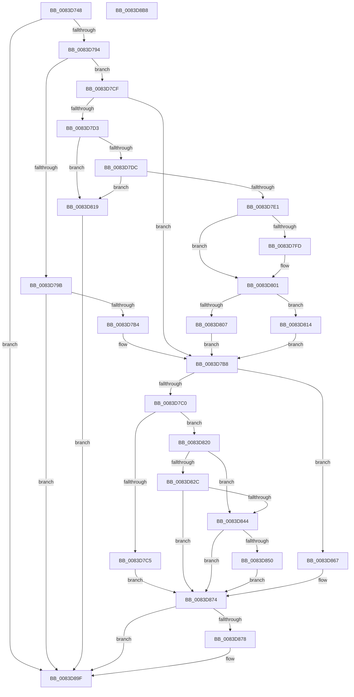

# RtlpMuiRegAddLanguageByName

- RVA: `0x0083D748`–`0x0083D8B9` (길이 `369` bytes)
- VA: `0x000000014083D748`
- 실행 섹션: `PAGE`
- PDB 이름 있음: `예`; PDB Function 태그: `아니요`
- unwind 정보 RVA: `0x000DB4B8`
- 디코드: `116`개 명령, `369/369` bytes 표시
- 미해석 바이트: `0` (있으면 어셈블리에 `.byte`로 보존)

> 이 문서는 커널 이미지의 기계어와 PDB 기호를 분석해 생성했습니다. 4번과 5번은 함수 원형과 자료형을 바이너리 사용 방식에서 추정한 C 해석이며 원본 소스 복구 결과는 아닙니다.

## 1. Dependencies

- 직접 호출 지점: **9**; 고유 호출 대상: **8**
- 직접 호출자로 확인된 함수: **1**
- RIP 상대 이미지 참조: **1**

### Outgoing calls
- `0x0083D785` → [RtlpMuiRegInitAnyLanguage](RtlpMuiRegInitAnyLanguage_function_0083F7FC.md) (function, `0x0083F7FC`)
- `0x0083D7A5` → [RtlpMuiRegInitLIPLanguage](RtlpMuiRegInitLIPLanguage_function_0083F8D8.md) (function, `0x0083F8D8`)
- `0x0083D7EF` → [RtlpMuiRegPopulateBaseLanguages](RtlpMuiRegPopulateBaseLanguages_function_0083FC4C.md) (function, `0x0083FC4C`)
- `0x0083D82F` → [RtlpLangNameInMultiSzString](../79/RtlpLangNameInMultiSzString_function_00791AE8.md) (function, `0x00791AE8`)
- `0x0083D856` → [RtlpLangNameInMultiSzString](../79/RtlpLangNameInMultiSzString_function_00791AE8.md) (function, `0x00791AE8`)
- `0x0083D86D` → [RtlpIsALicensedRegularLanguage](RtlpIsALicensedRegularLanguage_function_0083D1EC.md) (function, `0x0083D1EC`)
- `0x0083D888` → [RtlpMuiRegAddAlternateCodePage](../../text/6A/RtlpMuiRegAddAlternateCodePage_function_006A8EE4.md) (function, `0x006A8EE4`)
- `0x0083D898` → [RtlpMuiRegGetOrAddLangInfo](RtlpMuiRegGetOrAddLangInfo_function_0083E74C.md) (function, `0x0083E74C`)
- `0x0083D8A8` → [_security_check_cookie](../../text/6A/_security_check_cookie_function_006AC640.md) (function, `0x006AC640`)

### Direct callers
- [RtlpMuiRegLoadInstalledFromKey](../../text/6A/RtlpMuiRegLoadInstalledFromKey_function_006A9450.md) at `0x006A961A`

### Static image references
- `0x0083D756` → RVA `0x00E0A740` (`.data`; read)

## 2. Other-region calls and transfers

- 다른 실행 섹션으로 향하는 call: **2**
  - `0x0083D888` → [RtlpMuiRegAddAlternateCodePage](../../text/6A/RtlpMuiRegAddAlternateCodePage_function_006A8EE4.md) (`PAGE` → `.text`)
  - `0x0083D8A8` → [_security_check_cookie](../../text/6A/_security_check_cookie_function_006AC640.md) (`PAGE` → `.text`)
- 별도 외부 분기/꼬리 이동을 확인하지 못했습니다.

## 3. Assembly (complete function range)

```asm
0083D748  40 55                           push rbp
0083D74A  53                              push rbx
0083D74B  56                              push rsi
0083D74C  57                              push rdi
0083D74D  41 56                           push r14
0083D74F  48 8B EC                        mov rbp, rsp
0083D752  48 83 EC 60                     sub rsp, 0x60
0083D756  48 8B 05 E3 CF 5C 00            mov rax, qword ptr [rip + 0x5ccfe3]
0083D75D  48 33 C4                        xor rax, rsp
0083D760  48 89 45 F8                     mov qword ptr [rbp - 8], rax
0083D764  4C 8B 75 58                     mov r14, qword ptr [rbp + 0x58]
0083D768  33 C0                           xor eax, eax
0083D76A  48 8B FA                        mov rdi, rdx
0083D76D  48 89 45 E8                     mov qword ptr [rbp - 0x18], rax
0083D771  0F 57 C0                        xorps xmm0, xmm0
0083D774  89 45 F0                        mov dword ptr [rbp - 0x10], eax
0083D777  48 8D 55 D8                     lea rdx, [rbp - 0x28]
0083D77B  49 8B F0                        mov rsi, r8
0083D77E  0F 11 45 D8                     movups xmmword ptr [rbp - 0x28], xmm0
0083D782  48 8B D9                        mov rbx, rcx
0083D785  E8 72 20 00 00                  call 0x14083f7fc
0083D78A  8B C8                           mov ecx, eax
0083D78C  85 C0                           test eax, eax
0083D78E  0F 88 0B 01 00 00               js 0x14083d89f
0083D794  8A 45 D8                        mov al, byte ptr [rbp - 0x28]
0083D797  A8 04                           test al, 4
0083D799  74 34                           je 0x14083d7cf
0083D79B  4C 8D 45 D8                     lea r8, [rbp - 0x28]
0083D79F  48 8B D7                        mov rdx, rdi
0083D7A2  48 8B CB                        mov rcx, rbx
0083D7A5  E8 2E 21 00 00                  call 0x14083f8d8
0083D7AA  8B C8                           mov ecx, eax
0083D7AC  85 C0                           test eax, eax
0083D7AE  0F 88 EB 00 00 00               js 0x14083d89f
0083D7B4  0F B7 45 D8                     movzx eax, word ptr [rbp - 0x28]
0083D7B8  A8 04                           test al, 4
0083D7BA  0F 84 A7 00 00 00               je 0x14083d867
0083D7C0  48 85 DB                        test rbx, rbx
0083D7C3  75 5B                           jne 0x14083d820
0083D7C5  B9 0D 00 00 C0                  mov ecx, 0xc000000d
0083D7CA  E9 A5 00 00 00                  jmp 0x14083d874
0083D7CF  A8 02                           test al, 2
0083D7D1  74 E5                           je 0x14083d7b8
0083D7D3  83 65 D0 00                     and dword ptr [rbp - 0x30], 0
0083D7D7  48 85 DB                        test rbx, rbx
0083D7DA  74 3D                           je 0x14083d819
0083D7DC  48 85 FF                        test rdi, rdi
0083D7DF  74 38                           je 0x14083d819
0083D7E1  4C 8D 4D D0                     lea r9, [rbp - 0x30]
0083D7E5  48 8B D7                        mov rdx, rdi
0083D7E8  4C 8D 45 D8                     lea r8, [rbp - 0x28]
0083D7EC  48 8B CB                        mov rcx, rbx
0083D7EF  E8 58 24 00 00                  call 0x14083fc4c
0083D7F4  B9 00 10 00 00                  mov ecx, 0x1000
0083D7F9  85 C0                           test eax, eax
0083D7FB  79 04                           jns 0x14083d801
0083D7FD  66 09 4D D8                     or word ptr [rbp - 0x28], cx
0083D801  83 7D D0 00                     cmp dword ptr [rbp - 0x30], 0
0083D805  75 0D                           jne 0x14083d814
0083D807  0F B7 45 D8                     movzx eax, word ptr [rbp - 0x28]
0083D80B  66 0B C1                        or ax, cx
0083D80E  66 89 45 D8                     mov word ptr [rbp - 0x28], ax
0083D812  EB A4                           jmp 0x14083d7b8
0083D814  8A 45 D8                        mov al, byte ptr [rbp - 0x28]
0083D817  EB 9F                           jmp 0x14083d7b8
0083D819  B9 0D 00 00 C0                  mov ecx, 0xc000000d
0083D81E  EB 7F                           jmp 0x14083d89f
0083D820  48 8B 8B 88 00 00 00            mov rcx, qword ptr [rbx + 0x88]
0083D827  48 85 C9                        test rcx, rcx
0083D82A  74 18                           je 0x14083d844
0083D82C  48 8B D6                        mov rdx, rsi
0083D82F  E8 B4 42 F5 FF                  call 0x140791ae8
0083D834  8A C8                           mov cl, al
0083D836  F6 D9                           neg cl
0083D838  1B C9                           sbb ecx, ecx
0083D83A  81 E1 34 00 00 C0               and ecx, 0xc0000034
0083D840  84 C0                           test al, al
0083D842  75 30                           jne 0x14083d874
0083D844  48 8B 83 98 00 00 00            mov rax, qword ptr [rbx + 0x98]
0083D84B  48 85 C0                        test rax, rax
0083D84E  74 24                           je 0x14083d874
0083D850  48 8B D6                        mov rdx, rsi
0083D853  48 8B C8                        mov rcx, rax
0083D856  E8 8D 42 F5 FF                  call 0x140791ae8
0083D85B  F6 D8                           neg al
0083D85D  1B C9                           sbb ecx, ecx
0083D85F  81 E1 34 00 00 C0               and ecx, 0xc0000034
0083D865  EB 0D                           jmp 0x14083d874
0083D867  48 8B D6                        mov rdx, rsi
0083D86A  48 8B CB                        mov rcx, rbx
0083D86D  E8 7A F9 FF FF                  call 0x14083d1ec
0083D872  8B C8                           mov ecx, eax
0083D874  85 C9                           test ecx, ecx
0083D876  78 27                           js 0x14083d89f
0083D878  B8 20 08 00 00                  mov eax, 0x820
0083D87D  48 8D 4D D8                     lea rcx, [rbp - 0x28]
0083D881  66 09 45 D8                     or word ptr [rbp - 0x28], ax
0083D885  48 8B D7                        mov rdx, rdi
0083D888  E8 57 B6 E6 FF                  call 0x1406a8ee4
0083D88D  48 8D 4B 18                     lea rcx, [rbx + 0x18]
0083D891  4D 8B C6                        mov r8, r14
0083D894  48 8D 55 D8                     lea rdx, [rbp - 0x28]
0083D898  E8 AF 0E 00 00                  call 0x14083e74c
0083D89D  8B C8                           mov ecx, eax
0083D89F  8B C1                           mov eax, ecx
0083D8A1  48 8B 4D F8                     mov rcx, qword ptr [rbp - 8]
0083D8A5  48 33 CC                        xor rcx, rsp
0083D8A8  E8 93 ED E6 FF                  call 0x1406ac640
0083D8AD  48 83 C4 60                     add rsp, 0x60
0083D8B1  41 5E                           pop r14
0083D8B3  5F                              pop rdi
0083D8B4  5E                              pop rsi
0083D8B5  5B                              pop rbx
0083D8B6  5D                              pop rbp
0083D8B7  C3                              ret
0083D8B8  CC                              int3
```

## 4. C-style interpretation (structured pseudocode)

```c
__int64 __fastcall RtlpMuiRegAddLanguageByName(__int64 a1, __int64 a2, __int64 a3, __int64 a4, __int64 a5, __int64 a6)
{
    __int64 result;
    __int64 v_rsp;
    unsigned __int64 v_stack_m30;
    unsigned int v_stack_m38;
    unsigned __int64 v_stack_m40;
    unsigned __int64 v_stack_m50;
    unsigned int v_stack_m58;

    v_rsp = (v_rsp) - (96);
    result = (*(unsigned __int64 *)(v_rip + 6082531)) ^ (v_rsp);
    v_stack_m30 = result;
    result = 0;
    v_stack_m40 = 0;
    v_stack_m38 = 0;
    v_stack_m50 = v_xmm0;
    result = RtlpMuiRegInitAnyLanguage(a1, v_stack_m50, a3, a4);
    if (sign_flag) goto loc_0083D89F;
    if ((((unsigned __int8)(v_stack_m50)) & (4)) == 0) goto loc_0083D7CF;
    result = RtlpMuiRegInitLIPLanguage(a1, a2, v_stack_m50, a4);
    if (sign_flag) goto loc_0083D89F;
loc_0083D7B8:
    if ((((unsigned __int8)(v_stack_m50)) & (4)) == 0) goto loc_0083D867;
    if (a1 != 0) goto loc_0083D820;
    goto loc_0083D874;
loc_0083D7CF:
    if ((((unsigned __int8)(v_stack_m50)) & (2)) == 0) goto loc_0083D7B8;
    if (a1 == 0) goto loc_0083D819;
    if (a2 == 0) goto loc_0083D819;
    result = RtlpMuiRegPopulateBaseLanguages(a1, a2, v_stack_m50, v_stack_m58);
    if (sign_flag) {
    }
    if (v_stack_m58 != 0) goto loc_0083D814;
    result = (unsigned __int16)((v_stack_m50) | ((unsigned __int16)((unsigned int)(0x1000ULL))));
    v_stack_m50 = (unsigned __int16)(result);
    goto loc_0083D7B8;
loc_0083D814:
    goto loc_0083D7B8;
loc_0083D819:
    goto loc_0083D89F;
loc_0083D820:
    if (*(unsigned __int64 *)(a1 + 136) == 0) goto loc_0083D844;
    result = RtlpLangNameInMultiSzString(*(unsigned __int64 *)(a1 + 136), a3, v_stack_m50, v_stack_m58);
    a1 = (unsigned __int8)(-((unsigned __int8)(result)));
    a1 = (unsigned int)((a1) & (0xC0000034ULL));
    if ((unsigned __int8)(result) != 0) goto loc_0083D874;
loc_0083D844:
    if (*(unsigned __int64 *)(a1 + 152) == 0) goto loc_0083D874;
    result = RtlpLangNameInMultiSzString(*(unsigned __int64 *)(a1 + 152), a3, v_stack_m50, v_stack_m58);
    result = (unsigned __int8)(-(result));
    a1 = (unsigned int)((*(unsigned __int64 *)(a1 + 152)) & (0xC0000034ULL));
    goto loc_0083D874;
loc_0083D867:
    result = RtlpIsALicensedRegularLanguage(a1, a3, v_stack_m50, v_stack_m58);
loc_0083D874:
    if (!(sign_flag)) {
        result = 0x820ULL;
        a1 = v_stack_m50;
        a2 = a2;
        result = RtlpMuiRegAddAlternateCodePage(a1, a2, v_stack_m50, v_stack_m58);
        a1 = a1 + 24;
        a3 = a6;
        a2 = v_stack_m50;
        result = RtlpMuiRegGetOrAddLangInfo(a1, a2, a3, v_stack_m58);
        a1 = (unsigned int)(result);
    }
    a1 = (v_stack_m30) ^ (v_rsp);
    result = _security_check_cookie(a1, a2, a3, v_stack_m58);
    v_rsp = (v_rsp) + (96);
    return result;
}
```

## 5. (Beta) C Style

```c
int64_t RtlpMuiRegAddLanguageByName(int64_t Arg1, int64_t Arg2, int64_t Arg3, int64_t Arg4, uint64_t Arg5, int64_t Arg6)
{
    int64_t result;
    int64_t local_rsp;
    uint64_t v_stack_m30;
    uint32_t v_stack_m38;
    uint64_t v_stack_m40;
    uint64_t v_stack_m50;
    uint32_t v_stack_m58;

    local_rsp = (local_rsp) - (96);
    result = (*(uint64_t *)(v_rip + 0x5CCFE3)) ^ (local_rsp);
    v_stack_m30 = result;
    result = 0;
    v_stack_m40 = 0;
    v_stack_m38 = 0;
    v_stack_m50 = v_xmm0;
    result = RtlpMuiRegInitAnyLanguage(Arg1, v_stack_m50, Arg3, Arg4);
    if (sign_flag) goto loc_0083D89F;
    if ((((uint8_t)(v_stack_m50)) & (4)) == 0) goto loc_0083D7CF;
    result = RtlpMuiRegInitLIPLanguage(Arg1, Arg2, v_stack_m50, Arg4);
    if (sign_flag) goto loc_0083D89F;
loc_0083D7B8:
    if ((((uint8_t)(v_stack_m50)) & (4)) == 0) goto loc_0083D867;
    if (Arg1 != 0) goto loc_0083D820;
    goto loc_0083D874;
loc_0083D7CF:
    if ((((uint8_t)(v_stack_m50)) & (2)) == 0) goto loc_0083D7B8;
    if (Arg1 == 0) goto loc_0083D819;
    if (Arg2 == 0) goto loc_0083D819;
    result = RtlpMuiRegPopulateBaseLanguages(Arg1, Arg2, v_stack_m50, v_stack_m58);
    if (sign_flag) {
    }
    if (v_stack_m58 != 0) goto loc_0083D814;
    result = (uint16_t)((v_stack_m50) | ((uint16_t)((uint32_t)(0x1000ULL))));
    v_stack_m50 = (uint16_t)(result);
    goto loc_0083D7B8;
loc_0083D814:
    goto loc_0083D7B8;
loc_0083D819:
    goto loc_0083D89F;
loc_0083D820:
    if (*(uint64_t *)(Arg1 + 0x88) == 0) goto loc_0083D844;
    result = RtlpLangNameInMultiSzString(*(uint64_t *)(Arg1 + 0x88), Arg3, v_stack_m50, v_stack_m58);
    Arg1 = (uint8_t)(-((uint8_t)(result)));
    Arg1 = (uint32_t)((Arg1) & (0xC0000034ULL));
    if ((uint8_t)(result) != 0) goto loc_0083D874;
loc_0083D844:
    if (*(uint64_t *)(Arg1 + 0x98) == 0) goto loc_0083D874;
    result = RtlpLangNameInMultiSzString(*(uint64_t *)(Arg1 + 0x98), Arg3, v_stack_m50, v_stack_m58);
    result = (uint8_t)(-(result));
    Arg1 = (uint32_t)((*(uint64_t *)(Arg1 + 0x98)) & (0xC0000034ULL));
    goto loc_0083D874;
loc_0083D867:
    result = RtlpIsALicensedRegularLanguage(Arg1, Arg3, v_stack_m50, v_stack_m58);
loc_0083D874:
    if (!(sign_flag)) {
        result = 0x820ULL;
        Arg1 = v_stack_m50;
        Arg2 = Arg2;
        result = RtlpMuiRegAddAlternateCodePage(Arg1, Arg2, v_stack_m50, v_stack_m58);
        Arg1 = Arg1 + 24;
        Arg3 = Arg6;
        Arg2 = v_stack_m50;
        result = RtlpMuiRegGetOrAddLangInfo(Arg1, Arg2, Arg3, v_stack_m58);
        Arg1 = (uint32_t)(result);
    }
    Arg1 = (v_stack_m30) ^ (local_rsp);
    result = _security_check_cookie(Arg1, Arg2, Arg3, v_stack_m58);
    local_rsp = (local_rsp) + (96);
    return result;
}
```

## 6. Execution-region graph

[열기: 2D/3D 그래프와 함수 탐색 컨트롤 패널](../../../control-panel.html?section=page&rva=0x0083D748&view=graph)

- 2D 그래프는 위에서 아래로 흐르고, 3D 그래프는 빈 공간을 드래그해 회전합니다. Shift+드래그는 이동, 휠은 확대·축소, 함수 노드 선택은 대상 보고서 이동입니다.

### Static fallback


