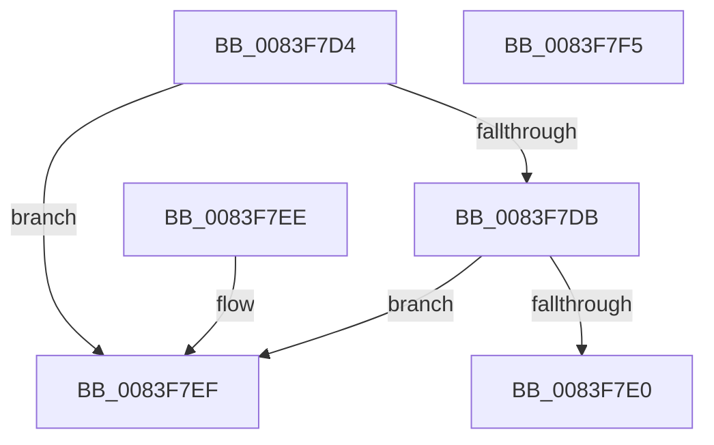

# RtlpMuiRegAddNeutralLanguage

- RVA: `0x0083F7D4`–`0x0083F7F6` (길이 `34` bytes)
- VA: `0x000000014083F7D4`
- 실행 섹션: `PAGE`
- PDB 이름 있음: `예`; PDB Function 태그: `아니요`
- unwind 정보 RVA: `0x000DB714`
- 디코드: `13`개 명령, `34/34` bytes 표시
- 미해석 바이트: `0` (있으면 어셈블리에 `.byte`로 보존)

> 이 문서는 커널 이미지의 기계어와 PDB 기호를 분석해 생성했습니다. 4번과 5번은 함수 원형과 자료형을 바이너리 사용 방식에서 추정한 C 해석이며 원본 소스 복구 결과는 아닙니다.

## 1. Dependencies

- 직접 호출 지점: **0**; 고유 호출 대상: **0**
- 직접 호출자로 확인된 함수: **1**
- RIP 상대 이미지 참조: **0**

### Outgoing calls
- 직접 디코드된 call 명령이 없습니다.

### Direct callers
- [RtlpMuiRegInitAnyLanguage](RtlpMuiRegInitAnyLanguage_function_0083F7FC.md) at `0x0083F8AB`

### Static image references
- 디코드된 RIP-relative 메모리 참조가 없습니다.

## 2. Other-region calls and transfers

- 다른 실행 섹션으로 향하는 call: **0**
- 별도 외부 분기/꼬리 이동을 확인하지 못했습니다.

## 3. Assembly (complete function range)

```asm
0083F7D4  33 C0                           xor eax, eax
0083F7D6  48 85 C9                        test rcx, rcx
0083F7D9  74 14                           je 0x14083f7ef
0083F7DB  48 85 D2                        test rdx, rdx
0083F7DE  74 0F                           je 0x14083f7ef
0083F7E0  B9 FF 3F 00 00                  mov ecx, 0x3fff
0083F7E5  66 89 42 0A                     mov word ptr [rdx + 0xa], ax
0083F7E9  66 21 4A 08                     and word ptr [rdx + 8], cx
0083F7ED  C3                              ret
0083F7EE  CC                              int3
0083F7EF  B8 0D 00 00 C0                  mov eax, 0xc000000d
0083F7F4  C3                              ret
0083F7F5  CC                              int3
```

## 4. C-style interpretation (structured pseudocode)

```c
__int64 __fastcall RtlpMuiRegAddNeutralLanguage(__int64 a1, __int64 a2)
{
    __int64 result;

    result = 0;
    if (a1 == 0) goto loc_0083F7EF;
    if (a2 == 0) goto loc_0083F7EF;
    *(unsigned __int16 *)(a2 + 10) = 0;
    return result;
loc_0083F7EF:
    return (unsigned int)(0xC000000DULL);
}
```

## 5. (Beta) C Style

```c
int64_t RtlpMuiRegAddNeutralLanguage(int64_t Arg1, int64_t Arg2)
{
    int64_t result;

    result = 0;
    if (Arg1 == 0) goto loc_0083F7EF;
    if (Arg2 == 0) goto loc_0083F7EF;
    *(uint16_t *)(Arg2 + 0xA) = 0;
    return result;
loc_0083F7EF:
    return (uint32_t)(0xC000000DULL);
}
```

## 6. Execution-region graph

[열기: 2D/3D 그래프와 함수 탐색 컨트롤 패널](../../../control-panel.html?section=page&rva=0x0083F7D4&view=graph)

- 2D 그래프는 위에서 아래로 흐르고, 3D 그래프는 빈 공간을 드래그해 회전합니다. Shift+드래그는 이동, 휠은 확대·축소, 함수 노드 선택은 대상 보고서 이동입니다.

### Static fallback


