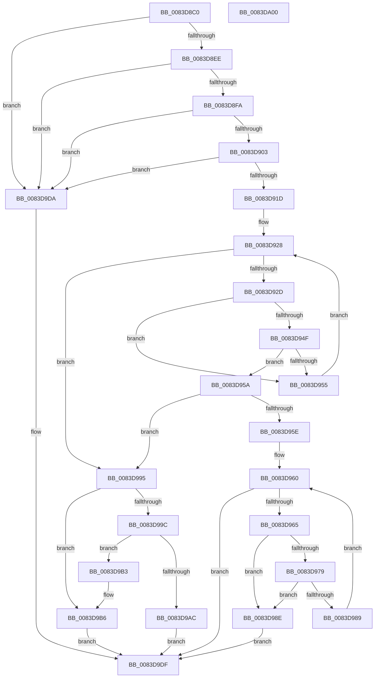

# RtlpMuiRegConfigListAddLanguage

- RVA: `0x0083D8C0`–`0x0083DA01` (길이 `321` bytes)
- VA: `0x000000014083D8C0`
- 실행 섹션: `PAGE`
- PDB 이름 있음: `예`; PDB Function 태그: `아니요`
- unwind 정보 RVA: `0x0005FEF8`
- 디코드: `94`개 명령, `321/321` bytes 표시
- 미해석 바이트: `0` (있으면 어셈블리에 `.byte`로 보존)

> 이 문서는 커널 이미지의 기계어와 PDB 기호를 분석해 생성했습니다. 4번과 5번은 함수 원형과 자료형을 바이너리 사용 방식에서 추정한 C 해석이며 원본 소스 복구 결과는 아닙니다.

## 1. Dependencies

- 직접 호출 지점: **1**; 고유 호출 대상: **1**
- 직접 호출자로 확인된 함수: **1**
- RIP 상대 이미지 참조: **0**

### Outgoing calls
- `0x0083D99F` → [RtlpMuiRegGrowLanguageConfigList](RtlpMuiRegGrowLanguageConfigList_function_0083EAB4.md) (function, `0x0083EAB4`)

### Direct callers
- [RtlpPopulateLanguageConfigList](RtlpPopulateLanguageConfigList_function_0083EF20.md) at `0x0083F190`

### Static image references
- 디코드된 RIP-relative 메모리 참조가 없습니다.

## 2. Other-region calls and transfers

- 다른 실행 섹션으로 향하는 call: **0**
- 별도 외부 분기/꼬리 이동을 확인하지 못했습니다.

## 3. Assembly (complete function range)

```asm
0083D8C0  48 8B C4                        mov rax, rsp
0083D8C3  48 89 58 08                     mov qword ptr [rax + 8], rbx
0083D8C7  48 89 68 10                     mov qword ptr [rax + 0x10], rbp
0083D8CB  48 89 70 18                     mov qword ptr [rax + 0x18], rsi
0083D8CF  48 89 78 20                     mov qword ptr [rax + 0x20], rdi
0083D8D3  41 54                           push r12
0083D8D5  41 56                           push r14
0083D8D7  41 57                           push r15
0083D8D9  48 83 EC 20                     sub rsp, 0x20
0083D8DD  33 DB                           xor ebx, ebx
0083D8DF  48 8B FA                        mov rdi, rdx
0083D8E2  48 8B F1                        mov rsi, rcx
0083D8E5  48 85 C9                        test rcx, rcx
0083D8E8  0F 84 EC 00 00 00               je 0x14083d9da
0083D8EE  4C 8B 01                        mov r8, qword ptr [rcx]
0083D8F1  4D 85 C0                        test r8, r8
0083D8F4  0F 84 E0 00 00 00               je 0x14083d9da
0083D8FA  48 85 D2                        test rdx, rdx
0083D8FD  0F 84 D7 00 00 00               je 0x14083d9da
0083D903  0F B7 6A 02                     movzx ebp, word ptr [rdx + 2]
0083D907  44 0F B7 32                     movzx r14d, word ptr [rdx]
0083D90B  44 0F B7 CD                     movzx r9d, bp
0083D90F  66 41 C1 E9 0E                  shr r9w, 0xe
0083D914  45 84 C9                        test r9b, r9b
0083D917  0F 84 BD 00 00 00               je 0x14083d9da
0083D91D  45 0F B7 50 04                  movzx r10d, word ptr [r8 + 4]
0083D922  44 8D 63 01                     lea r12d, [rbx + 1]
0083D926  8B D3                           mov edx, ebx
0083D928  41 3B D2                        cmp edx, r10d
0083D92B  7D 68                           jge 0x14083d995
0083D92D  48 63 C2                        movsxd rax, edx
0083D930  48 8D 0C 40                     lea rcx, [rax + rax*2]
0083D934  49 8B 40 08                     mov rax, qword ptr [r8 + 8]
0083D938  4C 8D 1C 88                     lea r11, [rax + rcx*4]
0083D93C  45 0F B7 7B 02                  movzx r15d, word ptr [r11 + 2]
0083D941  41 0F B7 C7                     movzx eax, r15w
0083D945  66 C1 E8 0E                     shr ax, 0xe
0083D949  66 41 3B C1                     cmp ax, r9w
0083D94D  75 06                           jne 0x14083d955
0083D94F  66 45 39 33                     cmp word ptr [r11], r14w
0083D953  74 05                           je 0x14083d95a
0083D955  41 03 D4                        add edx, r12d
0083D958  EB CE                           jmp 0x14083d928
0083D95A  85 D2                           test edx, edx
0083D95C  78 37                           js 0x14083d995
0083D95E  8B D3                           mov edx, ebx
0083D960  83 FA 03                        cmp edx, 3
0083D963  7D 7A                           jge 0x14083d9df
0083D965  0F B7 CA                        movzx ecx, dx
0083D968  41 0F B7 C7                     movzx eax, r15w
0083D96C  66 03 C9                        add cx, cx
0083D96F  66 33 C5                        xor ax, bp
0083D972  66 D3 E8                        shr ax, cl
0083D975  A8 03                           test al, 3
0083D977  75 15                           jne 0x14083d98e
0083D979  48 63 CA                        movsxd rcx, edx
0083D97C  0F B7 44 4F 06                  movzx eax, word ptr [rdi + rcx*2 + 6]
0083D981  66 41 39 44 4B 06               cmp word ptr [r11 + rcx*2 + 6], ax
0083D987  75 05                           jne 0x14083d98e
0083D989  41 03 D4                        add edx, r12d
0083D98C  EB D2                           jmp 0x14083d960
0083D98E  BB 00 00 00 40                  mov ebx, 0x40000000
0083D993  EB 4A                           jmp 0x14083d9df
0083D995  66 45 3B 50 06                  cmp r10w, word ptr [r8 + 6]
0083D99A  72 1A                           jb 0x14083d9b6
0083D99C  49 8B C8                        mov rcx, r8
0083D99F  E8 10 11 00 00                  call 0x14083eab4
0083D9A4  4C 8B C0                        mov r8, rax
0083D9A7  48 85 C0                        test rax, rax
0083D9AA  75 07                           jne 0x14083d9b3
0083D9AC  BB 17 00 00 C0                  mov ebx, 0xc0000017
0083D9B1  EB 2C                           jmp 0x14083d9df
0083D9B3  48 89 06                        mov qword ptr [rsi], rax
0083D9B6  41 0F B7 40 04                  movzx eax, word ptr [r8 + 4]
0083D9BB  49 8B 48 08                     mov rcx, qword ptr [r8 + 8]
0083D9BF  F2 0F 10 07                     movsd xmm0, qword ptr [rdi]
0083D9C3  48 8D 14 40                     lea rdx, [rax + rax*2]
0083D9C7  8B 47 08                        mov eax, dword ptr [rdi + 8]
0083D9CA  F2 0F 11 04 91                  movsd qword ptr [rcx + rdx*4], xmm0
0083D9CF  89 44 91 08                     mov dword ptr [rcx + rdx*4 + 8], eax
0083D9D3  66 45 01 60 04                  add word ptr [r8 + 4], r12w
0083D9D8  EB 05                           jmp 0x14083d9df
0083D9DA  BB 0D 00 00 C0                  mov ebx, 0xc000000d
0083D9DF  48 8B 6C 24 48                  mov rbp, qword ptr [rsp + 0x48]
0083D9E4  8B C3                           mov eax, ebx
0083D9E6  48 8B 5C 24 40                  mov rbx, qword ptr [rsp + 0x40]
0083D9EB  48 8B 74 24 50                  mov rsi, qword ptr [rsp + 0x50]
0083D9F0  48 8B 7C 24 58                  mov rdi, qword ptr [rsp + 0x58]
0083D9F5  48 83 C4 20                     add rsp, 0x20
0083D9F9  41 5F                           pop r15
0083D9FB  41 5E                           pop r14
0083D9FD  41 5C                           pop r12
0083D9FF  C3                              ret
0083DA00  CC                              int3
```

## 4. C-style interpretation (structured pseudocode)

```c
__int64 __fastcall RtlpMuiRegConfigListAddLanguage(__int64 a1, __int64 a2)
{
    __int64 result;
    __int64 v_rbx;
    __int64 v_rsp;
    unsigned __int64 v_stack_p10;
    unsigned __int64 v_stack_p18;
    unsigned __int64 v_stack_p20;
    unsigned __int64 v_stack_p8;

    *(unsigned __int64 *)(v_rsp + 8) = v_rbx;
    *(unsigned __int64 *)(v_rsp + 16) = v_rbp;
    *(unsigned __int64 *)(v_rsp + 24) = v_rsi;
    *(unsigned __int64 *)(v_rsp + 32) = v_rdi;
    v_rsp = (v_rsp) - (32);
    v_rbx = 0;
    if (a1 == 0) goto loc_0083D9DA;
    if (*(unsigned __int64 *)(a1) == 0) goto loc_0083D9DA;
    if (a2 == 0) goto loc_0083D9DA;
    a4 = (unsigned __int16)(((unsigned __int16)(*(unsigned __int16 *)(a2 + 2))) >> (14));
    if ((unsigned __int8)(a4) == 0) goto loc_0083D9DA;
loc_0083D928:
    if (0 >= ((unsigned int)(*(unsigned __int16 *)(*(unsigned __int64 *)(a1) + 4)))) goto loc_0083D995;
    result = (unsigned __int16)(((unsigned __int16)(*(unsigned __int16 *)(*(unsigned __int64 *)(*(unsigned __int64 *)(a1) + 8) + (int)(0) + (int)(0) * 2 * 4 + 2))) >> (14));
    if (((unsigned __int16)(result)) != ((unsigned __int16)(a4))) goto loc_0083D955;
    if ((*(unsigned __int16 *)(*(unsigned __int64 *)(*(unsigned __int64 *)(a1) + 8) + (int)(0) + (int)(0) * 2 * 4)) == ((unsigned __int16)(*(unsigned __int16 *)(a2)))) goto loc_0083D95A;
loc_0083D955:
    a2 = (unsigned int)((0) + ((unsigned int)(v_rbx + 1)));
    goto loc_0083D928;
loc_0083D95A:
    if (sign_flag) goto loc_0083D995;
loc_0083D960:
    if (0 >= 3) goto loc_0083D9DF;
    a1 = (unsigned __int16)((0) + (0));
    result = (unsigned __int16)(((unsigned __int16)(*(unsigned __int16 *)(*(unsigned __int64 *)(*(unsigned __int64 *)(a1) + 8) + (int)(0) + (int)(0) * 2 * 4 + 2))) ^ ((unsigned __int16)(*(unsigned __int16 *)(a2 + 2))));
    result = (unsigned __int16)((result) >> ((unsigned __int8)(a1)));
    if ((((unsigned __int8)(result)) & (3)) != 0) goto loc_0083D98E;
    if ((*(unsigned __int16 *)(*(unsigned __int64 *)(*(unsigned __int64 *)(a1) + 8) + (int)(0) + (int)(0) * 2 * 4 + (int)(0) * 2 + 6)) != ((unsigned __int16)(*(unsigned __int16 *)(a2 + (int)(0) * 2 + 6)))) goto loc_0083D98E;
    a2 = (unsigned int)((0) + ((unsigned int)(v_rbx + 1)));
    goto loc_0083D960;
loc_0083D98E:
    goto loc_0083D9DF;
loc_0083D995:
    if (((unsigned __int16)(*(unsigned __int16 *)(*(unsigned __int64 *)(a1) + 4))) < (*(unsigned __int16 *)(*(unsigned __int64 *)(a1) + 6))) goto loc_0083D9B6;
    result = RtlpMuiRegGrowLanguageConfigList(*(unsigned __int64 *)(a1), a2, *(unsigned __int64 *)(a1), a4);
    if (result != 0) goto loc_0083D9B3;
    goto loc_0083D9DF;
loc_0083D9B3:
    *(unsigned __int64 *)(a1) = result;
loc_0083D9B6:
    *(unsigned __int64 *)(*(unsigned __int64 *)(result + 8) + *(unsigned __int16 *)(result + 4) + *(unsigned __int16 *)(result + 4) * 2 * 4) = v_xmm0;
    *(unsigned int *)(*(unsigned __int64 *)(result + 8) + *(unsigned __int16 *)(result + 4) + *(unsigned __int16 *)(result + 4) * 2 * 4 + 8) = (unsigned int)((unsigned int)(*(unsigned int *)(a2 + 8)));
    goto loc_0083D9DF;
loc_0083D9DA:
loc_0083D9DF:
    v_rsp = (v_rsp) + (32);
    return (unsigned int)((unsigned int)((unsigned int)(0xC000000DULL)));
}
```

## 5. (Beta) C Style

```c
int64_t RtlpMuiRegConfigListAddLanguage(void *Arg1, void *Arg2)
{
    uint8_t *arg1 = (uint8_t *)Arg1;
    uint8_t *arg2 = (uint8_t *)Arg2;

    int64_t result;
    int64_t local_rbx;
    int64_t local_rsp;
    uint64_t v_stack_p10;
    uint64_t v_stack_p18;
    uint64_t v_stack_p20;
    uint64_t v_stack_p8;

    *(uint64_t *)(local_rsp + 0x8) = local_rbx;
    *(uint64_t *)(local_rsp + 0x10) = local_rbp;
    *(uint64_t *)(local_rsp + 0x18) = local_rsi;
    *(uint64_t *)(local_rsp + 0x20) = local_rdi;
    local_rsp = (local_rsp) - (32);
    local_rbx = 0;
    if (Arg1 == NULL) goto loc_0083D9DA;
    if (*(uint64_t *)(arg1) == 0) goto loc_0083D9DA;
    if (Arg2 == NULL) goto loc_0083D9DA;
    a4 = (uint16_t)(((uint16_t)(*(uint16_t *)(arg2 + 0x2))) >> (14));
    if ((uint8_t)(a4) == 0) goto loc_0083D9DA;
loc_0083D928:
    if (0 >= ((uint32_t)(*(uint16_t *)(*(uint64_t *)(arg1) + 0x4)))) goto loc_0083D995;
    result = (uint16_t)(((uint16_t)(*(uint16_t *)(*(uint64_t *)(*(uint64_t *)(arg1) + 0x8) + (int32_t)(0) + (int32_t)(0) * 2 * 4 + 0x2))) >> (14));
    if (((uint16_t)(result)) != ((uint16_t)(a4))) goto loc_0083D955;
    if ((*(uint16_t *)(*(uint64_t *)(*(uint64_t *)(arg1) + 0x8) + (int32_t)(0) + (int32_t)(0) * 2 * 4)) == ((uint16_t)(*(uint16_t *)(arg2)))) goto loc_0083D95A;
loc_0083D955:
    Arg2 = (uint32_t)((0) + ((uint32_t)(local_rbx + 1)));
    goto loc_0083D928;
loc_0083D95A:
    if (sign_flag) goto loc_0083D995;
loc_0083D960:
    if (0 >= 3) goto loc_0083D9DF;
    Arg1 = (uint16_t)((0) + (0));
    result = (uint16_t)(((uint16_t)(*(uint16_t *)(*(uint64_t *)(*(uint64_t *)(arg1) + 0x8) + (int32_t)(0) + (int32_t)(0) * 2 * 4 + 0x2))) ^ ((uint16_t)(*(uint16_t *)(arg2 + 0x2))));
    result = (uint16_t)((result) >> ((uint8_t)(Arg1)));
    if ((((uint8_t)(result)) & (3)) != 0) goto loc_0083D98E;
    if ((*(uint16_t *)(*(uint64_t *)(*(uint64_t *)(arg1) + 0x8) + (int32_t)(0) + (int32_t)(0) * 2 * 4 + (int32_t)(0) * 2 + 0x6)) != ((uint16_t)(*(uint16_t *)(arg2 + (int32_t)(0) * 2 + 0x6)))) goto loc_0083D98E;
    Arg2 = (uint32_t)((0) + ((uint32_t)(local_rbx + 1)));
    goto loc_0083D960;
loc_0083D98E:
    goto loc_0083D9DF;
loc_0083D995:
    if (((uint16_t)(*(uint16_t *)(*(uint64_t *)(arg1) + 0x4))) < (*(uint16_t *)(*(uint64_t *)(arg1) + 0x6))) goto loc_0083D9B6;
    result = RtlpMuiRegGrowLanguageConfigList(*(uint64_t *)(arg1), Arg2, *(uint64_t *)(arg1), a4);
    if (result != 0) goto loc_0083D9B3;
    goto loc_0083D9DF;
loc_0083D9B3:
    *(uint64_t *)(arg1) = result;
loc_0083D9B6:
    *(uint64_t *)(*(uint64_t *)(result + 0x8) + *(uint16_t *)(result + 0x4) + *(uint16_t *)(result + 0x4) * 2 * 4) = v_xmm0;
    *(uint32_t *)(*(uint64_t *)(result + 0x8) + *(uint16_t *)(result + 0x4) + *(uint16_t *)(result + 0x4) * 2 * 4 + 0x8) = (uint32_t)((uint32_t)(*(uint32_t *)(arg2 + 0x8)));
    goto loc_0083D9DF;
loc_0083D9DA:
loc_0083D9DF:
    local_rsp = (local_rsp) + (32);
    return (uint32_t)((uint32_t)((uint32_t)(0xC000000DULL)));
}
```

### 관측된 메모리 오프셋

구조체 형식이 확인되지 않은 접근은 인자 기준의 오프셋으로만 기록했습니다.

| 기준 인자 | 오프셋 표현 | 폭 (bit) | 접근 |
|---|---:|---:|---|
| `Arg1` | `+ 0x0` | `64` | `W` |
| `Arg2` | `+ 0x0` | `64` | `R` |
| `Arg2` | `+ 0x6 + rcx*2` | `16` | `R` |
| `Arg2` | `+ 0x8` | `32` | `R` |

## 6. Execution-region graph

[열기: 2D/3D 그래프와 함수 탐색 컨트롤 패널](../../../control-panel.html?section=page&rva=0x0083D8C0&view=graph)

- 2D 그래프는 위에서 아래로 흐르고, 3D 그래프는 빈 공간을 드래그해 회전합니다. Shift+드래그는 이동, 휠은 확대·축소, 함수 노드 선택은 대상 보고서 이동입니다.

### Static fallback


