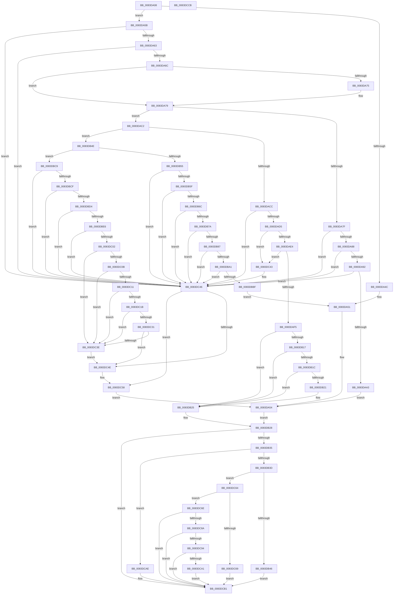

# RtlpMuiRegConfigMatchesInstalled

- RVA: `0x0083DA08`–`0x0083DCCC` (길이 `708` bytes)
- VA: `0x000000014083DA08`
- 실행 섹션: `PAGE`
- PDB 이름 있음: `예`; PDB Function 태그: `아니요`
- unwind 정보 RVA: `0x000BF660`
- 디코드: `203`개 명령, `708/708` bytes 표시
- 미해석 바이트: `0` (있으면 어셈블리에 `.byte`로 보존)

> 이 문서는 커널 이미지의 기계어와 PDB 기호를 분석해 생성했습니다. 4번과 5번은 함수 원형과 자료형을 바이너리 사용 방식에서 추정한 C 해석이며 원본 소스 복구 결과는 아닙니다.

## 1. Dependencies

- 직접 호출 지점: **9**; 고유 호출 대상: **8**
- 직접 호출자로 확인된 함수: **1**
- RIP 상대 이미지 참조: **0**

### Outgoing calls
- `0x0083DAB9` → [RtlpMuiRegLangInfoMatchesSpec](RtlpMuiRegLangInfoMatchesSpec_function_0083EBD0.md) (function, `0x0083EBD0`)
- `0x0083DB0A` → [RtlpMuiRegLangInfoMatchesSpec](RtlpMuiRegLangInfoMatchesSpec_function_0083EBD0.md) (function, `0x0083EBD0`)
- `0x0083DBA5` → [RtlInitUnicodeString](../../text/42/RtlInitUnicodeString_function_0042A780.md) (function, `0x0042A780`)
- `0x0083DBB2` → [RtlCultureNameToLCID](../AA/RtlCultureNameToLCID_function_00AACEF0.md) (function, `0x00AACEF0`)
- `0x0083DBD9` → [_MuiRegAllocArray](../../text/6A/_MuiRegAllocArray_function_006A9418.md) (function, `0x006A9418`)
- `0x0083DBF9` → [RtlLCIDToCultureName](../AD/RtlLCIDToCultureName_function_00AD3010.md) (function, `0x00AD3010`)
- `0x0083DC35` → [wcsicmp](../../text/50/wcsicmp_function_00500080.md) (function, `0x00500080`)
- `0x0083DC53` → [ExFreePoolWithTag](../../poolcode/B8/ExFreePoolWithTag_function_00B82870.md) (function, `0x00B82870`)
- `0x0083DC7F` → [RtlpMuiRegGetInstalledLanguageIndex](RtlpMuiRegGetInstalledLanguageIndex_function_0083E1CC.md) (function, `0x0083E1CC`)

### Direct callers
- [RtlpMuiRegValidateConfigNode](../../text/6A/RtlpMuiRegValidateConfigNode_function_006A925C.md) at `0x006A9365`

### Static image references
- 디코드된 RIP-relative 메모리 참조가 없습니다.

## 2. Other-region calls and transfers

- 다른 실행 섹션으로 향하는 call: **4**
  - `0x0083DBA5` → [RtlInitUnicodeString](../../text/42/RtlInitUnicodeString_function_0042A780.md) (`PAGE` → `.text`)
  - `0x0083DBD9` → [_MuiRegAllocArray](../../text/6A/_MuiRegAllocArray_function_006A9418.md) (`PAGE` → `.text`)
  - `0x0083DC35` → [wcsicmp](../../text/50/wcsicmp_function_00500080.md) (`PAGE` → `.text`)
  - `0x0083DC53` → [ExFreePoolWithTag](../../poolcode/B8/ExFreePoolWithTag_function_00B82870.md) (`PAGE` → `POOLCODE`)
- 별도 외부 분기/꼬리 이동을 확인하지 못했습니다.

## 3. Assembly (complete function range)

```asm
0083DA08  48 89 5C 24 08                  mov qword ptr [rsp + 8], rbx
0083DA0D  55                              push rbp
0083DA0E  56                              push rsi
0083DA0F  57                              push rdi
0083DA10  41 54                           push r12
0083DA12  41 55                           push r13
0083DA14  41 56                           push r14
0083DA16  41 57                           push r15
0083DA18  48 8B EC                        mov rbp, rsp
0083DA1B  48 83 EC 40                     sub rsp, 0x40
0083DA1F  45 33 FF                        xor r15d, r15d
0083DA22  44 0F B6 EA                     movzx r13d, dl
0083DA26  4D 0F BF F0                     movsx r14, r8w
0083DA2A  0F 57 C0                        xorps xmm0, xmm0
0083DA2D  44 89 7D 48                     mov dword ptr [rbp + 0x48], r15d
0083DA31  45 8A D1                        mov r10b, r9b
0083DA34  66 44 89 7D 58                  mov word ptr [rbp + 0x58], r15w
0083DA39  48 8B F1                        mov rsi, rcx
0083DA3C  4C 89 7D E8                     mov qword ptr [rbp - 0x18], r15
0083DA40  45 8B E7                        mov r12d, r15d
0083DA43  0F 11 45 F0                     movups xmmword ptr [rbp - 0x10], xmm0
0083DA47  45 3A E9                        cmp r13b, r9b
0083DA4A  75 0F                           jne 0x14083da5b
0083DA4C  66 44 3B 75 60                  cmp r14w, word ptr [rbp + 0x60]
0083DA51  0F 94 C3                        sete bl
0083DA54  33 C0                           xor eax, eax
0083DA56  E9 CD 00 00 00                  jmp 0x14083db28
0083DA5B  84 D2                           test dl, dl
0083DA5D  0F 84 E3 01 00 00               je 0x14083dc46
0083DA63  45 84 D2                        test r10b, r10b
0083DA66  0F 84 DA 01 00 00               je 0x14083dc46
0083DA6C  48 8B 7D 70                     mov rdi, qword ptr [rbp + 0x70]
0083DA70  48 85 FF                        test rdi, rdi
0083DA73  74 04                           je 0x14083da79
0083DA75  66 83 0F FF                     or word ptr [rdi], 0xffff
0083DA79  41 80 FD 02                     cmp r13b, 2
0083DA7D  75 43                           jne 0x14083dac2
0083DA7F  48 85 F6                        test rsi, rsi
0083DA82  0F 84 BE 01 00 00               je 0x14083dc46
0083DA88  66 45 85 F6                     test r14w, r14w
0083DA8C  0F 88 B4 01 00 00               js 0x14083dc46
0083DA92  48 8B 51 18                     mov rdx, qword ptr [rcx + 0x18]
0083DA96  0F B7 4A 06                     movzx ecx, word ptr [rdx + 6]
0083DA9A  44 3B F1                        cmp r14d, ecx
0083DA9D  0F 83 A3 01 00 00               jae 0x14083dc46
0083DAA3  44 0F B7 4D 60                  movzx r9d, word ptr [rbp + 0x60]
0083DAA8  45 8A C2                        mov r8b, r10b
0083DAAB  4D 6B FE 1C                     imul r15, r14, 0x1c
0083DAAF  48 8B CE                        mov rcx, rsi
0083DAB2  4C 03 7A 10                     add r15, qword ptr [rdx + 0x10]
0083DAB6  49 8B D7                        mov rdx, r15
0083DAB9  E8 12 11 00 00                  call 0x14083ebd0
0083DABE  8A D8                           mov bl, al
0083DAC0  EB 92                           jmp 0x14083da54
0083DAC2  41 80 FA 02                     cmp r10b, 2
0083DAC6  0F 85 82 00 00 00               jne 0x14083db4e
0083DACC  48 85 F6                        test rsi, rsi
0083DACF  0F 84 71 01 00 00               je 0x14083dc46
0083DAD5  4C 0F BF 7D 60                  movsx r15, word ptr [rbp + 0x60]
0083DADA  66 45 85 FF                     test r15w, r15w
0083DADE  0F 88 5F 01 00 00               js 0x14083dc43
0083DAE4  48 8B 56 18                     mov rdx, qword ptr [rsi + 0x18]
0083DAE8  0F B7 4A 06                     movzx ecx, word ptr [rdx + 6]
0083DAEC  44 3B F9                        cmp r15d, ecx
0083DAEF  0F 83 4E 01 00 00               jae 0x14083dc43
0083DAF5  4D 6B E7 1C                     imul r12, r15, 0x1c
0083DAF9  45 0F B7 CE                     movzx r9d, r14w
0083DAFD  45 8A C5                        mov r8b, r13b
0083DB00  4C 03 62 10                     add r12, qword ptr [rdx + 0x10]
0083DB04  48 8B CE                        mov rcx, rsi
0083DB07  49 8B D4                        mov rdx, r12
0083DB0A  E8 C1 10 00 00                  call 0x14083ebd0
0083DB0F  8A D8                           mov bl, al
0083DB11  33 C0                           xor eax, eax
0083DB13  84 DB                           test bl, bl
0083DB15  74 0E                           je 0x14083db25
0083DB17  4D 85 E4                        test r12, r12
0083DB1A  74 09                           je 0x14083db25
0083DB1C  48 85 FF                        test rdi, rdi
0083DB1F  74 04                           je 0x14083db25
0083DB21  66 44 89 3F                     mov word ptr [rdi], r15w
0083DB25  4C 8B F8                        mov r15, rax
0083DB28  48 8B 7D 68                     mov rdi, qword ptr [rbp + 0x68]
0083DB2C  48 85 FF                        test rdi, rdi
0083DB2F  0F 84 7C 01 00 00               je 0x14083dcb1
0083DB35  84 DB                           test bl, bl
0083DB37  0F 84 71 01 00 00               je 0x14083dcae
0083DB3D  4D 85 E4                        test r12, r12
0083DB40  0F 84 1E 01 00 00               je 0x14083dc64
0083DB46  4C 89 27                        mov qword ptr [rdi], r12
0083DB49  E9 63 01 00 00                  jmp 0x14083dcb1
0083DB4E  B3 01                           mov bl, 1
0083DB50  44 3A EB                        cmp r13b, bl
0083DB53  75 74                           jne 0x14083dbc9
0083DB55  41 80 FA 03                     cmp r10b, 3
0083DB59  0F 85 E7 00 00 00               jne 0x14083dc46
0083DB5F  4C 8B 41 20                     mov r8, qword ptr [rcx + 0x20]
0083DB63  4D 85 C0                        test r8, r8
0083DB66  0F 84 DA 00 00 00               je 0x14083dc46
0083DB6C  48 0F BF 55 60                  movsx rdx, word ptr [rbp + 0x60]
0083DB71  66 85 D2                        test dx, dx
0083DB74  0F 88 CC 00 00 00               js 0x14083dc46
0083DB7A  41 0F B7 48 06                  movzx ecx, word ptr [r8 + 6]
0083DB7F  3B D1                           cmp edx, ecx
0083DB81  0F 83 BF 00 00 00               jae 0x14083dc46
0083DB87  49 8B 40 10                     mov rax, qword ptr [r8 + 0x10]
0083DB8B  48 0F BF 14 50                  movsx rdx, word ptr [rax + rdx*2]
0083DB90  49 8B 40 18                     mov rax, qword ptr [r8 + 0x18]
0083DB94  48 8D 14 50                     lea rdx, [rax + rdx*2]
0083DB98  48 85 D2                        test rdx, rdx
0083DB9B  0F 84 A5 00 00 00               je 0x14083dc46
0083DBA1  48 8D 4D F0                     lea rcx, [rbp - 0x10]
0083DBA5  E8 D6 CB BE FF                  call 0x14042a780
0083DBAA  48 8D 55 48                     lea rdx, [rbp + 0x48]
0083DBAE  48 8D 4D F0                     lea rcx, [rbp - 0x10]
0083DBB2  E8 39 F3 26 00                  call 0x140aacef0
0083DBB7  84 C0                           test al, al
0083DBB9  0F 84 87 00 00 00               je 0x14083dc46
0083DBBF  66 44 3B 75 48                  cmp r14w, word ptr [rbp + 0x48]
0083DBC4  E9 88 FE FF FF                  jmp 0x14083da51
0083DBC9  41 80 FD 03                     cmp r13b, 3
0083DBCD  75 77                           jne 0x14083dc46
0083DBCF  44 3A D3                        cmp r10b, bl
0083DBD2  75 72                           jne 0x14083dc46
0083DBD4  BA 55 00 00 00                  mov edx, 0x55
0083DBD9  E8 3A B8 E6 FF                  call 0x1406a9418
0083DBDE  4C 8B E0                        mov r12, rax
0083DBE1  48 85 C0                        test rax, rax
0083DBE4  74 60                           je 0x14083dc46
0083DBE6  0F BF 4D 60                     movsx ecx, word ptr [rbp + 0x60]
0083DBEA  48 8D 55 F0                     lea rdx, [rbp - 0x10]
0083DBEE  48 89 45 F8                     mov qword ptr [rbp - 8], rax
0083DBF2  C7 45 F0 00 00 AA 00            mov dword ptr [rbp - 0x10], 0xaa0000
0083DBF9  E8 12 54 29 00                  call 0x140ad3010
0083DBFE  84 C0                           test al, al
0083DC00  74 44                           je 0x14083dc46
0083DC02  4C 8B 46 20                     mov r8, qword ptr [rsi + 0x20]
0083DC06  4D 85 C0                        test r8, r8
0083DC09  74 33                           je 0x14083dc3e
0083DC0B  66 45 85 F6                     test r14w, r14w
0083DC0F  78 2D                           js 0x14083dc3e
0083DC11  41 0F B7 48 06                  movzx ecx, word ptr [r8 + 6]
0083DC16  44 3B F1                        cmp r14d, ecx
0083DC19  73 23                           jae 0x14083dc3e
0083DC1B  49 8B 40 10                     mov rax, qword ptr [r8 + 0x10]
0083DC1F  4A 0F BF 14 70                  movsx rdx, word ptr [rax + r14*2]
0083DC24  49 8B 40 18                     mov rax, qword ptr [r8 + 0x18]
0083DC28  48 8D 14 50                     lea rdx, [rax + rdx*2]
0083DC2C  48 85 D2                        test rdx, rdx
0083DC2F  74 0D                           je 0x14083dc3e
0083DC31  48 8B 4D F8                     mov rcx, qword ptr [rbp - 8]
0083DC35  E8 46 24 CC FF                  call 0x140500080
0083DC3A  85 C0                           test eax, eax
0083DC3C  74 10                           je 0x14083dc4e
0083DC3E  41 8A DF                        mov bl, r15b
0083DC41  EB 0B                           jmp 0x14083dc4e
0083DC43  45 33 FF                        xor r15d, r15d
0083DC46  41 8A DF                        mov bl, r15b
0083DC49  4D 85 E4                        test r12, r12
0083DC4C  74 0A                           je 0x14083dc58
0083DC4E  33 D2                           xor edx, edx
0083DC50  49 8B CC                        mov rcx, r12
0083DC53  E8 18 4C 34 00                  call 0x140b82870
0083DC58  4C 8B 65 E8                     mov r12, qword ptr [rbp - 0x18]
0083DC5C  4D 8B FC                        mov r15, r12
0083DC5F  E9 F0 FD FF FF                  jmp 0x14083da54
0083DC64  4D 85 FF                        test r15, r15
0083DC67  74 05                           je 0x14083dc6e
0083DC69  4C 89 3F                        mov qword ptr [rdi], r15
0083DC6C  EB 43                           jmp 0x14083dcb1
0083DC6E  41 8B D5                        mov edx, r13d
0083DC71  48 89 07                        mov qword ptr [rdi], rax
0083DC74  4C 8D 4D 58                     lea r9, [rbp + 0x58]
0083DC78  45 0F B7 C6                     movzx r8d, r14w
0083DC7C  48 8B CE                        mov rcx, rsi
0083DC7F  E8 48 05 00 00                  call 0x14083e1cc
0083DC84  33 C9                           xor ecx, ecx
0083DC86  85 C0                           test eax, eax
0083DC88  78 27                           js 0x14083dcb1
0083DC8A  48 0F BF 55 58                  movsx rdx, word ptr [rbp + 0x58]
0083DC8F  66 3B CA                        cmp cx, dx
0083DC92  7F 1D                           jg 0x14083dcb1
0083DC94  4C 8B 46 18                     mov r8, qword ptr [rsi + 0x18]
0083DC98  41 0F B7 48 06                  movzx ecx, word ptr [r8 + 6]
0083DC9D  3B D1                           cmp edx, ecx
0083DC9F  7D 10                           jge 0x14083dcb1
0083DCA1  48 6B CA 1C                     imul rcx, rdx, 0x1c
0083DCA5  49 03 48 10                     add rcx, qword ptr [r8 + 0x10]
0083DCA9  48 89 0F                        mov qword ptr [rdi], rcx
0083DCAC  EB 03                           jmp 0x14083dcb1
0083DCAE  48 89 07                        mov qword ptr [rdi], rax
0083DCB1  8A C3                           mov al, bl
0083DCB3  48 8B 9C 24 80 00 00 00         mov rbx, qword ptr [rsp + 0x80]
0083DCBB  48 83 C4 40                     add rsp, 0x40
0083DCBF  41 5F                           pop r15
0083DCC1  41 5E                           pop r14
0083DCC3  41 5D                           pop r13
0083DCC5  41 5C                           pop r12
0083DCC7  5F                              pop rdi
0083DCC8  5E                              pop rsi
0083DCC9  5D                              pop rbp
0083DCCA  C3                              ret
0083DCCB  CC                              int3
```

## 4. C-style interpretation (structured pseudocode)

```c
__int64 __fastcall RtlpMuiRegConfigMatchesInstalled(__int64 a1, unsigned __int8 a2, unsigned __int16 a3, unsigned __int8 a4, unsigned __int16 a5, __int64 a6, __int64 a7)
{
    __int64 result;
    __int64 v_r12;
    __int64 v_r15;
    __int64 v_rbx;
    __int64 v_rsp;
    unsigned __int64 v_stack_m40;
    unsigned __int64 v_stack_m48;
    unsigned __int64 v_stack_m50;
    unsigned int v_stack_p10;
    unsigned __int16 v_stack_p20;
    unsigned __int64 v_stack_p8;

    v_stack_p8 = v_rbx;
    v_rsp = (v_rsp) - (64);
    v_r15 = 0;
    v_stack_p10 = 0;
    v_stack_p20 = 0;
    v_stack_m50 = 0;
    v_stack_m48 = v_xmm0;
    if (a2 != a4) goto loc_0083DA5B;
loc_0083DA51:
    v_rbx = (((unsigned __int16)((__int16)(a3))) == a5) ? 1 : 0;
loc_0083DA54:
    result = 0;
    goto loc_0083DB28;
loc_0083DA5B:
    if (a2 == 0) goto loc_0083DC46;
    if (a4 == 0) goto loc_0083DC46;
    if (a7 != 0) {
    }
    if (a2 != 2) goto loc_0083DAC2;
    if (a1 == 0) goto loc_0083DC46;
    if (sign_flag) goto loc_0083DC46;
    if (((unsigned int)((__int16)(a3))) >= ((unsigned int)(*(unsigned __int16 *)(*(unsigned __int64 *)(a1 + 24) + 6)))) goto loc_0083DC46;
    v_r15 = (v_r15) * ((__int16)(a3));
    v_r15 = (v_r15) + (*(unsigned __int64 *)(*(unsigned __int64 *)(a1 + 24) + 16));
    result = RtlpMuiRegLangInfoMatchesSpec(a1, v_r15, a4, a5);
    goto loc_0083DA54;
loc_0083DAC2:
    if (a4 != 2) goto loc_0083DB4E;
    if (a1 == 0) goto loc_0083DC46;
    if (sign_flag) goto loc_0083DC43;
    if (((unsigned int)((__int16)(a5))) >= ((unsigned int)(*(unsigned __int16 *)(*(unsigned __int64 *)(a1 + 24) + 6)))) goto loc_0083DC43;
    v_r12 = (0) * ((__int16)(a5));
    v_r12 = (v_r12) + (*(unsigned __int64 *)(*(unsigned __int64 *)(a1 + 24) + 16));
    result = RtlpMuiRegLangInfoMatchesSpec(a1, v_r12, a2, (unsigned __int16)((__int16)(a3)));
    result = 0;
    if ((unsigned __int8)((unsigned __int8)(result)) == 0) goto loc_0083DB25;
    if (v_r12 == 0) goto loc_0083DB25;
    if (a7 != 0) {
        *(unsigned __int16 *)(a7) = (unsigned __int16)((__int16)(a5));
    }
loc_0083DB28:
    if (a6 == 0) goto loc_0083DCB1;
    if ((unsigned __int8)((unsigned __int8)(result)) == 0) goto loc_0083DCAE;
    if (v_r12 == 0) goto loc_0083DC64;
    *(unsigned __int64 *)(a6) = v_r12;
    goto loc_0083DCB1;
loc_0083DB4E:
    if (a2 != 1) goto loc_0083DBC9;
    if (a4 != 3) goto loc_0083DC46;
    if (*(unsigned __int64 *)(a1 + 32) == 0) goto loc_0083DC46;
    if (sign_flag) goto loc_0083DC46;
    if (((unsigned int)((__int16)(a5))) >= ((unsigned int)(*(unsigned __int16 *)(*(unsigned __int64 *)(a1 + 32) + 6)))) goto loc_0083DC46;
    if (*(unsigned __int64 *)(*(unsigned __int64 *)(a1 + 32) + 24) + (__int16)(*(unsigned __int16 *)(*(unsigned __int64 *)(*(unsigned __int64 *)(a1 + 32) + 16) + (__int16)(a5) * 2)) * 2 == 0) goto loc_0083DC46;
    result = RtlInitUnicodeString(v_stack_m48, *(unsigned __int64 *)(*(unsigned __int64 *)(a1 + 32) + 24) + (__int16)(*(unsigned __int16 *)(*(unsigned __int64 *)(*(unsigned __int64 *)(a1 + 32) + 16) + (__int16)(a5) * 2)) * 2, *(unsigned __int64 *)(a1 + 32), (unsigned __int16)((__int16)(a3)));
    result = RtlCultureNameToLCID(v_stack_m48, v_stack_p10, *(unsigned __int64 *)(a1 + 32), (unsigned __int16)((__int16)(a3)));
    if ((unsigned __int8)(result) == 0) goto loc_0083DC46;
    goto loc_0083DA51;
loc_0083DBC9:
    if (a2 != 3) goto loc_0083DC46;
    if (a4 != 1) goto loc_0083DC46;
    result = _MuiRegAllocArray(v_stack_m48, 85, *(unsigned __int64 *)(a1 + 32), (unsigned __int16)((__int16)(a3)));
    if (result == 0) goto loc_0083DC46;
    v_stack_m40 = result;
    v_stack_m48 = 0xAA0000ULL;
    result = RtlLCIDToCultureName((__int16)(a5), v_stack_m48, *(unsigned __int64 *)(a1 + 32), (unsigned __int16)((__int16)(a3)));
    if ((unsigned __int8)(result) == 0) goto loc_0083DC46;
    if (*(unsigned __int64 *)(a1 + 32) == 0) goto loc_0083DC3E;
    if (sign_flag) goto loc_0083DC3E;
    if (((unsigned int)((__int16)(a3))) >= ((unsigned int)(*(unsigned __int16 *)(*(unsigned __int64 *)(a1 + 32) + 6)))) goto loc_0083DC3E;
    if (*(unsigned __int64 *)(*(unsigned __int64 *)(a1 + 32) + 24) + (__int16)(*(unsigned __int16 *)(*(unsigned __int64 *)(*(unsigned __int64 *)(a1 + 32) + 16) + (__int16)(a3) * 2)) * 2 == 0) goto loc_0083DC3E;
    result = wcsicmp(v_stack_m40, *(unsigned __int64 *)(*(unsigned __int64 *)(a1 + 32) + 24) + (__int16)(*(unsigned __int16 *)(*(unsigned __int64 *)(*(unsigned __int64 *)(a1 + 32) + 16) + (__int16)(a3) * 2)) * 2, *(unsigned __int64 *)(a1 + 32), (unsigned __int16)((__int16)(a3)));
    if ((unsigned int)(result) == 0) goto loc_0083DC4E;
loc_0083DC3E:
    goto loc_0083DC4E;
loc_0083DC43:
    v_r15 = 0;
loc_0083DC46:
    if (result != 0) {
        a2 = 0;
        a1 = result;
        result = ExFreePoolWithTag(a1, a2, *(unsigned __int64 *)(a1 + 32), (unsigned __int16)((__int16)(a3)));
    }
    goto loc_0083DA54;
loc_0083DC64:
    if (v_stack_m50 == 0) goto loc_0083DC6E;
    *(unsigned __int64 *)(a6) = v_stack_m50;
    goto loc_0083DCB1;
loc_0083DC6E:
    *(unsigned __int64 *)(a6) = result;
    result = RtlpMuiRegGetInstalledLanguageIndex(a1, 0, (unsigned __int16)((__int16)(a3)), v_stack_p20);
    a1 = 0;
    if (sign_flag) goto loc_0083DCB1;
    if (0 > ((unsigned __int16)((__int16)(v_stack_p20)))) goto loc_0083DCB1;
    if (((unsigned int)((__int16)(v_stack_p20))) >= ((unsigned int)(*(unsigned __int16 *)(*(unsigned __int64 *)(a1 + 24) + 6)))) goto loc_0083DCB1;
    a1 = (*(unsigned __int16 *)(*(unsigned __int64 *)(a1 + 24) + 6)) * ((__int16)(v_stack_p20));
    a1 = (a1) + (*(unsigned __int64 *)(*(unsigned __int64 *)(a1 + 24) + 16));
    *(unsigned __int64 *)(a6) = a1;
    goto loc_0083DCB1;
loc_0083DCAE:
    *(unsigned __int64 *)(a6) = result;
loc_0083DCB1:
    v_rsp = (v_rsp) + (64);
    return 0;
}
```

## 5. (Beta) C Style

```c
int64_t RtlpMuiRegConfigMatchesInstalled(void *Arg1, uint8_t Arg2, uint16_t Arg3, uint8_t Arg4, uint16_t Arg5, int64_t Arg6, int64_t Arg7)
{
    uint8_t *arg1 = (uint8_t *)Arg1;

    int64_t result;
    int64_t local_r12;
    int64_t local_r15;
    int64_t local_rbx;
    int64_t local_rsp;
    uint64_t v_stack_m40;
    uint64_t v_stack_m48;
    uint64_t v_stack_m50;
    uint32_t v_stack_p10;
    uint16_t v_stack_p20;
    uint64_t v_stack_p8;

    v_stack_p8 = local_rbx;
    local_rsp = (local_rsp) - (64);
    local_r15 = 0;
    v_stack_p10 = 0;
    v_stack_p20 = 0;
    v_stack_m50 = 0;
    v_stack_m48 = v_xmm0;
    if (Arg2 != Arg4) goto loc_0083DA5B;
loc_0083DA51:
    local_rbx = (((uint16_t)((int16_t)(Arg3))) == Arg5) ? 1 : 0;
loc_0083DA54:
    result = 0;
    goto loc_0083DB28;
loc_0083DA5B:
    if (Arg2 == 0) goto loc_0083DC46;
    if (Arg4 == 0) goto loc_0083DC46;
    if (Arg7 != 0) {
    }
    if (Arg2 != 2) goto loc_0083DAC2;
    if (Arg1 == NULL) goto loc_0083DC46;
    if (sign_flag) goto loc_0083DC46;
    if (((uint32_t)((int16_t)(Arg3))) >= ((uint32_t)(*(uint16_t *)(*(uint64_t *)(arg1 + 0x18) + 0x6)))) goto loc_0083DC46;
    local_r15 = (local_r15) * ((int16_t)(Arg3));
    local_r15 = (local_r15) + (*(uint64_t *)(*(uint64_t *)(arg1 + 0x18) + 0x10));
    result = RtlpMuiRegLangInfoMatchesSpec(Arg1, local_r15, Arg4, Arg5);
    goto loc_0083DA54;
loc_0083DAC2:
    if (Arg4 != 2) goto loc_0083DB4E;
    if (Arg1 == NULL) goto loc_0083DC46;
    if (sign_flag) goto loc_0083DC43;
    if (((uint32_t)((int16_t)(Arg5))) >= ((uint32_t)(*(uint16_t *)(*(uint64_t *)(arg1 + 0x18) + 0x6)))) goto loc_0083DC43;
    local_r12 = (0) * ((int16_t)(Arg5));
    local_r12 = (local_r12) + (*(uint64_t *)(*(uint64_t *)(arg1 + 0x18) + 0x10));
    result = RtlpMuiRegLangInfoMatchesSpec(Arg1, local_r12, Arg2, (uint16_t)((int16_t)(Arg3)));
    result = 0;
    if ((uint8_t)((uint8_t)(result)) == 0) goto loc_0083DB25;
    if (local_r12 == 0) goto loc_0083DB25;
    if (Arg7 != 0) {
        *(uint16_t *)(Arg7) = (uint16_t)((int16_t)(Arg5));
    }
loc_0083DB28:
    if (Arg6 == 0) goto loc_0083DCB1;
    if ((uint8_t)((uint8_t)(result)) == 0) goto loc_0083DCAE;
    if (local_r12 == 0) goto loc_0083DC64;
    *(uint64_t *)(Arg6) = local_r12;
    goto loc_0083DCB1;
loc_0083DB4E:
    if (Arg2 != 1) goto loc_0083DBC9;
    if (Arg4 != 3) goto loc_0083DC46;
    if (*(uint64_t *)(arg1 + 0x20) == 0) goto loc_0083DC46;
    if (sign_flag) goto loc_0083DC46;
    if (((uint32_t)((int16_t)(Arg5))) >= ((uint32_t)(*(uint16_t *)(*(uint64_t *)(arg1 + 0x20) + 0x6)))) goto loc_0083DC46;
    if (*(uint64_t *)(*(uint64_t *)(arg1 + 0x20) + 0x18) + (int16_t)(*(uint16_t *)(*(uint64_t *)(*(uint64_t *)(arg1 + 0x20) + 0x10) + (int16_t)(Arg5) * 2)) * 2 == 0) goto loc_0083DC46;
    result = RtlInitUnicodeString(v_stack_m48, *(uint64_t *)(*(uint64_t *)(arg1 + 0x20) + 0x18) + (int16_t)(*(uint16_t *)(*(uint64_t *)(*(uint64_t *)(arg1 + 0x20) + 0x10) + (int16_t)(Arg5) * 2)) * 2, *(uint64_t *)(arg1 + 0x20), (uint16_t)((int16_t)(Arg3)));
    result = RtlCultureNameToLCID(v_stack_m48, v_stack_p10, *(uint64_t *)(arg1 + 0x20), (uint16_t)((int16_t)(Arg3)));
    if ((uint8_t)(result) == 0) goto loc_0083DC46;
    goto loc_0083DA51;
loc_0083DBC9:
    if (Arg2 != 3) goto loc_0083DC46;
    if (Arg4 != 1) goto loc_0083DC46;
    result = _MuiRegAllocArray(v_stack_m48, 85, *(uint64_t *)(arg1 + 0x20), (uint16_t)((int16_t)(Arg3)));
    if (result == 0) goto loc_0083DC46;
    v_stack_m40 = result;
    v_stack_m48 = 0xAA0000ULL;
    result = RtlLCIDToCultureName((int16_t)(Arg5), v_stack_m48, *(uint64_t *)(arg1 + 0x20), (uint16_t)((int16_t)(Arg3)));
    if ((uint8_t)(result) == 0) goto loc_0083DC46;
    if (*(uint64_t *)(arg1 + 0x20) == 0) goto loc_0083DC3E;
    if (sign_flag) goto loc_0083DC3E;
    if (((uint32_t)((int16_t)(Arg3))) >= ((uint32_t)(*(uint16_t *)(*(uint64_t *)(arg1 + 0x20) + 0x6)))) goto loc_0083DC3E;
    if (*(uint64_t *)(*(uint64_t *)(arg1 + 0x20) + 0x18) + (int16_t)(*(uint16_t *)(*(uint64_t *)(*(uint64_t *)(arg1 + 0x20) + 0x10) + (int16_t)(Arg3) * 2)) * 2 == 0) goto loc_0083DC3E;
    result = wcsicmp(v_stack_m40, *(uint64_t *)(*(uint64_t *)(arg1 + 0x20) + 0x18) + (int16_t)(*(uint16_t *)(*(uint64_t *)(*(uint64_t *)(arg1 + 0x20) + 0x10) + (int16_t)(Arg3) * 2)) * 2, *(uint64_t *)(arg1 + 0x20), (uint16_t)((int16_t)(Arg3)));
    if ((uint32_t)(result) == 0) goto loc_0083DC4E;
loc_0083DC3E:
    goto loc_0083DC4E;
loc_0083DC43:
    local_r15 = 0;
loc_0083DC46:
    if (result != 0) {
        Arg2 = 0;
        Arg1 = result;
        result = ExFreePoolWithTag(Arg1, Arg2, *(uint64_t *)(arg1 + 0x20), (uint16_t)((int16_t)(Arg3)));
    }
    goto loc_0083DA54;
loc_0083DC64:
    if (v_stack_m50 == 0) goto loc_0083DC6E;
    *(uint64_t *)(Arg6) = v_stack_m50;
    goto loc_0083DCB1;
loc_0083DC6E:
    *(uint64_t *)(Arg6) = result;
    result = RtlpMuiRegGetInstalledLanguageIndex(Arg1, 0, (uint16_t)((int16_t)(Arg3)), v_stack_p20);
    Arg1 = 0;
    if (sign_flag) goto loc_0083DCB1;
    if (0 > ((uint16_t)((int16_t)(v_stack_p20)))) goto loc_0083DCB1;
    if (((uint32_t)((int16_t)(v_stack_p20))) >= ((uint32_t)(*(uint16_t *)(*(uint64_t *)(arg1 + 0x18) + 0x6)))) goto loc_0083DCB1;
    Arg1 = (*(uint16_t *)(*(uint64_t *)(arg1 + 0x18) + 0x6)) * ((int16_t)(v_stack_p20));
    Arg1 = (Arg1) + (*(uint64_t *)(*(uint64_t *)(arg1 + 0x18) + 0x10));
    *(void **)(Arg6) = Arg1;
    goto loc_0083DCB1;
loc_0083DCAE:
    *(uint64_t *)(Arg6) = result;
loc_0083DCB1:
    local_rsp = (local_rsp) + (64);
    return 0;
}
```

### 관측된 메모리 오프셋

구조체 형식이 확인되지 않은 접근은 인자 기준의 오프셋으로만 기록했습니다.

| 기준 인자 | 오프셋 표현 | 폭 (bit) | 접근 |
|---|---:|---:|---|
| `Arg1` | `+ 0x18` | `64` | `R` |
| `Arg1` | `+ 0x20` | `64` | `R` |

## 6. Execution-region graph

[열기: 2D/3D 그래프와 함수 탐색 컨트롤 패널](../../../control-panel.html?section=page&rva=0x0083DA08&view=graph)

- 2D 그래프는 위에서 아래로 흐르고, 3D 그래프는 빈 공간을 드래그해 회전합니다. Shift+드래그는 이동, 휠은 확대·축소, 함수 노드 선택은 대상 보고서 이동입니다.

### Static fallback


