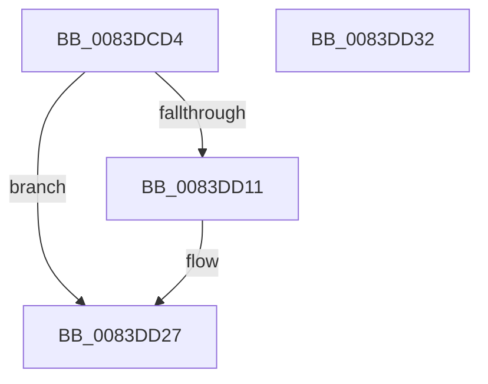

# RtlpMuiRegCreateLanguageConfigList

- RVA: `0x0083DCD4`–`0x0083DD33` (길이 `95` bytes)
- VA: `0x000000014083DCD4`
- 실행 섹션: `PAGE`
- PDB 이름 있음: `예`; PDB Function 태그: `아니요`
- unwind 정보 RVA: `0x0008A658`
- 디코드: `29`개 명령, `95/95` bytes 표시
- 미해석 바이트: `0` (있으면 어셈블리에 `.byte`로 보존)

> 이 문서는 커널 이미지의 기계어와 PDB 기호를 분석해 생성했습니다. 4번과 5번은 함수 원형과 자료형을 바이너리 사용 방식에서 추정한 C 해석이며 원본 소스 복구 결과는 아닙니다.

## 1. Dependencies

- 직접 호출 지점: **1**; 고유 호출 대상: **1**
- 직접 호출자로 확인된 함수: **2**
- RIP 상대 이미지 참조: **0**

### Outgoing calls
- `0x0083DD07` → [_SafeAllocBlob](../../text/6A/_SafeAllocBlob_function_006A9800.md) (function, `0x006A9800`)

### Direct callers
- [RtlpLoadLanguageConfigList](RtlpLoadLanguageConfigList_function_0083D450.md) at `0x0083D565`
- [RtlpPopulateLanguageConfigList](RtlpPopulateLanguageConfigList_function_0083EF20.md) at `0x0083F171`
- [RtlpPopulateLanguageConfigList](RtlpPopulateLanguageConfigList_function_0083EF20.md) at `0x0083F202`

### Static image references
- 디코드된 RIP-relative 메모리 참조가 없습니다.

## 2. Other-region calls and transfers

- 다른 실행 섹션으로 향하는 call: **1**
  - `0x0083DD07` → [_SafeAllocBlob](../../text/6A/_SafeAllocBlob_function_006A9800.md) (`PAGE` → `.text`)
- 별도 외부 분기/꼬리 이동을 확인하지 못했습니다.

## 3. Assembly (complete function range)

```asm
0083DCD4  48 89 5C 24 10                  mov qword ptr [rsp + 0x10], rbx
0083DCD9  57                              push rdi
0083DCDA  48 83 EC 30                     sub rsp, 0x30
0083DCDE  33 FF                           xor edi, edi
0083DCE0  48 8D 44 24 40                  lea rax, [rsp + 0x40]
0083DCE5  83 F9 01                        cmp ecx, 1
0083DCE8  48 89 44 24 28                  mov qword ptr [rsp + 0x28], rax
0083DCED  89 7C 24 40                     mov dword ptr [rsp + 0x40], edi
0083DCF1  89 7C 24 20                     mov dword ptr [rsp + 0x20], edi
0083DCF5  8D 5F 04                        lea ebx, [rdi + 4]
0083DCF8  0F 4D D9                        cmovge ebx, ecx
0083DCFB  44 8D 47 0C                     lea r8d, [rdi + 0xc]
0083DCFF  8B D3                           mov edx, ebx
0083DD01  8D 4F 10                        lea ecx, [rdi + 0x10]
0083DD04  45 33 C9                        xor r9d, r9d
0083DD07  E8 F4 BA E6 FF                  call 0x1406a9800
0083DD0C  48 85 C0                        test rax, rax
0083DD0F  74 16                           je 0x14083dd27
0083DD11  8B 4C 24 40                     mov ecx, dword ptr [rsp + 0x40]
0083DD15  89 08                           mov dword ptr [rax], ecx
0083DD17  48 8D 48 10                     lea rcx, [rax + 0x10]
0083DD1B  48 89 48 08                     mov qword ptr [rax + 8], rcx
0083DD1F  66 89 78 04                     mov word ptr [rax + 4], di
0083DD23  66 89 58 06                     mov word ptr [rax + 6], bx
0083DD27  48 8B 5C 24 48                  mov rbx, qword ptr [rsp + 0x48]
0083DD2C  48 83 C4 30                     add rsp, 0x30
0083DD30  5F                              pop rdi
0083DD31  C3                              ret
0083DD32  CC                              int3
```

## 4. C-style interpretation (structured pseudocode)

```c
__int64 __fastcall RtlpMuiRegCreateLanguageConfigList(int a1, __int64 a2, __int64 a3, int a4)
{
    __int64 result;
    __int64 v_rbx;
    __int64 v_rdi;
    __int64 v_rsp;
    unsigned __int64 v_stack_m10;
    unsigned int v_stack_m18;
    unsigned __int64 v_stack_p10;
    unsigned __int64 v_stack_p8;

    v_stack_p10 = v_rbx;
    v_rsp = (v_rsp) - (48);
    v_rdi = 0;
    v_stack_m10 = v_stack_p8;
    v_stack_p8 = 0;
    v_stack_m18 = 0;
    v_rbx = v_rdi + 4;
    if (a1 >= 1) { v_rbx = a1; }
    a4 = 0;
    result = _SafeAllocBlob(v_rdi + 16, (unsigned int)((unsigned int)(v_rbx)), v_rdi + 12, a4);
    if (result != 0) {
        a1 = v_stack_p8;
        *(unsigned int *)(result) = a1;
        a1 = result + 16;
        *(unsigned __int64 *)(result + 8) = a1;
        *(unsigned __int16 *)(result + 4) = 0;
        *(unsigned __int16 *)(result + 6) = (unsigned __int16)(v_rbx);
    }
    v_rsp = (v_rsp) + (48);
    return result;
}
```

## 5. (Beta) C Style

```c
int64_t RtlpMuiRegCreateLanguageConfigList(int32_t Arg1, int64_t Arg2, int64_t Arg3, int32_t Arg4)
{
    int64_t result;
    int64_t local_rbx;
    int64_t local_rdi;
    int64_t local_rsp;
    uint64_t v_stack_m10;
    uint32_t v_stack_m18;
    uint64_t v_stack_p10;
    uint64_t v_stack_p8;

    v_stack_p10 = local_rbx;
    local_rsp = (local_rsp) - (48);
    local_rdi = 0;
    v_stack_m10 = v_stack_p8;
    v_stack_p8 = 0;
    v_stack_m18 = 0;
    local_rbx = local_rdi + 4;
    if (Arg1 >= 1) { local_rbx = Arg1; }
    Arg4 = 0;
    result = _SafeAllocBlob(local_rdi + 16, (uint32_t)((uint32_t)(local_rbx)), local_rdi + 12, Arg4);
    if (result != 0) {
        Arg1 = v_stack_p8;
        *(uint32_t *)(result) = Arg1;
        Arg1 = result + 16;
        *(uint64_t *)(result + 0x8) = Arg1;
        *(uint16_t *)(result + 0x4) = 0;
        *(uint16_t *)(result + 0x6) = (uint16_t)(local_rbx);
    }
    local_rsp = (local_rsp) + (48);
    return result;
}
```

## 6. Execution-region graph

[열기: 2D/3D 그래프와 함수 탐색 컨트롤 패널](../../../control-panel.html?section=page&rva=0x0083DCD4&view=graph)

- 2D 그래프는 위에서 아래로 흐르고, 3D 그래프는 빈 공간을 드래그해 회전합니다. Shift+드래그는 이동, 휠은 확대·축소, 함수 노드 선택은 대상 보고서 이동입니다.

### Static fallback


