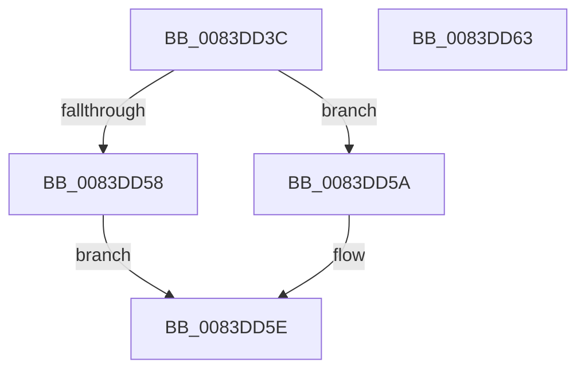

# RtlpMuiRegCreateRegistryInfo

- RVA: `0x0083DD3C`–`0x0083DD64` (길이 `40` bytes)
- VA: `0x000000014083DD3C`
- 실행 섹션: `PAGE`
- PDB 이름 있음: `예`; PDB Function 태그: `아니요`
- unwind 정보 RVA: `0x0005C788`
- 디코드: `12`개 명령, `40/40` bytes 표시
- 미해석 바이트: `0` (있으면 어셈블리에 `.byte`로 보존)

> 이 문서는 커널 이미지의 기계어와 PDB 기호를 분석해 생성했습니다. 4번과 5번은 함수 원형과 자료형을 바이너리 사용 방식에서 추정한 C 해석이며 원본 소스 복구 결과는 아닙니다.

## 1. Dependencies

- 직접 호출 지점: **1**; 고유 호출 대상: **1**
- 직접 호출자로 확인된 함수: **1**
- RIP 상대 이미지 참조: **0**

### Outgoing calls
- `0x0083DD4E` → [ExAllocatePool2](../../poolcode/B8/ExAllocatePool2_function_00B820F0.md) (function, `0x00B820F0`)

### Direct callers
- [RtlpMuiRegCreateKernelRegistryInfo](../../text/6A/RtlpMuiRegCreateKernelRegistryInfo_function_006A908C.md) at `0x006A90F6`

### Static image references
- 디코드된 RIP-relative 메모리 참조가 없습니다.

## 2. Other-region calls and transfers

- 다른 실행 섹션으로 향하는 call: **1**
  - `0x0083DD4E` → [ExAllocatePool2](../../poolcode/B8/ExAllocatePool2_function_00B820F0.md) (`PAGE` → `POOLCODE`)
- 별도 외부 분기/꼬리 이동을 확인하지 못했습니다.

## 3. Assembly (complete function range)

```asm
0083DD3C  48 83 EC 28                     sub rsp, 0x28
0083DD40  BA A8 00 00 00                  mov edx, 0xa8
0083DD45  41 B8 6D 6C 74 72               mov r8d, 0x72746c6d
0083DD4B  8D 4A 58                        lea ecx, [rdx + 0x58]
0083DD4E  E8 9D 43 34 00                  call 0x140b820f0
0083DD53  48 85 C0                        test rax, rax
0083DD56  75 02                           jne 0x14083dd5a
0083DD58  EB 04                           jmp 0x14083dd5e
0083DD5A  0F BA 28 0A                     bts dword ptr [rax], 0xa
0083DD5E  48 83 C4 28                     add rsp, 0x28
0083DD62  C3                              ret
0083DD63  CC                              int3
```

## 4. C-style interpretation (structured pseudocode)

```c
__int64 __fastcall RtlpMuiRegCreateRegistryInfo(void)
{
    __int64 result;
    __int64 v_rsp;

    v_rsp = (v_rsp) - (40);
    result = ExAllocatePool2(168 + 88, 168, (unsigned int)(0x72746C6DULL), a4);
    if (result != 0) goto loc_0083DD5A;
    goto loc_0083DD5E;
loc_0083DD5A:
loc_0083DD5E:
    v_rsp = (v_rsp) + (40);
    return result;
}
```

## 5. (Beta) C Style

```c
void RtlpMuiRegCreateRegistryInfo(void)
{
    int64_t result;
    int64_t local_rsp;

    local_rsp = (local_rsp) - (40);
    result = ExAllocatePool2(168 + 88, 168, (uint32_t)(0x72746C6DULL), a4);
    if (result != 0) goto loc_0083DD5A;
    goto loc_0083DD5E;
loc_0083DD5A:
loc_0083DD5E:
    local_rsp = (local_rsp) + (40);
    return result;
}
```

## 6. Execution-region graph

[열기: 2D/3D 그래프와 함수 탐색 컨트롤 패널](../../../control-panel.html?section=page&rva=0x0083DD3C&view=graph)

- 2D 그래프는 위에서 아래로 흐르고, 3D 그래프는 빈 공간을 드래그해 회전합니다. Shift+드래그는 이동, 휠은 확대·축소, 함수 노드 선택은 대상 보고서 이동입니다.

### Static fallback


