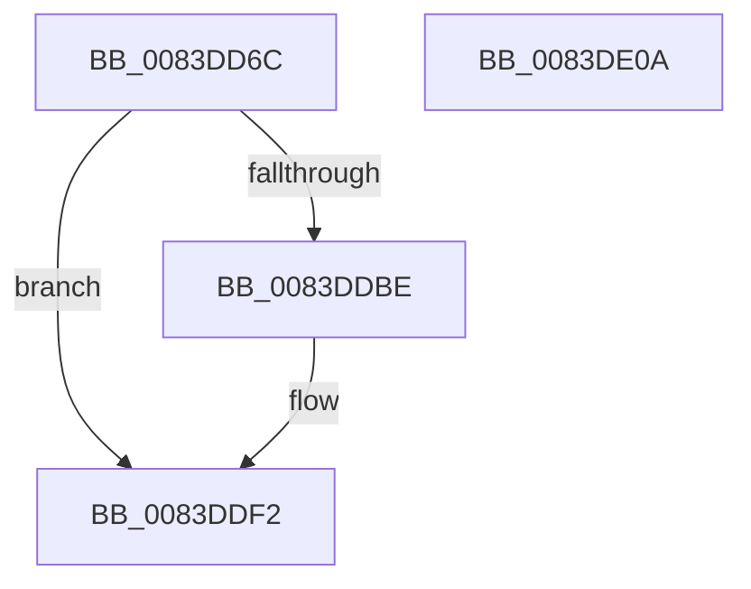

# RtlpMuiRegCreateStringPool

- RVA: `0x0083DD6C`–`0x0083DE0B` (길이 `159` bytes)
- VA: `0x000000014083DD6C`
- 실행 섹션: `PAGE`
- PDB 이름 있음: `예`; PDB Function 태그: `아니요`
- unwind 정보 RVA: `0x000A118C`
- 디코드: `48`개 명령, `159/159` bytes 표시
- 미해석 바이트: `0` (있으면 어셈블리에 `.byte`로 보존)

> 이 문서는 커널 이미지의 기계어와 PDB 기호를 분석해 생성했습니다. 4번과 5번은 함수 원형과 자료형을 바이너리 사용 방식에서 추정한 C 해석이며 원본 소스 복구 결과는 아닙니다.

## 1. Dependencies

- 직접 호출 지점: **1**; 고유 호출 대상: **1**
- 직접 호출자로 확인된 함수: **2**
- RIP 상대 이미지 참조: **0**

### Outgoing calls
- `0x0083DDB1` → [_SafeAllocBlob](../../text/6A/_SafeAllocBlob_function_006A9800.md) (function, `0x006A9800`)

### Direct callers
- [RtlpMuiRegResizeStringPool](RtlpMuiRegResizeStringPool_function_0083EE40.md) at `0x0083EEAE`
- [RtlpMuiRegLoadInstalled](RtlpMuiRegLoadInstalled_function_0083FB1C.md) at `0x0083FBF1`

### Static image references
- 디코드된 RIP-relative 메모리 참조가 없습니다.

## 2. Other-region calls and transfers

- 다른 실행 섹션으로 향하는 call: **1**
  - `0x0083DDB1` → [_SafeAllocBlob](../../text/6A/_SafeAllocBlob_function_006A9800.md) (`PAGE` → `.text`)
- 별도 외부 분기/꼬리 이동을 확인하지 못했습니다.

## 3. Assembly (complete function range)

```asm
0083DD6C  4C 8B DC                        mov r11, rsp
0083DD6F  49 89 5B 10                     mov qword ptr [r11 + 0x10], rbx
0083DD73  49 89 6B 18                     mov qword ptr [r11 + 0x18], rbp
0083DD77  49 89 73 20                     mov qword ptr [r11 + 0x20], rsi
0083DD7B  57                              push rdi
0083DD7C  48 83 EC 30                     sub rsp, 0x30
0083DD80  33 F6                           xor esi, esi
0083DD82  49 8D 43 08                     lea rax, [r11 + 8]
0083DD86  49 89 43 F0                     mov qword ptr [r11 - 0x10], rax
0083DD8A  89 74 24 40                     mov dword ptr [rsp + 0x40], esi
0083DD8E  8D 6E 01                        lea ebp, [rsi + 1]
0083DD91  3B CD                           cmp ecx, ebp
0083DD93  44 8D 46 02                     lea r8d, [rsi + 2]
0083DD97  8D 5E 04                        lea ebx, [rsi + 4]
0083DD9A  45 89 43 E8                     mov dword ptr [r11 - 0x18], r8d
0083DD9E  0F 4D D9                        cmovge ebx, ecx
0083DDA1  8D 7E 28                        lea edi, [rsi + 0x28]
0083DDA4  3B D5                           cmp edx, ebp
0083DDA6  8D 4E 20                        lea ecx, [rsi + 0x20]
0083DDA9  0F 4D FA                        cmovge edi, edx
0083DDAC  8B D3                           mov edx, ebx
0083DDAE  44 8B CF                        mov r9d, edi
0083DDB1  E8 4A BA E6 FF                  call 0x1406a9800
0083DDB6  4C 8B C0                        mov r8, rax
0083DDB9  48 85 C0                        test rax, rax
0083DDBC  74 34                           je 0x14083ddf2
0083DDBE  8B 4C 24 40                     mov ecx, dword ptr [rsp + 0x40]
0083DDC2  89 08                           mov dword ptr [rax], ecx
0083DDC4  48 8D 48 20                     lea rcx, [rax + 0x20]
0083DDC8  48 89 48 10                     mov qword ptr [rax + 0x10], rcx
0083DDCC  66 89 78 08                     mov word ptr [rax + 8], di
0083DDD0  0F B7 D3                        movzx edx, bx
0083DDD3  66 89 50 04                     mov word ptr [rax + 4], dx
0083DDD7  48 8D 0C 51                     lea rcx, [rcx + rdx*2]
0083DDDB  48 89 48 18                     mov qword ptr [rax + 0x18], rcx
0083DDDF  66 89 31                        mov word ptr [rcx], si
0083DDE2  66 89 68 0A                     mov word ptr [rax + 0xa], bp
0083DDE6  48 8B 40 10                     mov rax, qword ptr [rax + 0x10]
0083DDEA  66 89 30                        mov word ptr [rax], si
0083DDED  66 41 89 68 06                  mov word ptr [r8 + 6], bp
0083DDF2  48 8B 5C 24 48                  mov rbx, qword ptr [rsp + 0x48]
0083DDF7  49 8B C0                        mov rax, r8
0083DDFA  48 8B 6C 24 50                  mov rbp, qword ptr [rsp + 0x50]
0083DDFF  48 8B 74 24 58                  mov rsi, qword ptr [rsp + 0x58]
0083DE04  48 83 C4 30                     add rsp, 0x30
0083DE08  5F                              pop rdi
0083DE09  C3                              ret
0083DE0A  CC                              int3
```

## 4. C-style interpretation (structured pseudocode)

```c
__int64 __fastcall RtlpMuiRegCreateStringPool(int a1, int a2)
{
    __int64 result;
    __int64 v_rbx;
    __int64 v_rdi;
    __int64 v_rsi;
    __int64 v_rsp;
    unsigned __int64 v_stack_p10;
    unsigned __int64 v_stack_p18;
    unsigned __int64 v_stack_p20;
    unsigned int v_stack_p8;

    *(unsigned __int64 *)(v_rsp + 16) = v_rbx;
    *(unsigned __int64 *)(v_rsp + 24) = v_rbp;
    *(unsigned __int64 *)(v_rsp + 32) = v_rsi;
    v_rsp = (v_rsp) - (48);
    v_rsi = 0;
    *(unsigned __int64 *)(v_rsp - 16) = v_rsp + 8;
    v_stack_p8 = 0;
    *(unsigned int *)(v_rsp - 24) = (unsigned int)(v_rsi + 2);
    v_rbx = v_rsi + 4;
    if (a1 >= ((unsigned int)(v_rsi + 1))) { v_rbx = a1; }
    v_rdi = v_rsi + 40;
    if (a2 >= ((unsigned int)(v_rsi + 1))) { v_rdi = a2; }
    result = _SafeAllocBlob(v_rsi + 32, (unsigned int)((unsigned int)(v_rbx)), v_rsi + 2, (unsigned int)((unsigned int)(v_rdi)));
    if (result != 0) {
        a1 = v_stack_p8;
        *(unsigned int *)(result) = a1;
        a1 = result + 32;
        *(unsigned __int64 *)(result + 16) = a1;
        *(unsigned __int16 *)(result + 8) = (unsigned __int16)(v_rdi);
        a2 = (unsigned __int16)(v_rbx);
        *(unsigned __int16 *)(result + 4) = (unsigned __int16)(a2);
        a1 = a1 + a2 * 2;
        *(unsigned __int64 *)(result + 24) = a1;
        *(unsigned __int16 *)(a1) = 0;
        *(unsigned __int16 *)(result + 10) = (unsigned __int16)(v_rsi + 1);
        result = *(unsigned __int64 *)(result + 16);
        *(unsigned __int16 *)(result) = 0;
        *(unsigned __int16 *)(result + 6) = (unsigned __int16)(v_rsi + 1);
    }
    v_rsp = (v_rsp) + (48);
    return result;
}
```

## 5. (Beta) C Style

```c
int64_t RtlpMuiRegCreateStringPool(int32_t Arg1, int32_t Arg2)
{
    int64_t result;
    int64_t local_rbx;
    int64_t local_rdi;
    int64_t local_rsi;
    int64_t local_rsp;
    uint64_t v_stack_p10;
    uint64_t v_stack_p18;
    uint64_t v_stack_p20;
    uint32_t v_stack_p8;

    *(uint64_t *)(local_rsp + 0x10) = local_rbx;
    *(uint64_t *)(local_rsp + 0x18) = local_rbp;
    *(uint64_t *)(local_rsp + 0x20) = local_rsi;
    local_rsp = (local_rsp) - (48);
    local_rsi = 0;
    *(uint64_t *)(local_rsp - 0x10) = local_rsp + 8;
    v_stack_p8 = 0;
    *(uint32_t *)(local_rsp - 0x18) = (uint32_t)(local_rsi + 2);
    local_rbx = local_rsi + 4;
    if (Arg1 >= ((uint32_t)(local_rsi + 1))) { local_rbx = Arg1; }
    local_rdi = local_rsi + 40;
    if (Arg2 >= ((uint32_t)(local_rsi + 1))) { local_rdi = Arg2; }
    result = _SafeAllocBlob(local_rsi + 32, (uint32_t)((uint32_t)(local_rbx)), local_rsi + 2, (uint32_t)((uint32_t)(local_rdi)));
    if (result != 0) {
        Arg1 = v_stack_p8;
        *(uint32_t *)(result) = Arg1;
        Arg1 = result + 32;
        *(uint64_t *)(result + 0x10) = Arg1;
        *(uint16_t *)(result + 0x8) = (uint16_t)(local_rdi);
        Arg2 = (uint16_t)(local_rbx);
        *(uint16_t *)(result + 0x4) = (uint16_t)(Arg2);
        Arg1 = Arg1 + Arg2 * 2;
        *(uint64_t *)(result + 0x18) = Arg1;
        *(uint16_t *)(Arg1) = 0;
        *(uint16_t *)(result + 0xA) = (uint16_t)(local_rsi + 1);
        result = *(uint64_t *)(result + 0x10);
        *(uint16_t *)(result) = 0;
        *(uint16_t *)(result + 0x6) = (uint16_t)(local_rsi + 1);
    }
    local_rsp = (local_rsp) + (48);
    return result;
}
```

## 6. Execution-region graph

[열기: 2D/3D 그래프와 함수 탐색 컨트롤 패널](../../../control-panel.html?section=page&rva=0x0083DD6C&view=graph)

- 2D 그래프는 위에서 아래로 흐르고, 3D 그래프는 빈 공간을 드래그해 회전합니다. Shift+드래그는 이동, 휠은 확대·축소, 함수 노드 선택은 대상 보고서 이동입니다.

### Static fallback


