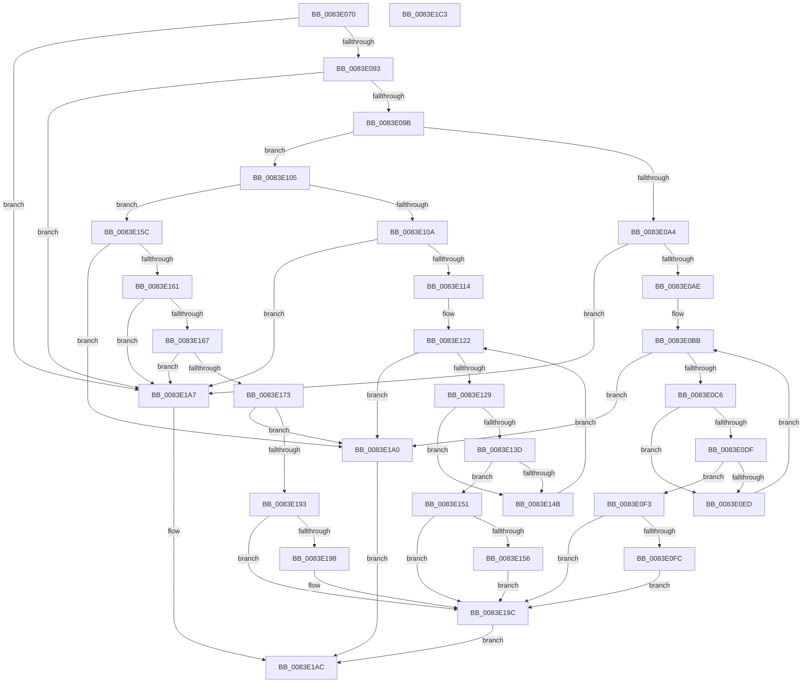

# RtlpMuiRegGetInstalledLangInfoIndex

- RVA: `0x0083E070`–`0x0083E1C4` (길이 `340` bytes)
- VA: `0x000000014083E070`
- 실행 섹션: `PAGE`
- PDB 이름 있음: `예`; PDB Function 태그: `아니요`
- unwind 정보 RVA: `0x000A6CEC`
- 디코드: `96`개 명령, `340/340` bytes 표시
- 미해석 바이트: `0` (있으면 어셈블리에 `.byte`로 보존)

> 이 문서는 커널 이미지의 기계어와 PDB 기호를 분석해 생성했습니다. 4번과 5번은 함수 원형과 자료형을 바이너리 사용 방식에서 추정한 C 해석이며 원본 소스 복구 결과는 아닙니다.

## 1. Dependencies

- 직접 호출 지점: **0**; 고유 호출 대상: **0**
- 직접 호출자로 확인된 함수: **2**
- RIP 상대 이미지 참조: **0**

### Outgoing calls
- 직접 디코드된 call 명령이 없습니다.

### Direct callers
- [RtlpMuiRegValidateLIPLanguage](../84/RtlpMuiRegValidateLIPLanguage_function_00840894.md) at `0x008409DA`
- [RtlpMuiRegValidatePartialLanguage](../84/RtlpMuiRegValidatePartialLanguage_function_00840AC0.md) at `0x00840B53`

### Static image references
- 디코드된 RIP-relative 메모리 참조가 없습니다.

## 2. Other-region calls and transfers

- 다른 실행 섹션으로 향하는 call: **0**
- 별도 외부 분기/꼬리 이동을 확인하지 못했습니다.

## 3. Assembly (complete function range)

```asm
0083E070  48 8B C4                        mov rax, rsp
0083E073  48 89 58 08                     mov qword ptr [rax + 8], rbx
0083E077  48 89 68 10                     mov qword ptr [rax + 0x10], rbp
0083E07B  48 89 70 18                     mov qword ptr [rax + 0x18], rsi
0083E07F  48 89 78 20                     mov qword ptr [rax + 0x20], rdi
0083E083  41 56                           push r14
0083E085  33 ED                           xor ebp, ebp
0083E087  4C 8B D1                        mov r10, rcx
0083E08A  48 85 C9                        test rcx, rcx
0083E08D  0F 84 14 01 00 00               je 0x14083e1a7
0083E093  85 D2                           test edx, edx
0083E095  0F 84 0C 01 00 00               je 0x14083e1a7
0083E09B  44 8D 75 01                     lea r14d, [rbp + 1]
0083E09F  41 3B D6                        cmp edx, r14d
0083E0A2  75 61                           jne 0x14083e105
0083E0A4  66 45 85 C0                     test r8w, r8w
0083E0A8  0F 84 F9 00 00 00               je 0x14083e1a7
0083E0AE  0F B7 71 06                     movzx esi, word ptr [rcx + 6]
0083E0B2  0F B7 D5                        movzx edx, bp
0083E0B5  41 BB 20 10 00 00               mov r11d, 0x1020
0083E0BB  0F BF C2                        movsx eax, dx
0083E0BE  3B C6                           cmp eax, esi
0083E0C0  0F 8D DA 00 00 00               jge 0x14083e1a0
0083E0C6  49 8B 7A 10                     mov rdi, qword ptr [r10 + 0x10]
0083E0CA  48 0F BF C2                     movsx rax, dx
0083E0CE  48 6B D8 1C                     imul rbx, rax, 0x1c
0083E0D2  41 0F BF C0                     movsx eax, r8w
0083E0D6  0F B7 4C 3B 04                  movzx ecx, word ptr [rbx + rdi + 4]
0083E0DB  3B C8                           cmp ecx, eax
0083E0DD  75 0E                           jne 0x14083e0ed
0083E0DF  0F B7 04 3B                     movzx eax, word ptr [rbx + rdi]
0083E0E3  66 41 23 C3                     and ax, r11w
0083E0E7  66 83 F8 20                     cmp ax, 0x20
0083E0EB  74 06                           je 0x14083e0f3
0083E0ED  66 41 03 D6                     add dx, r14w
0083E0F1  EB C8                           jmp 0x14083e0bb
0083E0F3  4D 85 C9                        test r9, r9
0083E0F6  0F 84 A0 00 00 00               je 0x14083e19c
0083E0FC  66 41 89 11                     mov word ptr [r9], dx
0083E100  E9 97 00 00 00                  jmp 0x14083e19c
0083E105  83 FA 03                        cmp edx, 3
0083E108  75 52                           jne 0x14083e15c
0083E10A  66 45 85 C0                     test r8w, r8w
0083E10E  0F 88 93 00 00 00               js 0x14083e1a7
0083E114  41 0F B7 5A 06                  movzx ebx, word ptr [r10 + 6]
0083E119  0F B7 CD                        movzx ecx, bp
0083E11C  41 BB 20 10 00 00               mov r11d, 0x1020
0083E122  0F BF C1                        movsx eax, cx
0083E125  3B C3                           cmp eax, ebx
0083E127  7D 77                           jge 0x14083e1a0
0083E129  49 8B 52 10                     mov rdx, qword ptr [r10 + 0x10]
0083E12D  48 0F BF C1                     movsx rax, cx
0083E131  48 6B C0 1C                     imul rax, rax, 0x1c
0083E135  66 44 39 44 10 06               cmp word ptr [rax + rdx + 6], r8w
0083E13B  75 0E                           jne 0x14083e14b
0083E13D  0F B7 04 10                     movzx eax, word ptr [rax + rdx]
0083E141  66 41 23 C3                     and ax, r11w
0083E145  66 83 F8 20                     cmp ax, 0x20
0083E149  74 06                           je 0x14083e151
0083E14B  66 41 03 CE                     add cx, r14w
0083E14F  EB D1                           jmp 0x14083e122
0083E151  4D 85 C9                        test r9, r9
0083E154  74 46                           je 0x14083e19c
0083E156  66 41 89 09                     mov word ptr [r9], cx
0083E15A  EB 40                           jmp 0x14083e19c
0083E15C  83 FA 02                        cmp edx, 2
0083E15F  75 3F                           jne 0x14083e1a0
0083E161  66 45 85 C0                     test r8w, r8w
0083E165  78 40                           js 0x14083e1a7
0083E167  0F B7 49 06                     movzx ecx, word ptr [rcx + 6]
0083E16B  41 0F BF C0                     movsx eax, r8w
0083E16F  3B C1                           cmp eax, ecx
0083E171  73 34                           jae 0x14083e1a7
0083E173  49 0F BF C0                     movsx rax, r8w
0083E177  41 BB 20 10 00 00               mov r11d, 0x1020
0083E17D  48 6B C8 1C                     imul rcx, rax, 0x1c
0083E181  49 8B 42 10                     mov rax, qword ptr [r10 + 0x10]
0083E185  0F B7 14 01                     movzx edx, word ptr [rcx + rax]
0083E189  66 41 23 D3                     and dx, r11w
0083E18D  66 83 FA 20                     cmp dx, 0x20
0083E191  75 0D                           jne 0x14083e1a0
0083E193  4D 85 C9                        test r9, r9
0083E196  74 04                           je 0x14083e19c
0083E198  66 45 89 01                     mov word ptr [r9], r8w
0083E19C  33 C0                           xor eax, eax
0083E19E  EB 0C                           jmp 0x14083e1ac
0083E1A0  B8 01 00 00 C0                  mov eax, 0xc0000001
0083E1A5  EB 05                           jmp 0x14083e1ac
0083E1A7  B8 0D 00 00 C0                  mov eax, 0xc000000d
0083E1AC  48 8B 5C 24 10                  mov rbx, qword ptr [rsp + 0x10]
0083E1B1  48 8B 6C 24 18                  mov rbp, qword ptr [rsp + 0x18]
0083E1B6  48 8B 74 24 20                  mov rsi, qword ptr [rsp + 0x20]
0083E1BB  48 8B 7C 24 28                  mov rdi, qword ptr [rsp + 0x28]
0083E1C0  41 5E                           pop r14
0083E1C2  C3                              ret
0083E1C3  CC                              int3
```

## 4. C-style interpretation (structured pseudocode)

```c
__int64 __fastcall RtlpMuiRegGetInstalledLangInfoIndex(__int64 a1, int a2, unsigned __int16 a3, __int64 a4)
{
    __int64 result;
    __int64 v_rbp;
    __int64 v_rbx;
    unsigned __int64 v_stack_p10;
    unsigned __int64 v_stack_p18;
    unsigned __int64 v_stack_p20;
    unsigned __int64 v_stack_p8;

    *(unsigned __int64 *)(v_rsp + 8) = v_rbx;
    *(unsigned __int64 *)(v_rsp + 16) = v_rbp;
    *(unsigned __int64 *)(v_rsp + 24) = v_rsi;
    *(unsigned __int64 *)(v_rsp + 32) = v_rdi;
    v_rbp = 0;
    if (a1 == 0) goto loc_0083E1A7;
    if (a2 == 0) goto loc_0083E1A7;
    if (a2 != ((unsigned int)(v_rbp + 1))) goto loc_0083E105;
    if (a3 == 0) goto loc_0083E1A7;
loc_0083E0BB:
    if (((unsigned int)((__int16)(0))) >= ((unsigned int)(*(unsigned __int16 *)(a1 + 6)))) goto loc_0083E1A0;
    v_rbx = (v_rbx) * ((__int16)(0));
    if (((unsigned int)(*(unsigned __int16 *)(v_rbx + *(unsigned __int64 *)(a1 + 16) * 1 + 4))) != ((unsigned int)((__int16)(a3)))) goto loc_0083E0ED;
    result = (unsigned __int16)((*(unsigned __int16 *)(v_rbx + *(unsigned __int64 *)(a1 + 16) * 1)) & ((unsigned __int16)((unsigned int)(0x1020ULL))));
    if (((unsigned __int16)(result)) == 32) goto loc_0083E0F3;
loc_0083E0ED:
    a2 = (unsigned __int16)((0) + ((unsigned __int16)(v_rbp + 1)));
    goto loc_0083E0BB;
loc_0083E0F3:
    if (a4 == 0) goto loc_0083E19C;
    *(unsigned __int16 *)(a4) = (unsigned __int16)(a2);
    goto loc_0083E19C;
loc_0083E105:
    if (a2 != 3) goto loc_0083E15C;
    if (sign_flag) goto loc_0083E1A7;
loc_0083E122:
    if (((unsigned int)((__int16)(0))) >= ((unsigned int)(*(unsigned __int16 *)(a1 + 6)))) goto loc_0083E1A0;
    result = ((__int16)(0)) * ((__int16)(0));
    if ((*(unsigned __int16 *)(result + *(unsigned __int64 *)(a1 + 16) * 1 + 6)) != a3) goto loc_0083E14B;
    result = (unsigned __int16)((*(unsigned __int16 *)(result + *(unsigned __int64 *)(a1 + 16) * 1)) & ((unsigned __int16)((unsigned int)(0x1020ULL))));
    if (((unsigned __int16)(result)) == 32) goto loc_0083E151;
loc_0083E14B:
    a1 = (unsigned __int16)((0) + ((unsigned __int16)(v_rbp + 1)));
    goto loc_0083E122;
loc_0083E151:
    if (a4 == 0) goto loc_0083E19C;
    *(unsigned __int16 *)(a4) = (unsigned __int16)(a1);
    goto loc_0083E19C;
loc_0083E15C:
    if (((unsigned int)(*(unsigned __int64 *)(a1 + 16))) != 2) goto loc_0083E1A0;
    if (sign_flag) goto loc_0083E1A7;
    if (((unsigned int)((__int16)(a3))) >= ((unsigned int)(*(unsigned __int16 *)(a1 + 6)))) goto loc_0083E1A7;
    a1 = (*(unsigned __int16 *)(a1 + 6)) * ((__int16)(a3));
    a2 = (unsigned __int16)((*(unsigned __int16 *)(a1 + *(unsigned __int64 *)(a1 + 16) * 1)) & ((unsigned __int16)((unsigned int)(0x1020ULL))));
    if (((unsigned __int16)(a2)) != 32) goto loc_0083E1A0;
    if (a4 != 0) {
        *(unsigned __int16 *)(a4) = a3;
    }
    result = 0;
    goto loc_0083E1AC;
loc_0083E1A0:
    goto loc_0083E1AC;
loc_0083E1A7:
loc_0083E1AC:
    return (unsigned int)(0xC000000DULL);
}
```

## 5. (Beta) C Style

```c
int64_t RtlpMuiRegGetInstalledLangInfoIndex(void *Arg1, int32_t Arg2, uint16_t Arg3, int64_t Arg4)
{
    uint8_t *arg1 = (uint8_t *)Arg1;

    int64_t result;
    int64_t local_rbp;
    int64_t local_rbx;
    uint64_t v_stack_p10;
    uint64_t v_stack_p18;
    uint64_t v_stack_p20;
    uint64_t v_stack_p8;

    *(uint64_t *)(local_rsp + 0x8) = local_rbx;
    *(uint64_t *)(local_rsp + 0x10) = local_rbp;
    *(uint64_t *)(local_rsp + 0x18) = local_rsi;
    *(uint64_t *)(local_rsp + 0x20) = local_rdi;
    local_rbp = 0;
    if (Arg1 == NULL) goto loc_0083E1A7;
    if (Arg2 == 0) goto loc_0083E1A7;
    if (Arg2 != ((uint32_t)(local_rbp + 1))) goto loc_0083E105;
    if (Arg3 == 0) goto loc_0083E1A7;
loc_0083E0BB:
    if (((uint32_t)((int16_t)(0))) >= ((uint32_t)(*(uint16_t *)(arg1 + 0x6)))) goto loc_0083E1A0;
    local_rbx = (local_rbx) * ((int16_t)(0));
    if (((uint32_t)(*(uint16_t *)(local_rbx + *(uint64_t *)(arg1 + 0x10) * 1 + 0x4))) != ((uint32_t)((int16_t)(Arg3)))) goto loc_0083E0ED;
    result = (uint16_t)((*(uint16_t *)(local_rbx + *(uint64_t *)(arg1 + 0x10) * 1)) & ((uint16_t)((uint32_t)(0x1020ULL))));
    if (((uint16_t)(result)) == 32) goto loc_0083E0F3;
loc_0083E0ED:
    Arg2 = (uint16_t)((0) + ((uint16_t)(local_rbp + 1)));
    goto loc_0083E0BB;
loc_0083E0F3:
    if (Arg4 == 0) goto loc_0083E19C;
    *(uint16_t *)(Arg4) = (uint16_t)(Arg2);
    goto loc_0083E19C;
loc_0083E105:
    if (Arg2 != 3) goto loc_0083E15C;
    if (sign_flag) goto loc_0083E1A7;
loc_0083E122:
    if (((uint32_t)((int16_t)(0))) >= ((uint32_t)(*(uint16_t *)(arg1 + 0x6)))) goto loc_0083E1A0;
    result = ((int16_t)(0)) * ((int16_t)(0));
    if ((*(uint16_t *)(result + *(uint64_t *)(arg1 + 0x10) * 1 + 0x6)) != Arg3) goto loc_0083E14B;
    result = (uint16_t)((*(uint16_t *)(result + *(uint64_t *)(arg1 + 0x10) * 1)) & ((uint16_t)((uint32_t)(0x1020ULL))));
    if (((uint16_t)(result)) == 32) goto loc_0083E151;
loc_0083E14B:
    Arg1 = (uint16_t)((0) + ((uint16_t)(local_rbp + 1)));
    goto loc_0083E122;
loc_0083E151:
    if (Arg4 == 0) goto loc_0083E19C;
    *(uint16_t *)(Arg4) = (uint16_t)(Arg1);
    goto loc_0083E19C;
loc_0083E15C:
    if (((uint32_t)(*(uint64_t *)(arg1 + 0x10))) != 2) goto loc_0083E1A0;
    if (sign_flag) goto loc_0083E1A7;
    if (((uint32_t)((int16_t)(Arg3))) >= ((uint32_t)(*(uint16_t *)(arg1 + 0x6)))) goto loc_0083E1A7;
    Arg1 = (*(uint16_t *)(arg1 + 0x6)) * ((int16_t)(Arg3));
    Arg2 = (uint16_t)((*(uint16_t *)(arg1 + *(uint64_t *)(arg1 + 0x10) * 1)) & ((uint16_t)((uint32_t)(0x1020ULL))));
    if (((uint16_t)(Arg2)) != 32) goto loc_0083E1A0;
    if (Arg4 != 0) {
        *(uint16_t *)(Arg4) = Arg3;
    }
    result = 0;
    goto loc_0083E1AC;
loc_0083E1A0:
    goto loc_0083E1AC;
loc_0083E1A7:
loc_0083E1AC:
    return (uint32_t)(0xC000000DULL);
}
```

### 관측된 메모리 오프셋

구조체 형식이 확인되지 않은 접근은 인자 기준의 오프셋으로만 기록했습니다.

| 기준 인자 | 오프셋 표현 | 폭 (bit) | 접근 |
|---|---:|---:|---|
| `Arg1` | `+ 0x6` | `16` | `R` |
| `Arg1` | `+ 0x10` | `64` | `R` |

## 6. Execution-region graph

[열기: 2D/3D 그래프와 함수 탐색 컨트롤 패널](../../../control-panel.html?section=page&rva=0x0083E070&view=graph)

- 2D 그래프는 위에서 아래로 흐르고, 3D 그래프는 빈 공간을 드래그해 회전합니다. Shift+드래그는 이동, 휠은 확대·축소, 함수 노드 선택은 대상 보고서 이동입니다.

### Static fallback


