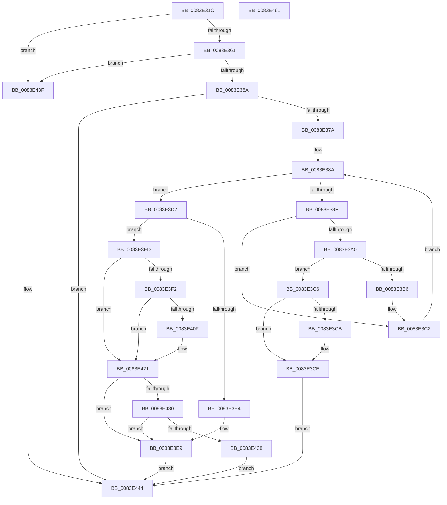

# RtlpMuiRegGetInstalledLanguageIndexByLangId

- RVA: `0x0083E31C`–`0x0083E462` (길이 `326` bytes)
- VA: `0x000000014083E31C`
- 실행 섹션: `PAGE`
- PDB 이름 있음: `예`; PDB Function 태그: `아니요`
- unwind 정보 RVA: `0x0008C20C`
- 디코드: `97`개 명령, `326/326` bytes 표시
- 미해석 바이트: `0` (있으면 어셈블리에 `.byte`로 보존)

> 이 문서는 커널 이미지의 기계어와 PDB 기호를 분석해 생성했습니다. 4번과 5번은 함수 원형과 자료형을 바이너리 사용 방식에서 추정한 C 해석이며 원본 소스 복구 결과는 아닙니다.

## 1. Dependencies

- 직접 호출 지점: **4**; 고유 호출 대상: **4**
- 직접 호출자로 확인된 함수: **3**
- RIP 상대 이미지 참조: **0**

### Outgoing calls
- `0x0083E3D7` → [_MuiRegAllocArray](../../text/6A/_MuiRegAllocArray_function_006A9418.md) (function, `0x006A9418`)
- `0x0083E406` → [RtlLCIDToCultureName](../AD/RtlLCIDToCultureName_function_00AD3010.md) (function, `0x00AD3010`)
- `0x0083E41A` → [RtlpMuiRegGetInstalledLanguageIndexByName](RtlpMuiRegGetInstalledLanguageIndexByName_function_0083E468.md) (function, `0x0083E468`)
- `0x0083E426` → [ExFreePoolWithTag](../../poolcode/B8/ExFreePoolWithTag_function_00B82870.md) (function, `0x00B82870`)

### Direct callers
- [RtlpMuiRegCreateKernelRegistryInfo](../../text/6A/RtlpMuiRegCreateKernelRegistryInfo_function_006A908C.md) at `0x006A916E`
- [RtlpMuiRegCreateKernelRegistryInfo](../../text/6A/RtlpMuiRegCreateKernelRegistryInfo_function_006A908C.md) at `0x006A9194`
- [RtlpMuiRegGetInstalledLanguageIndex](RtlpMuiRegGetInstalledLanguageIndex_function_0083E1CC.md) at `0x0083E2C7`
- [RtlpMuiRegValidateInstalled](../84/RtlpMuiRegValidateInstalled_function_008404D4.md) at `0x00840599`

### Static image references
- 디코드된 RIP-relative 메모리 참조가 없습니다.

## 2. Other-region calls and transfers

- 다른 실행 섹션으로 향하는 call: **2**
  - `0x0083E3D7` → [_MuiRegAllocArray](../../text/6A/_MuiRegAllocArray_function_006A9418.md) (`PAGE` → `.text`)
  - `0x0083E426` → [ExFreePoolWithTag](../../poolcode/B8/ExFreePoolWithTag_function_00B82870.md) (`PAGE` → `POOLCODE`)
- 별도 외부 분기/꼬리 이동을 확인하지 못했습니다.

## 3. Assembly (complete function range)

```asm
0083E31C  48 8B C4                        mov rax, rsp
0083E31F  48 89 58 08                     mov qword ptr [rax + 8], rbx
0083E323  48 89 68 10                     mov qword ptr [rax + 0x10], rbp
0083E327  48 89 70 18                     mov qword ptr [rax + 0x18], rsi
0083E32B  57                              push rdi
0083E32C  41 54                           push r12
0083E32E  41 55                           push r13
0083E330  41 56                           push r14
0083E332  41 57                           push r15
0083E334  48 83 EC 30                     sub rsp, 0x30
0083E338  45 33 ED                        xor r13d, r13d
0083E33B  0F B7 EA                        movzx ebp, dx
0083E33E  0F 57 C0                        xorps xmm0, xmm0
0083E341  49 8B F1                        mov rsi, r9
0083E344  45 8A E0                        mov r12b, r8b
0083E347  4C 8B F9                        mov r15, rcx
0083E34A  45 8A F5                        mov r14b, r13b
0083E34D  0F 11 40 C8                     movups xmmword ptr [rax - 0x38], xmm0
0083E351  B8 34 00 00 C0                  mov eax, 0xc0000034
0083E356  8B D8                           mov ebx, eax
0083E358  48 85 C9                        test rcx, rcx
0083E35B  0F 84 DE 00 00 00               je 0x14083e43f
0083E361  66 85 ED                        test bp, bp
0083E364  0F 84 D5 00 00 00               je 0x14083e43f
0083E36A  41 BB 00 10 00 00               mov r11d, 0x1000
0083E370  66 41 3B EB                     cmp bp, r11w
0083E374  0F 84 CA 00 00 00               je 0x14083e444
0083E37A  4C 8B 49 18                     mov r9, qword ptr [rcx + 0x18]
0083E37E  41 8D 7D 01                     lea edi, [r13 + 1]
0083E382  41 8B CD                        mov ecx, r13d
0083E385  45 0F B7 51 06                  movzx r10d, word ptr [r9 + 6]
0083E38A  41 3B CA                        cmp ecx, r10d
0083E38D  7D 43                           jge 0x14083e3d2
0083E38F  48 63 C1                        movsxd rax, ecx
0083E392  48 6B D0 1C                     imul rdx, rax, 0x1c
0083E396  49 03 51 10                     add rdx, qword ptr [r9 + 0x10]
0083E39A  66 39 6A 04                     cmp word ptr [rdx + 4], bp
0083E39E  75 22                           jne 0x14083e3c2
0083E3A0  44 0F B7 02                     movzx r8d, word ptr [rdx]
0083E3A4  BA 20 10 00 00                  mov edx, 0x1020
0083E3A9  41 0F B7 C0                     movzx eax, r8w
0083E3AD  66 23 C2                        and ax, dx
0083E3B0  66 83 F8 20                     cmp ax, 0x20
0083E3B4  74 10                           je 0x14083e3c6
0083E3B6  66 45 85 C3                     test r11w, r8w
0083E3BA  45 0F B6 F6                     movzx r14d, r14b
0083E3BE  44 0F 45 F7                     cmovne r14d, edi
0083E3C2  03 CF                           add ecx, edi
0083E3C4  EB C4                           jmp 0x14083e38a
0083E3C6  48 85 F6                        test rsi, rsi
0083E3C9  74 03                           je 0x14083e3ce
0083E3CB  66 89 0E                        mov word ptr [rsi], cx
0083E3CE  33 C0                           xor eax, eax
0083E3D0  EB 72                           jmp 0x14083e444
0083E3D2  BA 55 00 00 00                  mov edx, 0x55
0083E3D7  E8 3C B0 E6 FF                  call 0x1406a9418
0083E3DC  48 8B F8                        mov rdi, rax
0083E3DF  48 85 C0                        test rax, rax
0083E3E2  75 09                           jne 0x14083e3ed
0083E3E4  BB 17 00 00 C0                  mov ebx, 0xc0000017
0083E3E9  8B C3                           mov eax, ebx
0083E3EB  EB 57                           jmp 0x14083e444
0083E3ED  45 84 E4                        test r12b, r12b
0083E3F0  74 2F                           je 0x14083e421
0083E3F2  8B CD                           mov ecx, ebp
0083E3F4  48 89 7C 24 28                  mov qword ptr [rsp + 0x28], rdi
0083E3F9  48 8D 54 24 20                  lea rdx, [rsp + 0x20]
0083E3FE  C7 44 24 20 00 00 AA 00         mov dword ptr [rsp + 0x20], 0xaa0000
0083E406  E8 05 4C 29 00                  call 0x140ad3010
0083E40B  84 C0                           test al, al
0083E40D  74 12                           je 0x14083e421
0083E40F  48 8B 54 24 28                  mov rdx, qword ptr [rsp + 0x28]
0083E414  4C 8B CE                        mov r9, rsi
0083E417  49 8B CF                        mov rcx, r15
0083E41A  E8 49 00 00 00                  call 0x14083e468
0083E41F  8B D8                           mov ebx, eax
0083E421  33 D2                           xor edx, edx
0083E423  48 8B CF                        mov rcx, rdi
0083E426  E8 45 44 34 00                  call 0x140b82870
0083E42B  45 84 F6                        test r14b, r14b
0083E42E  74 B9                           je 0x14083e3e9
0083E430  81 FB 34 00 00 C0               cmp ebx, 0xc0000034
0083E436  75 B1                           jne 0x14083e3e9
0083E438  B8 BB 00 00 C0                  mov eax, 0xc00000bb
0083E43D  EB 05                           jmp 0x14083e444
0083E43F  B8 0D 00 00 C0                  mov eax, 0xc000000d
0083E444  48 8B 5C 24 60                  mov rbx, qword ptr [rsp + 0x60]
0083E449  48 8B 6C 24 68                  mov rbp, qword ptr [rsp + 0x68]
0083E44E  48 8B 74 24 70                  mov rsi, qword ptr [rsp + 0x70]
0083E453  48 83 C4 30                     add rsp, 0x30
0083E457  41 5F                           pop r15
0083E459  41 5E                           pop r14
0083E45B  41 5D                           pop r13
0083E45D  41 5C                           pop r12
0083E45F  5F                              pop rdi
0083E460  C3                              ret
0083E461  CC                              int3
```

## 4. C-style interpretation (structured pseudocode)

```c
__int64 __fastcall RtlpMuiRegGetInstalledLanguageIndexByLangId(__int64 a1, unsigned __int16 a2, unsigned __int8 a3, __int64 a4)
{
    __int64 result;
    __int64 v_r13;
    __int64 v_r14;
    __int64 v_rbx;
    __int64 v_rsp;
    unsigned __int64 v_stack_m30;
    unsigned __int64 v_stack_m38;
    unsigned __int64 v_stack_p10;
    unsigned __int64 v_stack_p18;
    unsigned __int64 v_stack_p8;

    *(unsigned __int64 *)(v_rsp + 8) = v_rbx;
    *(unsigned __int64 *)(v_rsp + 16) = v_rbp;
    *(unsigned __int64 *)(v_rsp + 24) = v_rsi;
    v_rsp = (v_rsp) - (48);
    v_r13 = 0;
    *(unsigned __int64 *)(v_rsp - 56) = v_xmm0;
    if (a1 == 0) goto loc_0083E43F;
    if (a2 == 0) goto loc_0083E43F;
    if (a2 == ((unsigned __int16)((unsigned int)(0x1000ULL)))) goto loc_0083E444;
loc_0083E38A:
    if (0 >= ((unsigned int)(*(unsigned __int16 *)(*(unsigned __int64 *)(a1 + 24) + 6)))) goto loc_0083E3D2;
    a2 = (a2) * ((int)(0));
    a2 = (a2) + (*(unsigned __int64 *)(*(unsigned __int64 *)(a1 + 24) + 16));
    if ((*(unsigned __int16 *)(a2 + 4)) != a2) goto loc_0083E3C2;
    result = (unsigned __int16)(((unsigned __int16)(*(unsigned __int16 *)(a2))) & ((unsigned __int16)((unsigned int)(0x1020ULL))));
    if (((unsigned __int16)(result)) == 32) goto loc_0083E3C6;
    v_r14 = 0;
    if ((((unsigned __int16)((unsigned int)(0x1000ULL))) & ((unsigned __int16)(*(unsigned __int16 *)(a2)))) != 0) { v_r14 = (unsigned int)(v_r13 + 1); }
loc_0083E3C2:
    a1 = (unsigned int)((0) + ((unsigned int)(v_r13 + 1)));
    goto loc_0083E38A;
loc_0083E3C6:
    if (a4 != 0) {
        *(unsigned __int16 *)(a4) = (unsigned __int16)(a1);
    }
    result = 0;
    goto loc_0083E444;
loc_0083E3D2:
    result = _MuiRegAllocArray(a1, 85, *(unsigned __int16 *)(a2), *(unsigned __int64 *)(a1 + 24));
    if (result != 0) goto loc_0083E3ED;
loc_0083E3E9:
    goto loc_0083E444;
loc_0083E3ED:
    if (a3 == 0) goto loc_0083E421;
    v_stack_m30 = result;
    v_stack_m38 = 0xAA0000ULL;
    result = RtlLCIDToCultureName((unsigned int)(a2), v_stack_m38, *(unsigned __int16 *)(a2), *(unsigned __int64 *)(a1 + 24));
    v_rbx = (unsigned int)(0xC0000017ULL);
    if ((unsigned __int8)(result) != 0) {
        a2 = v_stack_m30;
        a4 = a4;
        a1 = a1;
        result = RtlpMuiRegGetInstalledLanguageIndexByName(a1, a2, *(unsigned __int16 *)(a2), a4);
        v_rbx = (unsigned int)(result);
    }
    a2 = 0;
    result = ExFreePoolWithTag(result, a2, *(unsigned __int16 *)(a2), a4);
    if ((unsigned __int8)(v_r14) == 0) goto loc_0083E3E9;
    if (((unsigned int)(v_rbx)) != 0xC0000034ULL) goto loc_0083E3E9;
    goto loc_0083E444;
loc_0083E43F:
loc_0083E444:
    v_rsp = (v_rsp) + (48);
    return (unsigned int)(0xC000000DULL);
}
```

## 5. (Beta) C Style

```c
int64_t RtlpMuiRegGetInstalledLanguageIndexByLangId(int64_t Arg1, uint16_t Arg2, uint8_t Arg3, int64_t Arg4)
{
    int64_t result;
    int64_t local_r13;
    int64_t local_r14;
    int64_t local_rbx;
    int64_t local_rsp;
    uint64_t v_stack_m30;
    uint64_t v_stack_m38;
    uint64_t v_stack_p10;
    uint64_t v_stack_p18;
    uint64_t v_stack_p8;

    *(uint64_t *)(local_rsp + 0x8) = local_rbx;
    *(uint64_t *)(local_rsp + 0x10) = local_rbp;
    *(uint64_t *)(local_rsp + 0x18) = local_rsi;
    local_rsp = (local_rsp) - (48);
    local_r13 = 0;
    *(uint64_t *)(local_rsp - 0x38) = v_xmm0;
    if (Arg1 == 0) goto loc_0083E43F;
    if (Arg2 == 0) goto loc_0083E43F;
    if (Arg2 == ((uint16_t)((uint32_t)(0x1000ULL)))) goto loc_0083E444;
loc_0083E38A:
    if (0 >= ((uint32_t)(*(uint16_t *)(*(uint64_t *)(Arg1 + 0x18) + 0x6)))) goto loc_0083E3D2;
    Arg2 = (Arg2) * ((int32_t)(0));
    Arg2 = (Arg2) + (*(uint64_t *)(*(uint64_t *)(Arg1 + 0x18) + 0x10));
    if ((*(uint16_t *)(Arg2 + 0x4)) != Arg2) goto loc_0083E3C2;
    result = (uint16_t)(((uint16_t)(*(uint16_t *)(Arg2))) & ((uint16_t)((uint32_t)(0x1020ULL))));
    if (((uint16_t)(result)) == 32) goto loc_0083E3C6;
    local_r14 = 0;
    if ((((uint16_t)((uint32_t)(0x1000ULL))) & ((uint16_t)(*(uint16_t *)(Arg2)))) != 0) { local_r14 = (uint32_t)(local_r13 + 1); }
loc_0083E3C2:
    Arg1 = (uint32_t)((0) + ((uint32_t)(local_r13 + 1)));
    goto loc_0083E38A;
loc_0083E3C6:
    if (Arg4 != 0) {
        *(uint16_t *)(Arg4) = (uint16_t)(Arg1);
    }
    result = 0;
    goto loc_0083E444;
loc_0083E3D2:
    result = _MuiRegAllocArray(Arg1, 85, *(uint16_t *)(Arg2), *(uint64_t *)(Arg1 + 0x18));
    if (result != 0) goto loc_0083E3ED;
loc_0083E3E9:
    goto loc_0083E444;
loc_0083E3ED:
    if (Arg3 == 0) goto loc_0083E421;
    v_stack_m30 = result;
    v_stack_m38 = 0xAA0000ULL;
    result = RtlLCIDToCultureName((uint32_t)(Arg2), v_stack_m38, *(uint16_t *)(Arg2), *(uint64_t *)(Arg1 + 0x18));
    local_rbx = (uint32_t)(0xC0000017ULL);
    if ((uint8_t)(result) != 0) {
        Arg2 = v_stack_m30;
        Arg4 = Arg4;
        Arg1 = Arg1;
        result = RtlpMuiRegGetInstalledLanguageIndexByName(Arg1, Arg2, *(uint16_t *)(Arg2), Arg4);
        local_rbx = (uint32_t)(result);
    }
    Arg2 = 0;
    result = ExFreePoolWithTag(result, Arg2, *(uint16_t *)(Arg2), Arg4);
    if ((uint8_t)(local_r14) == 0) goto loc_0083E3E9;
    if (((uint32_t)(local_rbx)) != 0xC0000034ULL) goto loc_0083E3E9;
    goto loc_0083E444;
loc_0083E43F:
loc_0083E444:
    local_rsp = (local_rsp) + (48);
    return (uint32_t)(0xC000000DULL);
}
```

## 6. Execution-region graph

[열기: 2D/3D 그래프와 함수 탐색 컨트롤 패널](../../../control-panel.html?section=page&rva=0x0083E31C&view=graph)

- 2D 그래프는 위에서 아래로 흐르고, 3D 그래프는 빈 공간을 드래그해 회전합니다. Shift+드래그는 이동, 휠은 확대·축소, 함수 노드 선택은 대상 보고서 이동입니다.

### Static fallback


