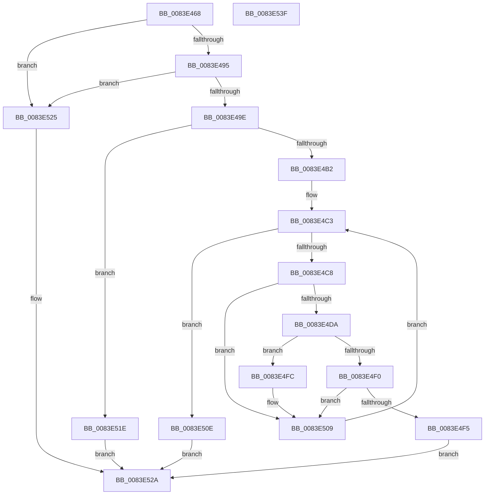

# RtlpMuiRegGetInstalledLanguageIndexByName

- RVA: `0x0083E468`–`0x0083E540` (길이 `216` bytes)
- VA: `0x000000014083E468`
- 실행 섹션: `PAGE`
- PDB 이름 있음: `예`; PDB Function 태그: `아니요`
- unwind 정보 RVA: `0x0006FC78`
- 디코드: `63`개 명령, `216/216` bytes 표시
- 미해석 바이트: `0` (있으면 어셈블리에 `.byte`로 보존)

> 이 문서는 커널 이미지의 기계어와 PDB 기호를 분석해 생성했습니다. 4번과 5번은 함수 원형과 자료형을 바이너리 사용 방식에서 추정한 C 해석이며 원본 소스 복구 결과는 아닙니다.

## 1. Dependencies

- 직접 호출 지점: **1**; 고유 호출 대상: **1**
- 직접 호출자로 확인된 함수: **2**
- RIP 상대 이미지 참조: **0**

### Outgoing calls
- `0x0083E4A9` → [RtlpMuiRegGetOrAddString](RtlpMuiRegGetOrAddString_function_0083E830.md) (function, `0x0083E830`)

### Direct callers
- [RtlpRemovePendingDeleteLanguages](../../text/6A/RtlpRemovePendingDeleteLanguages_function_006A9684.md) at `0x006A975F`
- [RtlpMuiRegGetInstalledLanguageIndexByLangId](RtlpMuiRegGetInstalledLanguageIndexByLangId_function_0083E31C.md) at `0x0083E41A`

### Static image references
- 디코드된 RIP-relative 메모리 참조가 없습니다.

## 2. Other-region calls and transfers

- 다른 실행 섹션으로 향하는 call: **0**
- 별도 외부 분기/꼬리 이동을 확인하지 못했습니다.

## 3. Assembly (complete function range)

```asm
0083E468  48 8B C4                        mov rax, rsp
0083E46B  48 89 58 08                     mov qword ptr [rax + 8], rbx
0083E46F  48 89 68 10                     mov qword ptr [rax + 0x10], rbp
0083E473  48 89 70 20                     mov qword ptr [rax + 0x20], rsi
0083E477  44 88 40 18                     mov byte ptr [rax + 0x18], r8b
0083E47B  57                              push rdi
0083E47C  48 83 EC 20                     sub rsp, 0x20
0083E480  33 ED                           xor ebp, ebp
0083E482  49 8B F9                        mov rdi, r9
0083E485  66 89 68 18                     mov word ptr [rax + 0x18], bp
0083E489  40 8A DD                        mov bl, bpl
0083E48C  48 85 C9                        test rcx, rcx
0083E48F  0F 84 90 00 00 00               je 0x14083e525
0083E495  48 85 D2                        test rdx, rdx
0083E498  0F 84 87 00 00 00               je 0x14083e525
0083E49E  48 8B 71 18                     mov rsi, qword ptr [rcx + 0x18]
0083E4A2  4C 8D 48 18                     lea r9, [rax + 0x18]
0083E4A6  45 33 C0                        xor r8d, r8d
0083E4A9  E8 82 03 00 00                  call 0x14083e830
0083E4AE  85 C0                           test eax, eax
0083E4B0  78 6C                           js 0x14083e51e
0083E4B2  44 0F B7 4E 06                  movzx r9d, word ptr [rsi + 6]
0083E4B7  44 8D 5D 01                     lea r11d, [rbp + 1]
0083E4BB  44 0F B7 54 24 40               movzx r10d, word ptr [rsp + 0x40]
0083E4C1  8B CD                           mov ecx, ebp
0083E4C3  41 3B C9                        cmp ecx, r9d
0083E4C6  7D 46                           jge 0x14083e50e
0083E4C8  48 63 C1                        movsxd rax, ecx
0083E4CB  48 6B D0 1C                     imul rdx, rax, 0x1c
0083E4CF  48 03 56 10                     add rdx, qword ptr [rsi + 0x10]
0083E4D3  66 44 39 52 06                  cmp word ptr [rdx + 6], r10w
0083E4D8  75 2F                           jne 0x14083e509
0083E4DA  44 0F B7 02                     movzx r8d, word ptr [rdx]
0083E4DE  BA 20 10 00 00                  mov edx, 0x1020
0083E4E3  41 0F B7 C0                     movzx eax, r8w
0083E4E7  66 23 C2                        and ax, dx
0083E4EA  66 83 F8 20                     cmp ax, 0x20
0083E4EE  75 0C                           jne 0x14083e4fc
0083E4F0  48 85 FF                        test rdi, rdi
0083E4F3  74 14                           je 0x14083e509
0083E4F5  66 89 0F                        mov word ptr [rdi], cx
0083E4F8  33 C0                           xor eax, eax
0083E4FA  EB 2E                           jmp 0x14083e52a
0083E4FC  66 41 0F BA E0 0C               bt r8w, 0xc
0083E502  0F B6 DB                        movzx ebx, bl
0083E505  41 0F 42 DB                     cmovb ebx, r11d
0083E509  41 03 CB                        add ecx, r11d
0083E50C  EB B5                           jmp 0x14083e4c3
0083E50E  F6 DB                           neg bl
0083E510  1B C0                           sbb eax, eax
0083E512  25 87 00 00 00                  and eax, 0x87
0083E517  05 34 00 00 C0                  add eax, 0xc0000034
0083E51C  EB 0C                           jmp 0x14083e52a
0083E51E  B8 34 00 00 C0                  mov eax, 0xc0000034
0083E523  EB 05                           jmp 0x14083e52a
0083E525  B8 0D 00 00 C0                  mov eax, 0xc000000d
0083E52A  48 8B 5C 24 30                  mov rbx, qword ptr [rsp + 0x30]
0083E52F  48 8B 6C 24 38                  mov rbp, qword ptr [rsp + 0x38]
0083E534  48 8B 74 24 48                  mov rsi, qword ptr [rsp + 0x48]
0083E539  48 83 C4 20                     add rsp, 0x20
0083E53D  5F                              pop rdi
0083E53E  C3                              ret
0083E53F  CC                              int3
```

## 4. C-style interpretation (structured pseudocode)

```c
__int64 __fastcall RtlpMuiRegGetInstalledLanguageIndexByName(__int64 a1, __int64 a2, int a3, __int64 a4)
{
    __int64 result;
    __int64 v_rbp;
    __int64 v_rbx;
    __int64 v_rsp;
    unsigned __int64 v_stack_p10;
    unsigned __int16 v_stack_p18;
    unsigned __int64 v_stack_p20;
    unsigned __int64 v_stack_p8;

    *(unsigned __int64 *)(v_rsp + 8) = v_rbx;
    *(unsigned __int64 *)(v_rsp + 16) = v_rbp;
    *(unsigned __int64 *)(v_rsp + 32) = v_rsi;
    *(unsigned __int8 *)(v_rsp + 24) = (unsigned __int8)(a3);
    v_rsp = (v_rsp) - (32);
    v_rbp = 0;
    *(unsigned __int16 *)(v_rsp + 24) = 0;
    if (a1 == 0) goto loc_0083E525;
    if (a2 == 0) goto loc_0083E525;
    a3 = 0;
    result = RtlpMuiRegGetOrAddString(a1, a2, a3, v_rsp + 24);
    if (sign_flag) goto loc_0083E51E;
loc_0083E4C3:
    if (0 >= ((unsigned int)(*(unsigned __int16 *)(*(unsigned __int64 *)(a1 + 24) + 6)))) goto loc_0083E50E;
    a2 = (a2) * ((int)(0));
    a2 = (a2) + (*(unsigned __int64 *)(*(unsigned __int64 *)(a1 + 24) + 16));
    if ((*(unsigned __int16 *)(a2 + 6)) != ((unsigned __int16)(v_stack_p18))) goto loc_0083E509;
    result = (unsigned __int16)(((unsigned __int16)(*(unsigned __int16 *)(a2))) & ((unsigned __int16)((unsigned int)(0x1020ULL))));
    if (((unsigned __int16)(result)) != 32) goto loc_0083E4FC;
    if (a4 == 0) goto loc_0083E509;
    *(unsigned __int16 *)(a4) = 0;
    result = 0;
    goto loc_0083E52A;
loc_0083E4FC:
    v_rbx = 0;
    if (condition_is_below) { v_rbx = (unsigned int)(v_rbp + 1); }
loc_0083E509:
    a1 = (unsigned int)((0) + ((unsigned int)(v_rbp + 1)));
    goto loc_0083E4C3;
loc_0083E50E:
    v_rbx = (unsigned __int8)(-(v_rbx));
    result = (unsigned int)((result) & (135));
    result = (unsigned int)((result) + (0xC0000034ULL));
    goto loc_0083E52A;
loc_0083E51E:
    goto loc_0083E52A;
loc_0083E525:
loc_0083E52A:
    v_rsp = (v_rsp) + (32);
    return (unsigned int)(0xC000000DULL);
}
```

## 5. (Beta) C Style

```c
int64_t RtlpMuiRegGetInstalledLanguageIndexByName(int64_t Arg1, int64_t Arg2, int32_t Arg3, int64_t Arg4)
{
    int64_t result;
    int64_t local_rbp;
    int64_t local_rbx;
    int64_t local_rsp;
    uint64_t v_stack_p10;
    uint16_t v_stack_p18;
    uint64_t v_stack_p20;
    uint64_t v_stack_p8;

    *(uint64_t *)(local_rsp + 0x8) = local_rbx;
    *(uint64_t *)(local_rsp + 0x10) = local_rbp;
    *(uint64_t *)(local_rsp + 0x20) = local_rsi;
    *(uint8_t *)(local_rsp + 0x18) = (uint8_t)(Arg3);
    local_rsp = (local_rsp) - (32);
    local_rbp = 0;
    *(uint16_t *)(local_rsp + 0x18) = 0;
    if (Arg1 == 0) goto loc_0083E525;
    if (Arg2 == 0) goto loc_0083E525;
    Arg3 = 0;
    result = RtlpMuiRegGetOrAddString(Arg1, Arg2, Arg3, local_rsp + 24);
    if (sign_flag) goto loc_0083E51E;
loc_0083E4C3:
    if (0 >= ((uint32_t)(*(uint16_t *)(*(uint64_t *)(Arg1 + 0x18) + 0x6)))) goto loc_0083E50E;
    Arg2 = (Arg2) * ((int32_t)(0));
    Arg2 = (Arg2) + (*(uint64_t *)(*(uint64_t *)(Arg1 + 0x18) + 0x10));
    if ((*(uint16_t *)(Arg2 + 0x6)) != ((uint16_t)(v_stack_p18))) goto loc_0083E509;
    result = (uint16_t)(((uint16_t)(*(uint16_t *)(Arg2))) & ((uint16_t)((uint32_t)(0x1020ULL))));
    if (((uint16_t)(result)) != 32) goto loc_0083E4FC;
    if (Arg4 == 0) goto loc_0083E509;
    *(uint16_t *)(Arg4) = 0;
    result = 0;
    goto loc_0083E52A;
loc_0083E4FC:
    local_rbx = 0;
    if (condition_is_below) { local_rbx = (uint32_t)(local_rbp + 1); }
loc_0083E509:
    Arg1 = (uint32_t)((0) + ((uint32_t)(local_rbp + 1)));
    goto loc_0083E4C3;
loc_0083E50E:
    local_rbx = (uint8_t)(-(local_rbx));
    result = (uint32_t)((result) & (135));
    result = (uint32_t)((result) + (0xC0000034ULL));
    goto loc_0083E52A;
loc_0083E51E:
    goto loc_0083E52A;
loc_0083E525:
loc_0083E52A:
    local_rsp = (local_rsp) + (32);
    return (uint32_t)(0xC000000DULL);
}
```

## 6. Execution-region graph

[열기: 2D/3D 그래프와 함수 탐색 컨트롤 패널](../../../control-panel.html?section=page&rva=0x0083E468&view=graph)

- 2D 그래프는 위에서 아래로 흐르고, 3D 그래프는 빈 공간을 드래그해 회전합니다. Shift+드래그는 이동, 휠은 확대·축소, 함수 노드 선택은 대상 보고서 이동입니다.

### Static fallback


