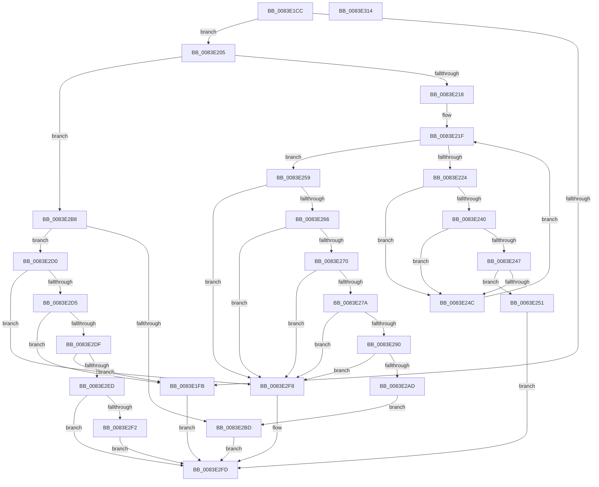

# RtlpMuiRegGetInstalledLanguageIndex

- RVA: `0x0083E1CC`–`0x0083E315` (길이 `329` bytes)
- VA: `0x000000014083E1CC`
- 실행 섹션: `PAGE`
- PDB 이름 있음: `예`; PDB Function 태그: `아니요`
- unwind 정보 RVA: `0x000A118C`
- 디코드: `93`개 명령, `329/329` bytes 표시
- 미해석 바이트: `0` (있으면 어셈블리에 `.byte`로 보존)

> 이 문서는 커널 이미지의 기계어와 PDB 기호를 분석해 생성했습니다. 4번과 5번은 함수 원형과 자료형을 바이너리 사용 방식에서 추정한 C 해석이며 원본 소스 복구 결과는 아닙니다.

## 1. Dependencies

- 직접 호출 지점: **3**; 고유 호출 대상: **3**
- 직접 호출자로 확인된 함수: **3**
- RIP 상대 이미지 참조: **0**

### Outgoing calls
- `0x0083E295` → [RtlInitUnicodeString](../../text/42/RtlInitUnicodeString_function_0042A780.md) (function, `0x0042A780`)
- `0x0083E2A4` → [RtlCultureNameToLCID](../AA/RtlCultureNameToLCID_function_00AACEF0.md) (function, `0x00AACEF0`)
- `0x0083E2C7` → [RtlpMuiRegGetInstalledLanguageIndexByLangId](RtlpMuiRegGetInstalledLanguageIndexByLangId_function_0083E31C.md) (function, `0x0083E31C`)

### Direct callers
- [RtlpMuiRegValidateConfigNode](../../text/6A/RtlpMuiRegValidateConfigNode_function_006A925C.md) at `0x006A9297`
- [RtlpLoadPolicyLanguageSpec](RtlpLoadPolicyLanguageSpec_function_0083D594.md) at `0x0083D6E8`
- [RtlpMuiRegConfigMatchesInstalled](RtlpMuiRegConfigMatchesInstalled_function_0083DA08.md) at `0x0083DC7F`

### Static image references
- 디코드된 RIP-relative 메모리 참조가 없습니다.

## 2. Other-region calls and transfers

- 다른 실행 섹션으로 향하는 call: **1**
  - `0x0083E295` → [RtlInitUnicodeString](../../text/42/RtlInitUnicodeString_function_0042A780.md) (`PAGE` → `.text`)
- 별도 외부 분기/꼬리 이동을 확인하지 못했습니다.

## 3. Assembly (complete function range)

```asm
0083E1CC  48 8B C4                        mov rax, rsp
0083E1CF  48 89 58 10                     mov qword ptr [rax + 0x10], rbx
0083E1D3  48 89 68 18                     mov qword ptr [rax + 0x18], rbp
0083E1D7  48 89 70 20                     mov qword ptr [rax + 0x20], rsi
0083E1DB  57                              push rdi
0083E1DC  48 83 EC 30                     sub rsp, 0x30
0083E1E0  33 DB                           xor ebx, ebx
0083E1E2  4D 0F BF D0                     movsx r10, r8w
0083E1E6  89 58 08                        mov dword ptr [rax + 8], ebx
0083E1E9  0F 57 C0                        xorps xmm0, xmm0
0083E1EC  49 8B F9                        mov rdi, r9
0083E1EF  48 8B F1                        mov rsi, rcx
0083E1F2  0F 11 40 E8                     movups xmmword ptr [rax - 0x18], xmm0
0083E1F6  48 85 C9                        test rcx, rcx
0083E1F9  75 0A                           jne 0x14083e205
0083E1FB  BB 0D 00 00 C0                  mov ebx, 0xc000000d
0083E200  E9 F8 00 00 00                  jmp 0x14083e2fd
0083E205  4C 8B 49 18                     mov r9, qword ptr [rcx + 0x18]
0083E209  41 B8 01 00 00 00               mov r8d, 1
0083E20F  83 FA 03                        cmp edx, 3
0083E212  0F 85 A0 00 00 00               jne 0x14083e2b8
0083E218  45 0F B7 59 06                  movzx r11d, word ptr [r9 + 6]
0083E21D  8B CB                           mov ecx, ebx
0083E21F  41 3B CB                        cmp ecx, r11d
0083E222  7D 35                           jge 0x14083e259
0083E224  48 63 C1                        movsxd rax, ecx
0083E227  BD 20 10 00 00                  mov ebp, 0x1020
0083E22C  48 6B D0 1C                     imul rdx, rax, 0x1c
0083E230  49 03 51 10                     add rdx, qword ptr [r9 + 0x10]
0083E234  0F B7 02                        movzx eax, word ptr [rdx]
0083E237  66 23 C5                        and ax, bp
0083E23A  66 83 F8 20                     cmp ax, 0x20
0083E23E  75 0C                           jne 0x14083e24c
0083E240  66 44 39 52 06                  cmp word ptr [rdx + 6], r10w
0083E245  75 05                           jne 0x14083e24c
0083E247  48 85 FF                        test rdi, rdi
0083E24A  75 05                           jne 0x14083e251
0083E24C  41 03 C8                        add ecx, r8d
0083E24F  EB CE                           jmp 0x14083e21f
0083E251  66 89 0F                        mov word ptr [rdi], cx
0083E254  E9 A4 00 00 00                  jmp 0x14083e2fd
0083E259  4C 8B 46 20                     mov r8, qword ptr [rsi + 0x20]
0083E25D  4D 85 C0                        test r8, r8
0083E260  0F 84 92 00 00 00               je 0x14083e2f8
0083E266  66 45 85 D2                     test r10w, r10w
0083E26A  0F 88 88 00 00 00               js 0x14083e2f8
0083E270  41 0F B7 48 06                  movzx ecx, word ptr [r8 + 6]
0083E275  44 3B D1                        cmp r10d, ecx
0083E278  73 7E                           jae 0x14083e2f8
0083E27A  49 8B 40 10                     mov rax, qword ptr [r8 + 0x10]
0083E27E  4A 0F BF 14 50                  movsx rdx, word ptr [rax + r10*2]
0083E283  49 8B 40 18                     mov rax, qword ptr [r8 + 0x18]
0083E287  48 8D 14 50                     lea rdx, [rax + rdx*2]
0083E28B  48 85 D2                        test rdx, rdx
0083E28E  74 68                           je 0x14083e2f8
0083E290  48 8D 4C 24 20                  lea rcx, [rsp + 0x20]
0083E295  E8 E6 C4 BE FF                  call 0x14042a780
0083E29A  48 8D 54 24 40                  lea rdx, [rsp + 0x40]
0083E29F  48 8D 4C 24 20                  lea rcx, [rsp + 0x20]
0083E2A4  E8 47 EC 26 00                  call 0x140aacef0
0083E2A9  84 C0                           test al, al
0083E2AB  74 4B                           je 0x14083e2f8
0083E2AD  44 0F B7 54 24 40               movzx r10d, word ptr [rsp + 0x40]
0083E2B3  44 8A C3                        mov r8b, bl
0083E2B6  EB 05                           jmp 0x14083e2bd
0083E2B8  41 3B D0                        cmp edx, r8d
0083E2BB  75 13                           jne 0x14083e2d0
0083E2BD  4C 8B CF                        mov r9, rdi
0083E2C0  41 0F B7 D2                     movzx edx, r10w
0083E2C4  48 8B CE                        mov rcx, rsi
0083E2C7  E8 50 00 00 00                  call 0x14083e31c
0083E2CC  8B D8                           mov ebx, eax
0083E2CE  EB 2D                           jmp 0x14083e2fd
0083E2D0  83 FA 02                        cmp edx, 2
0083E2D3  75 23                           jne 0x14083e2f8
0083E2D5  66 45 85 D2                     test r10w, r10w
0083E2D9  0F 8E 1C FF FF FF               jle 0x14083e1fb
0083E2DF  41 0F B7 49 06                  movzx ecx, word ptr [r9 + 6]
0083E2E4  44 3B D1                        cmp r10d, ecx
0083E2E7  0F 8D 0E FF FF FF               jge 0x14083e1fb
0083E2ED  48 85 FF                        test rdi, rdi
0083E2F0  74 0B                           je 0x14083e2fd
0083E2F2  66 44 89 17                     mov word ptr [rdi], r10w
0083E2F6  EB 05                           jmp 0x14083e2fd
0083E2F8  BB 34 00 00 C0                  mov ebx, 0xc0000034
0083E2FD  48 8B 6C 24 50                  mov rbp, qword ptr [rsp + 0x50]
0083E302  8B C3                           mov eax, ebx
0083E304  48 8B 5C 24 48                  mov rbx, qword ptr [rsp + 0x48]
0083E309  48 8B 74 24 58                  mov rsi, qword ptr [rsp + 0x58]
0083E30E  48 83 C4 30                     add rsp, 0x30
0083E312  5F                              pop rdi
0083E313  C3                              ret
0083E314  CC                              int3
```

## 4. C-style interpretation (structured pseudocode)

```c
__int64 __fastcall RtlpMuiRegGetInstalledLanguageIndex(__int64 a1, int a2, unsigned __int16 a3, __int64 a4)
{
    __int64 result;
    __int64 v_rbx;
    __int64 v_rsp;
    unsigned __int64 v_stack_m18;
    unsigned __int64 v_stack_p10;
    unsigned __int64 v_stack_p18;
    unsigned __int64 v_stack_p20;
    unsigned __int64 v_stack_p8;

    *(unsigned __int64 *)(v_rsp + 16) = v_rbx;
    *(unsigned __int64 *)(v_rsp + 24) = v_rbp;
    *(unsigned __int64 *)(v_rsp + 32) = v_rsi;
    v_rsp = (v_rsp) - (48);
    v_rbx = 0;
    *(unsigned int *)(v_rsp + 8) = 0;
    *(unsigned __int64 *)(v_rsp - 24) = v_xmm0;
    if (a1 != 0) goto loc_0083E205;
loc_0083E1FB:
    goto loc_0083E2FD;
loc_0083E205:
    if (a2 != 3) goto loc_0083E2B8;
loc_0083E21F:
    if (((unsigned int)((unsigned int)((unsigned int)((unsigned int)(0xC000000DULL))))) >= ((unsigned int)(*(unsigned __int16 *)(*(unsigned __int64 *)(a1 + 24) + 6)))) goto loc_0083E259;
    a2 = (a2) * ((int)((unsigned int)((unsigned int)((unsigned int)((unsigned int)(0xC000000DULL))))));
    a2 = (a2) + (*(unsigned __int64 *)(*(unsigned __int64 *)(a1 + 24) + 16));
    result = (unsigned __int16)((*(unsigned __int16 *)(a2)) & ((unsigned __int16)((unsigned int)(0x1020ULL))));
    if (((unsigned __int16)(result)) != 32) goto loc_0083E24C;
    if ((*(unsigned __int16 *)(a2 + 6)) != ((unsigned __int16)((__int16)(a3)))) goto loc_0083E24C;
    if (a4 != 0) goto loc_0083E251;
loc_0083E24C:
    a1 = (unsigned int)(((unsigned int)((unsigned int)((unsigned int)(0xC000000DULL)))) + (1));
    goto loc_0083E21F;
loc_0083E251:
    *(unsigned __int16 *)(a4) = (unsigned __int16)(a1);
    goto loc_0083E2FD;
loc_0083E259:
    if (*(unsigned __int64 *)(a1 + 32) == 0) goto loc_0083E2F8;
    if (sign_flag) goto loc_0083E2F8;
    if (((unsigned int)((__int16)(a3))) >= ((unsigned int)(*(unsigned __int16 *)(*(unsigned __int64 *)(a1 + 32) + 6)))) goto loc_0083E2F8;
    if (*(unsigned __int64 *)(*(unsigned __int64 *)(a1 + 32) + 24) + (__int16)(*(unsigned __int16 *)(*(unsigned __int64 *)(*(unsigned __int64 *)(a1 + 32) + 16) + (__int16)(a3) * 2)) * 2 == 0) goto loc_0083E2F8;
    result = RtlInitUnicodeString(v_stack_m18, *(unsigned __int64 *)(*(unsigned __int64 *)(a1 + 32) + 24) + (__int16)(*(unsigned __int16 *)(*(unsigned __int64 *)(*(unsigned __int64 *)(a1 + 32) + 16) + (__int16)(a3) * 2)) * 2, *(unsigned __int64 *)(a1 + 32), *(unsigned __int64 *)(a1 + 24));
    result = RtlCultureNameToLCID(v_stack_m18, v_stack_p8, *(unsigned __int64 *)(a1 + 32), *(unsigned __int64 *)(a1 + 24));
    if ((unsigned __int8)(result) == 0) goto loc_0083E2F8;
    goto loc_0083E2BD;
loc_0083E2B8:
    if (((unsigned int)(v_stack_p8)) != ((unsigned int)((unsigned __int8)((unsigned int)(0xC000000DULL))))) goto loc_0083E2D0;
loc_0083E2BD:
    result = RtlpMuiRegGetInstalledLanguageIndexByLangId(a1, (unsigned __int16)(v_stack_p8), (unsigned __int8)((unsigned int)(0xC000000DULL)), a4);
    goto loc_0083E2FD;
loc_0083E2D0:
    if (((unsigned int)((unsigned __int16)(v_stack_p8))) != 2) goto loc_0083E2F8;
    if (condition_is_less_or_equal) goto loc_0083E1FB;
    if (((unsigned int)(v_stack_p8)) >= ((unsigned int)(*(unsigned __int16 *)(a4 + 6)))) goto loc_0083E1FB;
    if (a4 == 0) goto loc_0083E2FD;
    *(unsigned __int16 *)(a4) = (unsigned __int16)(v_stack_p8);
    goto loc_0083E2FD;
loc_0083E2F8:
loc_0083E2FD:
    v_rsp = (v_rsp) + (48);
    return (unsigned int)((unsigned int)((unsigned int)(0xC0000034ULL)));
}
```

## 5. (Beta) C Style

```c
int64_t RtlpMuiRegGetInstalledLanguageIndex(void *Arg1, int32_t Arg2, uint16_t Arg3, int64_t Arg4)
{
    uint8_t *arg1 = (uint8_t *)Arg1;

    int64_t result;
    int64_t local_rbx;
    int64_t local_rsp;
    uint64_t v_stack_m18;
    uint64_t v_stack_p10;
    uint64_t v_stack_p18;
    uint64_t v_stack_p20;
    uint64_t v_stack_p8;

    *(uint64_t *)(local_rsp + 0x10) = local_rbx;
    *(uint64_t *)(local_rsp + 0x18) = local_rbp;
    *(uint64_t *)(local_rsp + 0x20) = local_rsi;
    local_rsp = (local_rsp) - (48);
    local_rbx = 0;
    *(uint32_t *)(local_rsp + 0x8) = 0;
    *(uint64_t *)(local_rsp - 0x18) = v_xmm0;
    if (Arg1 != NULL) goto loc_0083E205;
loc_0083E1FB:
    goto loc_0083E2FD;
loc_0083E205:
    if (Arg2 != 3) goto loc_0083E2B8;
loc_0083E21F:
    if (((uint32_t)((uint32_t)((uint32_t)((uint32_t)(0xC000000DULL))))) >= ((uint32_t)(*(uint16_t *)(*(uint64_t *)(arg1 + 0x18) + 0x6)))) goto loc_0083E259;
    Arg2 = (Arg2) * ((int32_t)((uint32_t)((uint32_t)((uint32_t)((uint32_t)(0xC000000DULL))))));
    Arg2 = (Arg2) + (*(uint64_t *)(*(uint64_t *)(arg1 + 0x18) + 0x10));
    result = (uint16_t)((*(uint16_t *)(Arg2)) & ((uint16_t)((uint32_t)(0x1020ULL))));
    if (((uint16_t)(result)) != 32) goto loc_0083E24C;
    if ((*(uint16_t *)(Arg2 + 0x6)) != ((uint16_t)((int16_t)(Arg3)))) goto loc_0083E24C;
    if (Arg4 != 0) goto loc_0083E251;
loc_0083E24C:
    Arg1 = (uint32_t)(((uint32_t)((uint32_t)((uint32_t)(0xC000000DULL)))) + (1));
    goto loc_0083E21F;
loc_0083E251:
    *(uint16_t *)(Arg4) = (uint16_t)(Arg1);
    goto loc_0083E2FD;
loc_0083E259:
    if (*(uint64_t *)(arg1 + 0x20) == 0) goto loc_0083E2F8;
    if (sign_flag) goto loc_0083E2F8;
    if (((uint32_t)((int16_t)(Arg3))) >= ((uint32_t)(*(uint16_t *)(*(uint64_t *)(arg1 + 0x20) + 0x6)))) goto loc_0083E2F8;
    if (*(uint64_t *)(*(uint64_t *)(arg1 + 0x20) + 0x18) + (int16_t)(*(uint16_t *)(*(uint64_t *)(*(uint64_t *)(arg1 + 0x20) + 0x10) + (int16_t)(Arg3) * 2)) * 2 == 0) goto loc_0083E2F8;
    result = RtlInitUnicodeString(v_stack_m18, *(uint64_t *)(*(uint64_t *)(arg1 + 0x20) + 0x18) + (int16_t)(*(uint16_t *)(*(uint64_t *)(*(uint64_t *)(arg1 + 0x20) + 0x10) + (int16_t)(Arg3) * 2)) * 2, *(uint64_t *)(arg1 + 0x20), *(uint64_t *)(arg1 + 0x18));
    result = RtlCultureNameToLCID(v_stack_m18, v_stack_p8, *(uint64_t *)(arg1 + 0x20), *(uint64_t *)(arg1 + 0x18));
    if ((uint8_t)(result) == 0) goto loc_0083E2F8;
    goto loc_0083E2BD;
loc_0083E2B8:
    if (((uint32_t)(v_stack_p8)) != ((uint32_t)((uint8_t)((uint32_t)(0xC000000DULL))))) goto loc_0083E2D0;
loc_0083E2BD:
    result = RtlpMuiRegGetInstalledLanguageIndexByLangId(Arg1, (uint16_t)(v_stack_p8), (uint8_t)((uint32_t)(0xC000000DULL)), Arg4);
    goto loc_0083E2FD;
loc_0083E2D0:
    if (((uint32_t)((uint16_t)(v_stack_p8))) != 2) goto loc_0083E2F8;
    if (condition_is_less_or_equal) goto loc_0083E1FB;
    if (((uint32_t)(v_stack_p8)) >= ((uint32_t)(*(uint16_t *)(Arg4 + 0x6)))) goto loc_0083E1FB;
    if (Arg4 == 0) goto loc_0083E2FD;
    *(uint16_t *)(Arg4) = (uint16_t)(v_stack_p8);
    goto loc_0083E2FD;
loc_0083E2F8:
loc_0083E2FD:
    local_rsp = (local_rsp) + (48);
    return (uint32_t)((uint32_t)((uint32_t)(0xC0000034ULL)));
}
```

### 관측된 메모리 오프셋

구조체 형식이 확인되지 않은 접근은 인자 기준의 오프셋으로만 기록했습니다.

| 기준 인자 | 오프셋 표현 | 폭 (bit) | 접근 |
|---|---:|---:|---|
| `Arg1` | `+ 0x20` | `64` | `R` |

## 6. Execution-region graph

[열기: 2D/3D 그래프와 함수 탐색 컨트롤 패널](../../../control-panel.html?section=page&rva=0x0083E1CC&view=graph)

- 2D 그래프는 위에서 아래로 흐르고, 3D 그래프는 빈 공간을 드래그해 회전합니다. Shift+드래그는 이동, 휠은 확대·축소, 함수 노드 선택은 대상 보고서 이동입니다.

### Static fallback


