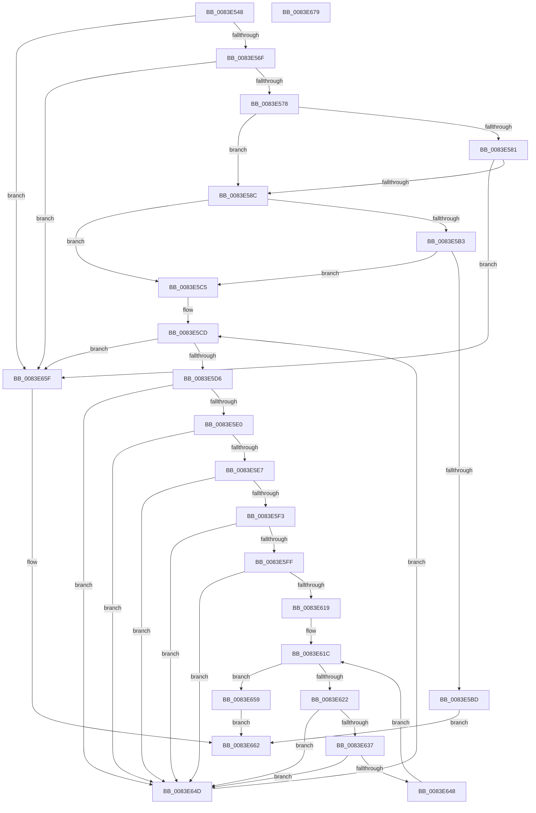

# RtlpMuiRegGetLangInfoIndex

- RVA: `0x0083E548`–`0x0083E67A` (길이 `306` bytes)
- VA: `0x000000014083E548`
- 실행 섹션: `PAGE`
- PDB 이름 있음: `예`; PDB Function 태그: `아니요`
- unwind 정보 RVA: `0x000A6CEC`
- 디코드: `84`개 명령, `306/306` bytes 표시
- 미해석 바이트: `0` (있으면 어셈블리에 `.byte`로 보존)

> 이 문서는 커널 이미지의 기계어와 PDB 기호를 분석해 생성했습니다. 4번과 5번은 함수 원형과 자료형을 바이너리 사용 방식에서 추정한 C 해석이며 원본 소스 복구 결과는 아닙니다.

## 1. Dependencies

- 직접 호출 지점: **0**; 고유 호출 대상: **0**
- 직접 호출자로 확인된 함수: **1**
- RIP 상대 이미지 참조: **0**

### Outgoing calls
- 직접 디코드된 call 명령이 없습니다.

### Direct callers
- [RtlpMuiRegGetOrAddLangInfo](RtlpMuiRegGetOrAddLangInfo_function_0083E74C.md) at `0x0083E799`

### Static image references
- 디코드된 RIP-relative 메모리 참조가 없습니다.

## 2. Other-region calls and transfers

- 다른 실행 섹션으로 향하는 call: **0**
- 별도 외부 분기/꼬리 이동을 확인하지 못했습니다.

## 3. Assembly (complete function range)

```asm
0083E548  48 8B C4                        mov rax, rsp
0083E54B  48 89 58 08                     mov qword ptr [rax + 8], rbx
0083E54F  48 89 68 10                     mov qword ptr [rax + 0x10], rbp
0083E553  48 89 70 18                     mov qword ptr [rax + 0x18], rsi
0083E557  48 89 78 20                     mov qword ptr [rax + 0x20], rdi
0083E55B  41 56                           push r14
0083E55D  45 33 F6                        xor r14d, r14d
0083E560  4C 8B C2                        mov r8, rdx
0083E563  4C 8B D1                        mov r10, rcx
0083E566  48 85 C9                        test rcx, rcx
0083E569  0F 84 F0 00 00 00               je 0x14083e65f
0083E56F  48 85 D2                        test rdx, rdx
0083E572  0F 84 E7 00 00 00               je 0x14083e65f
0083E578  0F B7 5A 04                     movzx ebx, word ptr [rdx + 4]
0083E57C  66 85 DB                        test bx, bx
0083E57F  75 0B                           jne 0x14083e58c
0083E581  66 44 39 72 06                  cmp word ptr [rdx + 6], r14w
0083E586  0F 8C D3 00 00 00               jl 0x14083e65f
0083E58C  4C 8B 49 10                     mov r9, qword ptr [rcx + 0x10]
0083E590  48 B8 25 49 92 24 49 92 24 49   movabs rax, 0x4924924924924925
0083E59A  49 8B C8                        mov rcx, r8
0083E59D  49 2B C9                        sub rcx, r9
0083E5A0  48 F7 E9                        imul rcx
0083E5A3  48 C1 FA 03                     sar rdx, 3
0083E5A7  48 8B C2                        mov rax, rdx
0083E5AA  48 C1 E8 3F                     shr rax, 0x3f
0083E5AE  48 03 D0                        add rdx, rax
0083E5B1  78 12                           js 0x14083e5c5
0083E5B3  41 0F B7 42 06                  movzx eax, word ptr [r10 + 6]
0083E5B8  48 3B D0                        cmp rdx, rax
0083E5BB  7D 08                           jge 0x14083e5c5
0083E5BD  0F B7 C2                        movzx eax, dx
0083E5C0  E9 9D 00 00 00                  jmp 0x14083e662
0083E5C5  41 0F B7 6A 06                  movzx ebp, word ptr [r10 + 6]
0083E5CA  4D 8B DE                        mov r11, r14
0083E5CD  4C 3B DD                        cmp r11, rbp
0083E5D0  0F 8D 89 00 00 00               jge 0x14083e65f
0083E5D6  41 0F B7 00                     movzx eax, word ptr [r8]
0083E5DA  66 41 39 01                     cmp word ptr [r9], ax
0083E5DE  75 6D                           jne 0x14083e64d
0083E5E0  66 41 39 59 04                  cmp word ptr [r9 + 4], bx
0083E5E5  75 66                           jne 0x14083e64d
0083E5E7  41 0F B7 40 06                  movzx eax, word ptr [r8 + 6]
0083E5EC  66 41 39 41 06                  cmp word ptr [r9 + 6], ax
0083E5F1  75 5A                           jne 0x14083e64d
0083E5F3  41 0F B7 40 0A                  movzx eax, word ptr [r8 + 0xa]
0083E5F8  66 41 39 41 0A                  cmp word ptr [r9 + 0xa], ax
0083E5FD  75 4E                           jne 0x14083e64d
0083E5FF  41 0F B7 70 08                  movzx esi, word ptr [r8 + 8]
0083E604  B9 00 C0 00 00                  mov ecx, 0xc000
0083E609  41 0F B7 79 08                  movzx edi, word ptr [r9 + 8]
0083E60E  0F B7 C6                        movzx eax, si
0083E611  66 33 C7                        xor ax, di
0083E614  66 85 C1                        test cx, ax
0083E617  75 34                           jne 0x14083e64d
0083E619  45 8B D6                        mov r10d, r14d
0083E61C  41 83 FA 04                     cmp r10d, 4
0083E620  73 37                           jae 0x14083e659
0083E622  41 0F B7 C2                     movzx eax, r10w
0083E626  0F B7 D6                        movzx edx, si
0083E629  66 33 D7                        xor dx, di
0083E62C  8D 0C 00                        lea ecx, [rax + rax]
0083E62F  66 D3 EA                        shr dx, cl
0083E632  F6 C2 03                        test dl, 3
0083E635  75 16                           jne 0x14083e64d
0083E637  41 8B CA                        mov ecx, r10d
0083E63A  41 0F B7 44 48 0C               movzx eax, word ptr [r8 + rcx*2 + 0xc]
0083E640  66 41 39 44 49 0C               cmp word ptr [r9 + rcx*2 + 0xc], ax
0083E646  75 05                           jne 0x14083e64d
0083E648  41 FF C2                        inc r10d
0083E64B  EB CF                           jmp 0x14083e61c
0083E64D  49 FF C3                        inc r11
0083E650  49 83 C1 1C                     add r9, 0x1c
0083E654  E9 74 FF FF FF                  jmp 0x14083e5cd
0083E659  41 0F B7 C3                     movzx eax, r11w
0083E65D  EB 03                           jmp 0x14083e662
0083E65F  83 C8 FF                        or eax, 0xffffffff
0083E662  48 8B 5C 24 10                  mov rbx, qword ptr [rsp + 0x10]
0083E667  48 8B 6C 24 18                  mov rbp, qword ptr [rsp + 0x18]
0083E66C  48 8B 74 24 20                  mov rsi, qword ptr [rsp + 0x20]
0083E671  48 8B 7C 24 28                  mov rdi, qword ptr [rsp + 0x28]
0083E676  41 5E                           pop r14
0083E678  C3                              ret
0083E679  CC                              int3
```

## 4. C-style interpretation (structured pseudocode)

```c
__int64 __fastcall RtlpMuiRegGetLangInfoIndex(__int64 a1, __int64 a2)
{
    __int64 result;
    __int64 v_r10;
    __int64 v_r11;
    __int64 v_r14;
    unsigned __int64 v_stack_p10;
    unsigned __int64 v_stack_p18;
    unsigned __int64 v_stack_p20;
    unsigned __int64 v_stack_p8;

    *(unsigned __int64 *)(v_rsp + 8) = v_rbx;
    *(unsigned __int64 *)(v_rsp + 16) = v_rbp;
    *(unsigned __int64 *)(v_rsp + 24) = v_rsi;
    *(unsigned __int64 *)(v_rsp + 32) = v_rdi;
    v_r14 = 0;
    if (a1 == 0) goto loc_0083E65F;
    if (a2 == 0) goto loc_0083E65F;
    if ((unsigned __int16)(*(unsigned __int16 *)(a2 + 4)) != 0) goto loc_0083E58C;
    if ((*(unsigned __int16 *)(a2 + 6)) < 0) goto loc_0083E65F;
loc_0083E58C:
    a1 = (a2) - (*(unsigned __int64 *)(a1 + 16));
    a2 = (a2) >> (3);
    result = (a2) >> (63);
    a2 = (a2) + (result);
    if (sign_flag) goto loc_0083E5C5;
    if (a2 >= (*(unsigned __int16 *)(a1 + 6))) goto loc_0083E5C5;
    goto loc_0083E662;
loc_0083E5C5:
loc_0083E5CD:
    if (0 >= (*(unsigned __int16 *)(a1 + 6))) goto loc_0083E65F;
    if ((*(unsigned __int16 *)(*(unsigned __int64 *)(a1 + 16))) != ((unsigned __int16)(*(unsigned __int16 *)(a2)))) goto loc_0083E64D;
    if ((*(unsigned __int16 *)(*(unsigned __int64 *)(a1 + 16) + 4)) != ((unsigned __int16)(*(unsigned __int16 *)(a2 + 4)))) goto loc_0083E64D;
    if ((*(unsigned __int16 *)(*(unsigned __int64 *)(a1 + 16) + 6)) != ((unsigned __int16)(*(unsigned __int16 *)(a2 + 6)))) goto loc_0083E64D;
    if ((*(unsigned __int16 *)(*(unsigned __int64 *)(a1 + 16) + 10)) != ((unsigned __int16)(*(unsigned __int16 *)(a2 + 10)))) goto loc_0083E64D;
    result = (unsigned __int16)(((unsigned __int16)(*(unsigned __int16 *)(a2 + 8))) ^ ((unsigned __int16)(*(unsigned __int16 *)(*(unsigned __int64 *)(a1 + 16) + 8))));
    if ((((unsigned __int16)((unsigned int)(0xC000ULL))) & ((unsigned __int16)(result))) != 0) goto loc_0083E64D;
loc_0083E61C:
    if (0 >= 4) goto loc_0083E659;
    a2 = (unsigned __int16)(((unsigned __int16)(*(unsigned __int16 *)(a2 + 8))) ^ ((unsigned __int16)(*(unsigned __int16 *)(*(unsigned __int64 *)(a1 + 16) + 8))));
    a2 = (unsigned __int16)((a2) >> ((unsigned __int8)(0 + 0 * 1)));
    if ((((unsigned __int8)(a2)) & (3)) != 0) goto loc_0083E64D;
    if ((*(unsigned __int16 *)(*(unsigned __int64 *)(a1 + 16) + 0 * 2 + 12)) != ((unsigned __int16)(*(unsigned __int16 *)(a2 + 0 * 2 + 12)))) goto loc_0083E64D;
    v_r10 = (unsigned int)((0) + 1);
    goto loc_0083E61C;
loc_0083E64D:
    v_r11 = (0) + 1;
    a4 = (*(unsigned __int64 *)(a1 + 16)) + (28);
    goto loc_0083E5CD;
loc_0083E659:
    goto loc_0083E662;
loc_0083E65F:
    result = (unsigned int)(((unsigned __int16)(v_r11)) | (0xFFFFFFFFULL));
loc_0083E662:
    return result;
}
```

## 5. (Beta) C Style

```c
int64_t RtlpMuiRegGetLangInfoIndex(void *Arg1, void *Arg2)
{
    uint8_t *arg1 = (uint8_t *)Arg1;
    uint8_t *arg2 = (uint8_t *)Arg2;

    int64_t result;
    int64_t local_r10;
    int64_t local_r11;
    int64_t local_r14;
    uint64_t v_stack_p10;
    uint64_t v_stack_p18;
    uint64_t v_stack_p20;
    uint64_t v_stack_p8;

    *(uint64_t *)(local_rsp + 0x8) = local_rbx;
    *(uint64_t *)(local_rsp + 0x10) = local_rbp;
    *(uint64_t *)(local_rsp + 0x18) = local_rsi;
    *(uint64_t *)(local_rsp + 0x20) = local_rdi;
    local_r14 = 0;
    if (Arg1 == NULL) goto loc_0083E65F;
    if (Arg2 == NULL) goto loc_0083E65F;
    if ((uint16_t)(*(uint16_t *)(arg2 + 0x4)) != 0) goto loc_0083E58C;
    if ((*(uint16_t *)(arg2 + 0x6)) < 0) goto loc_0083E65F;
loc_0083E58C:
    Arg1 = (Arg2) - (*(uint64_t *)(arg1 + 0x10));
    Arg2 = (Arg2) >> (3);
    result = (Arg2) >> (63);
    Arg2 = (Arg2) + (result);
    if (sign_flag) goto loc_0083E5C5;
    if (Arg2 >= (*(uint16_t *)(arg1 + 0x6))) goto loc_0083E5C5;
    goto loc_0083E662;
loc_0083E5C5:
loc_0083E5CD:
    if (0 >= (*(uint16_t *)(arg1 + 0x6))) goto loc_0083E65F;
    if ((*(uint16_t *)(*(uint64_t *)(arg1 + 0x10))) != ((uint16_t)(*(uint16_t *)(arg2)))) goto loc_0083E64D;
    if ((*(uint16_t *)(*(uint64_t *)(arg1 + 0x10) + 0x4)) != ((uint16_t)(*(uint16_t *)(arg2 + 0x4)))) goto loc_0083E64D;
    if ((*(uint16_t *)(*(uint64_t *)(arg1 + 0x10) + 0x6)) != ((uint16_t)(*(uint16_t *)(arg2 + 0x6)))) goto loc_0083E64D;
    if ((*(uint16_t *)(*(uint64_t *)(arg1 + 0x10) + 0xA)) != ((uint16_t)(*(uint16_t *)(arg2 + 0xA)))) goto loc_0083E64D;
    result = (uint16_t)(((uint16_t)(*(uint16_t *)(arg2 + 0x8))) ^ ((uint16_t)(*(uint16_t *)(*(uint64_t *)(arg1 + 0x10) + 0x8))));
    if ((((uint16_t)((uint32_t)(0xC000ULL))) & ((uint16_t)(result))) != 0) goto loc_0083E64D;
loc_0083E61C:
    if (0 >= 4) goto loc_0083E659;
    Arg2 = (uint16_t)(((uint16_t)(*(uint16_t *)(arg2 + 0x8))) ^ ((uint16_t)(*(uint16_t *)(*(uint64_t *)(arg1 + 0x10) + 0x8))));
    Arg2 = (uint16_t)((Arg2) >> ((uint8_t)(0 + 0 * 1)));
    if ((((uint8_t)(Arg2)) & (3)) != 0) goto loc_0083E64D;
    if ((*(uint16_t *)(*(uint64_t *)(arg1 + 0x10) + 0x0 * 2 + 0xC)) != ((uint16_t)(*(uint16_t *)(arg2 + 0x0 * 2 + 0xC)))) goto loc_0083E64D;
    local_r10 = (uint32_t)((0) + 1);
    goto loc_0083E61C;
loc_0083E64D:
    local_r11 = (0) + 1;
    a4 = (*(uint64_t *)(arg1 + 0x10)) + (28);
    goto loc_0083E5CD;
loc_0083E659:
    goto loc_0083E662;
loc_0083E65F:
    result = (uint32_t)(((uint16_t)(local_r11)) | (0xFFFFFFFFULL));
loc_0083E662:
    return result;
}
```

### 관측된 메모리 오프셋

구조체 형식이 확인되지 않은 접근은 인자 기준의 오프셋으로만 기록했습니다.

| 기준 인자 | 오프셋 표현 | 폭 (bit) | 접근 |
|---|---:|---:|---|
| `Arg1` | `+ 0x6` | `16` | `R` |
| `Arg2` | `+ 0x0` | `16` | `R` |
| `Arg2` | `+ 0x6` | `16` | `R` |
| `Arg2` | `+ 0x8` | `16` | `R` |
| `Arg2` | `+ 0xA` | `16` | `R` |
| `Arg2` | `+ 0xC + rcx*2` | `16` | `R` |

## 6. Execution-region graph

[열기: 2D/3D 그래프와 함수 탐색 컨트롤 패널](../../../control-panel.html?section=page&rva=0x0083E548&view=graph)

- 2D 그래프는 위에서 아래로 흐르고, 3D 그래프는 빈 공간을 드래그해 회전합니다. Shift+드래그는 이동, 휠은 확대·축소, 함수 노드 선택은 대상 보고서 이동입니다.

### Static fallback


