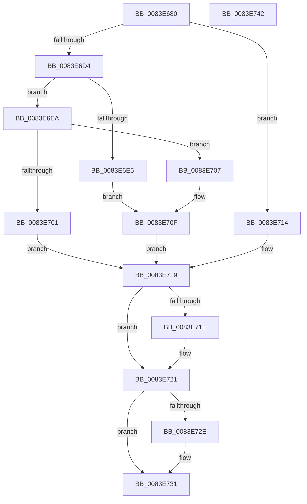

# RtlpMuiRegGetLanguageSpec

- RVA: `0x0083E680`–`0x0083E743` (길이 `195` bytes)
- VA: `0x000000014083E680`
- 실행 섹션: `PAGE`
- PDB 이름 있음: `예`; PDB Function 태그: `아니요`
- unwind 정보 RVA: `0x000DB530`
- 디코드: `62`개 명령, `195/195` bytes 표시
- 미해석 바이트: `0` (있으면 어셈블리에 `.byte`로 보존)

> 이 문서는 커널 이미지의 기계어와 PDB 기호를 분석해 생성했습니다. 4번과 5번은 함수 원형과 자료형을 바이너리 사용 방식에서 추정한 C 해석이며 원본 소스 복구 결과는 아닙니다.

## 1. Dependencies

- 직접 호출 지점: **3**; 고유 호출 대상: **3**
- 직접 호출자로 확인된 함수: **2**
- RIP 상대 이미지 참조: **0**

### Outgoing calls
- `0x0083E6BC` → [RtlInitUnicodeString](../../text/42/RtlInitUnicodeString_function_0042A780.md) (function, `0x0042A780`)
- `0x0083E6CB` → [RtlCultureNameToLCID](../AA/RtlCultureNameToLCID_function_00AACEF0.md) (function, `0x00AACEF0`)
- `0x0083E6F8` → [RtlpMuiRegGetOrAddString](RtlpMuiRegGetOrAddString_function_0083E830.md) (function, `0x0083E830`)

### Direct callers
- [RtlpPopulateLanguageConfigList](RtlpPopulateLanguageConfigList_function_0083EF20.md) at `0x0083F02D`
- [RtlpPopulateLanguageConfigList](RtlpPopulateLanguageConfigList_function_0083EF20.md) at `0x0083F0D0`
- [RtlpMuiRegAddBaseLanguage](RtlpMuiRegAddBaseLanguage_function_0083F494.md) at `0x0083F603`
- [RtlpMuiRegAddBaseLanguage](RtlpMuiRegAddBaseLanguage_function_0083F494.md) at `0x0083F686`
- [RtlpMuiRegAddBaseLanguage](RtlpMuiRegAddBaseLanguage_function_0083F494.md) at `0x0083F75E`

### Static image references
- 디코드된 RIP-relative 메모리 참조가 없습니다.

## 2. Other-region calls and transfers

- 다른 실행 섹션으로 향하는 call: **1**
  - `0x0083E6BC` → [RtlInitUnicodeString](../../text/42/RtlInitUnicodeString_function_0042A780.md) (`PAGE` → `.text`)
- 별도 외부 분기/꼬리 이동을 확인하지 못했습니다.

## 3. Assembly (complete function range)

```asm
0083E680  48 8B C4                        mov rax, rsp
0083E683  48 89 58 08                     mov qword ptr [rax + 8], rbx
0083E687  44 88 48 20                     mov byte ptr [rax + 0x20], r9b
0083E68B  55                              push rbp
0083E68C  56                              push rsi
0083E68D  57                              push rdi
0083E68E  41 56                           push r14
0083E690  41 57                           push r15
0083E692  48 83 EC 30                     sub rsp, 0x30
0083E696  45 33 FF                        xor r15d, r15d
0083E699  4C 8B F1                        mov r14, rcx
0083E69C  0F 57 C0                        xorps xmm0, xmm0
0083E69F  44 89 78 18                     mov dword ptr [rax + 0x18], r15d
0083E6A3  41 0F B7 DF                     movzx ebx, r15w
0083E6A7  48 8D 48 C8                     lea rcx, [rax - 0x38]
0083E6AB  66 89 58 20                     mov word ptr [rax + 0x20], bx
0083E6AF  49 8B F0                        mov rsi, r8
0083E6B2  48 8B EA                        mov rbp, rdx
0083E6B5  41 8A FF                        mov dil, r15b
0083E6B8  0F 11 40 C8                     movups xmmword ptr [rax - 0x38], xmm0
0083E6BC  E8 BF C0 BE FF                  call 0x14042a780
0083E6C1  48 8D 54 24 70                  lea rdx, [rsp + 0x70]
0083E6C6  48 8D 4C 24 20                  lea rcx, [rsp + 0x20]
0083E6CB  E8 20 E8 26 00                  call 0x140aacef0
0083E6D0  84 C0                           test al, al
0083E6D2  74 40                           je 0x14083e714
0083E6D4  8B 5C 24 70                     mov ebx, dword ptr [rsp + 0x70]
0083E6D8  8D 83 00 F0 FF FF               lea eax, [rbx - 0x1000]
0083E6DE  A9 FF FB FF FF                  test eax, 0xfffffbff
0083E6E3  74 05                           je 0x14083e6ea
0083E6E5  40 B7 01                        mov dil, 1
0083E6E8  EB 25                           jmp 0x14083e70f
0083E6EA  4C 8D 4C 24 78                  lea r9, [rsp + 0x78]
0083E6EF  41 B0 01                        mov r8b, 1
0083E6F2  48 8B D5                        mov rdx, rbp
0083E6F5  49 8B CE                        mov rcx, r14
0083E6F8  E8 33 01 00 00                  call 0x14083e830
0083E6FD  85 C0                           test eax, eax
0083E6FF  79 06                           jns 0x14083e707
0083E701  41 0F B7 DF                     movzx ebx, r15w
0083E705  EB 12                           jmp 0x14083e719
0083E707  0F B7 5C 24 78                  movzx ebx, word ptr [rsp + 0x78]
0083E70C  40 B7 03                        mov dil, 3
0083E70F  41 8B C7                        mov eax, r15d
0083E712  EB 05                           jmp 0x14083e719
0083E714  B8 0D 00 00 C0                  mov eax, 0xc000000d
0083E719  48 85 F6                        test rsi, rsi
0083E71C  74 03                           je 0x14083e721
0083E71E  40 88 3E                        mov byte ptr [rsi], dil
0083E721  48 8B 8C 24 80 00 00 00         mov rcx, qword ptr [rsp + 0x80]
0083E729  48 85 C9                        test rcx, rcx
0083E72C  74 03                           je 0x14083e731
0083E72E  66 89 19                        mov word ptr [rcx], bx
0083E731  48 8B 5C 24 60                  mov rbx, qword ptr [rsp + 0x60]
0083E736  48 83 C4 30                     add rsp, 0x30
0083E73A  41 5F                           pop r15
0083E73C  41 5E                           pop r14
0083E73E  5F                              pop rdi
0083E73F  5E                              pop rsi
0083E740  5D                              pop rbp
0083E741  C3                              ret
0083E742  CC                              int3
```

## 4. C-style interpretation (structured pseudocode)

```c
__int64 __fastcall RtlpMuiRegGetLanguageSpec(__int64 a1, __int64 a2, __int64 a3, unsigned __int8 a4, __int64 a5)
{
    __int64 result;
    __int64 v_r15;
    __int64 v_rsp;
    unsigned __int64 v_stack_m38;
    unsigned __int64 v_stack_p18;
    unsigned __int64 v_stack_p20;
    unsigned __int64 v_stack_p8;

    *(unsigned __int64 *)(v_rsp + 8) = v_rbx;
    *(unsigned __int8 *)(v_rsp + 32) = a4;
    v_rsp = (v_rsp) - (48);
    v_r15 = 0;
    *(unsigned int *)(v_rsp + 24) = 0;
    *(unsigned __int16 *)(v_rsp + 32) = 0;
    *(unsigned __int64 *)(v_rsp - 56) = v_xmm0;
    result = RtlInitUnicodeString(v_rsp - 56, a2, a3, a4);
    result = RtlCultureNameToLCID(v_stack_m38, v_stack_p18, a3, a4);
    if ((unsigned __int8)(result) == 0) goto loc_0083E714;
    if ((((unsigned int)((unsigned int)(v_stack_p18) - 4096)) & (0xFFFFFBFFULL)) == 0) goto loc_0083E6EA;
    goto loc_0083E70F;
loc_0083E6EA:
    result = RtlpMuiRegGetOrAddString(a1, a2, 1, v_stack_p20);
    if (!sign_flag) goto loc_0083E707;
    goto loc_0083E719;
loc_0083E707:
loc_0083E70F:
    goto loc_0083E719;
loc_0083E714:
loc_0083E719:
    if (a3 != 0) {
        *(unsigned __int8 *)(a3) = 3;
    }
    if (a5 != 0) {
        *(unsigned __int16 *)(a5) = (unsigned __int16)(v_stack_p20);
    }
    v_rsp = (v_rsp) + (48);
    return (unsigned int)(0xC000000DULL);
}
```

## 5. (Beta) C Style

```c
int64_t RtlpMuiRegGetLanguageSpec(int64_t Arg1, int64_t Arg2, int64_t Arg3, uint8_t Arg4, int64_t Arg5)
{
    int64_t result;
    int64_t local_r15;
    int64_t local_rsp;
    uint64_t v_stack_m38;
    uint64_t v_stack_p18;
    uint64_t v_stack_p20;
    uint64_t v_stack_p8;

    *(uint64_t *)(local_rsp + 0x8) = local_rbx;
    *(uint8_t *)(local_rsp + 0x20) = Arg4;
    local_rsp = (local_rsp) - (48);
    local_r15 = 0;
    *(uint32_t *)(local_rsp + 0x18) = 0;
    *(uint16_t *)(local_rsp + 0x20) = 0;
    *(uint64_t *)(local_rsp - 0x38) = v_xmm0;
    result = RtlInitUnicodeString(local_rsp - 56, Arg2, Arg3, Arg4);
    result = RtlCultureNameToLCID(v_stack_m38, v_stack_p18, Arg3, Arg4);
    if ((uint8_t)(result) == 0) goto loc_0083E714;
    if ((((uint32_t)((uint32_t)(v_stack_p18) - 4096)) & (0xFFFFFBFFULL)) == 0) goto loc_0083E6EA;
    goto loc_0083E70F;
loc_0083E6EA:
    result = RtlpMuiRegGetOrAddString(Arg1, Arg2, 1, v_stack_p20);
    if (!sign_flag) goto loc_0083E707;
    goto loc_0083E719;
loc_0083E707:
loc_0083E70F:
    goto loc_0083E719;
loc_0083E714:
loc_0083E719:
    if (Arg3 != 0) {
        *(uint8_t *)(Arg3) = 3;
    }
    if (Arg5 != 0) {
        *(uint16_t *)(Arg5) = (uint16_t)(v_stack_p20);
    }
    local_rsp = (local_rsp) + (48);
    return (uint32_t)(0xC000000DULL);
}
```

## 6. Execution-region graph

[열기: 2D/3D 그래프와 함수 탐색 컨트롤 패널](../../../control-panel.html?section=page&rva=0x0083E680&view=graph)

- 2D 그래프는 위에서 아래로 흐르고, 3D 그래프는 빈 공간을 드래그해 회전합니다. Shift+드래그는 이동, 휠은 확대·축소, 함수 노드 선택은 대상 보고서 이동입니다.

### Static fallback


