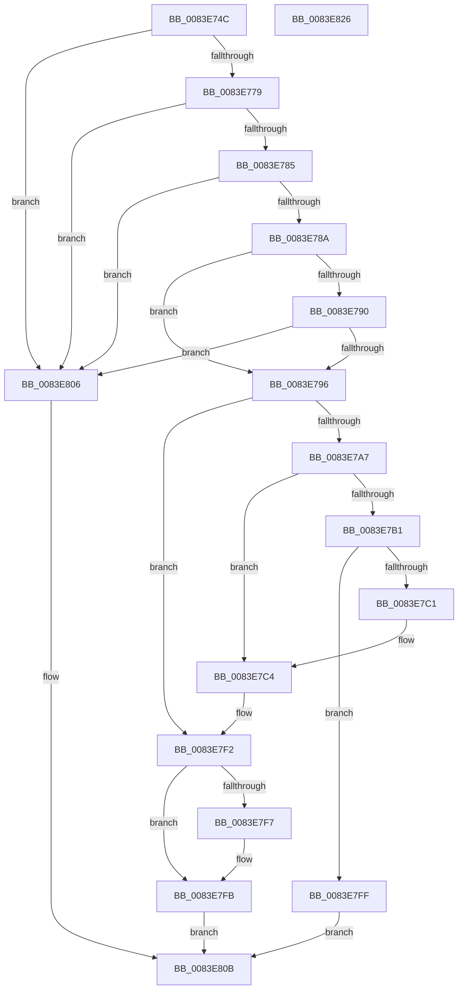

# RtlpMuiRegGetOrAddLangInfo

- RVA: `0x0083E74C`–`0x0083E827` (길이 `219` bytes)
- VA: `0x000000014083E74C`
- 실행 섹션: `PAGE`
- PDB 이름 있음: `예`; PDB Function 태그: `아니요`
- unwind 정보 RVA: `0x0005E6B4`
- 디코드: `63`개 명령, `219/219` bytes 표시
- 미해석 바이트: `0` (있으면 어셈블리에 `.byte`로 보존)

> 이 문서는 커널 이미지의 기계어와 PDB 기호를 분석해 생성했습니다. 4번과 5번은 함수 원형과 자료형을 바이너리 사용 방식에서 추정한 C 해석이며 원본 소스 복구 결과는 아닙니다.

## 1. Dependencies

- 직접 호출 지점: **2**; 고유 호출 대상: **2**
- 직접 호출자로 확인된 함수: **3**
- RIP 상대 이미지 참조: **0**

### Outgoing calls
- `0x0083E799` → [RtlpMuiRegGetLangInfoIndex](RtlpMuiRegGetLangInfoIndex_function_0083E548.md) (function, `0x0083E548`)
- `0x0083E7B4` → [RtlpMuiRegGrowLanguages](RtlpMuiRegGrowLanguages_function_0083EB38.md) (function, `0x0083EB38`)

### Direct callers
- [RtlpMuiRegAddLanguageByName](RtlpMuiRegAddLanguageByName_function_0083D748.md) at `0x0083D898`
- [RtlpMuiRegAddBaseLanguage](RtlpMuiRegAddBaseLanguage_function_0083F494.md) at `0x0083F739`
- [RtlpMuiRegValidateInstalled](../84/RtlpMuiRegValidateInstalled_function_008404D4.md) at `0x00840668`

### Static image references
- 디코드된 RIP-relative 메모리 참조가 없습니다.

## 2. Other-region calls and transfers

- 다른 실행 섹션으로 향하는 call: **0**
- 별도 외부 분기/꼬리 이동을 확인하지 못했습니다.

## 3. Assembly (complete function range)

```asm
0083E74C  48 8B C4                        mov rax, rsp
0083E74F  48 89 58 08                     mov qword ptr [rax + 8], rbx
0083E753  48 89 68 10                     mov qword ptr [rax + 0x10], rbp
0083E757  48 89 70 18                     mov qword ptr [rax + 0x18], rsi
0083E75B  48 89 78 20                     mov qword ptr [rax + 0x20], rdi
0083E75F  41 56                           push r14
0083E761  48 83 EC 20                     sub rsp, 0x20
0083E765  33 ED                           xor ebp, ebp
0083E767  4D 8B F0                        mov r14, r8
0083E76A  48 8B FA                        mov rdi, rdx
0083E76D  48 8B F1                        mov rsi, rcx
0083E770  48 85 C9                        test rcx, rcx
0083E773  0F 84 8D 00 00 00               je 0x14083e806
0083E779  48 8B 19                        mov rbx, qword ptr [rcx]
0083E77C  48 85 DB                        test rbx, rbx
0083E77F  0F 84 81 00 00 00               je 0x14083e806
0083E785  48 85 D2                        test rdx, rdx
0083E788  74 7C                           je 0x14083e806
0083E78A  66 39 6A 04                     cmp word ptr [rdx + 4], bp
0083E78E  75 06                           jne 0x14083e796
0083E790  66 39 6A 06                     cmp word ptr [rdx + 6], bp
0083E794  7C 70                           jl 0x14083e806
0083E796  48 8B CB                        mov rcx, rbx
0083E799  E8 AA FD FF FF                  call 0x14083e548
0083E79E  44 0F B7 C0                     movzx r8d, ax
0083E7A2  66 85 C0                        test ax, ax
0083E7A5  79 4B                           jns 0x14083e7f2
0083E7A7  0F B7 43 04                     movzx eax, word ptr [rbx + 4]
0083E7AB  66 39 43 06                     cmp word ptr [rbx + 6], ax
0083E7AF  72 13                           jb 0x14083e7c4
0083E7B1  48 8B CB                        mov rcx, rbx
0083E7B4  E8 7F 03 00 00                  call 0x14083eb38
0083E7B9  48 8B D8                        mov rbx, rax
0083E7BC  48 85 C0                        test rax, rax
0083E7BF  74 3E                           je 0x14083e7ff
0083E7C1  48 89 06                        mov qword ptr [rsi], rax
0083E7C4  4C 0F BF 43 06                  movsx r8, word ptr [rbx + 6]
0083E7C9  48 8B 4B 10                     mov rcx, qword ptr [rbx + 0x10]
0083E7CD  49 6B D0 1C                     imul rdx, r8, 0x1c
0083E7D1  41 8D 40 01                     lea eax, [r8 + 1]
0083E7D5  66 89 43 06                     mov word ptr [rbx + 6], ax
0083E7D9  0F 10 07                        movups xmm0, xmmword ptr [rdi]
0083E7DC  0F 11 04 0A                     movups xmmword ptr [rdx + rcx], xmm0
0083E7E0  F2 0F 10 4F 10                  movsd xmm1, qword ptr [rdi + 0x10]
0083E7E5  F2 0F 11 4C 0A 10               movsd qword ptr [rdx + rcx + 0x10], xmm1
0083E7EB  8B 47 18                        mov eax, dword ptr [rdi + 0x18]
0083E7EE  89 44 0A 18                     mov dword ptr [rdx + rcx + 0x18], eax
0083E7F2  4D 85 F6                        test r14, r14
0083E7F5  74 04                           je 0x14083e7fb
0083E7F7  66 45 89 06                     mov word ptr [r14], r8w
0083E7FB  33 C0                           xor eax, eax
0083E7FD  EB 0C                           jmp 0x14083e80b
0083E7FF  B8 17 00 00 C0                  mov eax, 0xc0000017
0083E804  EB 05                           jmp 0x14083e80b
0083E806  B8 0D 00 00 C0                  mov eax, 0xc000000d
0083E80B  48 8B 5C 24 30                  mov rbx, qword ptr [rsp + 0x30]
0083E810  48 8B 6C 24 38                  mov rbp, qword ptr [rsp + 0x38]
0083E815  48 8B 74 24 40                  mov rsi, qword ptr [rsp + 0x40]
0083E81A  48 8B 7C 24 48                  mov rdi, qword ptr [rsp + 0x48]
0083E81F  48 83 C4 20                     add rsp, 0x20
0083E823  41 5E                           pop r14
0083E825  C3                              ret
0083E826  CC                              int3
```

## 4. C-style interpretation (structured pseudocode)

```c
__int64 __fastcall RtlpMuiRegGetOrAddLangInfo(__int64 a1, __int64 a2, __int64 a3)
{
    __int64 result;
    __int64 v_rbp;
    __int64 v_rsp;
    unsigned __int64 v_stack_p10;
    unsigned __int64 v_stack_p18;
    unsigned __int64 v_stack_p20;
    unsigned __int64 v_stack_p8;

    *(unsigned __int64 *)(v_rsp + 8) = v_rbx;
    *(unsigned __int64 *)(v_rsp + 16) = v_rbp;
    *(unsigned __int64 *)(v_rsp + 24) = v_rsi;
    *(unsigned __int64 *)(v_rsp + 32) = v_rdi;
    v_rsp = (v_rsp) - (32);
    v_rbp = 0;
    if (a1 == 0) goto loc_0083E806;
    if (*(unsigned __int64 *)(a1) == 0) goto loc_0083E806;
    if (a2 == 0) goto loc_0083E806;
    if ((*(unsigned __int16 *)(a2 + 4)) != 0) goto loc_0083E796;
    if ((*(unsigned __int16 *)(a2 + 6)) < 0) goto loc_0083E806;
loc_0083E796:
    result = RtlpMuiRegGetLangInfoIndex(*(unsigned __int64 *)(a1), a2, a3, a4);
    if (!sign_flag) goto loc_0083E7F2;
    if ((*(unsigned __int16 *)(*(unsigned __int64 *)(a1) + 6)) < ((unsigned __int16)(*(unsigned __int16 *)(*(unsigned __int64 *)(a1) + 4)))) goto loc_0083E7C4;
    result = RtlpMuiRegGrowLanguages(*(unsigned __int64 *)(a1), a2, (unsigned __int16)(result), a4);
    if (result == 0) goto loc_0083E7FF;
    *(unsigned __int64 *)(a1) = result;
loc_0083E7C4:
    a2 = (a2) * ((__int16)(*(unsigned __int16 *)(result + 6)));
    *(unsigned __int16 *)(result + 6) = (unsigned __int16)((__int16)(*(unsigned __int16 *)(result + 6)) + 1);
    *(unsigned __int64 *)(a2 + *(unsigned __int64 *)(result + 16) * 1) = v_xmm0;
    *(unsigned __int64 *)(a2 + *(unsigned __int64 *)(result + 16) * 1 + 16) = v_xmm1;
    *(unsigned int *)(a2 + *(unsigned __int64 *)(result + 16) * 1 + 24) = (unsigned int)((unsigned int)(*(unsigned int *)(a2 + 24)));
loc_0083E7F2:
    if (a3 != 0) {
        *(unsigned __int16 *)(a3) = (unsigned __int16)((__int16)(*(unsigned __int16 *)(result + 6)));
    }
    result = 0;
    goto loc_0083E80B;
loc_0083E7FF:
    goto loc_0083E80B;
loc_0083E806:
loc_0083E80B:
    v_rsp = (v_rsp) + (32);
    return (unsigned int)(0xC000000DULL);
}
```

## 5. (Beta) C Style

```c
int64_t RtlpMuiRegGetOrAddLangInfo(void *Arg1, void *Arg2, int64_t Arg3)
{
    uint8_t *arg1 = (uint8_t *)Arg1;
    uint8_t *arg2 = (uint8_t *)Arg2;

    int64_t result;
    int64_t local_rbp;
    int64_t local_rsp;
    uint64_t v_stack_p10;
    uint64_t v_stack_p18;
    uint64_t v_stack_p20;
    uint64_t v_stack_p8;

    *(uint64_t *)(local_rsp + 0x8) = local_rbx;
    *(uint64_t *)(local_rsp + 0x10) = local_rbp;
    *(uint64_t *)(local_rsp + 0x18) = local_rsi;
    *(uint64_t *)(local_rsp + 0x20) = local_rdi;
    local_rsp = (local_rsp) - (32);
    local_rbp = 0;
    if (Arg1 == NULL) goto loc_0083E806;
    if (*(uint64_t *)(arg1) == 0) goto loc_0083E806;
    if (Arg2 == NULL) goto loc_0083E806;
    if ((*(uint16_t *)(arg2 + 0x4)) != 0) goto loc_0083E796;
    if ((*(uint16_t *)(arg2 + 0x6)) < 0) goto loc_0083E806;
loc_0083E796:
    result = RtlpMuiRegGetLangInfoIndex(*(uint64_t *)(arg1), Arg2, Arg3, a4);
    if (!sign_flag) goto loc_0083E7F2;
    if ((*(uint16_t *)(*(uint64_t *)(arg1) + 0x6)) < ((uint16_t)(*(uint16_t *)(*(uint64_t *)(arg1) + 0x4)))) goto loc_0083E7C4;
    result = RtlpMuiRegGrowLanguages(*(uint64_t *)(arg1), Arg2, (uint16_t)(result), a4);
    if (result == 0) goto loc_0083E7FF;
    *(uint64_t *)(arg1) = result;
loc_0083E7C4:
    Arg2 = (Arg2) * ((int16_t)(*(uint16_t *)(result + 0x6)));
    *(uint16_t *)(result + 0x6) = (uint16_t)((int16_t)(*(uint16_t *)(result + 0x6)) + 1);
    *(uint64_t *)(arg2 + *(uint64_t *)(result + 0x10) * 1) = v_xmm0;
    *(uint64_t *)(arg2 + *(uint64_t *)(result + 0x10) * 1 + 0x10) = v_xmm1;
    *(uint32_t *)(arg2 + *(uint64_t *)(result + 0x10) * 1 + 0x18) = (uint32_t)((uint32_t)(*(uint32_t *)(arg2 + 0x18)));
loc_0083E7F2:
    if (Arg3 != 0) {
        *(uint16_t *)(Arg3) = (uint16_t)((int16_t)(*(uint16_t *)(result + 0x6)));
    }
    result = 0;
    goto loc_0083E80B;
loc_0083E7FF:
    goto loc_0083E80B;
loc_0083E806:
loc_0083E80B:
    local_rsp = (local_rsp) + (32);
    return (uint32_t)(0xC000000DULL);
}
```

### 관측된 메모리 오프셋

구조체 형식이 확인되지 않은 접근은 인자 기준의 오프셋으로만 기록했습니다.

| 기준 인자 | 오프셋 표현 | 폭 (bit) | 접근 |
|---|---:|---:|---|
| `Arg1` | `+ 0x0` | `64` | `W` |
| `Arg2` | `+ 0x0` | `128` | `R` |
| `Arg2` | `+ 0x10` | `64` | `R` |
| `Arg2` | `+ 0x18` | `32` | `R` |

## 6. Execution-region graph

[열기: 2D/3D 그래프와 함수 탐색 컨트롤 패널](../../../control-panel.html?section=page&rva=0x0083E74C&view=graph)

- 2D 그래프는 위에서 아래로 흐르고, 3D 그래프는 빈 공간을 드래그해 회전합니다. Shift+드래그는 이동, 휠은 확대·축소, 함수 노드 선택은 대상 보고서 이동입니다.

### Static fallback


