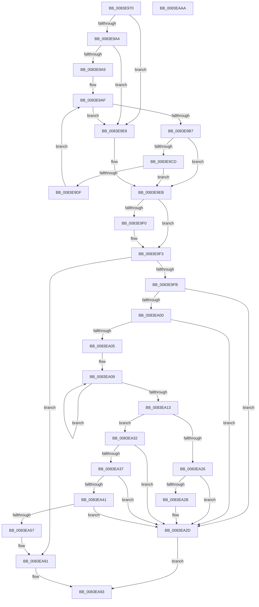

# RtlpMuiRegGetOrAddStringToPool

- RVA: `0x0083E970`–`0x0083EAAB` (길이 `315` bytes)
- VA: `0x000000014083E970`
- 실행 섹션: `PAGE`
- PDB 이름 있음: `예`; PDB Function 태그: `아니요`
- unwind 정보 RVA: `0x00083688`
- 디코드: `99`개 명령, `315/315` bytes 표시
- 미해석 바이트: `0` (있으면 어셈블리에 `.byte`로 보존)

> 이 문서는 커널 이미지의 기계어와 PDB 기호를 분석해 생성했습니다. 4번과 5번은 함수 원형과 자료형을 바이너리 사용 방식에서 추정한 C 해석이며 원본 소스 복구 결과는 아닙니다.

## 1. Dependencies

- 직접 호출 지점: **3**; 고유 호출 대상: **3**
- 직접 호출자로 확인된 함수: **1**
- RIP 상대 이미지 참조: **0**

### Outgoing calls
- `0x0083E9D0` → [wcsicmp](../../text/50/wcsicmp_function_00500080.md) (function, `0x00500080`)
- `0x0083EA4E` → [RtlULongLongMult](../../text/43/RtlULongLongMult_function_0043E530.md) (function, `0x0043E530`)
- `0x0083EA80` → [memcpy](../../text/6C/memcpy_function_006C6840.md) (function, `0x006C6840`)

### Direct callers
- [RtlpMuiRegGetOrAddString](RtlpMuiRegGetOrAddString_function_0083E830.md) at `0x0083E896`
- [RtlpMuiRegGetOrAddString](RtlpMuiRegGetOrAddString_function_0083E830.md) at `0x0083E932`

### Static image references
- 디코드된 RIP-relative 메모리 참조가 없습니다.

## 2. Other-region calls and transfers

- 다른 실행 섹션으로 향하는 call: **3**
  - `0x0083E9D0` → [wcsicmp](../../text/50/wcsicmp_function_00500080.md) (`PAGE` → `.text`)
  - `0x0083EA4E` → [RtlULongLongMult](../../text/43/RtlULongLongMult_function_0043E530.md) (`PAGE` → `.text`)
  - `0x0083EA80` → [memcpy](../../text/6C/memcpy_function_006C6840.md) (`PAGE` → `.text`)
- 별도 외부 분기/꼬리 이동을 확인하지 못했습니다.

## 3. Assembly (complete function range)

```asm
0083E970  48 89 5C 24 10                  mov qword ptr [rsp + 0x10], rbx
0083E975  48 89 6C 24 18                  mov qword ptr [rsp + 0x18], rbp
0083E97A  56                              push rsi
0083E97B  57                              push rdi
0083E97C  41 54                           push r12
0083E97E  41 56                           push r14
0083E980  41 57                           push r15
0083E982  48 83 EC 20                     sub rsp, 0x20
0083E986  45 33 E4                        xor r12d, r12d
0083E989  49 8B D9                        mov rbx, r9
0083E98C  4C 89 64 24 50                  mov qword ptr [rsp + 0x50], r12
0083E991  45 8A F8                        mov r15b, r8b
0083E994  4C 8B F2                        mov r14, rdx
0083E997  48 8B F9                        mov rdi, rcx
0083E99A  45 8D 4C 24 01                  lea r9d, [r12 + 1]
0083E99F  48 85 C9                        test rcx, rcx
0083E9A2  74 44                           je 0x14083e9e8
0083E9A4  48 85 D2                        test rdx, rdx
0083E9A7  74 3F                           je 0x14083e9e8
0083E9A9  41 8B F4                        mov esi, r12d
0083E9AC  41 8B EC                        mov ebp, r12d
0083E9AF  0F B7 47 06                     movzx eax, word ptr [rdi + 6]
0083E9B3  3B F0                           cmp esi, eax
0083E9B5  7D 31                           jge 0x14083e9e8
0083E9B7  48 8B 47 10                     mov rax, qword ptr [rdi + 0x10]
0083E9BB  48 0F BF 0C 28                  movsx rcx, word ptr [rax + rbp]
0083E9C0  48 8B 47 18                     mov rax, qword ptr [rdi + 0x18]
0083E9C4  48 8D 0C 48                     lea rcx, [rax + rcx*2]
0083E9C8  49 3B CE                        cmp rcx, r14
0083E9CB  74 1E                           je 0x14083e9eb
0083E9CD  49 8B D6                        mov rdx, r14
0083E9D0  E8 AB 16 CC FF                  call 0x140500080
0083E9D5  41 B9 01 00 00 00               mov r9d, 1
0083E9DB  85 C0                           test eax, eax
0083E9DD  74 0C                           je 0x14083e9eb
0083E9DF  41 03 F1                        add esi, r9d
0083E9E2  48 83 C5 02                     add rbp, 2
0083E9E6  EB C7                           jmp 0x14083e9af
0083E9E8  83 CE FF                        or esi, 0xffffffff
0083E9EB  48 85 DB                        test rbx, rbx
0083E9EE  74 03                           je 0x14083e9f3
0083E9F0  44 89 23                        mov dword ptr [rbx], r12d
0083E9F3  85 F6                           test esi, esi
0083E9F5  0F 89 96 00 00 00               jns 0x14083ea91
0083E9FB  48 85 FF                        test rdi, rdi
0083E9FE  74 2D                           je 0x14083ea2d
0083EA00  4D 85 F6                        test r14, r14
0083EA03  74 28                           je 0x14083ea2d
0083EA05  48 83 CD FF                     or rbp, 0xffffffffffffffff
0083EA09  48 FF C5                        inc rbp
0083EA0C  66 45 39 24 6E                  cmp word ptr [r14 + rbp*2], r12w
0083EA11  75 F6                           jne 0x14083ea09
0083EA13  0F B7 4F 0A                     movzx ecx, word ptr [rdi + 0xa]
0083EA17  49 03 E9                        add rbp, r9
0083EA1A  0F B7 47 08                     movzx eax, word ptr [rdi + 8]
0083EA1E  48 03 CD                        add rcx, rbp
0083EA21  48 3B C8                        cmp rcx, rax
0083EA24  76 0C                           jbe 0x14083ea32
0083EA26  48 85 DB                        test rbx, rbx
0083EA29  74 02                           je 0x14083ea2d
0083EA2B  89 2B                           mov dword ptr [rbx], ebp
0083EA2D  83 C8 FF                        or eax, 0xffffffff
0083EA30  EB 61                           jmp 0x14083ea93
0083EA32  45 84 FF                        test r15b, r15b
0083EA35  74 F6                           je 0x14083ea2d
0083EA37  0F B7 47 04                     movzx eax, word ptr [rdi + 4]
0083EA3B  66 39 47 06                     cmp word ptr [rdi + 6], ax
0083EA3F  73 EC                           jae 0x14083ea2d
0083EA41  4C 8D 44 24 50                  lea r8, [rsp + 0x50]
0083EA46  BA 02 00 00 00                  mov edx, 2
0083EA4B  48 8B CD                        mov rcx, rbp
0083EA4E  E8 DD FA BF FF                  call 0x14043e530
0083EA53  85 C0                           test eax, eax
0083EA55  78 D6                           js 0x14083ea2d
0083EA57  48 0F BF 5F 0A                  movsx rbx, word ptr [rdi + 0xa]
0083EA5C  49 8B D6                        mov rdx, r14
0083EA5F  0F B7 77 06                     movzx esi, word ptr [rdi + 6]
0083EA63  4C 8B 44 24 50                  mov r8, qword ptr [rsp + 0x50]
0083EA68  41 8D 04 31                     lea eax, [r9 + rsi]
0083EA6C  66 89 47 06                     mov word ptr [rdi + 6], ax
0083EA70  41 8D 04 19                     lea eax, [r9 + rbx]
0083EA74  66 89 47 0A                     mov word ptr [rdi + 0xa], ax
0083EA78  48 8B 47 18                     mov rax, qword ptr [rdi + 0x18]
0083EA7C  48 8D 0C 58                     lea rcx, [rax + rbx*2]
0083EA80  E8 BB 7D E8 FF                  call 0x1406c6840
0083EA85  48 8B 47 10                     mov rax, qword ptr [rdi + 0x10]
0083EA89  66 01 6F 0A                     add word ptr [rdi + 0xa], bp
0083EA8D  66 89 1C 70                     mov word ptr [rax + rsi*2], bx
0083EA91  8B C6                           mov eax, esi
0083EA93  48 8B 5C 24 58                  mov rbx, qword ptr [rsp + 0x58]
0083EA98  48 8B 6C 24 60                  mov rbp, qword ptr [rsp + 0x60]
0083EA9D  48 83 C4 20                     add rsp, 0x20
0083EAA1  41 5F                           pop r15
0083EAA3  41 5E                           pop r14
0083EAA5  41 5C                           pop r12
0083EAA7  5F                              pop rdi
0083EAA8  5E                              pop rsi
0083EAA9  C3                              ret
0083EAAA  CC                              int3
```

## 4. C-style interpretation (structured pseudocode)

```c
__int64 __fastcall RtlpMuiRegGetOrAddStringToPool(__int64 a1, __int64 a2, unsigned __int8 a3, __int64 a4)
{
    __int64 result;
    __int64 v_r12;
    __int64 v_rbp;
    __int64 v_rsi;
    __int64 v_rsp;
    unsigned __int64 v_stack_p10;
    unsigned __int64 v_stack_p18;
    unsigned __int64 v_stack_p8;

    v_stack_p10 = v_rbx;
    v_stack_p18 = v_rbp;
    v_rsp = (v_rsp) - (32);
    v_r12 = 0;
    v_stack_p8 = 0;
    if (a1 == 0) goto loc_0083E9E8;
    if (a2 == 0) goto loc_0083E9E8;
loc_0083E9AF:
    if (0 >= ((unsigned int)(*(unsigned __int16 *)(a1 + 6)))) goto loc_0083E9E8;
    if ((*(unsigned __int64 *)(a1 + 24) + (__int16)(*(unsigned __int16 *)(*(unsigned __int64 *)(a1 + 16) + 0 * 1)) * 2) == a2) goto loc_0083E9EB;
    result = wcsicmp(*(unsigned __int64 *)(a1 + 24) + (__int16)(*(unsigned __int16 *)(*(unsigned __int64 *)(a1 + 16) + 0 * 1)) * 2, a2, a3, v_r12 + 1);
    if ((unsigned int)(result) == 0) goto loc_0083E9EB;
    v_rsi = (unsigned int)((0) + (1));
    v_rbp = (0) + (2);
    goto loc_0083E9AF;
loc_0083E9E8:
    v_rsi = (unsigned int)((v_rsi) | (0xFFFFFFFFULL));
loc_0083E9EB:
    if (a4 != 0) {
        *(unsigned int *)(a4) = 0;
    }
    if (!sign_flag) goto loc_0083EA91;
    if (a1 == 0) goto loc_0083EA2D;
    if (a2 == 0) goto loc_0083EA2D;
    v_rbp = (v_rbp) | (-1);
loc_0083EA09:
    v_rbp = (v_rbp) + 1;
    if ((*(unsigned __int16 *)(a2 + v_rbp * 2)) != 0) goto loc_0083EA09;
    v_rbp = (v_rbp) + (1);
    a1 = (*(unsigned __int16 *)(a1 + 10)) + (v_rbp);
    if (a1 <= (*(unsigned __int16 *)(a1 + 8))) goto loc_0083EA32;
    if (a4 != 0) {
        *(unsigned int *)(a4) = (unsigned int)(v_rbp);
    }
    result = (unsigned int)((*(unsigned __int16 *)(a1 + 8)) | (0xFFFFFFFFULL));
    goto loc_0083EA93;
loc_0083EA32:
    if (a3 == 0) goto loc_0083EA2D;
    if ((*(unsigned __int16 *)(a1 + 6)) >= ((unsigned __int16)(*(unsigned __int16 *)(a1 + 4)))) goto loc_0083EA2D;
    result = RtlULongLongMult(v_rbp, 2, v_stack_p8, 1);
    if (sign_flag) goto loc_0083EA2D;
    *(unsigned __int16 *)(a1 + 6) = (unsigned __int16)(1 + *(unsigned __int16 *)(a1 + 6) * 1);
    *(unsigned __int16 *)(a1 + 10) = (unsigned __int16)(1 + (__int16)(*(unsigned __int16 *)(a1 + 10)) * 1);
    result = memcpy(*(unsigned __int64 *)(a1 + 24) + (__int16)(*(unsigned __int16 *)(a1 + 10)) * 2, a2, v_stack_p8, 1);
    *(unsigned __int16 *)(*(unsigned __int64 *)(a1 + 16) + *(unsigned __int16 *)(a1 + 6) * 2) = (unsigned __int16)((__int16)(*(unsigned __int16 *)(a1 + 10)));
loc_0083EA91:
loc_0083EA93:
    v_rsp = (v_rsp) + (32);
    return (unsigned int)((unsigned int)(*(unsigned __int16 *)(a1 + 6)));
}
```

## 5. (Beta) C Style

```c
int64_t RtlpMuiRegGetOrAddStringToPool(void *Arg1, int64_t Arg2, uint8_t Arg3, int64_t Arg4)
{
    uint8_t *arg1 = (uint8_t *)Arg1;

    int64_t result;
    int64_t local_r12;
    int64_t local_rbp;
    int64_t local_rsi;
    int64_t local_rsp;
    uint64_t v_stack_p10;
    uint64_t v_stack_p18;
    uint64_t v_stack_p8;

    v_stack_p10 = local_rbx;
    v_stack_p18 = local_rbp;
    local_rsp = (local_rsp) - (32);
    local_r12 = 0;
    v_stack_p8 = 0;
    if (Arg1 == NULL) goto loc_0083E9E8;
    if (Arg2 == 0) goto loc_0083E9E8;
loc_0083E9AF:
    if (0 >= ((uint32_t)(*(uint16_t *)(arg1 + 0x6)))) goto loc_0083E9E8;
    if ((*(uint64_t *)(arg1 + 0x18) + (int16_t)(*(uint16_t *)(*(uint64_t *)(arg1 + 0x10) + 0x0 * 1)) * 2) == Arg2) goto loc_0083E9EB;
    result = wcsicmp(*(uint64_t *)(arg1 + 0x18) + (int16_t)(*(uint16_t *)(*(uint64_t *)(arg1 + 0x10) + 0x0 * 1)) * 2, Arg2, Arg3, local_r12 + 1);
    if ((uint32_t)(result) == 0) goto loc_0083E9EB;
    local_rsi = (uint32_t)((0) + (1));
    local_rbp = (0) + (2);
    goto loc_0083E9AF;
loc_0083E9E8:
    local_rsi = (uint32_t)((local_rsi) | (0xFFFFFFFFULL));
loc_0083E9EB:
    if (Arg4 != 0) {
        *(uint32_t *)(Arg4) = 0;
    }
    if (!sign_flag) goto loc_0083EA91;
    if (Arg1 == NULL) goto loc_0083EA2D;
    if (Arg2 == 0) goto loc_0083EA2D;
    local_rbp = (local_rbp) | (-1);
loc_0083EA09:
    local_rbp = (local_rbp) + 1;
    if ((*(uint16_t *)(Arg2 + local_rbp * 2)) != 0) goto loc_0083EA09;
    local_rbp = (local_rbp) + (1);
    Arg1 = (*(uint16_t *)(arg1 + 0xA)) + (local_rbp);
    if (Arg1 <= (*(uint16_t *)(arg1 + 0x8))) goto loc_0083EA32;
    if (Arg4 != 0) {
        *(uint32_t *)(Arg4) = (uint32_t)(local_rbp);
    }
    result = (uint32_t)((*(uint16_t *)(arg1 + 0x8)) | (0xFFFFFFFFULL));
    goto loc_0083EA93;
loc_0083EA32:
    if (Arg3 == 0) goto loc_0083EA2D;
    if ((*(uint16_t *)(arg1 + 0x6)) >= ((uint16_t)(*(uint16_t *)(arg1 + 0x4)))) goto loc_0083EA2D;
    result = RtlULongLongMult(local_rbp, 2, v_stack_p8, 1);
    if (sign_flag) goto loc_0083EA2D;
    *(uint16_t *)(arg1 + 0x6) = (uint16_t)(1 + *(uint16_t *)(arg1 + 0x6) * 1);
    *(uint16_t *)(arg1 + 0xA) = (uint16_t)(1 + (int16_t)(*(uint16_t *)(arg1 + 0xA)) * 1);
    result = memcpy(*(uint64_t *)(arg1 + 0x18) + (int16_t)(*(uint16_t *)(arg1 + 0xA)) * 2, Arg2, v_stack_p8, 1);
    *(uint16_t *)(*(uint64_t *)(arg1 + 0x10) + *(uint16_t *)(arg1 + 0x6) * 2) = (uint16_t)((int16_t)(*(uint16_t *)(arg1 + 0xA)));
loc_0083EA91:
loc_0083EA93:
    local_rsp = (local_rsp) + (32);
    return (uint32_t)((uint32_t)(*(uint16_t *)(arg1 + 0x6)));
}
```

### 관측된 메모리 오프셋

구조체 형식이 확인되지 않은 접근은 인자 기준의 오프셋으로만 기록했습니다.

| 기준 인자 | 오프셋 표현 | 폭 (bit) | 접근 |
|---|---:|---:|---|
| `Arg1` | `+ 0x6` | `16` | `R` |
| `Arg1` | `+ 0x10` | `64` | `R` |
| `Arg1` | `+ 0x18` | `64` | `R` |

## 6. Execution-region graph

[열기: 2D/3D 그래프와 함수 탐색 컨트롤 패널](../../../control-panel.html?section=page&rva=0x0083E970&view=graph)

- 2D 그래프는 위에서 아래로 흐르고, 3D 그래프는 빈 공간을 드래그해 회전합니다. Shift+드래그는 이동, 휠은 확대·축소, 함수 노드 선택은 대상 보고서 이동입니다.

### Static fallback


