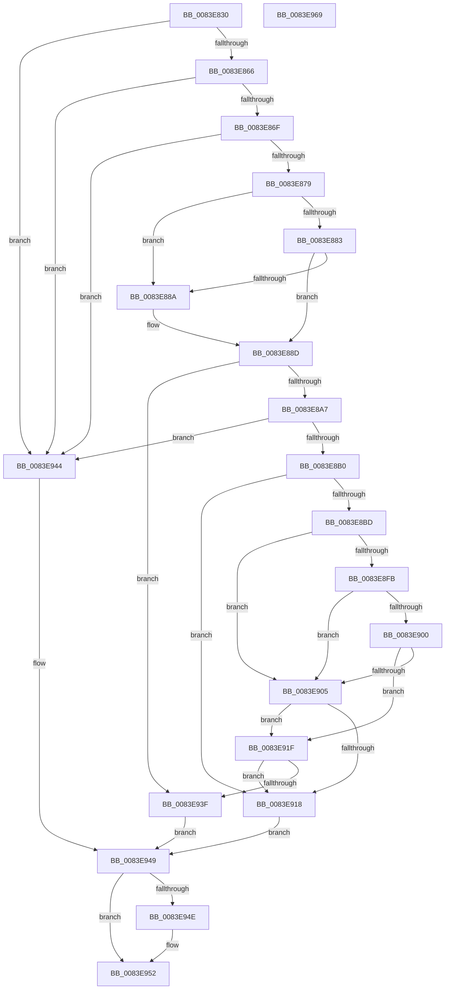

# RtlpMuiRegGetOrAddString

- RVA: `0x0083E830`–`0x0083E96A` (길이 `314` bytes)
- VA: `0x000000014083E830`
- 실행 섹션: `PAGE`
- PDB 이름 있음: `예`; PDB Function 태그: `아니요`
- unwind 정보 RVA: `0x00083688`
- 디코드: `98`개 명령, `314/314` bytes 표시
- 미해석 바이트: `0` (있으면 어셈블리에 `.byte`로 보존)

> 이 문서는 커널 이미지의 기계어와 PDB 기호를 분석해 생성했습니다. 4번과 5번은 함수 원형과 자료형을 바이너리 사용 방식에서 추정한 C 해석이며 원본 소스 복구 결과는 아닙니다.

## 1. Dependencies

- 직접 호출 지점: **3**; 고유 호출 대상: **2**
- 직접 호출자로 확인된 함수: **6**
- RIP 상대 이미지 참조: **0**

### Outgoing calls
- `0x0083E896` → [RtlpMuiRegGetOrAddStringToPool](RtlpMuiRegGetOrAddStringToPool_function_0083E970.md) (function, `0x0083E970`)
- `0x0083E90B` → [RtlpMuiRegResizeStringPool](RtlpMuiRegResizeStringPool_function_0083EE40.md) (function, `0x0083EE40`)
- `0x0083E932` → [RtlpMuiRegGetOrAddStringToPool](RtlpMuiRegGetOrAddStringToPool_function_0083E970.md) (function, `0x0083E970`)

### Direct callers
- [RtlpLoadPolicyLanguageSpec](RtlpLoadPolicyLanguageSpec_function_0083D594.md) at `0x0083D6CA`
- [RtlpMuiRegGetInstalledLanguageIndexByName](RtlpMuiRegGetInstalledLanguageIndexByName_function_0083E468.md) at `0x0083E4A9`
- [RtlpMuiRegGetLanguageSpec](RtlpMuiRegGetLanguageSpec_function_0083E680.md) at `0x0083E6F8`
- [RtlMuiRegAddLIPParent](RtlMuiRegAddLIPParent_function_0083F2BC.md) at `0x0083F351`
- [RtlpMuiRegInitAnyLanguage](RtlpMuiRegInitAnyLanguage_function_0083F7FC.md) at `0x0083F86D`
- [RtlpMuiRegValidateInstalled](../84/RtlpMuiRegValidateInstalled_function_008404D4.md) at `0x00840617`

### Static image references
- 디코드된 RIP-relative 메모리 참조가 없습니다.

## 2. Other-region calls and transfers

- 다른 실행 섹션으로 향하는 call: **0**
- 별도 외부 분기/꼬리 이동을 확인하지 못했습니다.

## 3. Assembly (complete function range)

```asm
0083E830  48 89 5C 24 10                  mov qword ptr [rsp + 0x10], rbx
0083E835  48 89 6C 24 18                  mov qword ptr [rsp + 0x18], rbp
0083E83A  56                              push rsi
0083E83B  57                              push rdi
0083E83C  41 54                           push r12
0083E83E  41 56                           push r14
0083E840  41 57                           push r15
0083E842  48 83 EC 20                     sub rsp, 0x20
0083E846  45 33 E4                        xor r12d, r12d
0083E849  83 CF FF                        or edi, 0xffffffff
0083E84C  44 89 64 24 50                  mov dword ptr [rsp + 0x50], r12d
0083E851  4D 8B F9                        mov r15, r9
0083E854  45 8A F0                        mov r14b, r8b
0083E857  48 8B EA                        mov rbp, rdx
0083E85A  48 8B D9                        mov rbx, rcx
0083E85D  48 85 C9                        test rcx, rcx
0083E860  0F 84 DE 00 00 00               je 0x14083e944
0083E866  48 85 D2                        test rdx, rdx
0083E869  0F 84 D5 00 00 00               je 0x14083e944
0083E86F  66 44 39 22                     cmp word ptr [rdx], r12w
0083E873  0F 84 CB 00 00 00               je 0x14083e944
0083E879  8B 31                           mov esi, dword ptr [rcx]
0083E87B  83 E6 02                        and esi, 2
0083E87E  45 84 C0                        test r8b, r8b
0083E881  74 07                           je 0x14083e88a
0083E883  41 B0 01                        mov r8b, 1
0083E886  85 F6                           test esi, esi
0083E888  75 03                           jne 0x14083e88d
0083E88A  45 8A C4                        mov r8b, r12b
0083E88D  48 8B 49 20                     mov rcx, qword ptr [rcx + 0x20]
0083E891  4C 8D 4C 24 50                  lea r9, [rsp + 0x50]
0083E896  E8 D5 00 00 00                  call 0x14083e970
0083E89B  0F B7 F8                        movzx edi, ax
0083E89E  66 85 C0                        test ax, ax
0083E8A1  0F 89 98 00 00 00               jns 0x14083e93f
0083E8A7  45 84 F6                        test r14b, r14b
0083E8AA  0F 84 94 00 00 00               je 0x14083e944
0083E8B0  4C 8B 53 20                     mov r10, qword ptr [rbx + 0x20]
0083E8B4  8B 54 24 50                     mov edx, dword ptr [rsp + 0x50]
0083E8B8  4D 85 D2                        test r10, r10
0083E8BB  74 5B                           je 0x14083e918
0083E8BD  45 0F B7 5A 04                  movzx r11d, word ptr [r10 + 4]
0083E8C2  85 D2                           test edx, edx
0083E8C4  41 0F B7 4A 06                  movzx ecx, word ptr [r10 + 6]
0083E8C9  B8 10 00 00 00                  mov eax, 0x10
0083E8CE  0F 48 D0                        cmovs edx, eax
0083E8D1  41 0F B7 42 0A                  movzx eax, word ptr [r10 + 0xa]
0083E8D6  03 D0                           add edx, eax
0083E8D8  FF C1                           inc ecx
0083E8DA  41 3B CB                        cmp ecx, r11d
0083E8DD  41 8B C3                        mov eax, r11d
0083E8E0  0F 43 C1                        cmovae eax, ecx
0083E8E3  41 0F B7 4A 08                  movzx ecx, word ptr [r10 + 8]
0083E8E8  3B D1                           cmp edx, ecx
0083E8EA  44 8B C1                        mov r8d, ecx
0083E8ED  44 0F 4D C2                     cmovge r8d, edx
0083E8F1  85 F6                           test esi, esi
0083E8F3  41 0F 94 C1                     sete r9b
0083E8F7  85 F6                           test esi, esi
0083E8F9  74 0A                           je 0x14083e905
0083E8FB  41 3B C3                        cmp eax, r11d
0083E8FE  75 05                           jne 0x14083e905
0083E900  44 3B C1                        cmp r8d, ecx
0083E903  74 1A                           je 0x14083e91f
0083E905  0F B7 D0                        movzx edx, ax
0083E908  49 8B CA                        mov rcx, r10
0083E90B  E8 30 05 00 00                  call 0x14083ee40
0083E910  4C 8B D0                        mov r10, rax
0083E913  48 85 C0                        test rax, rax
0083E916  75 07                           jne 0x14083e91f
0083E918  B8 17 00 00 C0                  mov eax, 0xc0000017
0083E91D  EB 2A                           jmp 0x14083e949
0083E91F  83 0B 02                        or dword ptr [rbx], 2
0083E922  45 33 C9                        xor r9d, r9d
0083E925  41 B0 01                        mov r8b, 1
0083E928  4C 89 53 20                     mov qword ptr [rbx + 0x20], r10
0083E92C  48 8B D5                        mov rdx, rbp
0083E92F  49 8B CA                        mov rcx, r10
0083E932  E8 39 00 00 00                  call 0x14083e970
0083E937  0F B7 F8                        movzx edi, ax
0083E93A  66 85 C0                        test ax, ax
0083E93D  78 D9                           js 0x14083e918
0083E93F  41 8B C4                        mov eax, r12d
0083E942  EB 05                           jmp 0x14083e949
0083E944  B8 0D 00 00 C0                  mov eax, 0xc000000d
0083E949  4D 85 FF                        test r15, r15
0083E94C  74 04                           je 0x14083e952
0083E94E  66 41 89 3F                     mov word ptr [r15], di
0083E952  48 8B 5C 24 58                  mov rbx, qword ptr [rsp + 0x58]
0083E957  48 8B 6C 24 60                  mov rbp, qword ptr [rsp + 0x60]
0083E95C  48 83 C4 20                     add rsp, 0x20
0083E960  41 5F                           pop r15
0083E962  41 5E                           pop r14
0083E964  41 5C                           pop r12
0083E966  5F                              pop rdi
0083E967  5E                              pop rsi
0083E968  C3                              ret
0083E969  CC                              int3
```

## 4. C-style interpretation (structured pseudocode)

```c
__int64 __fastcall RtlpMuiRegGetOrAddString(__int64 a1, __int64 a2, unsigned __int8 a3, __int64 a4)
{
    __int64 result;
    __int64 v_r12;
    __int64 v_rdi;
    __int64 v_rsi;
    __int64 v_rsp;
    unsigned __int64 v_stack_p10;
    unsigned __int64 v_stack_p18;
    unsigned int v_stack_p8;

    v_stack_p10 = v_rbx;
    v_stack_p18 = v_rbp;
    v_rsp = (v_rsp) - (32);
    v_r12 = 0;
    v_rdi = (unsigned int)((v_rdi) | (0xFFFFFFFFULL));
    v_stack_p8 = 0;
    if (a1 == 0) goto loc_0083E944;
    if (a2 == 0) goto loc_0083E944;
    if ((*(unsigned __int16 *)(a2)) == 0) goto loc_0083E944;
    v_rsi = (unsigned int)(((unsigned int)(*(unsigned int *)(a1))) & (2));
    if (a3 == 0) goto loc_0083E88A;
    if ((unsigned int)(v_rsi) == 0) {
        a3 = 0;
    }
    result = RtlpMuiRegGetOrAddStringToPool(*(unsigned __int64 *)(a1 + 32), a2, a3, v_stack_p8);
    if (!sign_flag) goto loc_0083E93F;
    if (a3 == 0) goto loc_0083E944;
    if (*(unsigned __int64 *)(a1 + 32) == 0) goto loc_0083E918;
    a2 = (unsigned int)(v_stack_p8);
    if (sign_flag) { a2 = 16; }
    a2 = (unsigned int)((a2) + ((unsigned int)(*(unsigned __int16 *)(*(unsigned __int64 *)(a1 + 32) + 10))));
    a1 = (unsigned int)((*(unsigned __int16 *)(*(unsigned __int64 *)(a1 + 32) + 6)) + 1);
    result = (unsigned int)((unsigned int)(*(unsigned __int16 *)(*(unsigned __int64 *)(a1 + 32) + 4)));
    if (((unsigned int)(a1)) >= ((unsigned int)(*(unsigned __int16 *)(*(unsigned __int64 *)(a1 + 32) + 4)))) { result = (unsigned int)(a1); }
    a3 = (unsigned int)((unsigned int)(*(unsigned __int16 *)(*(unsigned __int64 *)(a1 + 32) + 8)));
    if (((unsigned int)(a2)) >= ((unsigned int)(*(unsigned __int16 *)(*(unsigned __int64 *)(a1 + 32) + 8)))) { a3 = (unsigned int)(a2); }
    a4 = ((unsigned int)(v_rsi) == 0) ? 1 : 0;
    if ((unsigned int)(v_rsi) == 0) goto loc_0083E905;
    if (((unsigned int)(result)) != ((unsigned int)(*(unsigned __int16 *)(*(unsigned __int64 *)(a1 + 32) + 4)))) goto loc_0083E905;
    if (a3 == ((unsigned int)(*(unsigned __int16 *)(*(unsigned __int64 *)(a1 + 32) + 8)))) goto loc_0083E91F;
loc_0083E905:
    result = RtlpMuiRegResizeStringPool(*(unsigned __int64 *)(a1 + 32), (unsigned __int16)(result), a3, a4);
    if (result != 0) goto loc_0083E91F;
loc_0083E918:
    goto loc_0083E949;
loc_0083E91F:
    a4 = 0;
    *(unsigned __int64 *)(a1 + 32) = result;
    result = RtlpMuiRegGetOrAddStringToPool(result, a2, 1, a4);
    if (sign_flag) goto loc_0083E918;
loc_0083E93F:
    goto loc_0083E949;
loc_0083E944:
loc_0083E949:
    if (0 != 0) {
        *(unsigned __int16 *)(a4) = (unsigned __int16)((unsigned __int16)(result));
    }
    v_rsp = (v_rsp) + (32);
    return (unsigned int)(0xC000000DULL);
}
```

## 5. (Beta) C Style

```c
int64_t RtlpMuiRegGetOrAddString(void *Arg1, int64_t Arg2, uint8_t Arg3, int64_t Arg4)
{
    uint8_t *arg1 = (uint8_t *)Arg1;

    int64_t result;
    int64_t local_r12;
    int64_t local_rdi;
    int64_t local_rsi;
    int64_t local_rsp;
    uint64_t v_stack_p10;
    uint64_t v_stack_p18;
    uint32_t v_stack_p8;

    v_stack_p10 = local_rbx;
    v_stack_p18 = local_rbp;
    local_rsp = (local_rsp) - (32);
    local_r12 = 0;
    local_rdi = (uint32_t)((local_rdi) | (0xFFFFFFFFULL));
    v_stack_p8 = 0;
    if (Arg1 == NULL) goto loc_0083E944;
    if (Arg2 == 0) goto loc_0083E944;
    if ((*(uint16_t *)(Arg2)) == 0) goto loc_0083E944;
    local_rsi = (uint32_t)(((uint32_t)(*(uint32_t *)(arg1))) & (2));
    if (Arg3 == 0) goto loc_0083E88A;
    if ((uint32_t)(local_rsi) == 0) {
        Arg3 = 0;
    }
    result = RtlpMuiRegGetOrAddStringToPool(*(uint64_t *)(arg1 + 0x20), Arg2, Arg3, v_stack_p8);
    if (!sign_flag) goto loc_0083E93F;
    if (Arg3 == 0) goto loc_0083E944;
    if (*(uint64_t *)(arg1 + 0x20) == 0) goto loc_0083E918;
    Arg2 = (uint32_t)(v_stack_p8);
    if (sign_flag) { Arg2 = 16; }
    Arg2 = (uint32_t)((Arg2) + ((uint32_t)(*(uint16_t *)(*(uint64_t *)(arg1 + 0x20) + 0xA))));
    Arg1 = (uint32_t)((*(uint16_t *)(*(uint64_t *)(arg1 + 0x20) + 0x6)) + 1);
    result = (uint32_t)((uint32_t)(*(uint16_t *)(*(uint64_t *)(arg1 + 0x20) + 0x4)));
    if (((uint32_t)(Arg1)) >= ((uint32_t)(*(uint16_t *)(*(uint64_t *)(arg1 + 0x20) + 0x4)))) { result = (uint32_t)(Arg1); }
    Arg3 = (uint32_t)((uint32_t)(*(uint16_t *)(*(uint64_t *)(arg1 + 0x20) + 0x8)));
    if (((uint32_t)(Arg2)) >= ((uint32_t)(*(uint16_t *)(*(uint64_t *)(arg1 + 0x20) + 0x8)))) { Arg3 = (uint32_t)(Arg2); }
    Arg4 = ((uint32_t)(local_rsi) == 0) ? 1 : 0;
    if ((uint32_t)(local_rsi) == 0) goto loc_0083E905;
    if (((uint32_t)(result)) != ((uint32_t)(*(uint16_t *)(*(uint64_t *)(arg1 + 0x20) + 0x4)))) goto loc_0083E905;
    if (Arg3 == ((uint32_t)(*(uint16_t *)(*(uint64_t *)(arg1 + 0x20) + 0x8)))) goto loc_0083E91F;
loc_0083E905:
    result = RtlpMuiRegResizeStringPool(*(uint64_t *)(arg1 + 0x20), (uint16_t)(result), Arg3, Arg4);
    if (result != 0) goto loc_0083E91F;
loc_0083E918:
    goto loc_0083E949;
loc_0083E91F:
    Arg4 = 0;
    *(uint64_t *)(arg1 + 0x20) = result;
    result = RtlpMuiRegGetOrAddStringToPool(result, Arg2, 1, Arg4);
    if (sign_flag) goto loc_0083E918;
loc_0083E93F:
    goto loc_0083E949;
loc_0083E944:
loc_0083E949:
    if (0 != 0) {
        *(uint16_t *)(Arg4) = (uint16_t)((uint16_t)(result));
    }
    local_rsp = (local_rsp) + (32);
    return (uint32_t)(0xC000000DULL);
}
```

### 관측된 메모리 오프셋

구조체 형식이 확인되지 않은 접근은 인자 기준의 오프셋으로만 기록했습니다.

| 기준 인자 | 오프셋 표현 | 폭 (bit) | 접근 |
|---|---:|---:|---|
| `Arg1` | `+ 0x0` | `32` | `R/W` |
| `Arg1` | `+ 0x20` | `64` | `R` |
| `Arg1` | `+ 0x20` | `64` | `W` |

## 6. Execution-region graph

[열기: 2D/3D 그래프와 함수 탐색 컨트롤 패널](../../../control-panel.html?section=page&rva=0x0083E830&view=graph)

- 2D 그래프는 위에서 아래로 흐르고, 3D 그래프는 빈 공간을 드래그해 회전합니다. Shift+드래그는 이동, 휠은 확대·축소, 함수 노드 선택은 대상 보고서 이동입니다.

### Static fallback


