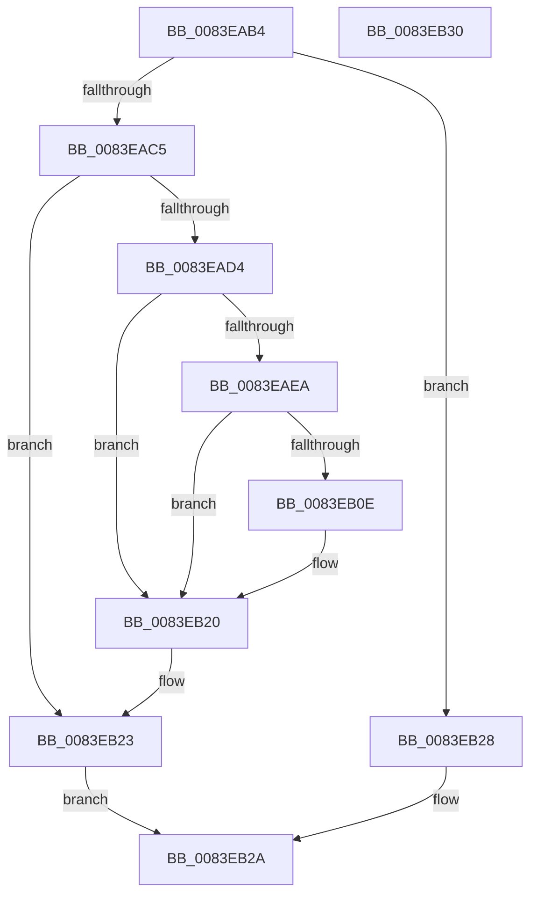

# RtlpMuiRegGrowLanguageConfigList

- RVA: `0x0083EAB4`–`0x0083EB31` (길이 `125` bytes)
- VA: `0x000000014083EAB4`
- 실행 섹션: `PAGE`
- PDB 이름 있음: `예`; PDB Function 태그: `아니요`
- unwind 정보 RVA: `0x000C8844`
- 디코드: `41`개 명령, `125/125` bytes 표시
- 미해석 바이트: `0` (있으면 어셈블리에 `.byte`로 보존)

> 이 문서는 커널 이미지의 기계어와 PDB 기호를 분석해 생성했습니다. 4번과 5번은 함수 원형과 자료형을 바이너리 사용 방식에서 추정한 C 해석이며 원본 소스 복구 결과는 아닙니다.

## 1. Dependencies

- 직접 호출 지점: **1**; 고유 호출 대상: **1**
- 직접 호출자로 확인된 함수: **1**
- RIP 상대 이미지 참조: **0**

### Outgoing calls
- `0x0083EB01` → [_SafeReallocBlob](../../text/6A/_SafeReallocBlob_function_006A986C.md) (function, `0x006A986C`)

### Direct callers
- [RtlpMuiRegConfigListAddLanguage](RtlpMuiRegConfigListAddLanguage_function_0083D8C0.md) at `0x0083D99F`

### Static image references
- 디코드된 RIP-relative 메모리 참조가 없습니다.

## 2. Other-region calls and transfers

- 다른 실행 섹션으로 향하는 call: **1**
  - `0x0083EB01` → [_SafeReallocBlob](../../text/6A/_SafeReallocBlob_function_006A986C.md) (`PAGE` → `.text`)
- 별도 외부 분기/꼬리 이동을 확인하지 못했습니다.

## 3. Assembly (complete function range)

```asm
0083EAB4  89 54 24 10                     mov dword ptr [rsp + 0x10], edx
0083EAB8  53                              push rbx
0083EAB9  48 83 EC 40                     sub rsp, 0x40
0083EABD  4C 8B D1                        mov r10, rcx
0083EAC0  48 85 C9                        test rcx, rcx
0083EAC3  74 63                           je 0x14083eb28
0083EAC5  0F B7 51 04                     movzx edx, word ptr [rcx + 4]
0083EAC9  0F B7 41 06                     movzx eax, word ptr [rcx + 6]
0083EACD  8D 5A 01                        lea ebx, [rdx + 1]
0083EAD0  3B D8                           cmp ebx, eax
0083EAD2  72 4F                           jb 0x14083eb23
0083EAD4  83 64 24 58 00                  and dword ptr [rsp + 0x58], 0
0083EAD9  B8 04 00 00 00                  mov eax, 4
0083EADE  83 FB 01                        cmp ebx, 1
0083EAE1  0F 42 D8                        cmovb ebx, eax
0083EAE4  33 C9                           xor ecx, ecx
0083EAE6  3B DA                           cmp ebx, edx
0083EAE8  72 36                           jb 0x14083eb20
0083EAEA  48 8D 44 24 58                  lea rax, [rsp + 0x58]
0083EAEF  44 8B C3                        mov r8d, ebx
0083EAF2  44 8D 49 0C                     lea r9d, [rcx + 0xc]
0083EAF6  48 89 44 24 30                  mov qword ptr [rsp + 0x30], rax
0083EAFB  8D 51 10                        lea edx, [rcx + 0x10]
0083EAFE  49 8B CA                        mov rcx, r10
0083EB01  E8 66 AD E6 FF                  call 0x1406a986c
0083EB06  48 8B C8                        mov rcx, rax
0083EB09  48 85 C0                        test rax, rax
0083EB0C  74 12                           je 0x14083eb20
0083EB0E  8B 44 24 58                     mov eax, dword ptr [rsp + 0x58]
0083EB12  89 01                           mov dword ptr [rcx], eax
0083EB14  48 8D 41 10                     lea rax, [rcx + 0x10]
0083EB18  48 89 41 08                     mov qword ptr [rcx + 8], rax
0083EB1C  66 89 59 06                     mov word ptr [rcx + 6], bx
0083EB20  4C 8B D1                        mov r10, rcx
0083EB23  49 8B C2                        mov rax, r10
0083EB26  EB 02                           jmp 0x14083eb2a
0083EB28  33 C0                           xor eax, eax
0083EB2A  48 83 C4 40                     add rsp, 0x40
0083EB2E  5B                              pop rbx
0083EB2F  C3                              ret
0083EB30  CC                              int3
```

## 4. C-style interpretation (structured pseudocode)

```c
__int64 __fastcall RtlpMuiRegGrowLanguageConfigList(__int64 a1, int a2)
{
    __int64 result;
    __int64 v_rbx;
    __int64 v_rsp;
    unsigned __int64 v_stack_m18;
    unsigned int v_stack_p10;

    v_stack_p10 = a2;
    v_rsp = (v_rsp) - (64);
    if (a1 == 0) goto loc_0083EB28;
    if (((unsigned int)(*(unsigned __int16 *)(a1 + 4) + 1)) < ((unsigned int)(*(unsigned __int16 *)(a1 + 6)))) goto loc_0083EB23;
    v_rbx = *(unsigned __int16 *)(a1 + 4) + 1;
    if (((unsigned int)(*(unsigned __int16 *)(a1 + 4) + 1)) < 1) { v_rbx = 4; }
    a1 = 0;
    if (((unsigned int)(v_rbx)) < ((unsigned int)(*(unsigned __int16 *)(a1 + 4)))) goto loc_0083EB20;
    v_stack_m18 = v_stack_p10;
    result = _SafeReallocBlob(0, a1 + 16, (unsigned int)((unsigned int)(v_rbx)), a1 + 12);
    if (result != 0) {
        result = v_stack_p10;
        *(unsigned int *)(result) = (unsigned int)(result);
        result = result + 16;
        *(unsigned __int64 *)(result + 8) = result;
        *(unsigned __int16 *)(result + 6) = (unsigned __int16)(v_rbx);
    }
loc_0083EB23:
    goto loc_0083EB2A;
loc_0083EB28:
    result = 0;
loc_0083EB2A:
    v_rsp = (v_rsp) + (64);
    return result;
}
```

## 5. (Beta) C Style

```c
int64_t RtlpMuiRegGrowLanguageConfigList(int64_t Arg1, int32_t Arg2)
{
    int64_t result;
    int64_t local_rbx;
    int64_t local_rsp;
    uint64_t v_stack_m18;
    uint32_t v_stack_p10;

    v_stack_p10 = Arg2;
    local_rsp = (local_rsp) - (64);
    if (Arg1 == 0) goto loc_0083EB28;
    if (((uint32_t)(*(uint16_t *)(Arg1 + 0x4) + 1)) < ((uint32_t)(*(uint16_t *)(Arg1 + 0x6)))) goto loc_0083EB23;
    local_rbx = *(uint16_t *)(Arg1 + 0x4) + 1;
    if (((uint32_t)(*(uint16_t *)(Arg1 + 0x4) + 1)) < 1) { local_rbx = 4; }
    Arg1 = 0;
    if (((uint32_t)(local_rbx)) < ((uint32_t)(*(uint16_t *)(Arg1 + 0x4)))) goto loc_0083EB20;
    v_stack_m18 = v_stack_p10;
    result = _SafeReallocBlob(0, Arg1 + 16, (uint32_t)((uint32_t)(local_rbx)), Arg1 + 12);
    if (result != 0) {
        result = v_stack_p10;
        *(uint32_t *)(result) = (uint32_t)(result);
        result = result + 16;
        *(uint64_t *)(result + 0x8) = result;
        *(uint16_t *)(result + 0x6) = (uint16_t)(local_rbx);
    }
loc_0083EB23:
    goto loc_0083EB2A;
loc_0083EB28:
    result = 0;
loc_0083EB2A:
    local_rsp = (local_rsp) + (64);
    return result;
}
```

## 6. Execution-region graph

[열기: 2D/3D 그래프와 함수 탐색 컨트롤 패널](../../../control-panel.html?section=page&rva=0x0083EAB4&view=graph)

- 2D 그래프는 위에서 아래로 흐르고, 3D 그래프는 빈 공간을 드래그해 회전합니다. Shift+드래그는 이동, 휠은 확대·축소, 함수 노드 선택은 대상 보고서 이동입니다.

### Static fallback


