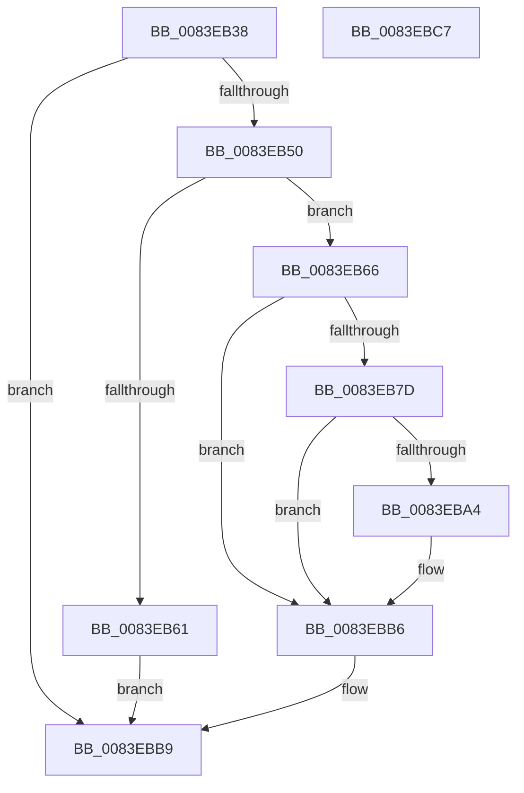

# RtlpMuiRegGrowLanguages

- RVA: `0x0083EB38`–`0x0083EBC8` (길이 `144` bytes)
- VA: `0x000000014083EB38`
- 실행 섹션: `PAGE`
- PDB 이름 있음: `예`; PDB Function 태그: `아니요`
- unwind 정보 RVA: `0x000DB5CC`
- 디코드: `44`개 명령, `144/144` bytes 표시
- 미해석 바이트: `0` (있으면 어셈블리에 `.byte`로 보존)

> 이 문서는 커널 이미지의 기계어와 PDB 기호를 분석해 생성했습니다. 4번과 5번은 함수 원형과 자료형을 바이너리 사용 방식에서 추정한 C 해석이며 원본 소스 복구 결과는 아닙니다.

## 1. Dependencies

- 직접 호출 지점: **1**; 고유 호출 대상: **1**
- 직접 호출자로 확인된 함수: **1**
- RIP 상대 이미지 참조: **0**

### Outgoing calls
- `0x0083EB97` → [_SafeReallocBlob](../../text/6A/_SafeReallocBlob_function_006A986C.md) (function, `0x006A986C`)

### Direct callers
- [RtlpMuiRegGetOrAddLangInfo](RtlpMuiRegGetOrAddLangInfo_function_0083E74C.md) at `0x0083E7B4`

### Static image references
- 디코드된 RIP-relative 메모리 참조가 없습니다.

## 2. Other-region calls and transfers

- 다른 실행 섹션으로 향하는 call: **1**
  - `0x0083EB97` → [_SafeReallocBlob](../../text/6A/_SafeReallocBlob_function_006A986C.md) (`PAGE` → `.text`)
- 별도 외부 분기/꼬리 이동을 확인하지 못했습니다.

## 3. Assembly (complete function range)

```asm
0083EB38  48 89 5C 24 08                  mov qword ptr [rsp + 8], rbx
0083EB3D  89 54 24 10                     mov dword ptr [rsp + 0x10], edx
0083EB41  57                              push rdi
0083EB42  48 83 EC 40                     sub rsp, 0x40
0083EB46  33 DB                           xor ebx, ebx
0083EB48  4C 8B D1                        mov r10, rcx
0083EB4B  48 85 C9                        test rcx, rcx
0083EB4E  74 69                           je 0x14083ebb9
0083EB50  44 0F B7 41 06                  movzx r8d, word ptr [rcx + 6]
0083EB55  0F B7 41 04                     movzx eax, word ptr [rcx + 4]
0083EB59  41 8D 50 04                     lea edx, [r8 + 4]
0083EB5D  3B D0                           cmp edx, eax
0083EB5F  73 05                           jae 0x14083eb66
0083EB61  48 8B D9                        mov rbx, rcx
0083EB64  EB 53                           jmp 0x14083ebb9
0083EB66  83 FA 01                        cmp edx, 1
0083EB69  89 5C 24 58                     mov dword ptr [rsp + 0x58], ebx
0083EB6D  BF 04 00 00 00                  mov edi, 4
0083EB72  48 8B CB                        mov rcx, rbx
0083EB75  0F 43 FA                        cmovae edi, edx
0083EB78  41 3B F8                        cmp edi, r8d
0083EB7B  72 39                           jb 0x14083ebb6
0083EB7D  41 B9 1C 00 00 00               mov r9d, 0x1c
0083EB83  48 8D 44 24 58                  lea rax, [rsp + 0x58]
0083EB88  44 8B C7                        mov r8d, edi
0083EB8B  48 89 44 24 30                  mov qword ptr [rsp + 0x30], rax
0083EB90  49 8B CA                        mov rcx, r10
0083EB93  41 8D 51 FC                     lea edx, [r9 - 4]
0083EB97  E8 D0 AC E6 FF                  call 0x1406a986c
0083EB9C  48 8B C8                        mov rcx, rax
0083EB9F  48 85 C0                        test rax, rax
0083EBA2  74 12                           je 0x14083ebb6
0083EBA4  8B 44 24 58                     mov eax, dword ptr [rsp + 0x58]
0083EBA8  89 01                           mov dword ptr [rcx], eax
0083EBAA  48 8D 41 18                     lea rax, [rcx + 0x18]
0083EBAE  48 89 41 10                     mov qword ptr [rcx + 0x10], rax
0083EBB2  66 89 79 04                     mov word ptr [rcx + 4], di
0083EBB6  48 8B D9                        mov rbx, rcx
0083EBB9  48 8B C3                        mov rax, rbx
0083EBBC  48 8B 5C 24 50                  mov rbx, qword ptr [rsp + 0x50]
0083EBC1  48 83 C4 40                     add rsp, 0x40
0083EBC5  5F                              pop rdi
0083EBC6  C3                              ret
0083EBC7  CC                              int3
```

## 4. C-style interpretation (structured pseudocode)

```c
__int64 __fastcall RtlpMuiRegGrowLanguages(__int64 a1, int a2)
{
    __int64 result;
    __int64 v_rbx;
    __int64 v_rdi;
    __int64 v_rsp;
    unsigned __int64 v_stack_m18;
    unsigned int v_stack_p10;
    unsigned __int64 v_stack_p8;

    v_stack_p8 = v_rbx;
    v_stack_p10 = a2;
    v_rsp = (v_rsp) - (64);
    v_rbx = 0;
    if (a1 == 0) goto loc_0083EBB9;
    if (((unsigned int)(*(unsigned __int16 *)(a1 + 6) + 4)) >= ((unsigned int)(*(unsigned __int16 *)(a1 + 4)))) goto loc_0083EB66;
    goto loc_0083EBB9;
loc_0083EB66:
    v_stack_p10 = (unsigned int)(a1);
    v_rdi = 4;
    if (((unsigned int)(*(unsigned __int16 *)(a1 + 6) + 4)) >= 1) { v_rdi = (unsigned int)(*(unsigned __int16 *)(a1 + 6) + 4); }
    if (((unsigned int)(v_rdi)) < ((unsigned int)(*(unsigned __int16 *)(a1 + 6)))) goto loc_0083EBB6;
    v_stack_m18 = v_stack_p10;
    result = _SafeReallocBlob(a1, 28 - 4, (unsigned int)((unsigned int)(v_rdi)), 28);
    if (result != 0) {
        result = v_stack_p10;
        *(unsigned int *)(result) = (unsigned int)(result);
        result = result + 24;
        *(unsigned __int64 *)(result + 16) = result;
        *(unsigned __int16 *)(result + 4) = (unsigned __int16)(v_rdi);
    }
loc_0083EBB9:
    v_rsp = (v_rsp) + (64);
    return result;
}
```

## 5. (Beta) C Style

```c
int64_t RtlpMuiRegGrowLanguages(int64_t Arg1, int32_t Arg2)
{
    int64_t result;
    int64_t local_rbx;
    int64_t local_rdi;
    int64_t local_rsp;
    uint64_t v_stack_m18;
    uint32_t v_stack_p10;
    uint64_t v_stack_p8;

    v_stack_p8 = local_rbx;
    v_stack_p10 = Arg2;
    local_rsp = (local_rsp) - (64);
    local_rbx = 0;
    if (Arg1 == 0) goto loc_0083EBB9;
    if (((uint32_t)(*(uint16_t *)(Arg1 + 0x6) + 4)) >= ((uint32_t)(*(uint16_t *)(Arg1 + 0x4)))) goto loc_0083EB66;
    goto loc_0083EBB9;
loc_0083EB66:
    v_stack_p10 = (uint32_t)(Arg1);
    local_rdi = 4;
    if (((uint32_t)(*(uint16_t *)(Arg1 + 0x6) + 4)) >= 1) { local_rdi = (uint32_t)(*(uint16_t *)(Arg1 + 0x6) + 4); }
    if (((uint32_t)(local_rdi)) < ((uint32_t)(*(uint16_t *)(Arg1 + 0x6)))) goto loc_0083EBB6;
    v_stack_m18 = v_stack_p10;
    result = _SafeReallocBlob(Arg1, 28 - 4, (uint32_t)((uint32_t)(local_rdi)), 28);
    if (result != 0) {
        result = v_stack_p10;
        *(uint32_t *)(result) = (uint32_t)(result);
        result = result + 24;
        *(uint64_t *)(result + 0x10) = result;
        *(uint16_t *)(result + 0x4) = (uint16_t)(local_rdi);
    }
loc_0083EBB9:
    local_rsp = (local_rsp) + (64);
    return result;
}
```

## 6. Execution-region graph

[열기: 2D/3D 그래프와 함수 탐색 컨트롤 패널](../../../control-panel.html?section=page&rva=0x0083EB38&view=graph)

- 2D 그래프는 위에서 아래로 흐르고, 3D 그래프는 빈 공간을 드래그해 회전합니다. Shift+드래그는 이동, 휠은 확대·축소, 함수 노드 선택은 대상 보고서 이동입니다.

### Static fallback


