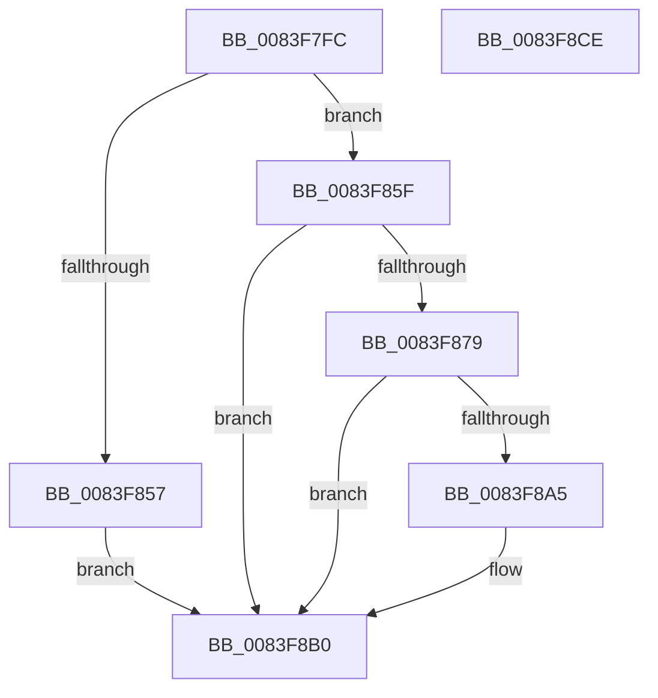

# RtlpMuiRegInitAnyLanguage

- RVA: `0x0083F7FC`–`0x0083F8CF` (길이 `211` bytes)
- VA: `0x000000014083F7FC`
- 실행 섹션: `PAGE`
- PDB 이름 있음: `예`; PDB Function 태그: `아니요`
- unwind 정보 RVA: `0x00060130`
- 디코드: `58`개 명령, `211/211` bytes 표시
- 미해석 바이트: `0` (있으면 어셈블리에 `.byte`로 보존)

> 이 문서는 커널 이미지의 기계어와 PDB 기호를 분석해 생성했습니다. 4번과 5번은 함수 원형과 자료형을 바이너리 사용 방식에서 추정한 C 해석이며 원본 소스 복구 결과는 아닙니다.

## 1. Dependencies

- 직접 호출 지점: **4**; 고유 호출 대상: **4**
- 직접 호출자로 확인된 함수: **2**
- RIP 상대 이미지 참조: **0**

### Outgoing calls
- `0x0083F83F` → [RtlInitUnicodeString](../../text/42/RtlInitUnicodeString_function_0042A780.md) (function, `0x0042A780`)
- `0x0083F84E` → [RtlCultureNameToLCID](../AA/RtlCultureNameToLCID_function_00AACEF0.md) (function, `0x00AACEF0`)
- `0x0083F86D` → [RtlpMuiRegGetOrAddString](RtlpMuiRegGetOrAddString_function_0083E830.md) (function, `0x0083E830`)
- `0x0083F8AB` → [RtlpMuiRegAddNeutralLanguage](RtlpMuiRegAddNeutralLanguage_function_0083F7D4.md) (function, `0x0083F7D4`)

### Direct callers
- [RtlpMuiRegAddLanguageByName](RtlpMuiRegAddLanguageByName_function_0083D748.md) at `0x0083D785`
- [RtlpMuiRegAddBaseLanguage](RtlpMuiRegAddBaseLanguage_function_0083F494.md) at `0x0083F58A`

### Static image references
- 디코드된 RIP-relative 메모리 참조가 없습니다.

## 2. Other-region calls and transfers

- 다른 실행 섹션으로 향하는 call: **1**
  - `0x0083F83F` → [RtlInitUnicodeString](../../text/42/RtlInitUnicodeString_function_0042A780.md) (`PAGE` → `.text`)
- 별도 외부 분기/꼬리 이동을 확인하지 못했습니다.

## 3. Assembly (complete function range)

```asm
0083F7FC  48 8B C4                        mov rax, rsp
0083F7FF  48 89 58 08                     mov qword ptr [rax + 8], rbx
0083F803  48 89 68 10                     mov qword ptr [rax + 0x10], rbp
0083F807  48 89 70 18                     mov qword ptr [rax + 0x18], rsi
0083F80B  48 89 78 20                     mov qword ptr [rax + 0x20], rdi
0083F80F  41 56                           push r14
0083F811  48 83 EC 40                     sub rsp, 0x40
0083F815  0F 57 C0                        xorps xmm0, xmm0
0083F818  48 8B DA                        mov rbx, rdx
0083F81B  0F 11 40 E0                     movups xmmword ptr [rax - 0x20], xmm0
0083F81F  48 8B F9                        mov rdi, rcx
0083F822  45 33 F6                        xor r14d, r14d
0083F825  44 89 70 DC                     mov dword ptr [rax - 0x24], r14d
0083F829  48 8D 4C 24 28                  lea rcx, [rsp + 0x28]
0083F82E  83 C8 FF                        or eax, 0xffffffff
0083F831  49 8B D0                        mov rdx, r8
0083F834  66 89 44 24 20                  mov word ptr [rsp + 0x20], ax
0083F839  41 8B E9                        mov ebp, r9d
0083F83C  49 8B F0                        mov rsi, r8
0083F83F  E8 3C AF BE FF                  call 0x14042a780
0083F844  48 8D 54 24 24                  lea rdx, [rsp + 0x24]
0083F849  48 8D 4C 24 28                  lea rcx, [rsp + 0x28]
0083F84E  E8 9D D6 26 00                  call 0x140aacef0
0083F853  84 C0                           test al, al
0083F855  75 08                           jne 0x14083f85f
0083F857  41 B8 04 00 0B C0               mov r8d, 0xc00b0004
0083F85D  EB 51                           jmp 0x14083f8b0
0083F85F  4C 8D 4C 24 20                  lea r9, [rsp + 0x20]
0083F864  41 B0 01                        mov r8b, 1
0083F867  48 8B D6                        mov rdx, rsi
0083F86A  48 8B CF                        mov rcx, rdi
0083F86D  E8 BE EF FF FF                  call 0x14083e830
0083F872  44 8B C0                        mov r8d, eax
0083F875  85 C0                           test eax, eax
0083F877  78 37                           js 0x14083f8b0
0083F879  0F B7 4C 24 24                  movzx ecx, word ptr [rsp + 0x24]
0083F87E  66 89 4B 04                     mov word ptr [rbx + 4], cx
0083F882  0F B7 4C 24 20                  movzx ecx, word ptr [rsp + 0x20]
0083F887  66 89 4B 06                     mov word ptr [rbx + 6], cx
0083F88B  66 89 2B                        mov word ptr [rbx], bp
0083F88E  66 44 89 73 02                  mov word ptr [rbx + 2], r14w
0083F893  4C 89 73 08                     mov qword ptr [rbx + 8], r14
0083F897  4C 89 73 10                     mov qword ptr [rbx + 0x10], r14
0083F89B  44 89 73 18                     mov dword ptr [rbx + 0x18], r14d
0083F89F  0F BA E5 0D                     bt ebp, 0xd
0083F8A3  72 0B                           jb 0x14083f8b0
0083F8A5  48 8B D3                        mov rdx, rbx
0083F8A8  48 8B CF                        mov rcx, rdi
0083F8AB  E8 24 FF FF FF                  call 0x14083f7d4
0083F8B0  48 8B 5C 24 50                  mov rbx, qword ptr [rsp + 0x50]
0083F8B5  41 8B C0                        mov eax, r8d
0083F8B8  48 8B 6C 24 58                  mov rbp, qword ptr [rsp + 0x58]
0083F8BD  48 8B 74 24 60                  mov rsi, qword ptr [rsp + 0x60]
0083F8C2  48 8B 7C 24 68                  mov rdi, qword ptr [rsp + 0x68]
0083F8C7  48 83 C4 40                     add rsp, 0x40
0083F8CB  41 5E                           pop r14
0083F8CD  C3                              ret
0083F8CE  CC                              int3
```

## 4. C-style interpretation (structured pseudocode)

```c
__int64 __fastcall RtlpMuiRegInitAnyLanguage(__int64 a1, __int64 a2, __int64 a3, int a4)
{
    __int64 result;
    __int64 v_r14;
    __int64 v_rsp;
    unsigned __int64 v_stack_m20;
    unsigned __int64 v_stack_m24;
    unsigned __int16 v_stack_m28;
    unsigned __int64 v_stack_p10;
    unsigned __int64 v_stack_p18;
    unsigned __int64 v_stack_p20;
    unsigned __int64 v_stack_p8;

    *(unsigned __int64 *)(v_rsp + 8) = v_rbx;
    *(unsigned __int64 *)(v_rsp + 16) = v_rbp;
    *(unsigned __int64 *)(v_rsp + 24) = v_rsi;
    *(unsigned __int64 *)(v_rsp + 32) = v_rdi;
    v_rsp = (v_rsp) - (64);
    *(unsigned __int64 *)(v_rsp - 32) = v_xmm0;
    v_r14 = 0;
    *(unsigned int *)(v_rsp - 36) = 0;
    result = (unsigned int)((v_rsp) | (0xFFFFFFFFULL));
    v_stack_m28 = (unsigned __int16)(result);
    result = RtlInitUnicodeString(v_stack_m20, a3, a3, a4);
    result = RtlCultureNameToLCID(v_stack_m20, v_stack_m24, a3, a4);
    if ((unsigned __int8)(result) != 0) goto loc_0083F85F;
    goto loc_0083F8B0;
loc_0083F85F:
    result = RtlpMuiRegGetOrAddString(a1, a3, 1, v_stack_m28);
    if (sign_flag) goto loc_0083F8B0;
    *(unsigned __int16 *)(a2 + 4) = (unsigned __int16)(v_stack_m24);
    *(unsigned __int16 *)(a2 + 6) = (unsigned __int16)(v_stack_m28);
    *(unsigned __int16 *)(a2) = (unsigned __int16)((unsigned int)(a4));
    *(unsigned __int16 *)(a2 + 2) = 0;
    *(unsigned __int64 *)(a2 + 8) = 0;
    *(unsigned __int64 *)(a2 + 16) = 0;
    *(unsigned int *)(a2 + 24) = 0;
    if (!(condition_is_below)) {
        a2 = a2;
        a1 = a1;
        result = RtlpMuiRegAddNeutralLanguage(a1, a2, (unsigned int)((unsigned int)(result)), v_stack_m28);
    }
    v_rsp = (v_rsp) + (64);
    return (unsigned int)((unsigned int)((unsigned int)((unsigned int)(result))));
}
```

## 5. (Beta) C Style

```c
int64_t RtlpMuiRegInitAnyLanguage(int64_t Arg1, void *Arg2, int64_t Arg3, int32_t Arg4)
{
    uint8_t *arg2 = (uint8_t *)Arg2;

    int64_t result;
    int64_t local_r14;
    int64_t local_rsp;
    uint64_t v_stack_m20;
    uint64_t v_stack_m24;
    uint16_t v_stack_m28;
    uint64_t v_stack_p10;
    uint64_t v_stack_p18;
    uint64_t v_stack_p20;
    uint64_t v_stack_p8;

    *(uint64_t *)(local_rsp + 0x8) = local_rbx;
    *(uint64_t *)(local_rsp + 0x10) = local_rbp;
    *(uint64_t *)(local_rsp + 0x18) = local_rsi;
    *(uint64_t *)(local_rsp + 0x20) = local_rdi;
    local_rsp = (local_rsp) - (64);
    *(uint64_t *)(local_rsp - 0x20) = v_xmm0;
    local_r14 = 0;
    *(uint32_t *)(local_rsp - 0x24) = 0;
    result = (uint32_t)((local_rsp) | (0xFFFFFFFFULL));
    v_stack_m28 = (uint16_t)(result);
    result = RtlInitUnicodeString(v_stack_m20, Arg3, Arg3, Arg4);
    result = RtlCultureNameToLCID(v_stack_m20, v_stack_m24, Arg3, Arg4);
    if ((uint8_t)(result) != 0) goto loc_0083F85F;
    goto loc_0083F8B0;
loc_0083F85F:
    result = RtlpMuiRegGetOrAddString(Arg1, Arg3, 1, v_stack_m28);
    if (sign_flag) goto loc_0083F8B0;
    *(uint16_t *)(arg2 + 0x4) = (uint16_t)(v_stack_m24);
    *(uint16_t *)(arg2 + 0x6) = (uint16_t)(v_stack_m28);
    *(uint16_t *)(arg2) = (uint16_t)((uint32_t)(Arg4));
    *(uint16_t *)(arg2 + 0x2) = 0;
    *(uint64_t *)(arg2 + 0x8) = 0;
    *(uint64_t *)(arg2 + 0x10) = 0;
    *(uint32_t *)(arg2 + 0x18) = 0;
    if (!(condition_is_below)) {
        Arg2 = Arg2;
        Arg1 = Arg1;
        result = RtlpMuiRegAddNeutralLanguage(Arg1, Arg2, (uint32_t)((uint32_t)(result)), v_stack_m28);
    }
    local_rsp = (local_rsp) + (64);
    return (uint32_t)((uint32_t)((uint32_t)((uint32_t)(result))));
}
```

### 관측된 메모리 오프셋

구조체 형식이 확인되지 않은 접근은 인자 기준의 오프셋으로만 기록했습니다.

| 기준 인자 | 오프셋 표현 | 폭 (bit) | 접근 |
|---|---:|---:|---|
| `Arg2` | `+ 0x0` | `16` | `W` |
| `Arg2` | `+ 0x2` | `16` | `W` |
| `Arg2` | `+ 0x4` | `16` | `W` |
| `Arg2` | `+ 0x6` | `16` | `W` |
| `Arg2` | `+ 0x8` | `64` | `W` |
| `Arg2` | `+ 0x10` | `64` | `W` |
| `Arg2` | `+ 0x18` | `32` | `W` |

## 6. Execution-region graph

[열기: 2D/3D 그래프와 함수 탐색 컨트롤 패널](../../../control-panel.html?section=page&rva=0x0083F7FC&view=graph)

- 2D 그래프는 위에서 아래로 흐르고, 3D 그래프는 빈 공간을 드래그해 회전합니다. Shift+드래그는 이동, 휠은 확대·축소, 함수 노드 선택은 대상 보고서 이동입니다.

### Static fallback


