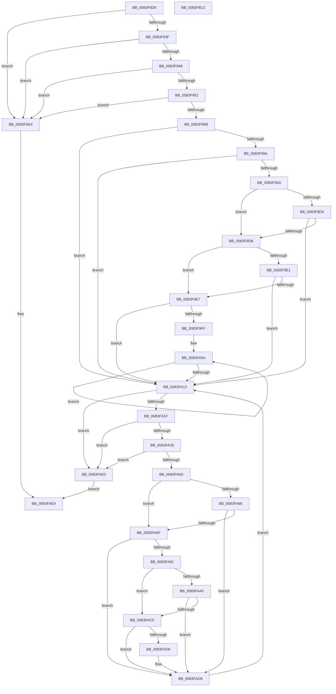

# RtlpMuiRegInitLIPLanguage

- RVA: `0x0083F8D8`–`0x0083FB14` (길이 `572` bytes)
- VA: `0x000000014083F8D8`
- 실행 섹션: `PAGE`
- PDB 이름 있음: `예`; PDB Function 태그: `아니요`
- unwind 정보 RVA: `0x000DB500`
- 디코드: `153`개 명령, `572/572` bytes 표시
- 미해석 바이트: `0` (있으면 어셈블리에 `.byte`로 보존)

> 이 문서는 커널 이미지의 기계어와 PDB 기호를 분석해 생성했습니다. 4번과 5번은 함수 원형과 자료형을 바이너리 사용 방식에서 추정한 C 해석이며 원본 소스 복구 결과는 아닙니다.

## 1. Dependencies

- 직접 호출 지점: **11**; 고유 호출 대상: **7**
- 직접 호출자로 확인된 함수: **1**
- RIP 상대 이미지 참조: **2**

### Outgoing calls
- `0x0083F931` → [memset](../../text/6C/memset_function_006C6C40.md) (function, `0x006C6C40`)
- `0x0083F966` → [RtlInitUnicodeString](../../text/42/RtlInitUnicodeString_function_0042A780.md) (function, `0x0042A780`)
- `0x0083F991` → [LdrpQueryValueKey](../79/LdrpQueryValueKey_function_007919D0.md) (function, `0x007919D0`)
- `0x0083F9A8` → [RtlInitUnicodeString](../../text/42/RtlInitUnicodeString_function_0042A780.md) (function, `0x0042A780`)
- `0x0083F9C9` → [LdrpQueryValueKey](../79/LdrpQueryValueKey_function_007919D0.md) (function, `0x007919D0`)
- `0x0083F9F4` → [RtlMuiRegAddLIPParent](RtlMuiRegAddLIPParent_function_0083F2BC.md) (function, `0x0083F2BC`)
- `0x0083FA4C` → [ZwEnumerateValueKey](../../text/6A/ZwEnumerateValueKey_function_006AD330.md) (function, `0x006AD330`)
- `0x0083FA97` → [RtlInitUnicodeString](../../text/42/RtlInitUnicodeString_function_0042A780.md) (function, `0x0042A780`)
- `0x0083FAB7` → [RtlCompareUnicodeStrings](../97/RtlCompareUnicodeStrings_function_009727E0.md) (function, `0x009727E0`)
- `0x0083FACD` → [RtlMuiRegAddLIPParent](RtlMuiRegAddLIPParent_function_0083F2BC.md) (function, `0x0083F2BC`)
- `0x0083FAF3` → [_security_check_cookie](../../text/6A/_security_check_cookie_function_006AC640.md) (function, `0x006AC640`)

### Direct callers
- [RtlpMuiRegAddLanguageByName](RtlpMuiRegAddLanguageByName_function_0083D748.md) at `0x0083D7A5`

### Static image references
- `0x0083F8F8` → RVA `0x00E0A740` (`.data`; read)
- `0x0083F95B` → RVA `0x00B0E390` (` ?? ::NNGAKEGL::`string'`; read)

## 2. Other-region calls and transfers

- 다른 실행 섹션으로 향하는 call: **6**
  - `0x0083F931` → [memset](../../text/6C/memset_function_006C6C40.md) (`PAGE` → `.text`)
  - `0x0083F966` → [RtlInitUnicodeString](../../text/42/RtlInitUnicodeString_function_0042A780.md) (`PAGE` → `.text`)
  - `0x0083F9A8` → [RtlInitUnicodeString](../../text/42/RtlInitUnicodeString_function_0042A780.md) (`PAGE` → `.text`)
  - `0x0083FA4C` → [ZwEnumerateValueKey](../../text/6A/ZwEnumerateValueKey_function_006AD330.md) (`PAGE` → `.text`)
  - `0x0083FA97` → [RtlInitUnicodeString](../../text/42/RtlInitUnicodeString_function_0042A780.md) (`PAGE` → `.text`)
  - `0x0083FAF3` → [_security_check_cookie](../../text/6A/_security_check_cookie_function_006AC640.md) (`PAGE` → `.text`)
- 별도 외부 분기/꼬리 이동을 확인하지 못했습니다.

## 3. Assembly (complete function range)

```asm
0083F8D8  48 89 5C 24 20                  mov qword ptr [rsp + 0x20], rbx
0083F8DD  55                              push rbp
0083F8DE  56                              push rsi
0083F8DF  57                              push rdi
0083F8E0  41 54                           push r12
0083F8E2  41 55                           push r13
0083F8E4  41 56                           push r14
0083F8E6  41 57                           push r15
0083F8E8  48 81 EC 40 03 00 00            sub rsp, 0x340
0083F8EF  48 8D 6C 24 50                  lea rbp, [rsp + 0x50]
0083F8F4  48 83 E5 E0                     and rbp, 0xffffffffffffffe0
0083F8F8  48 8B 05 41 AE 5C 00            mov rax, qword ptr [rip + 0x5cae41]
0083F8FF  48 33 C4                        xor rax, rsp
0083F902  48 89 85 E0 02 00 00            mov qword ptr [rbp + 0x2e0], rax
0083F909  33 DB                           xor ebx, ebx
0083F90B  4D 8B F0                        mov r14, r8
0083F90E  4C 8B FA                        mov r15, rdx
0083F911  89 5D 1C                        mov dword ptr [rbp + 0x1c], ebx
0083F914  4C 8B E9                        mov r13, rcx
0083F917  0F 57 C0                        xorps xmm0, xmm0
0083F91A  33 D2                           xor edx, edx
0083F91C  48 8D 4D 20                     lea rcx, [rbp + 0x20]
0083F920  41 B8 AA 00 00 00               mov r8d, 0xaa
0083F926  8B F3                           mov esi, ebx
0083F928  8B FB                           mov edi, ebx
0083F92A  44 8B E3                        mov r12d, ebx
0083F92D  0F 11 45 08                     movups xmmword ptr [rbp + 8], xmm0
0083F931  E8 0A 73 E8 FF                  call 0x1406c6c40
0083F936  4D 85 ED                        test r13, r13
0083F939  0F 84 A5 01 00 00               je 0x14083fae4
0083F93F  4D 85 FF                        test r15, r15
0083F942  0F 84 9C 01 00 00               je 0x14083fae4
0083F948  4D 85 F6                        test r14, r14
0083F94B  0F 84 93 01 00 00               je 0x14083fae4
0083F951  41 F6 06 04                     test byte ptr [r14], 4
0083F955  0F 84 89 01 00 00               je 0x14083fae4
0083F95B  48 8D 15 2E EA 2C 00            lea rdx, [rip + 0x2cea2e]
0083F962  48 8D 4D 08                     lea rcx, [rbp + 8]
0083F966  E8 15 AE BE FF                  call 0x14042a780
0083F96B  48 8D 45 18                     lea rax, [rbp + 0x18]
0083F96F  C7 45 00 01 00 00 00            mov dword ptr [rbp], 1
0083F976  4C 8D 4D 20                     lea r9, [rbp + 0x20]
0083F97A  48 89 44 24 20                  mov qword ptr [rsp + 0x20], rax
0083F97F  4C 8D 45 00                     lea r8, [rbp]
0083F983  C7 45 18 AA 00 00 00            mov dword ptr [rbp + 0x18], 0xaa
0083F98A  48 8D 55 08                     lea rdx, [rbp + 8]
0083F98E  49 8B CF                        mov rcx, r15
0083F991  E8 3A 20 F5 FF                  call 0x1407919d0
0083F996  85 C0                           test eax, eax
0083F998  78 79                           js 0x14083fa13
0083F99A  83 7D 00 01                     cmp dword ptr [rbp], 1
0083F99E  75 73                           jne 0x14083fa13
0083F9A0  48 8D 55 20                     lea rdx, [rbp + 0x20]
0083F9A4  48 8D 4D 08                     lea rcx, [rbp + 8]
0083F9A8  E8 D3 AD BE FF                  call 0x14042a780
0083F9AD  33 C0                           xor eax, eax
0083F9AF  C7 45 00 07 00 00 00            mov dword ptr [rbp], 7
0083F9B6  45 33 C9                        xor r9d, r9d
0083F9B9  48 89 44 24 20                  mov qword ptr [rsp + 0x20], rax
0083F9BE  4C 8D 45 00                     lea r8, [rbp]
0083F9C2  49 8B CF                        mov rcx, r15
0083F9C5  48 8D 55 08                     lea rdx, [rbp + 8]
0083F9C9  E8 02 20 F5 FF                  call 0x1407919d0
0083F9CE  8B F0                           mov esi, eax
0083F9D0  85 C0                           test eax, eax
0083F9D2  74 07                           je 0x14083f9db
0083F9D4  3D 05 00 00 80                  cmp eax, 0x80000005
0083F9D9  75 38                           jne 0x14083fa13
0083F9DB  83 7D 00 07                     cmp dword ptr [rbp], 7
0083F9DF  74 06                           je 0x14083f9e7
0083F9E1  83 7D 00 01                     cmp dword ptr [rbp], 1
0083F9E5  75 2C                           jne 0x14083fa13
0083F9E7  4C 8D 4D 20                     lea r9, [rbp + 0x20]
0083F9EB  45 33 C0                        xor r8d, r8d
0083F9EE  49 8B D6                        mov rdx, r14
0083F9F1  49 8B CD                        mov rcx, r13
0083F9F4  E8 C3 F8 FF FF                  call 0x14083f2bc
0083F9F9  33 D2                           xor edx, edx
0083F9FB  85 C0                           test eax, eax
0083F9FD  78 14                           js 0x14083fa13
0083F9FF  8D 7A 01                        lea edi, [rdx + 1]
0083FA02  48 83 CB FF                     or rbx, 0xffffffffffffffff
0083FA06  48 8D 45 20                     lea rax, [rbp + 0x20]
0083FA0A  48 FF C3                        inc rbx
0083FA0D  66 39 14 58                     cmp word ptr [rax + rbx*2], dx
0083FA11  75 F7                           jne 0x14083fa0a
0083FA13  81 FE 1A 00 00 80               cmp esi, 0x8000001a
0083FA19  0F 84 C1 00 00 00               je 0x14083fae0
0083FA1F  83 FF 04                        cmp edi, 4
0083FA22  0F 83 B8 00 00 00               jae 0x14083fae0
0083FA28  48 8D 45 1C                     lea rax, [rbp + 0x1c]
0083FA2C  41 B8 01 00 00 00               mov r8d, 1
0083FA32  48 89 44 24 28                  mov qword ptr [rsp + 0x28], rax
0083FA37  4C 8D 8D E0 00 00 00            lea r9, [rbp + 0xe0]
0083FA3E  41 8B D4                        mov edx, r12d
0083FA41  C7 44 24 20 00 02 00 00         mov dword ptr [rsp + 0x20], 0x200
0083FA49  49 8B CF                        mov rcx, r15
0083FA4C  E8 DF D8 E6 FF                  call 0x1406ad330
0083FA51  33 D2                           xor edx, edx
0083FA53  8B F0                           mov esi, eax
0083FA55  85 C0                           test eax, eax
0083FA57  0F 88 83 00 00 00               js 0x14083fae0
0083FA5D  83 BD E4 00 00 00 07            cmp dword ptr [rbp + 0xe4], 7
0083FA64  74 09                           je 0x14083fa6f
0083FA66  83 BD E4 00 00 00 01            cmp dword ptr [rbp + 0xe4], 1
0083FA6D  75 69                           jne 0x14083fad8
0083FA6F  8B 8D F0 00 00 00               mov ecx, dword ptr [rbp + 0xf0]
0083FA75  48 8D 41 18                     lea rax, [rcx + 0x18]
0083FA79  48 3D 00 02 00 00               cmp rax, 0x200
0083FA7F  77 57                           ja 0x14083fad8
0083FA81  48 D1 E9                        shr rcx, 1
0083FA84  66 89 94 4D F4 00 00 00         mov word ptr [rbp + rcx*2 + 0xf4], dx
0083FA8C  48 8D 95 F4 00 00 00            lea rdx, [rbp + 0xf4]
0083FA93  48 8D 4D 08                     lea rcx, [rbp + 8]
0083FA97  E8 E4 AC BE FF                  call 0x14042a780
0083FA9C  85 DB                           test ebx, ebx
0083FA9E  74 20                           je 0x14083fac0
0083FAA0  0F B7 55 08                     movzx edx, word ptr [rbp + 8]
0083FAA4  4C 8D 45 20                     lea r8, [rbp + 0x20]
0083FAA8  48 8B 4D 10                     mov rcx, qword ptr [rbp + 0x10]
0083FAAC  48 D1 EA                        shr rdx, 1
0083FAAF  44 8B CB                        mov r9d, ebx
0083FAB2  C6 44 24 20 01                  mov byte ptr [rsp + 0x20], 1
0083FAB7  E8 24 2D 13 00                  call 0x1409727e0
0083FABC  85 C0                           test eax, eax
0083FABE  74 18                           je 0x14083fad8
0083FAC0  4C 8B 4D 10                     mov r9, qword ptr [rbp + 0x10]
0083FAC4  44 8B C7                        mov r8d, edi
0083FAC7  49 8B D6                        mov rdx, r14
0083FACA  49 8B CD                        mov rcx, r13
0083FACD  E8 EA F7 FF FF                  call 0x14083f2bc
0083FAD2  85 C0                           test eax, eax
0083FAD4  78 02                           js 0x14083fad8
0083FAD6  FF C7                           inc edi
0083FAD8  41 FF C4                        inc r12d
0083FADB  E9 33 FF FF FF                  jmp 0x14083fa13
0083FAE0  33 C0                           xor eax, eax
0083FAE2  EB 05                           jmp 0x14083fae9
0083FAE4  B8 0D 00 00 C0                  mov eax, 0xc000000d
0083FAE9  48 8B 8D E0 02 00 00            mov rcx, qword ptr [rbp + 0x2e0]
0083FAF0  48 33 CC                        xor rcx, rsp
0083FAF3  E8 48 CB E6 FF                  call 0x1406ac640
0083FAF8  48 8B 9C 24 98 03 00 00         mov rbx, qword ptr [rsp + 0x398]
0083FB00  48 81 C4 40 03 00 00            add rsp, 0x340
0083FB07  41 5F                           pop r15
0083FB09  41 5E                           pop r14
0083FB0B  41 5D                           pop r13
0083FB0D  41 5C                           pop r12
0083FB0F  5F                              pop rdi
0083FB10  5E                              pop rsi
0083FB11  5D                              pop rbp
0083FB12  C3                              ret
0083FB13  CC                              int3
```

## 4. C-style interpretation (structured pseudocode)

```c
__int64 __fastcall RtlpMuiRegInitLIPLanguage(__int64 a1, __int64 a2, __int64 a3)
{
    __int64 result;
    __int64 v_r12;
    __int64 v_rbp;
    __int64 v_rbx;
    __int64 v_rdi;
    __int64 v_rsp;
    unsigned __int64 v_stack_m234;
    unsigned int v_stack_m238;
    unsigned int v_stack_m244;
    unsigned __int64 v_stack_m248;
    unsigned __int64 v_stack_m308;
    unsigned int v_stack_m30C;
    unsigned __int64 v_stack_m310;
    unsigned __int64 v_stack_m318;
    unsigned __int64 v_stack_m320;
    unsigned __int64 v_stack_m328;
    unsigned __int64 v_stack_m350;
    unsigned __int64 v_stack_m358;
    unsigned __int64 v_stack_m48;
    unsigned __int64 v_stack_p20;

    v_stack_p20 = v_rbx;
    v_rsp = (v_rsp) - (832);
    v_rbp = (v_stack_m328) & (-32);
    result = (*(unsigned __int64 *)(v_rip + 6073921)) ^ (v_rsp);
    v_stack_m48 = result;
    v_rbx = 0;
    v_stack_m30C = 0;
    a2 = 0;
    v_stack_m320 = v_xmm0;
    result = memset(v_stack_m308, a2, 170, a4);
    if (a1 == 0) goto loc_0083FAE4;
    if (0 == 0) goto loc_0083FAE4;
    if (a3 == 0) goto loc_0083FAE4;
    if (((*(unsigned __int8 *)(a3)) & (4)) == 0) goto loc_0083FAE4;
    result = RtlInitUnicodeString(v_stack_m320, v_rip + 2943534, 170, a4);
    v_stack_m328 = 1;
    v_stack_m358 = v_stack_m310;
    v_stack_m310 = 170;
    result = LdrpQueryValueKey(0, v_stack_m320, v_stack_m328, v_stack_m308);
    if (sign_flag) goto loc_0083FA13;
    if (v_stack_m328 != 1) goto loc_0083FA13;
    result = RtlInitUnicodeString(v_stack_m320, v_stack_m308, v_stack_m328, v_stack_m308);
    result = 0;
    v_stack_m328 = 7;
    a4 = 0;
    v_stack_m358 = 0;
    result = LdrpQueryValueKey(0, v_stack_m320, v_stack_m328, a4);
    if ((unsigned int)(result) == 0) goto loc_0083F9DB;
    if (((unsigned int)(result)) != 0x80000005ULL) goto loc_0083FA13;
loc_0083F9DB:
    if (v_stack_m328 == 7) goto loc_0083F9E7;
    if (v_stack_m328 != 1) goto loc_0083FA13;
loc_0083F9E7:
    a3 = 0;
    result = RtlMuiRegAddLIPParent(a1, 0, a3, v_stack_m308);
    a2 = 0;
    if (sign_flag) goto loc_0083FA13;
    v_rbx = (v_rbx) | (-1);
loc_0083FA0A:
    v_rbx = (v_rbx) + 1;
    if ((*(unsigned __int16 *)(v_stack_m308 + v_rbx * 2)) != 0) goto loc_0083FA0A;
loc_0083FA13:
    if (((unsigned int)((unsigned int)((unsigned int)(result)))) == 0x8000001AULL) goto loc_0083FAE0;
    if (((unsigned int)(a2 + 1)) >= 4) goto loc_0083FAE0;
    v_stack_m350 = v_stack_m30C;
    v_stack_m358 = 512;
    result = ZwEnumerateValueKey(0, 0, 1, v_stack_m248);
    a2 = 0;
    if (sign_flag) goto loc_0083FAE0;
    if (v_stack_m244 == 7) goto loc_0083FA6F;
    if (v_stack_m244 != 1) goto loc_0083FAD8;
loc_0083FA6F:
    if (((unsigned int)(v_stack_m238) + 24) > 512) goto loc_0083FAD8;
    a1 = ((unsigned int)(v_stack_m238)) >> (1);
    *(unsigned __int16 *)(v_rbp + a1 * 2 + 244) = 0;
    result = RtlInitUnicodeString(v_stack_m320, v_stack_m234, 1, v_stack_m248);
    if ((unsigned int)(v_rbx) == 0) goto loc_0083FAC0;
    a2 = (v_stack_m320) >> (1);
    v_stack_m358 = 1;
    result = RtlCompareUnicodeStrings(v_stack_m318, a2, v_stack_m308, (unsigned int)((unsigned int)(v_rbx)));
    if ((unsigned int)(result) == 0) goto loc_0083FAD8;
loc_0083FAC0:
    result = RtlMuiRegAddLIPParent(a1, 0, (unsigned int)((unsigned int)(a2 + 1)), v_stack_m318);
    v_rdi = a2 + 1;
    if (!(sign_flag)) {
        v_rdi = (unsigned int)((a2 + 1) + 1);
    }
    v_r12 = (unsigned int)((0) + 1);
    goto loc_0083FA13;
loc_0083FAE0:
    result = 0;
    goto loc_0083FAE9;
loc_0083FAE4:
loc_0083FAE9:
    a1 = (v_stack_m48) ^ (v_rsp);
    result = _security_check_cookie(a1, 0, (unsigned int)((unsigned int)(a2 + 1)), v_stack_m318);
    v_rsp = (v_rsp) + (832);
    return result;
}
```

## 5. (Beta) C Style

```c
int64_t RtlpMuiRegInitLIPLanguage(int64_t Arg1, int64_t Arg2, int64_t Arg3)
{
    int64_t result;
    int64_t local_r12;
    int64_t local_rbp;
    int64_t local_rbx;
    int64_t local_rdi;
    int64_t local_rsp;
    uint64_t v_stack_m234;
    uint32_t v_stack_m238;
    uint32_t v_stack_m244;
    uint64_t v_stack_m248;
    uint64_t v_stack_m308;
    uint32_t v_stack_m30C;
    uint64_t v_stack_m310;
    uint64_t v_stack_m318;
    uint64_t v_stack_m320;
    uint64_t v_stack_m328;
    uint64_t v_stack_m350;
    uint64_t v_stack_m358;
    uint64_t v_stack_m48;
    uint64_t v_stack_p20;

    v_stack_p20 = local_rbx;
    local_rsp = (local_rsp) - (832);
    local_rbp = (v_stack_m328) & (-32);
    result = (*(uint64_t *)(v_rip + 0x5CAE41)) ^ (local_rsp);
    v_stack_m48 = result;
    local_rbx = 0;
    v_stack_m30C = 0;
    Arg2 = 0;
    v_stack_m320 = v_xmm0;
    result = memset(v_stack_m308, Arg2, 170, a4);
    if (Arg1 == 0) goto loc_0083FAE4;
    if (0 == 0) goto loc_0083FAE4;
    if (Arg3 == 0) goto loc_0083FAE4;
    if (((*(uint8_t *)(Arg3)) & (4)) == 0) goto loc_0083FAE4;
    result = RtlInitUnicodeString(v_stack_m320, v_rip + 2943534, 170, a4);
    v_stack_m328 = 1;
    v_stack_m358 = v_stack_m310;
    v_stack_m310 = 170;
    result = LdrpQueryValueKey(0, v_stack_m320, v_stack_m328, v_stack_m308);
    if (sign_flag) goto loc_0083FA13;
    if (v_stack_m328 != 1) goto loc_0083FA13;
    result = RtlInitUnicodeString(v_stack_m320, v_stack_m308, v_stack_m328, v_stack_m308);
    result = 0;
    v_stack_m328 = 7;
    a4 = 0;
    v_stack_m358 = 0;
    result = LdrpQueryValueKey(0, v_stack_m320, v_stack_m328, a4);
    if ((uint32_t)(result) == 0) goto loc_0083F9DB;
    if (((uint32_t)(result)) != 0x80000005ULL) goto loc_0083FA13;
loc_0083F9DB:
    if (v_stack_m328 == 7) goto loc_0083F9E7;
    if (v_stack_m328 != 1) goto loc_0083FA13;
loc_0083F9E7:
    Arg3 = 0;
    result = RtlMuiRegAddLIPParent(Arg1, 0, Arg3, v_stack_m308);
    Arg2 = 0;
    if (sign_flag) goto loc_0083FA13;
    local_rbx = (local_rbx) | (-1);
loc_0083FA0A:
    local_rbx = (local_rbx) + 1;
    if ((*(uint16_t *)(v_stack_m308 + local_rbx * 2)) != 0) goto loc_0083FA0A;
loc_0083FA13:
    if (((uint32_t)((uint32_t)((uint32_t)(result)))) == 0x8000001AULL) goto loc_0083FAE0;
    if (((uint32_t)(Arg2 + 1)) >= 4) goto loc_0083FAE0;
    v_stack_m350 = v_stack_m30C;
    v_stack_m358 = 512;
    result = ZwEnumerateValueKey(0, 0, 1, v_stack_m248);
    Arg2 = 0;
    if (sign_flag) goto loc_0083FAE0;
    if (v_stack_m244 == 7) goto loc_0083FA6F;
    if (v_stack_m244 != 1) goto loc_0083FAD8;
loc_0083FA6F:
    if (((uint32_t)(v_stack_m238) + 24) > 512) goto loc_0083FAD8;
    Arg1 = ((uint32_t)(v_stack_m238)) >> (1);
    *(uint16_t *)(local_rbp + Arg1 * 2 + 0xF4) = 0;
    result = RtlInitUnicodeString(v_stack_m320, v_stack_m234, 1, v_stack_m248);
    if ((uint32_t)(local_rbx) == 0) goto loc_0083FAC0;
    Arg2 = (v_stack_m320) >> (1);
    v_stack_m358 = 1;
    result = RtlCompareUnicodeStrings(v_stack_m318, Arg2, v_stack_m308, (uint32_t)((uint32_t)(local_rbx)));
    if ((uint32_t)(result) == 0) goto loc_0083FAD8;
loc_0083FAC0:
    result = RtlMuiRegAddLIPParent(Arg1, 0, (uint32_t)((uint32_t)(Arg2 + 1)), v_stack_m318);
    local_rdi = Arg2 + 1;
    if (!(sign_flag)) {
        local_rdi = (uint32_t)((Arg2 + 1) + 1);
    }
    local_r12 = (uint32_t)((0) + 1);
    goto loc_0083FA13;
loc_0083FAE0:
    result = 0;
    goto loc_0083FAE9;
loc_0083FAE4:
loc_0083FAE9:
    Arg1 = (v_stack_m48) ^ (local_rsp);
    result = _security_check_cookie(Arg1, 0, (uint32_t)((uint32_t)(Arg2 + 1)), v_stack_m318);
    local_rsp = (local_rsp) + (832);
    return result;
}
```

## 6. Execution-region graph

[열기: 2D/3D 그래프와 함수 탐색 컨트롤 패널](../../../control-panel.html?section=page&rva=0x0083F8D8&view=graph)

- 2D 그래프는 위에서 아래로 흐르고, 3D 그래프는 빈 공간을 드래그해 회전합니다. Shift+드래그는 이동, 휠은 확대·축소, 함수 노드 선택은 대상 보고서 이동입니다.

### Static fallback


