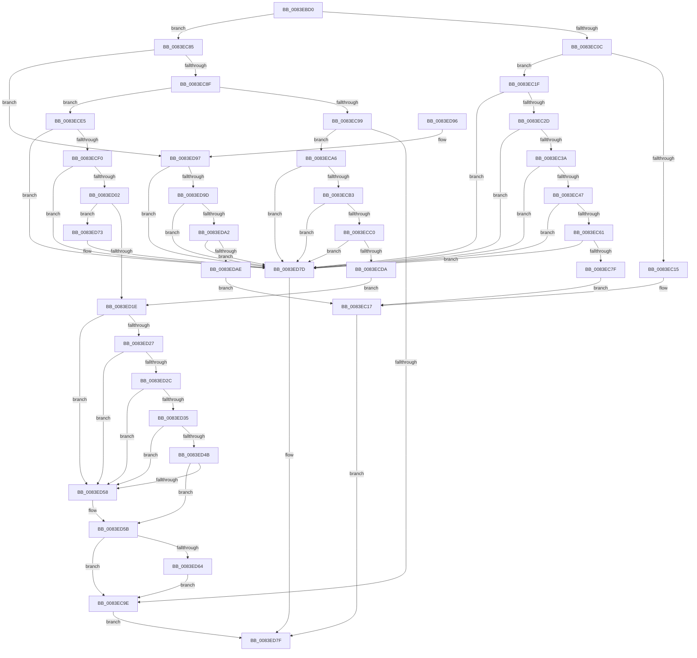

# RtlpMuiRegLangInfoMatchesSpec

- RVA: `0x0083EBD0`–`0x0083EDBE` (길이 `494` bytes)
- VA: `0x000000014083EBD0`
- 실행 섹션: `PAGE`
- PDB 이름 있음: `예`; PDB Function 태그: `아니요`
- unwind 정보 RVA: `0x000DB5B0`
- 디코드: `139`개 명령, `494/494` bytes 표시
- 미해석 바이트: `0` (있으면 어셈블리에 `.byte`로 보존)

> 이 문서는 커널 이미지의 기계어와 PDB 기호를 분석해 생성했습니다. 4번과 5번은 함수 원형과 자료형을 바이너리 사용 방식에서 추정한 C 해석이며 원본 소스 복구 결과는 아닙니다.

## 1. Dependencies

- 직접 호출 지점: **8**; 고유 호출 대상: **6**
- 직접 호출자로 확인된 함수: **1**
- RIP 상대 이미지 참조: **0**

### Outgoing calls
- `0x0083EC65` → [RtlInitUnicodeString](../../text/42/RtlInitUnicodeString_function_0042A780.md) (function, `0x0042A780`)
- `0x0083EC72` → [RtlCultureNameToLCID](../AA/RtlCultureNameToLCID_function_00AACEF0.md) (function, `0x00AACEF0`)
- `0x0083ECDE` → [RtlInitUnicodeString](../../text/42/RtlInitUnicodeString_function_0042A780.md) (function, `0x0042A780`)
- `0x0083ECF5` → [_MuiRegAllocArray](../../text/6A/_MuiRegAllocArray_function_006A9418.md) (function, `0x006A9418`)
- `0x0083ED15` → [RtlLCIDToCultureName](../AD/RtlLCIDToCultureName_function_00AD3010.md) (function, `0x00AD3010`)
- `0x0083ED4F` → [wcsicmp](../../text/50/wcsicmp_function_00500080.md) (function, `0x00500080`)
- `0x0083ED69` → [ExFreePoolWithTag](../../poolcode/B8/ExFreePoolWithTag_function_00B82870.md) (function, `0x00B82870`)
- `0x0083ED78` → [ExFreePoolWithTag](../../poolcode/B8/ExFreePoolWithTag_function_00B82870.md) (function, `0x00B82870`)

### Direct callers
- [RtlpMuiRegConfigMatchesInstalled](RtlpMuiRegConfigMatchesInstalled_function_0083DA08.md) at `0x0083DAB9`
- [RtlpMuiRegConfigMatchesInstalled](RtlpMuiRegConfigMatchesInstalled_function_0083DA08.md) at `0x0083DB0A`

### Static image references
- 디코드된 RIP-relative 메모리 참조가 없습니다.

## 2. Other-region calls and transfers

- 다른 실행 섹션으로 향하는 call: **6**
  - `0x0083EC65` → [RtlInitUnicodeString](../../text/42/RtlInitUnicodeString_function_0042A780.md) (`PAGE` → `.text`)
  - `0x0083ECDE` → [RtlInitUnicodeString](../../text/42/RtlInitUnicodeString_function_0042A780.md) (`PAGE` → `.text`)
  - `0x0083ECF5` → [_MuiRegAllocArray](../../text/6A/_MuiRegAllocArray_function_006A9418.md) (`PAGE` → `.text`)
  - `0x0083ED4F` → [wcsicmp](../../text/50/wcsicmp_function_00500080.md) (`PAGE` → `.text`)
  - `0x0083ED69` → [ExFreePoolWithTag](../../poolcode/B8/ExFreePoolWithTag_function_00B82870.md) (`PAGE` → `POOLCODE`)
  - `0x0083ED78` → [ExFreePoolWithTag](../../poolcode/B8/ExFreePoolWithTag_function_00B82870.md) (`PAGE` → `POOLCODE`)
- 별도 외부 분기/꼬리 이동을 확인하지 못했습니다.

## 3. Assembly (complete function range)

```asm
0083EBD0  48 89 5C 24 08                  mov qword ptr [rsp + 8], rbx
0083EBD5  48 89 74 24 10                  mov qword ptr [rsp + 0x10], rsi
0083EBDA  55                              push rbp
0083EBDB  57                              push rdi
0083EBDC  41 54                           push r12
0083EBDE  41 56                           push r14
0083EBE0  41 57                           push r15
0083EBE2  48 8B EC                        mov rbp, rsp
0083EBE5  48 83 EC 30                     sub rsp, 0x30
0083EBE9  45 33 E4                        xor r12d, r12d
0083EBEC  49 0F BF D9                     movsx rbx, r9w
0083EBF0  41 B6 01                        mov r14b, 1
0083EBF3  44 89 65 40                     mov dword ptr [rbp + 0x40], r12d
0083EBF7  0F 57 C0                        xorps xmm0, xmm0
0083EBFA  48 8B FA                        mov rdi, rdx
0083EBFD  4C 8B F9                        mov r15, rcx
0083EC00  41 8B F4                        mov esi, r12d
0083EC03  0F 11 45 F0                     movups xmmword ptr [rbp - 0x10], xmm0
0083EC07  45 3A C6                        cmp r8b, r14b
0083EC0A  75 79                           jne 0x14083ec85
0083EC0C  0F B7 42 04                     movzx eax, word ptr [rdx + 4]
0083EC10  66 85 C0                        test ax, ax
0083EC13  74 0A                           je 0x14083ec1f
0083EC15  3B C3                           cmp eax, ebx
0083EC17  0F 94 C0                        sete al
0083EC1A  E9 60 01 00 00                  jmp 0x14083ed7f
0083EC1F  48 0F BF 52 06                  movsx rdx, word ptr [rdx + 6]
0083EC24  66 85 D2                        test dx, dx
0083EC27  0F 88 50 01 00 00               js 0x14083ed7d
0083EC2D  4C 8B 41 20                     mov r8, qword ptr [rcx + 0x20]
0083EC31  4D 85 C0                        test r8, r8
0083EC34  0F 84 43 01 00 00               je 0x14083ed7d
0083EC3A  41 0F B7 48 06                  movzx ecx, word ptr [r8 + 6]
0083EC3F  3B D1                           cmp edx, ecx
0083EC41  0F 8D 36 01 00 00               jge 0x14083ed7d
0083EC47  49 8B 40 10                     mov rax, qword ptr [r8 + 0x10]
0083EC4B  48 0F BF 14 50                  movsx rdx, word ptr [rax + rdx*2]
0083EC50  49 8B 40 18                     mov rax, qword ptr [r8 + 0x18]
0083EC54  48 8D 14 50                     lea rdx, [rax + rdx*2]
0083EC58  48 85 D2                        test rdx, rdx
0083EC5B  0F 84 1C 01 00 00               je 0x14083ed7d
0083EC61  48 8D 4D F0                     lea rcx, [rbp - 0x10]
0083EC65  E8 16 BB BE FF                  call 0x14042a780
0083EC6A  48 8D 55 40                     lea rdx, [rbp + 0x40]
0083EC6E  48 8D 4D F0                     lea rcx, [rbp - 0x10]
0083EC72  E8 79 E2 26 00                  call 0x140aacef0
0083EC77  84 C0                           test al, al
0083EC79  0F 84 FE 00 00 00               je 0x14083ed7d
0083EC7F  66 39 5D 40                     cmp word ptr [rbp + 0x40], bx
0083EC83  EB 92                           jmp 0x14083ec17
0083EC85  41 80 F8 03                     cmp r8b, 3
0083EC89  0F 85 08 01 00 00               jne 0x14083ed97
0083EC8F  48 0F BF 52 06                  movsx rdx, word ptr [rdx + 6]
0083EC94  66 85 D2                        test dx, dx
0083EC97  78 4C                           js 0x14083ece5
0083EC99  66 3B D3                        cmp dx, bx
0083EC9C  75 08                           jne 0x14083eca6
0083EC9E  41 8A C6                        mov al, r14b
0083ECA1  E9 D9 00 00 00                  jmp 0x14083ed7f
0083ECA6  4C 8B 41 20                     mov r8, qword ptr [rcx + 0x20]
0083ECAA  4D 85 C0                        test r8, r8
0083ECAD  0F 84 CA 00 00 00               je 0x14083ed7d
0083ECB3  41 0F B7 48 06                  movzx ecx, word ptr [r8 + 6]
0083ECB8  3B D1                           cmp edx, ecx
0083ECBA  0F 8D BD 00 00 00               jge 0x14083ed7d
0083ECC0  49 8B 40 10                     mov rax, qword ptr [r8 + 0x10]
0083ECC4  48 0F BF 14 50                  movsx rdx, word ptr [rax + rdx*2]
0083ECC9  49 8B 40 18                     mov rax, qword ptr [r8 + 0x18]
0083ECCD  48 8D 14 50                     lea rdx, [rax + rdx*2]
0083ECD1  48 85 D2                        test rdx, rdx
0083ECD4  0F 84 A3 00 00 00               je 0x14083ed7d
0083ECDA  48 8D 4D F0                     lea rcx, [rbp - 0x10]
0083ECDE  E8 9D BA BE FF                  call 0x14042a780
0083ECE3  EB 39                           jmp 0x14083ed1e
0083ECE5  66 44 39 67 04                  cmp word ptr [rdi + 4], r12w
0083ECEA  0F 84 8D 00 00 00               je 0x14083ed7d
0083ECF0  BA 55 00 00 00                  mov edx, 0x55
0083ECF5  E8 1E A7 E6 FF                  call 0x1406a9418
0083ECFA  48 8B F0                        mov rsi, rax
0083ECFD  48 85 C0                        test rax, rax
0083ED00  74 7B                           je 0x14083ed7d
0083ED02  0F B7 4F 04                     movzx ecx, word ptr [rdi + 4]
0083ED06  48 8D 55 F0                     lea rdx, [rbp - 0x10]
0083ED0A  48 89 45 F8                     mov qword ptr [rbp - 8], rax
0083ED0E  C7 45 F0 00 00 AA 00            mov dword ptr [rbp - 0x10], 0xaa0000
0083ED15  E8 F6 42 29 00                  call 0x140ad3010
0083ED1A  84 C0                           test al, al
0083ED1C  74 55                           je 0x14083ed73
0083ED1E  4D 8B 47 20                     mov r8, qword ptr [r15 + 0x20]
0083ED22  4D 85 C0                        test r8, r8
0083ED25  74 31                           je 0x14083ed58
0083ED27  66 85 DB                        test bx, bx
0083ED2A  78 2C                           js 0x14083ed58
0083ED2C  41 0F B7 48 06                  movzx ecx, word ptr [r8 + 6]
0083ED31  3B D9                           cmp ebx, ecx
0083ED33  73 23                           jae 0x14083ed58
0083ED35  49 8B 40 10                     mov rax, qword ptr [r8 + 0x10]
0083ED39  48 0F BF 14 58                  movsx rdx, word ptr [rax + rbx*2]
0083ED3E  49 8B 40 18                     mov rax, qword ptr [r8 + 0x18]
0083ED42  48 8D 14 50                     lea rdx, [rax + rdx*2]
0083ED46  48 85 D2                        test rdx, rdx
0083ED49  74 0D                           je 0x14083ed58
0083ED4B  48 8B 4D F8                     mov rcx, qword ptr [rbp - 8]
0083ED4F  E8 2C 13 CC FF                  call 0x140500080
0083ED54  85 C0                           test eax, eax
0083ED56  74 03                           je 0x14083ed5b
0083ED58  45 8A F4                        mov r14b, r12b
0083ED5B  48 85 F6                        test rsi, rsi
0083ED5E  0F 84 3A FF FF FF               je 0x14083ec9e
0083ED64  33 D2                           xor edx, edx
0083ED66  48 8B CE                        mov rcx, rsi
0083ED69  E8 02 3B 34 00                  call 0x140b82870
0083ED6E  E9 2B FF FF FF                  jmp 0x14083ec9e
0083ED73  33 D2                           xor edx, edx
0083ED75  48 8B CE                        mov rcx, rsi
0083ED78  E8 F3 3A 34 00                  call 0x140b82870
0083ED7D  32 C0                           xor al, al
0083ED7F  48 8B 5C 24 60                  mov rbx, qword ptr [rsp + 0x60]
0083ED84  48 8B 74 24 68                  mov rsi, qword ptr [rsp + 0x68]
0083ED89  48 83 C4 30                     add rsp, 0x30
0083ED8D  41 5F                           pop r15
0083ED8F  41 5E                           pop r14
0083ED91  41 5C                           pop r12
0083ED93  5F                              pop rdi
0083ED94  5D                              pop rbp
0083ED95  C3                              ret
0083ED96  CC                              int3
0083ED97  41 80 F8 02                     cmp r8b, 2
0083ED9B  75 E0                           jne 0x14083ed7d
0083ED9D  66 85 DB                        test bx, bx
0083EDA0  78 DB                           js 0x14083ed7d
0083EDA2  48 8B 51 18                     mov rdx, qword ptr [rcx + 0x18]
0083EDA6  0F B7 4A 06                     movzx ecx, word ptr [rdx + 6]
0083EDAA  3B D9                           cmp ebx, ecx
0083EDAC  73 CF                           jae 0x14083ed7d
0083EDAE  48 6B CB 1C                     imul rcx, rbx, 0x1c
0083EDB2  48 03 4A 10                     add rcx, qword ptr [rdx + 0x10]
0083EDB6  48 3B F9                        cmp rdi, rcx
0083EDB9  E9 59 FE FF FF                  jmp 0x14083ec17
```

## 4. C-style interpretation (structured pseudocode)

```c
__int64 __fastcall RtlpMuiRegLangInfoMatchesSpec(__int64 a1, __int64 a2, unsigned __int8 a3, unsigned __int16 a4)
{
    __int64 result;
    __int64 v_r12;
    __int64 v_r14;
    __int64 v_rsp;
    unsigned __int64 v_stack_m30;
    unsigned __int64 v_stack_m38;
    unsigned __int64 v_stack_p10;
    unsigned int v_stack_p18;
    unsigned __int64 v_stack_p8;

    v_stack_p8 = v_rbx;
    v_stack_p10 = v_rsi;
    v_rsp = (v_rsp) - (48);
    v_r12 = 0;
    v_stack_p18 = 0;
    v_stack_m38 = v_xmm0;
    if (a3 != 1) goto loc_0083EC85;
    if ((unsigned __int16)(*(unsigned __int16 *)(a2 + 4)) == 0) goto loc_0083EC1F;
loc_0083EC17:
    result = (((unsigned int)(*(unsigned __int16 *)(a2 + 4))) == ((unsigned int)((__int16)(a4)))) ? 1 : 0;
    goto loc_0083ED7F;
loc_0083EC1F:
    if (sign_flag) goto loc_0083ED7D;
    if (*(unsigned __int64 *)(a1 + 32) == 0) goto loc_0083ED7D;
    if (((unsigned int)((__int16)(*(unsigned __int16 *)(a2 + 6)))) >= ((unsigned int)(*(unsigned __int16 *)(*(unsigned __int64 *)(a1 + 32) + 6)))) goto loc_0083ED7D;
    if (*(unsigned __int64 *)(*(unsigned __int64 *)(a1 + 32) + 24) + (__int16)(*(unsigned __int16 *)(*(unsigned __int64 *)(*(unsigned __int64 *)(a1 + 32) + 16) + (__int16)(*(unsigned __int16 *)(a2 + 6)) * 2)) * 2 == 0) goto loc_0083ED7D;
    result = RtlInitUnicodeString(v_stack_m38, *(unsigned __int64 *)(*(unsigned __int64 *)(a1 + 32) + 24) + (__int16)(*(unsigned __int16 *)(*(unsigned __int64 *)(*(unsigned __int64 *)(a1 + 32) + 16) + (__int16)(*(unsigned __int16 *)(a2 + 6)) * 2)) * 2, *(unsigned __int64 *)(a1 + 32), a4);
    result = RtlCultureNameToLCID(v_stack_m38, v_stack_p18, *(unsigned __int64 *)(a1 + 32), a4);
    if ((unsigned __int8)(result) == 0) goto loc_0083ED7D;
    goto loc_0083EC17;
loc_0083EC85:
    if (((unsigned __int8)(*(unsigned __int64 *)(a1 + 32))) != 3) goto loc_0083ED97;
    if (sign_flag) goto loc_0083ECE5;
    if (((unsigned __int16)((__int16)(*(unsigned __int16 *)(v_stack_p18 + 6)))) != ((unsigned __int16)((__int16)(a4)))) goto loc_0083ECA6;
loc_0083EC9E:
    goto loc_0083ED7F;
loc_0083ECA6:
    if (*(unsigned __int64 *)(v_stack_m38 + 32) == 0) goto loc_0083ED7D;
    if (((unsigned int)((__int16)(*(unsigned __int16 *)(v_stack_p18 + 6)))) >= ((unsigned int)(*(unsigned __int16 *)(*(unsigned __int64 *)(v_stack_m38 + 32) + 6)))) goto loc_0083ED7D;
    if (*(unsigned __int64 *)(*(unsigned __int64 *)(v_stack_m38 + 32) + 24) + (__int16)(*(unsigned __int16 *)(*(unsigned __int64 *)(*(unsigned __int64 *)(v_stack_m38 + 32) + 16) + (__int16)(*(unsigned __int16 *)(v_stack_p18 + 6)) * 2)) * 2 == 0) goto loc_0083ED7D;
    result = RtlInitUnicodeString(v_stack_m38, *(unsigned __int64 *)(*(unsigned __int64 *)(v_stack_m38 + 32) + 24) + (__int16)(*(unsigned __int16 *)(*(unsigned __int64 *)(*(unsigned __int64 *)(v_stack_m38 + 32) + 16) + (__int16)(*(unsigned __int16 *)(v_stack_p18 + 6)) * 2)) * 2, *(unsigned __int64 *)(v_stack_m38 + 32), a4);
    goto loc_0083ED1E;
loc_0083ECE5:
    if ((*(unsigned __int16 *)(a2 + 4)) == 0) goto loc_0083ED7D;
    result = _MuiRegAllocArray(v_stack_m38, 85, *(unsigned __int64 *)(v_stack_m38 + 32), a4);
    if (result == 0) goto loc_0083ED7D;
    v_stack_m30 = result;
    v_stack_m38 = 0xAA0000ULL;
    result = RtlLCIDToCultureName(*(unsigned __int16 *)(a2 + 4), v_stack_m38, *(unsigned __int64 *)(v_stack_m38 + 32), a4);
    if ((unsigned __int8)(result) == 0) goto loc_0083ED73;
loc_0083ED1E:
    if (*(unsigned __int64 *)(a1 + 32) == 0) goto loc_0083ED58;
    if (sign_flag) goto loc_0083ED58;
    if (((unsigned int)((__int16)(a4))) >= ((unsigned int)(*(unsigned __int16 *)(*(unsigned __int64 *)(a1 + 32) + 6)))) goto loc_0083ED58;
    if (*(unsigned __int64 *)(*(unsigned __int64 *)(a1 + 32) + 24) + (__int16)(*(unsigned __int16 *)(*(unsigned __int64 *)(*(unsigned __int64 *)(a1 + 32) + 16) + (__int16)(a4) * 2)) * 2 == 0) goto loc_0083ED58;
    result = wcsicmp(v_stack_m30, *(unsigned __int64 *)(*(unsigned __int64 *)(a1 + 32) + 24) + (__int16)(*(unsigned __int16 *)(*(unsigned __int64 *)(*(unsigned __int64 *)(a1 + 32) + 16) + (__int16)(a4) * 2)) * 2, *(unsigned __int64 *)(a1 + 32), a4);
    v_r14 = 1;
    if ((unsigned int)(result) != 0) {
        v_r14 = 0;
    }
    if (result == 0) goto loc_0083EC9E;
    a2 = 0;
    result = ExFreePoolWithTag(result, a2, *(unsigned __int64 *)(a1 + 32), a4);
    goto loc_0083EC9E;
loc_0083ED73:
    a2 = 0;
    result = ExFreePoolWithTag(result, a2, *(unsigned __int64 *)(a1 + 32), a4);
loc_0083ED7D:
    result = 0;
loc_0083ED7F:
    v_rsp = (v_rsp) + (48);
    return result;
loc_0083ED97:
    if (((unsigned __int8)(*(unsigned __int64 *)(a1 + 32))) != 2) goto loc_0083ED7D;
    if (sign_flag) goto loc_0083ED7D;
    if (((unsigned int)(v_stack_p8)) >= ((unsigned int)(*(unsigned __int16 *)(*(unsigned __int64 *)(result + 24) + 6)))) goto loc_0083ED7D;
    a1 = (*(unsigned __int16 *)(*(unsigned __int64 *)(result + 24) + 6)) * (v_stack_p8);
    a1 = (a1) + (*(unsigned __int64 *)(*(unsigned __int64 *)(result + 24) + 16));
    goto loc_0083EC17;
}
```

## 5. (Beta) C Style

```c
int64_t RtlpMuiRegLangInfoMatchesSpec(void *Arg1, void *Arg2, uint8_t Arg3, uint16_t Arg4)
{
    uint8_t *arg1 = (uint8_t *)Arg1;
    uint8_t *arg2 = (uint8_t *)Arg2;

    int64_t result;
    int64_t local_r12;
    int64_t local_r14;
    int64_t local_rsp;
    uint64_t v_stack_m30;
    uint64_t v_stack_m38;
    uint64_t v_stack_p10;
    uint32_t v_stack_p18;
    uint64_t v_stack_p8;

    v_stack_p8 = local_rbx;
    v_stack_p10 = local_rsi;
    local_rsp = (local_rsp) - (48);
    local_r12 = 0;
    v_stack_p18 = 0;
    v_stack_m38 = v_xmm0;
    if (Arg3 != 1) goto loc_0083EC85;
    if ((uint16_t)(*(uint16_t *)(arg2 + 0x4)) == 0) goto loc_0083EC1F;
loc_0083EC17:
    result = (((uint32_t)(*(uint16_t *)(arg2 + 0x4))) == ((uint32_t)((int16_t)(Arg4)))) ? 1 : 0;
    goto loc_0083ED7F;
loc_0083EC1F:
    if (sign_flag) goto loc_0083ED7D;
    if (*(uint64_t *)(arg1 + 0x20) == 0) goto loc_0083ED7D;
    if (((uint32_t)((int16_t)(*(uint16_t *)(arg2 + 0x6)))) >= ((uint32_t)(*(uint16_t *)(*(uint64_t *)(arg1 + 0x20) + 0x6)))) goto loc_0083ED7D;
    if (*(uint64_t *)(*(uint64_t *)(arg1 + 0x20) + 0x18) + (int16_t)(*(uint16_t *)(*(uint64_t *)(*(uint64_t *)(arg1 + 0x20) + 0x10) + (int16_t)(*(uint16_t *)(arg2 + 0x6)) * 2)) * 2 == 0) goto loc_0083ED7D;
    result = RtlInitUnicodeString(v_stack_m38, *(uint64_t *)(*(uint64_t *)(arg1 + 0x20) + 0x18) + (int16_t)(*(uint16_t *)(*(uint64_t *)(*(uint64_t *)(arg1 + 0x20) + 0x10) + (int16_t)(*(uint16_t *)(arg2 + 0x6)) * 2)) * 2, *(uint64_t *)(arg1 + 0x20), Arg4);
    result = RtlCultureNameToLCID(v_stack_m38, v_stack_p18, *(uint64_t *)(arg1 + 0x20), Arg4);
    if ((uint8_t)(result) == 0) goto loc_0083ED7D;
    goto loc_0083EC17;
loc_0083EC85:
    if (((uint8_t)(*(uint64_t *)(arg1 + 0x20))) != 3) goto loc_0083ED97;
    if (sign_flag) goto loc_0083ECE5;
    if (((uint16_t)((int16_t)(*(uint16_t *)(v_stack_p18 + 0x6)))) != ((uint16_t)((int16_t)(Arg4)))) goto loc_0083ECA6;
loc_0083EC9E:
    goto loc_0083ED7F;
loc_0083ECA6:
    if (*(uint64_t *)(v_stack_m38 + 0x20) == 0) goto loc_0083ED7D;
    if (((uint32_t)((int16_t)(*(uint16_t *)(v_stack_p18 + 0x6)))) >= ((uint32_t)(*(uint16_t *)(*(uint64_t *)(v_stack_m38 + 0x20) + 0x6)))) goto loc_0083ED7D;
    if (*(uint64_t *)(*(uint64_t *)(v_stack_m38 + 0x20) + 0x18) + (int16_t)(*(uint16_t *)(*(uint64_t *)(*(uint64_t *)(v_stack_m38 + 0x20) + 0x10) + (int16_t)(*(uint16_t *)(v_stack_p18 + 0x6)) * 2)) * 2 == 0) goto loc_0083ED7D;
    result = RtlInitUnicodeString(v_stack_m38, *(uint64_t *)(*(uint64_t *)(v_stack_m38 + 0x20) + 0x18) + (int16_t)(*(uint16_t *)(*(uint64_t *)(*(uint64_t *)(v_stack_m38 + 0x20) + 0x10) + (int16_t)(*(uint16_t *)(v_stack_p18 + 0x6)) * 2)) * 2, *(uint64_t *)(v_stack_m38 + 0x20), Arg4);
    goto loc_0083ED1E;
loc_0083ECE5:
    if ((*(uint16_t *)(arg2 + 0x4)) == 0) goto loc_0083ED7D;
    result = _MuiRegAllocArray(v_stack_m38, 85, *(uint64_t *)(v_stack_m38 + 0x20), Arg4);
    if (result == 0) goto loc_0083ED7D;
    v_stack_m30 = result;
    v_stack_m38 = 0xAA0000ULL;
    result = RtlLCIDToCultureName(*(uint16_t *)(arg2 + 0x4), v_stack_m38, *(uint64_t *)(v_stack_m38 + 0x20), Arg4);
    if ((uint8_t)(result) == 0) goto loc_0083ED73;
loc_0083ED1E:
    if (*(uint64_t *)(arg1 + 0x20) == 0) goto loc_0083ED58;
    if (sign_flag) goto loc_0083ED58;
    if (((uint32_t)((int16_t)(Arg4))) >= ((uint32_t)(*(uint16_t *)(*(uint64_t *)(arg1 + 0x20) + 0x6)))) goto loc_0083ED58;
    if (*(uint64_t *)(*(uint64_t *)(arg1 + 0x20) + 0x18) + (int16_t)(*(uint16_t *)(*(uint64_t *)(*(uint64_t *)(arg1 + 0x20) + 0x10) + (int16_t)(Arg4) * 2)) * 2 == 0) goto loc_0083ED58;
    result = wcsicmp(v_stack_m30, *(uint64_t *)(*(uint64_t *)(arg1 + 0x20) + 0x18) + (int16_t)(*(uint16_t *)(*(uint64_t *)(*(uint64_t *)(arg1 + 0x20) + 0x10) + (int16_t)(Arg4) * 2)) * 2, *(uint64_t *)(arg1 + 0x20), Arg4);
    local_r14 = 1;
    if ((uint32_t)(result) != 0) {
        local_r14 = 0;
    }
    if (result == 0) goto loc_0083EC9E;
    Arg2 = 0;
    result = ExFreePoolWithTag(result, Arg2, *(uint64_t *)(arg1 + 0x20), Arg4);
    goto loc_0083EC9E;
loc_0083ED73:
    Arg2 = 0;
    result = ExFreePoolWithTag(result, Arg2, *(uint64_t *)(arg1 + 0x20), Arg4);
loc_0083ED7D:
    result = 0;
loc_0083ED7F:
    local_rsp = (local_rsp) + (48);
    return result;
loc_0083ED97:
    if (((uint8_t)(*(uint64_t *)(arg1 + 0x20))) != 2) goto loc_0083ED7D;
    if (sign_flag) goto loc_0083ED7D;
    if (((uint32_t)(v_stack_p8)) >= ((uint32_t)(*(uint16_t *)(*(uint64_t *)(result + 0x18) + 0x6)))) goto loc_0083ED7D;
    Arg1 = (*(uint16_t *)(*(uint64_t *)(result + 0x18) + 0x6)) * (v_stack_p8);
    Arg1 = (Arg1) + (*(uint64_t *)(*(uint64_t *)(result + 0x18) + 0x10));
    goto loc_0083EC17;
}
```

### 관측된 메모리 오프셋

구조체 형식이 확인되지 않은 접근은 인자 기준의 오프셋으로만 기록했습니다.

| 기준 인자 | 오프셋 표현 | 폭 (bit) | 접근 |
|---|---:|---:|---|
| `Arg1` | `+ 0x18` | `64` | `R` |
| `Arg1` | `+ 0x20` | `64` | `R` |
| `Arg2` | `+ 0x4` | `16` | `R` |
| `Arg2` | `+ 0x6` | `16` | `R` |

## 6. Execution-region graph

[열기: 2D/3D 그래프와 함수 탐색 컨트롤 패널](../../../control-panel.html?section=page&rva=0x0083EBD0&view=graph)

- 2D 그래프는 위에서 아래로 흐르고, 3D 그래프는 빈 공간을 드래그해 회전합니다. Shift+드래그는 이동, 휠은 확대·축소, 함수 노드 선택은 대상 보고서 이동입니다.

### Static fallback


