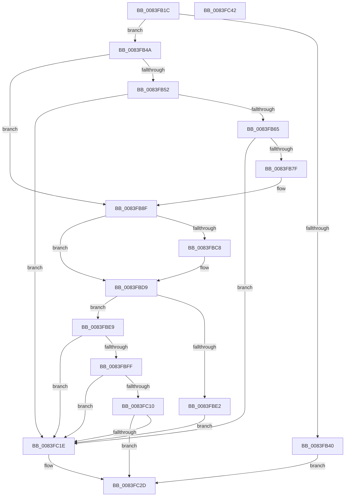

# RtlpMuiRegLoadInstalled

- RVA: `0x0083FB1C`–`0x0083FC43` (길이 `295` bytes)
- VA: `0x000000014083FB1C`
- 실행 섹션: `PAGE`
- PDB 이름 있음: `예`; PDB Function 태그: `아니요`
- unwind 정보 RVA: `0x000D25F4`
- 디코드: `85`개 명령, `295/295` bytes 표시
- 미해석 바이트: `0` (있으면 어셈블리에 `.byte`로 보존)

> 이 문서는 커널 이미지의 기계어와 PDB 기호를 분석해 생성했습니다. 4번과 5번은 함수 원형과 자료형을 바이너리 사용 방식에서 추정한 C 해석이며 원본 소스 복구 결과는 아닙니다.

## 1. Dependencies

- 직접 호출 지점: **8**; 고유 호출 대상: **7**
- 직접 호출자로 확인된 함수: **1**
- RIP 상대 이미지 참조: **1**

### Outgoing calls
- `0x0083FB56` → [ZwQueryInstallUILanguage](../../text/6A/ZwQueryInstallUILanguage_function_006AFC70.md) (function, `0x006AFC70`)
- `0x0083FB8A` → [RtlpLoadInstallLanguageFallback](RtlpLoadInstallLanguageFallback_function_0083D278.md) (function, `0x0083D278`)
- `0x0083FB97` → [RtlpMuiRegFreeRegistryInfo](RtlpMuiRegFreeRegistryInfo_function_0083DE14.md) (function, `0x0083DE14`)
- `0x0083FBBE` → [_SafeAllocBlob](../../text/6A/_SafeAllocBlob_function_006A9800.md) (function, `0x006A9800`)
- `0x0083FBF1` → [RtlpMuiRegCreateStringPool](RtlpMuiRegCreateStringPool_function_0083DD6C.md) (function, `0x0083DD6C`)
- `0x0083FC05` → [RtlpMuiRegLoadInstalledFromKey](../../text/6A/RtlpMuiRegLoadInstalledFromKey_function_006A9450.md) (function, `0x006A9450`)
- `0x0083FC13` → [RtlpMuiRegValidateInstalled](../84/RtlpMuiRegValidateInstalled_function_008404D4.md) (function, `0x008404D4`)
- `0x0083FC26` → [RtlpMuiRegFreeRegistryInfo](RtlpMuiRegFreeRegistryInfo_function_0083DE14.md) (function, `0x0083DE14`)

### Direct callers
- [RtlpMuiRegLoadRegistryInfo](RtlpMuiRegLoadRegistryInfo_function_0083EDC4.md) at `0x0083EDF9`

### Static image references
- `0x0083FB4A` → RVA `0x00FD9BB8` (`PAGEDATA`; read)

## 2. Other-region calls and transfers

- 다른 실행 섹션으로 향하는 call: **3**
  - `0x0083FB56` → [ZwQueryInstallUILanguage](../../text/6A/ZwQueryInstallUILanguage_function_006AFC70.md) (`PAGE` → `.text`)
  - `0x0083FBBE` → [_SafeAllocBlob](../../text/6A/_SafeAllocBlob_function_006A9800.md) (`PAGE` → `.text`)
  - `0x0083FC05` → [RtlpMuiRegLoadInstalledFromKey](../../text/6A/RtlpMuiRegLoadInstalledFromKey_function_006A9450.md) (`PAGE` → `.text`)
- 별도 외부 분기/꼬리 이동을 확인하지 못했습니다.

## 3. Assembly (complete function range)

```asm
0083FB1C  48 8B C4                        mov rax, rsp
0083FB1F  48 89 58 08                     mov qword ptr [rax + 8], rbx
0083FB23  48 89 68 10                     mov qword ptr [rax + 0x10], rbp
0083FB27  48 89 70 18                     mov qword ptr [rax + 0x18], rsi
0083FB2B  44 89 48 20                     mov dword ptr [rax + 0x20], r9d
0083FB2F  57                              push rdi
0083FB30  48 83 EC 30                     sub rsp, 0x30
0083FB34  33 ED                           xor ebp, ebp
0083FB36  48 8B D9                        mov rbx, rcx
0083FB39  8B FD                           mov edi, ebp
0083FB3B  48 85 C9                        test rcx, rcx
0083FB3E  75 0A                           jne 0x14083fb4a
0083FB40  B8 0D 00 00 C0                  mov eax, 0xc000000d
0083FB45  E9 E3 00 00 00                  jmp 0x14083fc2d
0083FB4A  39 2D 68 A0 79 00               cmp dword ptr [rip + 0x79a068], ebp
0083FB50  74 3D                           je 0x14083fb8f
0083FB52  48 83 C1 04                     add rcx, 4
0083FB56  E8 15 01 E7 FF                  call 0x1406afc70
0083FB5B  8B F8                           mov edi, eax
0083FB5D  85 C0                           test eax, eax
0083FB5F  0F 88 B9 00 00 00               js 0x14083fc1e
0083FB65  0F B7 4B 04                     movzx ecx, word ptr [rbx + 4]
0083FB69  B8 00 10 00 00                  mov eax, 0x1000
0083FB6E  66 2B C8                        sub cx, ax
0083FB71  B8 FF FB 00 00                  mov eax, 0xfbff
0083FB76  66 85 C8                        test ax, cx
0083FB79  0F 84 9F 00 00 00               je 0x14083fc1e
0083FB7F  4C 8D 43 08                     lea r8, [rbx + 8]
0083FB83  48 8B CB                        mov rcx, rbx
0083FB86  48 8D 53 06                     lea rdx, [rbx + 6]
0083FB8A  E8 E9 D6 FF FF                  call 0x14083d278
0083FB8F  BA FF 03 00 00                  mov edx, 0x3ff
0083FB94  48 8B CB                        mov rcx, rbx
0083FB97  E8 78 E2 FF FF                  call 0x14083de14
0083FB9C  45 33 C9                        xor r9d, r9d
0083FB9F  89 6C 24 58                     mov dword ptr [rsp + 0x58], ebp
0083FBA3  48 8D 44 24 58                  lea rax, [rsp + 0x58]
0083FBA8  48 89 44 24 28                  mov qword ptr [rsp + 0x28], rax
0083FBAD  89 6C 24 20                     mov dword ptr [rsp + 0x20], ebp
0083FBB1  41 8D 71 04                     lea esi, [r9 + 4]
0083FBB5  8B D6                           mov edx, esi
0083FBB7  8D 4E 14                        lea ecx, [rsi + 0x14]
0083FBBA  45 8D 41 1C                     lea r8d, [r9 + 0x1c]
0083FBBE  E8 3D 9C E6 FF                  call 0x1406a9800
0083FBC3  48 85 C0                        test rax, rax
0083FBC6  74 11                           je 0x14083fbd9
0083FBC8  8B 4C 24 58                     mov ecx, dword ptr [rsp + 0x58]
0083FBCC  89 08                           mov dword ptr [rax], ecx
0083FBCE  48 8D 48 18                     lea rcx, [rax + 0x18]
0083FBD2  48 89 48 10                     mov qword ptr [rax + 0x10], rcx
0083FBD6  89 70 04                        mov dword ptr [rax + 4], esi
0083FBD9  48 89 43 18                     mov qword ptr [rbx + 0x18], rax
0083FBDD  48 85 C0                        test rax, rax
0083FBE0  75 07                           jne 0x14083fbe9
0083FBE2  BF 17 00 00 C0                  mov edi, 0xc0000017
0083FBE7  EB 35                           jmp 0x14083fc1e
0083FBE9  83 0B 01                        or dword ptr [rbx], 1
0083FBEC  83 C9 FF                        or ecx, 0xffffffff
0083FBEF  8B D1                           mov edx, ecx
0083FBF1  E8 76 E1 FF FF                  call 0x14083dd6c
0083FBF6  48 89 43 20                     mov qword ptr [rbx + 0x20], rax
0083FBFA  48 85 C0                        test rax, rax
0083FBFD  74 1F                           je 0x14083fc1e
0083FBFF  83 0B 02                        or dword ptr [rbx], 2
0083FC02  48 8B CB                        mov rcx, rbx
0083FC05  E8 46 98 E6 FF                  call 0x1406a9450
0083FC0A  8B F8                           mov edi, eax
0083FC0C  85 C0                           test eax, eax
0083FC0E  78 0E                           js 0x14083fc1e
0083FC10  48 8B CB                        mov rcx, rbx
0083FC13  E8 BC 08 00 00                  call 0x1408404d4
0083FC18  8B F8                           mov edi, eax
0083FC1A  85 C0                           test eax, eax
0083FC1C  79 0F                           jns 0x14083fc2d
0083FC1E  BA FF 03 00 00                  mov edx, 0x3ff
0083FC23  48 8B CB                        mov rcx, rbx
0083FC26  E8 E9 E1 FF FF                  call 0x14083de14
0083FC2B  8B C7                           mov eax, edi
0083FC2D  48 8B 5C 24 40                  mov rbx, qword ptr [rsp + 0x40]
0083FC32  48 8B 6C 24 48                  mov rbp, qword ptr [rsp + 0x48]
0083FC37  48 8B 74 24 50                  mov rsi, qword ptr [rsp + 0x50]
0083FC3C  48 83 C4 30                     add rsp, 0x30
0083FC40  5F                              pop rdi
0083FC41  C3                              ret
0083FC42  CC                              int3
```

## 4. C-style interpretation (structured pseudocode)

```c
__int64 __fastcall RtlpMuiRegLoadInstalled(__int64 a1, __int64 a2, __int64 a3, int a4)
{
    __int64 result;
    __int64 v_rbp;
    __int64 v_rsp;
    unsigned __int64 v_stack_m10;
    unsigned int v_stack_m18;
    unsigned __int64 v_stack_p10;
    unsigned __int64 v_stack_p18;
    unsigned int v_stack_p20;
    unsigned __int64 v_stack_p8;

    *(unsigned __int64 *)(v_rsp + 8) = v_rbx;
    *(unsigned __int64 *)(v_rsp + 16) = v_rbp;
    *(unsigned __int64 *)(v_rsp + 24) = v_rsi;
    *(unsigned int *)(v_rsp + 32) = a4;
    v_rsp = (v_rsp) - (48);
    v_rbp = 0;
    if (a1 != 0) goto loc_0083FB4A;
    goto loc_0083FC2D;
loc_0083FB4A:
    if ((*(unsigned int *)(v_rip + 7970920)) == 0) goto loc_0083FB8F;
    a1 = (a1) + (4);
    result = ZwQueryInstallUILanguage(a1, a2, a3, a4);
    if (sign_flag) goto loc_0083FC1E;
    a1 = (unsigned __int16)((*(unsigned __int16 *)(a1 + 4)) - ((unsigned __int16)((unsigned int)(0x1000ULL))));
    if ((((unsigned __int16)((unsigned int)(0xFBFFULL))) & ((unsigned __int16)(a1))) == 0) goto loc_0083FC1E;
    result = RtlpLoadInstallLanguageFallback(a1, a1 + 6, a1 + 8, a4);
loc_0083FB8F:
    result = RtlpMuiRegFreeRegistryInfo(a1, (unsigned int)(0x3FFULL), a1 + 8, a4);
    a4 = 0;
    v_stack_p20 = 0;
    v_stack_m10 = v_stack_p20;
    v_stack_m18 = 0;
    result = _SafeAllocBlob(a4 + 4 + 20, (unsigned int)((unsigned int)(a4 + 4)), a4 + 28, a4);
    if (result != 0) {
        a1 = v_stack_p20;
        *(unsigned int *)(result) = (unsigned int)(a1);
        a1 = result + 24;
        *(unsigned __int64 *)(result + 16) = a1;
        *(unsigned int *)(result + 4) = (unsigned int)(a4 + 4);
    }
    *(unsigned __int64 *)(a1 + 24) = result;
    if (result != 0) goto loc_0083FBE9;
    goto loc_0083FC1E;
loc_0083FBE9:
    a1 = (unsigned int)((a1) | (0xFFFFFFFFULL));
    result = RtlpMuiRegCreateStringPool(a1, (unsigned int)((unsigned int)(a1)), a4 + 28, a4);
    *(unsigned __int64 *)(a1 + 32) = result;
    if (result == 0) goto loc_0083FC1E;
    result = RtlpMuiRegLoadInstalledFromKey(a1, (unsigned int)((unsigned int)(a1)), a4 + 28, a4);
    if (sign_flag) goto loc_0083FC1E;
    result = RtlpMuiRegValidateInstalled(a1, (unsigned int)((unsigned int)(a1)), a4 + 28, a4);
    if (sign_flag) {
        a2 = 0x3FFULL;
        a1 = a1;
        result = RtlpMuiRegFreeRegistryInfo(a1, a2, a4 + 28, a4);
        result = (unsigned int)((unsigned int)((unsigned int)(result)));
    }
    v_rsp = (v_rsp) + (48);
    return result;
}
```

## 5. (Beta) C Style

```c
int64_t RtlpMuiRegLoadInstalled(void *Arg1, int64_t Arg2, int64_t Arg3, int32_t Arg4)
{
    uint8_t *arg1 = (uint8_t *)Arg1;

    int64_t result;
    int64_t local_rbp;
    int64_t local_rsp;
    uint64_t v_stack_m10;
    uint32_t v_stack_m18;
    uint64_t v_stack_p10;
    uint64_t v_stack_p18;
    uint32_t v_stack_p20;
    uint64_t v_stack_p8;

    *(uint64_t *)(local_rsp + 0x8) = local_rbx;
    *(uint64_t *)(local_rsp + 0x10) = local_rbp;
    *(uint64_t *)(local_rsp + 0x18) = local_rsi;
    *(uint32_t *)(local_rsp + 0x20) = Arg4;
    local_rsp = (local_rsp) - (48);
    local_rbp = 0;
    if (Arg1 != NULL) goto loc_0083FB4A;
    goto loc_0083FC2D;
loc_0083FB4A:
    if ((*(uint32_t *)(v_rip + 0x79A068)) == 0) goto loc_0083FB8F;
    Arg1 = (Arg1) + (4);
    result = ZwQueryInstallUILanguage(Arg1, Arg2, Arg3, Arg4);
    if (sign_flag) goto loc_0083FC1E;
    Arg1 = (uint16_t)((*(uint16_t *)(arg1 + 0x4)) - ((uint16_t)((uint32_t)(0x1000ULL))));
    if ((((uint16_t)((uint32_t)(0xFBFFULL))) & ((uint16_t)(Arg1))) == 0) goto loc_0083FC1E;
    result = RtlpLoadInstallLanguageFallback(Arg1, Arg1 + 6, Arg1 + 8, Arg4);
loc_0083FB8F:
    result = RtlpMuiRegFreeRegistryInfo(Arg1, (uint32_t)(0x3FFULL), Arg1 + 8, Arg4);
    Arg4 = 0;
    v_stack_p20 = 0;
    v_stack_m10 = v_stack_p20;
    v_stack_m18 = 0;
    result = _SafeAllocBlob(Arg4 + 4 + 20, (uint32_t)((uint32_t)(Arg4 + 4)), Arg4 + 28, Arg4);
    if (result != 0) {
        Arg1 = v_stack_p20;
        *(uint32_t *)(result) = (uint32_t)(Arg1);
        Arg1 = result + 24;
        *(void **)(result + 0x10) = Arg1;
        *(uint32_t *)(result + 0x4) = (uint32_t)(Arg4 + 4);
    }
    *(uint64_t *)(arg1 + 0x18) = result;
    if (result != 0) goto loc_0083FBE9;
    goto loc_0083FC1E;
loc_0083FBE9:
    Arg1 = (uint32_t)((Arg1) | (0xFFFFFFFFULL));
    result = RtlpMuiRegCreateStringPool(Arg1, (uint32_t)((uint32_t)(Arg1)), Arg4 + 28, Arg4);
    *(uint64_t *)(arg1 + 0x20) = result;
    if (result == 0) goto loc_0083FC1E;
    result = RtlpMuiRegLoadInstalledFromKey(Arg1, (uint32_t)((uint32_t)(Arg1)), Arg4 + 28, Arg4);
    if (sign_flag) goto loc_0083FC1E;
    result = RtlpMuiRegValidateInstalled(Arg1, (uint32_t)((uint32_t)(Arg1)), Arg4 + 28, Arg4);
    if (sign_flag) {
        Arg2 = 0x3FFULL;
        Arg1 = Arg1;
        result = RtlpMuiRegFreeRegistryInfo(Arg1, Arg2, Arg4 + 28, Arg4);
        result = (uint32_t)((uint32_t)((uint32_t)(result)));
    }
    local_rsp = (local_rsp) + (48);
    return result;
}
```

### 관측된 메모리 오프셋

구조체 형식이 확인되지 않은 접근은 인자 기준의 오프셋으로만 기록했습니다.

| 기준 인자 | 오프셋 표현 | 폭 (bit) | 접근 |
|---|---:|---:|---|
| `Arg1` | `+ 0x0` | `32` | `R/W` |
| `Arg1` | `+ 0x4` | `16` | `R` |
| `Arg1` | `+ 0x6` | `64` | `R` |
| `Arg1` | `+ 0x8` | `64` | `R` |
| `Arg1` | `+ 0x18` | `64` | `W` |
| `Arg1` | `+ 0x20` | `64` | `W` |

## 6. Execution-region graph

[열기: 2D/3D 그래프와 함수 탐색 컨트롤 패널](../../../control-panel.html?section=page&rva=0x0083FB1C&view=graph)

- 2D 그래프는 위에서 아래로 흐르고, 3D 그래프는 빈 공간을 드래그해 회전합니다. Shift+드래그는 이동, 휠은 확대·축소, 함수 노드 선택은 대상 보고서 이동입니다.

### Static fallback


