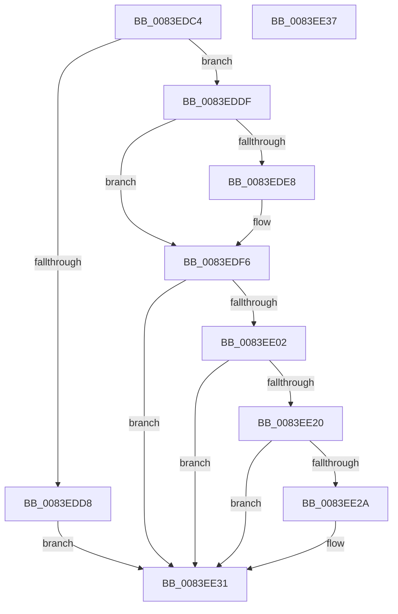

# RtlpMuiRegLoadRegistryInfo

- RVA: `0x0083EDC4`–`0x0083EE38` (길이 `116` bytes)
- VA: `0x000000014083EDC4`
- 실행 섹션: `PAGE`
- PDB 이름 있음: `예`; PDB Function 태그: `아니요`
- unwind 정보 RVA: `0x0005CF00`
- 디코드: `35`개 명령, `116/116` bytes 표시
- 미해석 바이트: `0` (있으면 어셈블리에 `.byte`로 보존)

> 이 문서는 커널 이미지의 기계어와 PDB 기호를 분석해 생성했습니다. 4번과 5번은 함수 원형과 자료형을 바이너리 사용 방식에서 추정한 C 해석이며 원본 소스 복구 결과는 아닙니다.

## 1. Dependencies

- 직접 호출 지점: **5**; 고유 호출 대상: **5**
- 직접 호출자로 확인된 함수: **1**
- RIP 상대 이미지 참조: **1**

### Outgoing calls
- `0x0083EDDF` → [RtlpMuiRegLoadLicInformation](../../text/4C/RtlpMuiRegLoadLicInformation_function_004CB26C.md) (function, `0x004CB26C`)
- `0x0083EDF1` → [DbgPrint](../../text/35/DbgPrint_function_00358CB0.md) (function, `0x00358CB0`)
- `0x0083EDF9` → [RtlpMuiRegLoadInstalled](RtlpMuiRegLoadInstalled_function_0083FB1C.md) (function, `0x0083FB1C`)
- `0x0083EE0A` → [RtlpMuiRegFreeRegistryInfo](RtlpMuiRegFreeRegistryInfo_function_0083DE14.md) (function, `0x0083DE14`)
- `0x0083EE17` → [RtlpLoadLanguageConfigList](RtlpLoadLanguageConfigList_function_0083D450.md) (function, `0x0083D450`)

### Direct callers
- [RtlpMuiRegCreateKernelRegistryInfo](../../text/6A/RtlpMuiRegCreateKernelRegistryInfo_function_006A908C.md) at `0x006A9110`

### Static image references
- `0x0083EDEA` → RVA `0x00B0E2D0` (` ?? ::NNGAKEGL::`string'`; read)

## 2. Other-region calls and transfers

- 다른 실행 섹션으로 향하는 call: **2**
  - `0x0083EDDF` → [RtlpMuiRegLoadLicInformation](../../text/4C/RtlpMuiRegLoadLicInformation_function_004CB26C.md) (`PAGE` → `.text`)
  - `0x0083EDF1` → [DbgPrint](../../text/35/DbgPrint_function_00358CB0.md) (`PAGE` → `.text`)
- 별도 외부 분기/꼬리 이동을 확인하지 못했습니다.

## 3. Assembly (complete function range)

```asm
0083EDC4  40 53                           push rbx
0083EDC6  48 83 EC 20                     sub rsp, 0x20
0083EDCA  48 83 64 24 30 00               and qword ptr [rsp + 0x30], 0
0083EDD0  48 8B D9                        mov rbx, rcx
0083EDD3  48 85 C9                        test rcx, rcx
0083EDD6  75 07                           jne 0x14083eddf
0083EDD8  B8 0D 00 00 C0                  mov eax, 0xc000000d
0083EDDD  EB 52                           jmp 0x14083ee31
0083EDDF  E8 88 C4 C8 FF                  call 0x1404cb26c
0083EDE4  85 C0                           test eax, eax
0083EDE6  79 0E                           jns 0x14083edf6
0083EDE8  8B D0                           mov edx, eax
0083EDEA  48 8D 0D DF F4 2C 00            lea rcx, [rip + 0x2cf4df]
0083EDF1  E8 BA 9E B1 FF                  call 0x140358cb0
0083EDF6  48 8B CB                        mov rcx, rbx
0083EDF9  E8 1E 0D 00 00                  call 0x14083fb1c
0083EDFE  85 C0                           test eax, eax
0083EE00  78 2F                           js 0x14083ee31
0083EE02  BA 04 00 00 00                  mov edx, 4
0083EE07  48 8B CB                        mov rcx, rbx
0083EE0A  E8 05 F0 FF FF                  call 0x14083de14
0083EE0F  4C 8B C3                        mov r8, rbx
0083EE12  48 8D 54 24 30                  lea rdx, [rsp + 0x30]
0083EE17  E8 34 E6 FF FF                  call 0x14083d450
0083EE1C  85 C0                           test eax, eax
0083EE1E  78 11                           js 0x14083ee31
0083EE20  48 8B 4C 24 30                  mov rcx, qword ptr [rsp + 0x30]
0083EE25  48 85 C9                        test rcx, rcx
0083EE28  74 07                           je 0x14083ee31
0083EE2A  83 0B 04                        or dword ptr [rbx], 4
0083EE2D  48 89 4B 28                     mov qword ptr [rbx + 0x28], rcx
0083EE31  48 83 C4 20                     add rsp, 0x20
0083EE35  5B                              pop rbx
0083EE36  C3                              ret
0083EE37  CC                              int3
```

## 4. C-style interpretation (structured pseudocode)

```c
__int64 __fastcall RtlpMuiRegLoadRegistryInfo(__int64 a1)
{
    __int64 result;
    __int64 v_rsp;
    unsigned __int64 v_stack_p8;

    v_rsp = (v_rsp) - (32);
    if (a1 != 0) goto loc_0083EDDF;
    goto loc_0083EE31;
loc_0083EDDF:
    result = RtlpMuiRegLoadLicInformation(a1, a2, a3, a4);
    if (sign_flag) {
        a2 = (unsigned int)(result);
        a1 = v_rip + 2946271;
        result = DbgPrint(a1, a2, a3, a4);
    }
    result = RtlpMuiRegLoadInstalled(a1, a2, a3, a4);
    if (sign_flag) goto loc_0083EE31;
    result = RtlpMuiRegFreeRegistryInfo(a1, 4, a3, a4);
    result = RtlpLoadLanguageConfigList(a1, v_stack_p8, a1, a4);
    if (sign_flag) goto loc_0083EE31;
    if (v_stack_p8 != 0) {
        *(unsigned __int64 *)(a1 + 40) = v_stack_p8;
    }
    v_rsp = (v_rsp) + (32);
    return result;
}
```

## 5. (Beta) C Style

```c
int64_t RtlpMuiRegLoadRegistryInfo(void *Arg1)
{
    uint8_t *arg1 = (uint8_t *)Arg1;

    int64_t result;
    int64_t local_rsp;
    uint64_t v_stack_p8;

    local_rsp = (local_rsp) - (32);
    if (Arg1 != NULL) goto loc_0083EDDF;
    goto loc_0083EE31;
loc_0083EDDF:
    result = RtlpMuiRegLoadLicInformation(Arg1, a2, a3, a4);
    if (sign_flag) {
        a2 = (uint32_t)(result);
        Arg1 = v_rip + 2946271;
        result = DbgPrint(Arg1, a2, a3, a4);
    }
    result = RtlpMuiRegLoadInstalled(Arg1, a2, a3, a4);
    if (sign_flag) goto loc_0083EE31;
    result = RtlpMuiRegFreeRegistryInfo(Arg1, 4, a3, a4);
    result = RtlpLoadLanguageConfigList(Arg1, v_stack_p8, Arg1, a4);
    if (sign_flag) goto loc_0083EE31;
    if (v_stack_p8 != 0) {
        *(uint64_t *)(arg1 + 0x28) = v_stack_p8;
    }
    local_rsp = (local_rsp) + (32);
    return result;
}
```

### 관측된 메모리 오프셋

구조체 형식이 확인되지 않은 접근은 인자 기준의 오프셋으로만 기록했습니다.

| 기준 인자 | 오프셋 표현 | 폭 (bit) | 접근 |
|---|---:|---:|---|
| `Arg1` | `+ 0x0` | `32` | `R/W` |
| `Arg1` | `+ 0x28` | `64` | `W` |

## 6. Execution-region graph

[열기: 2D/3D 그래프와 함수 탐색 컨트롤 패널](../../../control-panel.html?section=page&rva=0x0083EDC4&view=graph)

- 2D 그래프는 위에서 아래로 흐르고, 3D 그래프는 빈 공간을 드래그해 회전합니다. Shift+드래그는 이동, 휠은 확대·축소, 함수 노드 선택은 대상 보고서 이동입니다.

### Static fallback


