# RtlpMuiRegPopulateBaseLanguages

- RVA: `0x0083FC4C`–`0x0084007F` (길이 `1,075` bytes)
- VA: `0x000000014083FC4C`
- 실행 섹션: `PAGE`
- PDB 이름 있음: `예`; PDB Function 태그: `아니요`
- unwind 정보 RVA: `0x000DB4D4`
- 디코드: `274`개 명령, `1,075/1,075` bytes 표시
- 미해석 바이트: `0` (있으면 어셈블리에 `.byte`로 보존)

> 이 문서는 커널 이미지의 기계어와 PDB 기호를 분석해 생성했습니다. 4번과 5번은 함수 원형과 자료형을 바이너리 사용 방식에서 추정한 C 해석이며 원본 소스 복구 결과는 아닙니다.

## 1. Dependencies

- 직접 호출 지점: **20**; 고유 호출 대상: **12**
- 직접 호출자로 확인된 함수: **1**
- RIP 상대 이미지 참조: **3**

### Outgoing calls
- `0x0083FCA7` → [memset](../../text/6C/memset_function_006C6C40.md) (function, `0x006C6C40`)
- `0x0083FCB8` → [memset](../../text/6C/memset_function_006C6C40.md) (function, `0x006C6C40`)
- `0x0083FCC9` → [memset](../../text/6C/memset_function_006C6C40.md) (function, `0x006C6C40`)
- `0x0083FD16` → [NtQueryInstallUILanguage](../A7/NtQueryInstallUILanguage_function_00A74B30.md) (function, `0x00A74B30`)
- `0x0083FD2E` → [RtlpLoadInstallLanguageFallback](RtlpLoadInstallLanguageFallback_function_0083D278.md) (function, `0x0083D278`)
- `0x0083FDA7` → [RtlLCIDToCultureName](../AD/RtlLCIDToCultureName_function_00AD3010.md) (function, `0x00AD3010`)
- `0x0083FDD8` → [ZwQueryValueKey](../../text/6A/ZwQueryValueKey_function_006AD3B0.md) (function, `0x006AD3B0`)
- `0x0083FDF6` → [RtlpMuiRegValidateAndGetInstallFallbackBase](../84/RtlpMuiRegValidateAndGetInstallFallbackBase_function_0084042C.md) (function, `0x0084042C`)
- `0x0083FE1D` → [RtlpMuiRegAddBaseLanguage](RtlpMuiRegAddBaseLanguage_function_0083F494.md) (function, `0x0083F494`)
- `0x0083FE48` → [RtlInitUnicodeString](../../text/42/RtlInitUnicodeString_function_0042A780.md) (function, `0x0042A780`)
- `0x0083FE78` → [LdrpQueryValueKey](../79/LdrpQueryValueKey_function_007919D0.md) (function, `0x007919D0`)
- `0x0083FEAD` → [RtlCompareUnicodeStrings](../97/RtlCompareUnicodeStrings_function_009727E0.md) (function, `0x009727E0`)
- `0x0083FEBE` → [RtlInitUnicodeString](../../text/42/RtlInitUnicodeString_function_0042A780.md) (function, `0x0042A780`)
- `0x0083FEEC` → [ZwQueryValueKey](../../text/6A/ZwQueryValueKey_function_006AD3B0.md) (function, `0x006AD3B0`)
- `0x0083FF15` → [RtlpMuiRegAddBaseLanguage](RtlpMuiRegAddBaseLanguage_function_0083F494.md) (function, `0x0083F494`)
- `0x0083FF65` → [ZwEnumerateValueKey](../../text/6A/ZwEnumerateValueKey_function_006AD330.md) (function, `0x006AD330`)
- `0x0083FFD6` → [RtlCompareUnicodeStrings](../97/RtlCompareUnicodeStrings_function_009727E0.md) (function, `0x009727E0`)
- `0x00840002` → [RtlCompareUnicodeStrings](../97/RtlCompareUnicodeStrings_function_009727E0.md) (function, `0x009727E0`)
- `0x0084002B` → [RtlpMuiRegAddBaseLanguage](RtlpMuiRegAddBaseLanguage_function_0083F494.md) (function, `0x0083F494`)
- `0x00840065` → [_security_check_cookie](../../text/6A/_security_check_cookie_function_006AC640.md) (function, `0x006AC640`)

### Direct callers
- [RtlpMuiRegAddLanguageByName](RtlpMuiRegAddLanguageByName_function_0083D748.md) at `0x0083D7EF`

### Static image references
- `0x0083FC69` → RVA `0x00E0A740` (`.data`; read)
- `0x0083FD49` → RVA `0x00FD9BB8` (`PAGEDATA`; read)
- `0x0083FE3D` → RVA `0x00B0E390` (` ?? ::NNGAKEGL::`string'`; read)

## 2. Other-region calls and transfers

- 다른 실행 섹션으로 향하는 call: **9**
  - `0x0083FCA7` → [memset](../../text/6C/memset_function_006C6C40.md) (`PAGE` → `.text`)
  - `0x0083FCB8` → [memset](../../text/6C/memset_function_006C6C40.md) (`PAGE` → `.text`)
  - `0x0083FCC9` → [memset](../../text/6C/memset_function_006C6C40.md) (`PAGE` → `.text`)
  - `0x0083FDD8` → [ZwQueryValueKey](../../text/6A/ZwQueryValueKey_function_006AD3B0.md) (`PAGE` → `.text`)
  - `0x0083FE48` → [RtlInitUnicodeString](../../text/42/RtlInitUnicodeString_function_0042A780.md) (`PAGE` → `.text`)
  - `0x0083FEBE` → [RtlInitUnicodeString](../../text/42/RtlInitUnicodeString_function_0042A780.md) (`PAGE` → `.text`)
  - `0x0083FEEC` → [ZwQueryValueKey](../../text/6A/ZwQueryValueKey_function_006AD3B0.md) (`PAGE` → `.text`)
  - `0x0083FF65` → [ZwEnumerateValueKey](../../text/6A/ZwEnumerateValueKey_function_006AD330.md) (`PAGE` → `.text`)
  - `0x00840065` → [_security_check_cookie](../../text/6A/_security_check_cookie_function_006AC640.md) (`PAGE` → `.text`)
- 별도 외부 분기/꼬리 이동을 확인하지 못했습니다.

## 3. Assembly (complete function range)

```asm
0083FC4C  40 55                           push rbp
0083FC4E  53                              push rbx
0083FC4F  56                              push rsi
0083FC50  57                              push rdi
0083FC51  41 54                           push r12
0083FC53  41 55                           push r13
0083FC55  41 56                           push r14
0083FC57  41 57                           push r15
0083FC59  48 81 EC C8 04 00 00            sub rsp, 0x4c8
0083FC60  48 8D 6C 24 50                  lea rbp, [rsp + 0x50]
0083FC65  48 83 E5 E0                     and rbp, 0xffffffffffffffe0
0083FC69  48 8B 05 D0 AA 5C 00            mov rax, qword ptr [rip + 0x5caad0]
0083FC70  48 33 C4                        xor rax, rsp
0083FC73  48 89 85 60 04 00 00            mov qword ptr [rbp + 0x460], rax
0083FC7A  4D 8B E0                        mov r12, r8
0083FC7D  48 89 55 30                     mov qword ptr [rbp + 0x30], rdx
0083FC81  48 8B FA                        mov rdi, rdx
0083FC84  4C 89 4D 38                     mov qword ptr [rbp + 0x38], r9
0083FC88  48 8B D9                        mov rbx, rcx
0083FC8B  0F 57 C0                        xorps xmm0, xmm0
0083FC8E  BE AA 00 00 00                  mov esi, 0xaa
0083FC93  48 8D 4D 40                     lea rcx, [rbp + 0x40]
0083FC97  45 33 FF                        xor r15d, r15d
0083FC9A  44 8B C6                        mov r8d, esi
0083FC9D  33 D2                           xor edx, edx
0083FC9F  44 89 7D 28                     mov dword ptr [rbp + 0x28], r15d
0083FCA3  0F 11 45 18                     movups xmmword ptr [rbp + 0x18], xmm0
0083FCA7  E8 94 6F E8 FF                  call 0x1406c6c40
0083FCAC  44 8B C6                        mov r8d, esi
0083FCAF  48 8D 8D 00 03 00 00            lea rcx, [rbp + 0x300]
0083FCB6  33 D2                           xor edx, edx
0083FCB8  E8 83 6F E8 FF                  call 0x1406c6c40
0083FCBD  44 8B C6                        mov r8d, esi
0083FCC0  48 8D 8D B0 03 00 00            lea rcx, [rbp + 0x3b0]
0083FCC7  33 D2                           xor edx, edx
0083FCC9  E8 72 6F E8 FF                  call 0x1406c6c40
0083FCCE  66 44 89 7D 00                  mov word ptr [rbp], r15w
0083FCD3  45 8B EF                        mov r13d, r15d
0083FCD6  66 44 89 7D 08                  mov word ptr [rbp + 8], r15w
0083FCDB  45 8B F7                        mov r14d, r15d
0083FCDE  66 44 89 7D 0C                  mov word ptr [rbp + 0xc], r15w
0083FCE3  44 89 7D 04                     mov dword ptr [rbp + 4], r15d
0083FCE7  48 85 DB                        test rbx, rbx
0083FCEA  0F 84 66 03 00 00               je 0x140840056
0083FCF0  4D 85 E4                        test r12, r12
0083FCF3  0F 84 5D 03 00 00               je 0x140840056
0083FCF9  48 85 FF                        test rdi, rdi
0083FCFC  0F 84 54 03 00 00               je 0x140840056
0083FD02  0F B7 43 04                     movzx eax, word ptr [rbx + 4]
0083FD06  41 8B FF                        mov edi, r15d
0083FD09  44 89 7D 10                     mov dword ptr [rbp + 0x10], r15d
0083FD0D  66 85 C0                        test ax, ax
0083FD10  75 52                           jne 0x14083fd64
0083FD12  48 8D 4D 00                     lea rcx, [rbp]
0083FD16  E8 15 4E 23 00                  call 0x140a74b30
0083FD1B  85 C0                           test eax, eax
0083FD1D  0F 88 38 03 00 00               js 0x14084005b
0083FD23  4C 8D 45 0C                     lea r8, [rbp + 0xc]
0083FD27  48 8B CB                        mov rcx, rbx
0083FD2A  48 8D 55 08                     lea rdx, [rbp + 8]
0083FD2E  E8 45 D5 FF FF                  call 0x14083d278
0083FD33  85 C0                           test eax, eax
0083FD35  79 0A                           jns 0x14083fd41
0083FD37  41 0F B7 CF                     movzx ecx, r15w
0083FD3B  41 0F B7 F7                     movzx esi, r15w
0083FD3F  EB 08                           jmp 0x14083fd49
0083FD41  0F B7 4D 08                     movzx ecx, word ptr [rbp + 8]
0083FD45  0F B7 75 0C                     movzx esi, word ptr [rbp + 0xc]
0083FD49  44 39 3D 68 9E 79 00            cmp dword ptr [rip + 0x799e68], r15d
0083FD50  0F B7 45 00                     movzx eax, word ptr [rbp]
0083FD54  74 16                           je 0x14083fd6c
0083FD56  66 89 73 08                     mov word ptr [rbx + 8], si
0083FD5A  66 89 4B 06                     mov word ptr [rbx + 6], cx
0083FD5E  66 89 43 04                     mov word ptr [rbx + 4], ax
0083FD62  EB 08                           jmp 0x14083fd6c
0083FD64  0F B7 4B 06                     movzx ecx, word ptr [rbx + 6]
0083FD68  0F B7 73 08                     movzx esi, word ptr [rbx + 8]
0083FD6C  49 83 CF FF                     or r15, 0xffffffffffffffff
0083FD70  66 41 39 44 24 04               cmp word ptr [r12 + 4], ax
0083FD76  0F 85 C1 00 00 00               jne 0x14083fe3d
0083FD7C  66 85 C9                        test cx, cx
0083FD7F  0F 84 B8 00 00 00               je 0x14083fe3d
0083FD85  48 8D 85 00 03 00 00            lea rax, [rbp + 0x300]
0083FD8C  0F B7 C9                        movzx ecx, cx
0083FD8F  48 89 45 20                     mov qword ptr [rbp + 0x20], rax
0083FD93  48 8D 55 18                     lea rdx, [rbp + 0x18]
0083FD97  B8 AA 00 00 00                  mov eax, 0xaa
0083FD9C  C7 45 04 00 02 00 00            mov dword ptr [rbp + 4], 0x200
0083FDA3  66 89 45 1A                     mov word ptr [rbp + 0x1a], ax
0083FDA7  E8 64 32 29 00                  call 0x140ad3010
0083FDAC  84 C0                           test al, al
0083FDAE  0F 84 89 00 00 00               je 0x14083fe3d
0083FDB4  48 8B 4D 30                     mov rcx, qword ptr [rbp + 0x30]
0083FDB8  48 8D 45 04                     lea rax, [rbp + 4]
0083FDBC  48 89 44 24 28                  mov qword ptr [rsp + 0x28], rax
0083FDC1  4C 8D 8D 00 01 00 00            lea r9, [rbp + 0x100]
0083FDC8  45 8D 47 02                     lea r8d, [r15 + 2]
0083FDCC  C7 44 24 20 00 02 00 00         mov dword ptr [rsp + 0x20], 0x200
0083FDD4  48 8D 55 18                     lea rdx, [rbp + 0x18]
0083FDD8  E8 D3 D5 E6 FF                  call 0x1406ad3b0
0083FDDD  85 C0                           test eax, eax
0083FDDF  78 5C                           js 0x14083fe3d
0083FDE1  4C 8D 8D B0 03 00 00            lea r9, [rbp + 0x3b0]
0083FDE8  44 0F B7 C6                     movzx r8d, si
0083FDEC  48 8D 95 00 01 00 00            lea rdx, [rbp + 0x100]
0083FDF3  48 8B CB                        mov rcx, rbx
0083FDF6  E8 31 06 00 00                  call 0x14084042c
0083FDFB  33 F6                           xor esi, esi
0083FDFD  85 C0                           test eax, eax
0083FDFF  78 3C                           js 0x14083fe3d
0083FE01  48 8D 85 B0 03 00 00            lea rax, [rbp + 0x3b0]
0083FE08  45 33 C0                        xor r8d, r8d
0083FE0B  4C 8D 8D 00 01 00 00            lea r9, [rbp + 0x100]
0083FE12  48 89 44 24 20                  mov qword ptr [rsp + 0x20], rax
0083FE17  49 8B D4                        mov rdx, r12
0083FE1A  48 8B CB                        mov rcx, rbx
0083FE1D  E8 72 F6 FF FF                  call 0x14083f494
0083FE22  85 C0                           test eax, eax
0083FE24  78 17                           js 0x14083fe3d
0083FE26  8D 7E 01                        lea edi, [rsi + 1]
0083FE29  4D 8B F7                        mov r14, r15
0083FE2C  48 8D 85 00 03 00 00            lea rax, [rbp + 0x300]
0083FE33  49 FF C6                        inc r14
0083FE36  66 42 39 34 70                  cmp word ptr [rax + r14*2], si
0083FE3B  75 F6                           jne 0x14083fe33
0083FE3D  48 8D 15 4C E5 2C 00            lea rdx, [rip + 0x2ce54c]
0083FE44  48 8D 4D 18                     lea rcx, [rbp + 0x18]
0083FE48  E8 33 A9 BE FF                  call 0x14042a780
0083FE4D  48 8B 75 30                     mov rsi, qword ptr [rbp + 0x30]
0083FE51  4C 8D 4D 40                     lea r9, [rbp + 0x40]
0083FE55  B8 AA 00 00 00                  mov eax, 0xaa
0083FE5A  C7 45 0C 01 00 00 00            mov dword ptr [rbp + 0xc], 1
0083FE61  89 45 04                        mov dword ptr [rbp + 4], eax
0083FE64  4C 8D 45 0C                     lea r8, [rbp + 0xc]
0083FE68  48 8D 45 04                     lea rax, [rbp + 4]
0083FE6C  48 8B CE                        mov rcx, rsi
0083FE6F  48 8D 55 18                     lea rdx, [rbp + 0x18]
0083FE73  48 89 44 24 20                  mov qword ptr [rsp + 0x20], rax
0083FE78  E8 53 1B F5 FF                  call 0x1407919d0
0083FE7D  85 C0                           test eax, eax
0083FE7F  0F 88 AE 00 00 00               js 0x14083ff33
0083FE85  83 7D 0C 01                     cmp dword ptr [rbp + 0xc], 1
0083FE89  0F 85 A4 00 00 00               jne 0x14083ff33
0083FE8F  45 85 F6                        test r14d, r14d
0083FE92  74 22                           je 0x14083feb6
0083FE94  8B 55 04                        mov edx, dword ptr [rbp + 4]
0083FE97  4C 8D 85 00 03 00 00            lea r8, [rbp + 0x300]
0083FE9E  48 D1 EA                        shr rdx, 1
0083FEA1  48 8D 4D 40                     lea rcx, [rbp + 0x40]
0083FEA5  45 8B CE                        mov r9d, r14d
0083FEA8  C6 44 24 20 01                  mov byte ptr [rsp + 0x20], 1
0083FEAD  E8 2E 29 13 00                  call 0x1409727e0
0083FEB2  85 C0                           test eax, eax
0083FEB4  74 7D                           je 0x14083ff33
0083FEB6  48 8D 55 40                     lea rdx, [rbp + 0x40]
0083FEBA  48 8D 4D 18                     lea rcx, [rbp + 0x18]
0083FEBE  E8 BD A8 BE FF                  call 0x14042a780
0083FEC3  B9 00 02 00 00                  mov ecx, 0x200
0083FEC8  48 8D 45 04                     lea rax, [rbp + 4]
0083FECC  48 89 44 24 28                  mov qword ptr [rsp + 0x28], rax
0083FED1  4C 8D 8D 00 01 00 00            lea r9, [rbp + 0x100]
0083FED8  89 4C 24 20                     mov dword ptr [rsp + 0x20], ecx
0083FEDC  48 8D 55 18                     lea rdx, [rbp + 0x18]
0083FEE0  89 4D 04                        mov dword ptr [rbp + 4], ecx
0083FEE3  41 B8 01 00 00 00               mov r8d, 1
0083FEE9  48 8B CE                        mov rcx, rsi
0083FEEC  E8 BF D4 E6 FF                  call 0x1406ad3b0
0083FEF1  33 C9                           xor ecx, ecx
0083FEF3  85 C0                           test eax, eax
0083FEF5  78 3C                           js 0x14083ff33
0083FEF7  83 BD 04 01 00 00 07            cmp dword ptr [rbp + 0x104], 7
0083FEFE  75 33                           jne 0x14083ff33
0083FF00  48 89 4C 24 20                  mov qword ptr [rsp + 0x20], rcx
0083FF05  4C 8D 8D 00 01 00 00            lea r9, [rbp + 0x100]
0083FF0C  48 8B CB                        mov rcx, rbx
0083FF0F  44 8B C7                        mov r8d, edi
0083FF12  49 8B D4                        mov rdx, r12
0083FF15  E8 7A F5 FF FF                  call 0x14083f494
0083FF1A  33 C9                           xor ecx, ecx
0083FF1C  85 C0                           test eax, eax
0083FF1E  78 13                           js 0x14083ff33
0083FF20  FF C7                           inc edi
0083FF22  48 8D 45 40                     lea rax, [rbp + 0x40]
0083FF26  49 FF C7                        inc r15
0083FF29  66 42 39 0C 78                  cmp word ptr [rax + r15*2], cx
0083FF2E  75 F6                           jne 0x14083ff26
0083FF30  4D 8B EF                        mov r13, r15
0083FF33  8B 45 10                        mov eax, dword ptr [rbp + 0x10]
0083FF36  83 FF 04                        cmp edi, 4
0083FF39  0F 83 08 01 00 00               jae 0x140840047
0083FF3F  48 8D 4D 28                     lea rcx, [rbp + 0x28]
0083FF43  41 BF 00 02 00 00               mov r15d, 0x200
0083FF49  48 89 4C 24 28                  mov qword ptr [rsp + 0x28], rcx
0083FF4E  4C 8D 8D 00 01 00 00            lea r9, [rbp + 0x100]
0083FF55  48 8B CE                        mov rcx, rsi
0083FF58  44 89 7C 24 20                  mov dword ptr [rsp + 0x20], r15d
0083FF5D  41 B8 01 00 00 00               mov r8d, 1
0083FF63  8B D0                           mov edx, eax
0083FF65  E8 C6 D3 E6 FF                  call 0x1406ad330
0083FF6A  33 C9                           xor ecx, ecx
0083FF6C  85 C0                           test eax, eax
0083FF6E  0F 88 D3 00 00 00               js 0x140840047
0083FF74  83 BD 04 01 00 00 07            cmp dword ptr [rbp + 0x104], 7
0083FF7B  0F 85 B5 00 00 00               jne 0x140840036
0083FF81  44 39 BD 10 01 00 00            cmp dword ptr [rbp + 0x110], r15d
0083FF88  0F 87 A8 00 00 00               ja 0x140840036
0083FF8E  45 85 ED                        test r13d, r13d
0083FF91  75 05                           jne 0x14083ff98
0083FF93  45 85 F6                        test r14d, r14d
0083FF96  74 7E                           je 0x140840016
0083FF98  8B B5 10 01 00 00               mov esi, dword ptr [rbp + 0x110]
0083FF9E  48 D1 EE                        shr rsi, 1
0083FFA1  44 0F B7 BC 75 14 01 00 00      movzx r15d, word ptr [rbp + rsi*2 + 0x114]
0083FFAA  66 89 8C 75 14 01 00 00         mov word ptr [rbp + rsi*2 + 0x114], cx
0083FFB2  45 85 F6                        test r14d, r14d
0083FFB5  74 2A                           je 0x14083ffe1
0083FFB7  8B 95 10 01 00 00               mov edx, dword ptr [rbp + 0x110]
0083FFBD  4C 8D 85 00 03 00 00            lea r8, [rbp + 0x300]
0083FFC4  48 D1 EA                        shr rdx, 1
0083FFC7  48 8D 8D 14 01 00 00            lea rcx, [rbp + 0x114]
0083FFCE  45 8B CE                        mov r9d, r14d
0083FFD1  C6 44 24 20 01                  mov byte ptr [rsp + 0x20], 1
0083FFD6  E8 05 28 13 00                  call 0x1409727e0
0083FFDB  33 C9                           xor ecx, ecx
0083FFDD  85 C0                           test eax, eax
0083FFDF  74 55                           je 0x140840036
0083FFE1  45 85 ED                        test r13d, r13d
0083FFE4  74 27                           je 0x14084000d
0083FFE6  8B 95 10 01 00 00               mov edx, dword ptr [rbp + 0x110]
0083FFEC  4C 8D 45 40                     lea r8, [rbp + 0x40]
0083FFF0  48 D1 EA                        shr rdx, 1
0083FFF3  48 8D 8D 14 01 00 00            lea rcx, [rbp + 0x114]
0083FFFA  45 8B CD                        mov r9d, r13d
0083FFFD  C6 44 24 20 01                  mov byte ptr [rsp + 0x20], 1
00840002  E8 D9 27 13 00                  call 0x1409727e0
00840007  33 C9                           xor ecx, ecx
00840009  85 C0                           test eax, eax
0084000B  74 29                           je 0x140840036
0084000D  66 44 89 BC 75 14 01 00 00      mov word ptr [rbp + rsi*2 + 0x114], r15w
00840016  48 89 4C 24 20                  mov qword ptr [rsp + 0x20], rcx
0084001B  4C 8D 8D 00 01 00 00            lea r9, [rbp + 0x100]
00840022  48 8B CB                        mov rcx, rbx
00840025  44 8B C7                        mov r8d, edi
00840028  49 8B D4                        mov rdx, r12
0084002B  E8 64 F4 FF FF                  call 0x14083f494
00840030  85 C0                           test eax, eax
00840032  78 02                           js 0x140840036
00840034  FF C7                           inc edi
00840036  8B 45 10                        mov eax, dword ptr [rbp + 0x10]
00840039  48 8B 75 30                     mov rsi, qword ptr [rbp + 0x30]
0084003D  FF C0                           inc eax
0084003F  89 45 10                        mov dword ptr [rbp + 0x10], eax
00840042  E9 EF FE FF FF                  jmp 0x14083ff36
00840047  48 8B 45 38                     mov rax, qword ptr [rbp + 0x38]
0084004B  48 85 C0                        test rax, rax
0084004E  74 02                           je 0x140840052
00840050  89 38                           mov dword ptr [rax], edi
00840052  33 C0                           xor eax, eax
00840054  EB 05                           jmp 0x14084005b
00840056  B8 0D 00 00 C0                  mov eax, 0xc000000d
0084005B  48 8B 8D 60 04 00 00            mov rcx, qword ptr [rbp + 0x460]
00840062  48 33 CC                        xor rcx, rsp
00840065  E8 D6 C5 E6 FF                  call 0x1406ac640
0084006A  48 81 C4 C8 04 00 00            add rsp, 0x4c8
00840071  41 5F                           pop r15
00840073  41 5E                           pop r14
00840075  41 5D                           pop r13
00840077  41 5C                           pop r12
00840079  5F                              pop rdi
0084007A  5E                              pop rsi
0084007B  5B                              pop rbx
0084007C  5D                              pop rbp
0084007D  C3                              ret
0084007E  CC                              int3
```

## 4. C-style interpretation (structured pseudocode)

```c
__int64 __fastcall RtlpMuiRegPopulateBaseLanguages(__int64 a1, __int64 a2, __int64 a3, __int64 a4)
{
    __int64 result;
    __int64 v_r14;
    __int64 v_r15;
    __int64 v_rbp;
    __int64 v_rdi;
    __int64 v_rsi;
    __int64 v_rsp;
    unsigned __int64 v_stack_m108;
    unsigned __int64 v_stack_m1B8;
    unsigned __int64 v_stack_m3A4;
    unsigned int v_stack_m3A8;
    unsigned int v_stack_m3B4;
    unsigned __int64 v_stack_m3B8;
    unsigned __int64 v_stack_m478;
    unsigned __int64 v_stack_m480;
    unsigned __int64 v_stack_m488;
    unsigned int v_stack_m490;
    unsigned __int64 v_stack_m498;
    unsigned __int16 v_stack_m49E;
    unsigned __int64 v_stack_m4A0;
    unsigned int v_stack_m4A8;
    unsigned __int16 v_stack_m4AC;
    unsigned __int16 v_stack_m4B0;
    unsigned int v_stack_m4B4;
    unsigned __int64 v_stack_m4B8;
    unsigned __int64 v_stack_m4E0;
    unsigned int v_stack_m4E8;
    unsigned __int64 v_stack_m58;

    v_rsp = (v_rsp) - (0x4C8ULL);
    v_rbp = (v_stack_m4B8) & (-32);
    result = (*(unsigned __int64 *)(v_rip + 6073040)) ^ (v_rsp);
    v_stack_m58 = result;
    v_stack_m488 = a2;
    v_stack_m480 = a4;
    v_r15 = 0;
    a2 = 0;
    v_stack_m490 = 0;
    v_stack_m4A0 = v_xmm0;
    result = memset(v_stack_m478, a2, 170, a4);
    a2 = 0;
    result = memset(v_stack_m1B8, a2, 170, a4);
    a2 = 0;
    result = memset(v_stack_m108, a2, 170, a4);
    v_stack_m4B8 = 0;
    v_stack_m4B0 = 0;
    v_stack_m4AC = 0;
    v_stack_m4B4 = 0;
    if (a1 == 0) goto loc_00840056;
    if (a3 == 0) goto loc_00840056;
    if (0 == 0) goto loc_00840056;
    v_stack_m4A8 = 0;
    if ((unsigned __int16)(*(unsigned __int16 *)(a1 + 4)) != 0) goto loc_0083FD64;
    result = NtQueryInstallUILanguage(v_stack_m4B8, a2, 170, a4);
    if (sign_flag) goto loc_0084005B;
    result = RtlpLoadInstallLanguageFallback(a1, v_stack_m4B0, v_stack_m4AC, a4);
    if (!sign_flag) goto loc_0083FD41;
    goto loc_0083FD49;
loc_0083FD41:
loc_0083FD49:
    if ((*(unsigned int *)(v_rip + 7970408)) == 0) goto loc_0083FD6C;
    *(unsigned __int16 *)(a1 + 8) = (unsigned __int16)(v_stack_m4AC);
    *(unsigned __int16 *)(a1 + 6) = (unsigned __int16)(v_stack_m4B0);
    *(unsigned __int16 *)(a1 + 4) = (unsigned __int16)(v_stack_m4B8);
    goto loc_0083FD6C;
loc_0083FD64:
loc_0083FD6C:
    v_r15 = (v_r15) | (-1);
    if ((*(unsigned __int16 *)(a3 + 4)) != ((unsigned __int16)(v_stack_m4B8))) goto loc_0083FE3D;
    if ((unsigned __int16)(*(unsigned __int16 *)(a1 + 6)) == 0) goto loc_0083FE3D;
    v_stack_m498 = v_stack_m1B8;
    v_stack_m4B4 = 512;
    v_stack_m49E = 170;
    result = RtlLCIDToCultureName((unsigned __int16)(*(unsigned __int16 *)(a1 + 6)), v_stack_m4A0, v_stack_m4AC, a4);
    if ((unsigned __int8)(result) == 0) goto loc_0083FE3D;
    v_stack_m4E0 = v_stack_m4B4;
    v_stack_m4E8 = 512;
    result = ZwQueryValueKey(v_stack_m488, v_stack_m4A0, v_r15 + 2, v_stack_m3B8);
    if (sign_flag) goto loc_0083FE3D;
    result = RtlpMuiRegValidateAndGetInstallFallbackBase(a1, v_stack_m3B8, (unsigned __int16)(*(unsigned __int16 *)(a1 + 8)), v_stack_m108);
    v_rsi = 0;
    if (sign_flag) goto loc_0083FE3D;
    a3 = 0;
    v_stack_m4E8 = v_stack_m108;
    result = RtlpMuiRegAddBaseLanguage(a1, 0, a3, v_stack_m3B8);
    if (sign_flag) goto loc_0083FE3D;
loc_0083FE33:
    v_r14 = (v_r15) + 1;
    if ((*(unsigned __int16 *)(v_stack_m1B8 + v_r14 * 2)) != 0) goto loc_0083FE33;
loc_0083FE3D:
    result = RtlInitUnicodeString(v_stack_m4A0, v_rip + 2942284, a3, v_stack_m3B8);
    v_stack_m4AC = 1;
    v_stack_m4B4 = 170;
    v_stack_m4E8 = v_stack_m4B4;
    result = LdrpQueryValueKey(v_stack_m488, v_stack_m4A0, v_stack_m4AC, v_stack_m478);
    if (sign_flag) goto loc_0083FF33;
    if (v_stack_m4AC != 1) goto loc_0083FF33;
    if ((unsigned int)(v_r14) == 0) goto loc_0083FEB6;
    a2 = ((unsigned int)(v_stack_m4B4)) >> (1);
    v_stack_m4E8 = 1;
    result = RtlCompareUnicodeStrings(v_stack_m478, a2, v_stack_m1B8, (unsigned int)((unsigned int)(v_r14)));
    if ((unsigned int)(result) == 0) goto loc_0083FF33;
loc_0083FEB6:
    result = RtlInitUnicodeString(v_stack_m4A0, v_stack_m478, v_stack_m1B8, (unsigned int)((unsigned int)(v_r14)));
    v_stack_m4E0 = v_stack_m4B4;
    v_stack_m4E8 = 512;
    v_stack_m4B4 = 512;
    result = ZwQueryValueKey(v_stack_m488, v_stack_m4A0, 1, v_stack_m3B8);
    a1 = 0;
    if (sign_flag) goto loc_0083FF33;
    if (v_stack_m3B4 != 7) goto loc_0083FF33;
    v_stack_m4E8 = 0;
    result = RtlpMuiRegAddBaseLanguage(0, 0, (unsigned int)((unsigned int)(v_rsi + 1)), v_stack_m3B8);
    a1 = 0;
    if (sign_flag) goto loc_0083FF33;
    v_rdi = (unsigned int)((v_rsi + 1) + 1);
loc_0083FF26:
    v_r15 = (v_r15) + 1;
    if ((*(unsigned __int16 *)(v_stack_m478 + v_r15 * 2)) != 0) goto loc_0083FF26;
loc_0083FF33:
loc_0083FF36:
    if (((unsigned int)(v_rdi)) >= 4) goto loc_00840047;
    v_stack_m4E0 = v_stack_m490;
    v_stack_m4E8 = 512;
    result = ZwEnumerateValueKey(v_stack_m488, (unsigned int)((unsigned int)((unsigned int)(v_stack_m4A8))), 1, v_stack_m3B8);
    a1 = 0;
    if (sign_flag) goto loc_00840047;
    if (v_stack_m3B4 != 7) goto loc_00840036;
    if (v_stack_m3A8 > 512) goto loc_00840036;
    if ((unsigned int)(v_r15) != 0) goto loc_0083FF98;
    if ((unsigned int)(v_r14) == 0) goto loc_00840016;
loc_0083FF98:
    v_rsi = ((unsigned int)(v_stack_m3A8)) >> (1);
    *(unsigned __int16 *)(v_rbp + v_rsi * 2 + 276) = 0;
    if ((unsigned int)(v_r14) == 0) goto loc_0083FFE1;
    a2 = ((unsigned int)(v_stack_m3A8)) >> (1);
    v_stack_m4E8 = 1;
    result = RtlCompareUnicodeStrings(v_stack_m3A4, a2, v_stack_m1B8, (unsigned int)((unsigned int)(v_r14)));
    a1 = 0;
    if ((unsigned int)(result) == 0) goto loc_00840036;
loc_0083FFE1:
    if ((unsigned int)(v_r15) == 0) goto loc_0084000D;
    a2 = ((unsigned int)(v_stack_m3A8)) >> (1);
    v_stack_m4E8 = 1;
    result = RtlCompareUnicodeStrings(v_stack_m3A4, a2, v_stack_m478, (unsigned int)((unsigned int)(v_r15)));
    a1 = 0;
    if ((unsigned int)(result) == 0) goto loc_00840036;
loc_0084000D:
    *(unsigned __int16 *)(v_rbp + v_rsi * 2 + 276) = (unsigned __int16)(*(unsigned __int16 *)(v_rbp + v_rsi * 2 + 276));
loc_00840016:
    v_stack_m4E8 = 0;
    result = RtlpMuiRegAddBaseLanguage(0, 0, (unsigned int)((unsigned int)(v_rdi)), v_stack_m3B8);
    if (!(sign_flag)) {
        v_rdi = (unsigned int)((v_rdi) + 1);
    }
    result = (unsigned int)(((unsigned int)(v_stack_m4A8)) + 1);
    v_stack_m4A8 = (unsigned int)(result);
    goto loc_0083FF36;
loc_00840047:
    if (v_stack_m480 != 0) {
        *(unsigned int *)(v_stack_m480) = (unsigned int)(v_rdi);
    }
    result = 0;
    goto loc_0084005B;
loc_00840056:
loc_0084005B:
    a1 = (v_stack_m58) ^ (v_rsp);
    result = _security_check_cookie(a1, 0, (unsigned int)((unsigned int)(v_rdi)), v_stack_m3B8);
    v_rsp = (v_rsp) + (0x4C8ULL);
    return result;
}
```

## 5. (Beta) C Style

```c
int64_t RtlpMuiRegPopulateBaseLanguages(int64_t Arg1, int64_t Arg2, int64_t Arg3, int64_t Arg4)
{
    int64_t result;
    int64_t local_r14;
    int64_t local_r15;
    int64_t local_rbp;
    int64_t local_rdi;
    int64_t local_rsi;
    int64_t local_rsp;
    uint64_t v_stack_m108;
    uint64_t v_stack_m1B8;
    uint64_t v_stack_m3A4;
    uint32_t v_stack_m3A8;
    uint32_t v_stack_m3B4;
    uint64_t v_stack_m3B8;
    uint64_t v_stack_m478;
    uint64_t v_stack_m480;
    uint64_t v_stack_m488;
    uint32_t v_stack_m490;
    uint64_t v_stack_m498;
    uint16_t v_stack_m49E;
    uint64_t v_stack_m4A0;
    uint32_t v_stack_m4A8;
    uint16_t v_stack_m4AC;
    uint16_t v_stack_m4B0;
    uint32_t v_stack_m4B4;
    uint64_t v_stack_m4B8;
    uint64_t v_stack_m4E0;
    uint32_t v_stack_m4E8;
    uint64_t v_stack_m58;

    local_rsp = (local_rsp) - (0x4C8ULL);
    local_rbp = (v_stack_m4B8) & (-32);
    result = (*(uint64_t *)(v_rip + 0x5CAAD0)) ^ (local_rsp);
    v_stack_m58 = result;
    v_stack_m488 = Arg2;
    v_stack_m480 = Arg4;
    local_r15 = 0;
    Arg2 = 0;
    v_stack_m490 = 0;
    v_stack_m4A0 = v_xmm0;
    result = memset(v_stack_m478, Arg2, 170, Arg4);
    Arg2 = 0;
    result = memset(v_stack_m1B8, Arg2, 170, Arg4);
    Arg2 = 0;
    result = memset(v_stack_m108, Arg2, 170, Arg4);
    v_stack_m4B8 = 0;
    v_stack_m4B0 = 0;
    v_stack_m4AC = 0;
    v_stack_m4B4 = 0;
    if (Arg1 == 0) goto loc_00840056;
    if (Arg3 == 0) goto loc_00840056;
    if (0 == 0) goto loc_00840056;
    v_stack_m4A8 = 0;
    if ((uint16_t)(*(uint16_t *)(Arg1 + 0x4)) != 0) goto loc_0083FD64;
    result = NtQueryInstallUILanguage(v_stack_m4B8, Arg2, 170, Arg4);
    if (sign_flag) goto loc_0084005B;
    result = RtlpLoadInstallLanguageFallback(Arg1, v_stack_m4B0, v_stack_m4AC, Arg4);
    if (!sign_flag) goto loc_0083FD41;
    goto loc_0083FD49;
loc_0083FD41:
loc_0083FD49:
    if ((*(uint32_t *)(v_rip + 0x799E68)) == 0) goto loc_0083FD6C;
    *(uint16_t *)(Arg1 + 0x8) = (uint16_t)(v_stack_m4AC);
    *(uint16_t *)(Arg1 + 0x6) = (uint16_t)(v_stack_m4B0);
    *(uint16_t *)(Arg1 + 0x4) = (uint16_t)(v_stack_m4B8);
    goto loc_0083FD6C;
loc_0083FD64:
loc_0083FD6C:
    local_r15 = (local_r15) | (-1);
    if ((*(uint16_t *)(Arg3 + 0x4)) != ((uint16_t)(v_stack_m4B8))) goto loc_0083FE3D;
    if ((uint16_t)(*(uint16_t *)(Arg1 + 0x6)) == 0) goto loc_0083FE3D;
    v_stack_m498 = v_stack_m1B8;
    v_stack_m4B4 = 512;
    v_stack_m49E = 170;
    result = RtlLCIDToCultureName((uint16_t)(*(uint16_t *)(Arg1 + 0x6)), v_stack_m4A0, v_stack_m4AC, Arg4);
    if ((uint8_t)(result) == 0) goto loc_0083FE3D;
    v_stack_m4E0 = v_stack_m4B4;
    v_stack_m4E8 = 512;
    result = ZwQueryValueKey(v_stack_m488, v_stack_m4A0, local_r15 + 2, v_stack_m3B8);
    if (sign_flag) goto loc_0083FE3D;
    result = RtlpMuiRegValidateAndGetInstallFallbackBase(Arg1, v_stack_m3B8, (uint16_t)(*(uint16_t *)(Arg1 + 0x8)), v_stack_m108);
    local_rsi = 0;
    if (sign_flag) goto loc_0083FE3D;
    Arg3 = 0;
    v_stack_m4E8 = v_stack_m108;
    result = RtlpMuiRegAddBaseLanguage(Arg1, 0, Arg3, v_stack_m3B8);
    if (sign_flag) goto loc_0083FE3D;
loc_0083FE33:
    local_r14 = (local_r15) + 1;
    if ((*(uint16_t *)(v_stack_m1B8 + local_r14 * 2)) != 0) goto loc_0083FE33;
loc_0083FE3D:
    result = RtlInitUnicodeString(v_stack_m4A0, v_rip + 2942284, Arg3, v_stack_m3B8);
    v_stack_m4AC = 1;
    v_stack_m4B4 = 170;
    v_stack_m4E8 = v_stack_m4B4;
    result = LdrpQueryValueKey(v_stack_m488, v_stack_m4A0, v_stack_m4AC, v_stack_m478);
    if (sign_flag) goto loc_0083FF33;
    if (v_stack_m4AC != 1) goto loc_0083FF33;
    if ((uint32_t)(local_r14) == 0) goto loc_0083FEB6;
    Arg2 = ((uint32_t)(v_stack_m4B4)) >> (1);
    v_stack_m4E8 = 1;
    result = RtlCompareUnicodeStrings(v_stack_m478, Arg2, v_stack_m1B8, (uint32_t)((uint32_t)(local_r14)));
    if ((uint32_t)(result) == 0) goto loc_0083FF33;
loc_0083FEB6:
    result = RtlInitUnicodeString(v_stack_m4A0, v_stack_m478, v_stack_m1B8, (uint32_t)((uint32_t)(local_r14)));
    v_stack_m4E0 = v_stack_m4B4;
    v_stack_m4E8 = 512;
    v_stack_m4B4 = 512;
    result = ZwQueryValueKey(v_stack_m488, v_stack_m4A0, 1, v_stack_m3B8);
    Arg1 = 0;
    if (sign_flag) goto loc_0083FF33;
    if (v_stack_m3B4 != 7) goto loc_0083FF33;
    v_stack_m4E8 = 0;
    result = RtlpMuiRegAddBaseLanguage(0, 0, (uint32_t)((uint32_t)(local_rsi + 1)), v_stack_m3B8);
    Arg1 = 0;
    if (sign_flag) goto loc_0083FF33;
    local_rdi = (uint32_t)((local_rsi + 1) + 1);
loc_0083FF26:
    local_r15 = (local_r15) + 1;
    if ((*(uint16_t *)(v_stack_m478 + local_r15 * 2)) != 0) goto loc_0083FF26;
loc_0083FF33:
loc_0083FF36:
    if (((uint32_t)(local_rdi)) >= 4) goto loc_00840047;
    v_stack_m4E0 = v_stack_m490;
    v_stack_m4E8 = 512;
    result = ZwEnumerateValueKey(v_stack_m488, (uint32_t)((uint32_t)((uint32_t)(v_stack_m4A8))), 1, v_stack_m3B8);
    Arg1 = 0;
    if (sign_flag) goto loc_00840047;
    if (v_stack_m3B4 != 7) goto loc_00840036;
    if (v_stack_m3A8 > 512) goto loc_00840036;
    if ((uint32_t)(local_r15) != 0) goto loc_0083FF98;
    if ((uint32_t)(local_r14) == 0) goto loc_00840016;
loc_0083FF98:
    local_rsi = ((uint32_t)(v_stack_m3A8)) >> (1);
    *(uint16_t *)(local_rbp + local_rsi * 2 + 0x114) = 0;
    if ((uint32_t)(local_r14) == 0) goto loc_0083FFE1;
    Arg2 = ((uint32_t)(v_stack_m3A8)) >> (1);
    v_stack_m4E8 = 1;
    result = RtlCompareUnicodeStrings(v_stack_m3A4, Arg2, v_stack_m1B8, (uint32_t)((uint32_t)(local_r14)));
    Arg1 = 0;
    if ((uint32_t)(result) == 0) goto loc_00840036;
loc_0083FFE1:
    if ((uint32_t)(local_r15) == 0) goto loc_0084000D;
    Arg2 = ((uint32_t)(v_stack_m3A8)) >> (1);
    v_stack_m4E8 = 1;
    result = RtlCompareUnicodeStrings(v_stack_m3A4, Arg2, v_stack_m478, (uint32_t)((uint32_t)(local_r15)));
    Arg1 = 0;
    if ((uint32_t)(result) == 0) goto loc_00840036;
loc_0084000D:
    *(uint16_t *)(local_rbp + local_rsi * 2 + 0x114) = (uint16_t)(*(uint16_t *)(local_rbp + local_rsi * 2 + 0x114));
loc_00840016:
    v_stack_m4E8 = 0;
    result = RtlpMuiRegAddBaseLanguage(0, 0, (uint32_t)((uint32_t)(local_rdi)), v_stack_m3B8);
    if (!(sign_flag)) {
        local_rdi = (uint32_t)((local_rdi) + 1);
    }
    result = (uint32_t)(((uint32_t)(v_stack_m4A8)) + 1);
    v_stack_m4A8 = (uint32_t)(result);
    goto loc_0083FF36;
loc_00840047:
    if (v_stack_m480 != 0) {
        *(uint32_t *)(v_stack_m480) = (uint32_t)(local_rdi);
    }
    result = 0;
    goto loc_0084005B;
loc_00840056:
loc_0084005B:
    Arg1 = (v_stack_m58) ^ (local_rsp);
    result = _security_check_cookie(Arg1, 0, (uint32_t)((uint32_t)(local_rdi)), v_stack_m3B8);
    local_rsp = (local_rsp) + (0x4C8ULL);
    return result;
}
```

## 6. Execution-region graph

[열기: 2D/3D 그래프와 함수 탐색 컨트롤 패널](../../../control-panel.html?section=page&rva=0x0083FC4C&view=graph)

- 2D 그래프는 위에서 아래로 흐르고, 3D 그래프는 빈 공간을 드래그해 회전합니다. Shift+드래그는 이동, 휠은 확대·축소, 함수 노드 선택은 대상 보고서 이동입니다.

### Static fallback

```mermaid
flowchart TD
  bb_0083FC4C[BB_0083FC4C]
  bb_0083FCF0[BB_0083FCF0]
  bb_0083FCF9[BB_0083FCF9]
  bb_0083FD02[BB_0083FD02]
  bb_0083FD12[BB_0083FD12]
  bb_0083FD23[BB_0083FD23]
  bb_0083FD37[BB_0083FD37]
  bb_0083FD41[BB_0083FD41]
  bb_0083FD49[BB_0083FD49]
  bb_0083FD56[BB_0083FD56]
  bb_0083FD64[BB_0083FD64]
  bb_0083FD6C[BB_0083FD6C]
  bb_0083FD7C[BB_0083FD7C]
  bb_0083FD85[BB_0083FD85]
  bb_0083FDB4[BB_0083FDB4]
  bb_0083FDE1[BB_0083FDE1]
  bb_0083FE01[BB_0083FE01]
  bb_0083FE26[BB_0083FE26]
  bb_0083FE33[BB_0083FE33]
  bb_0083FE3D[BB_0083FE3D]
  bb_0083FE85[BB_0083FE85]
  bb_0083FE8F[BB_0083FE8F]
  bb_0083FE94[BB_0083FE94]
  bb_0083FEB6[BB_0083FEB6]
  bb_0083FEF7[BB_0083FEF7]
  bb_0083FF00[BB_0083FF00]
  bb_0083FF20[BB_0083FF20]
  bb_0083FF26[BB_0083FF26]
  bb_0083FF30[BB_0083FF30]
  bb_0083FF33[BB_0083FF33]
  bb_0083FF36[BB_0083FF36]
  bb_0083FF3F[BB_0083FF3F]
  bb_0083FF74[BB_0083FF74]
  bb_0083FF81[BB_0083FF81]
  bb_0083FF8E[BB_0083FF8E]
  bb_0083FF93[BB_0083FF93]
  bb_0083FF98[BB_0083FF98]
  bb_0083FFB7[BB_0083FFB7]
  bb_0083FFE1[BB_0083FFE1]
  bb_0083FFE6[BB_0083FFE6]
  bb_0084000D[BB_0084000D]
  bb_00840016[BB_00840016]
  bb_00840034[BB_00840034]
  bb_00840036[BB_00840036]
  bb_00840047[BB_00840047]
  bb_00840050[BB_00840050]
  bb_00840052[BB_00840052]
  bb_00840056[BB_00840056]
  bb_0084005B[BB_0084005B]
  bb_0084007E[BB_0084007E]
  bb_0083FC4C -->|branch| bb_00840056
  bb_0083FC4C -->|fallthrough| bb_0083FCF0
  bb_0083FCF0 -->|branch| bb_00840056
  bb_0083FCF0 -->|fallthrough| bb_0083FCF9
  bb_0083FCF9 -->|branch| bb_00840056
  bb_0083FCF9 -->|fallthrough| bb_0083FD02
  bb_0083FD02 -->|branch| bb_0083FD64
  bb_0083FD02 -->|fallthrough| bb_0083FD12
  bb_0083FD12 -->|branch| bb_0084005B
  bb_0083FD12 -->|fallthrough| bb_0083FD23
  bb_0083FD23 -->|branch| bb_0083FD41
  bb_0083FD23 -->|fallthrough| bb_0083FD37
  bb_0083FD37 -->|branch| bb_0083FD49
  bb_0083FD41 -->|flow| bb_0083FD49
  bb_0083FD49 -->|branch| bb_0083FD6C
  bb_0083FD49 -->|fallthrough| bb_0083FD56
  bb_0083FD56 -->|branch| bb_0083FD6C
  bb_0083FD64 -->|flow| bb_0083FD6C
  bb_0083FD6C -->|branch| bb_0083FE3D
  bb_0083FD6C -->|fallthrough| bb_0083FD7C
  bb_0083FD7C -->|branch| bb_0083FE3D
  bb_0083FD7C -->|fallthrough| bb_0083FD85
  bb_0083FD85 -->|branch| bb_0083FE3D
  bb_0083FD85 -->|fallthrough| bb_0083FDB4
  bb_0083FDB4 -->|branch| bb_0083FE3D
  bb_0083FDB4 -->|fallthrough| bb_0083FDE1
  bb_0083FDE1 -->|branch| bb_0083FE3D
  bb_0083FDE1 -->|fallthrough| bb_0083FE01
  bb_0083FE01 -->|branch| bb_0083FE3D
  bb_0083FE01 -->|fallthrough| bb_0083FE26
  bb_0083FE26 -->|flow| bb_0083FE33
  bb_0083FE33 -->|branch| bb_0083FE33
  bb_0083FE33 -->|fallthrough| bb_0083FE3D
  bb_0083FE3D -->|branch| bb_0083FF33
  bb_0083FE3D -->|fallthrough| bb_0083FE85
  bb_0083FE85 -->|branch| bb_0083FF33
  bb_0083FE85 -->|fallthrough| bb_0083FE8F
  bb_0083FE8F -->|branch| bb_0083FEB6
  bb_0083FE8F -->|fallthrough| bb_0083FE94
  bb_0083FE94 -->|branch| bb_0083FF33
  bb_0083FE94 -->|fallthrough| bb_0083FEB6
  bb_0083FEB6 -->|branch| bb_0083FF33
  bb_0083FEB6 -->|fallthrough| bb_0083FEF7
  bb_0083FEF7 -->|branch| bb_0083FF33
  bb_0083FEF7 -->|fallthrough| bb_0083FF00
  bb_0083FF00 -->|branch| bb_0083FF33
  bb_0083FF00 -->|fallthrough| bb_0083FF20
  bb_0083FF20 -->|flow| bb_0083FF26
  bb_0083FF26 -->|branch| bb_0083FF26
  bb_0083FF26 -->|fallthrough| bb_0083FF30
  bb_0083FF30 -->|flow| bb_0083FF33
  bb_0083FF33 -->|flow| bb_0083FF36
  bb_0083FF36 -->|branch| bb_00840047
  bb_0083FF36 -->|fallthrough| bb_0083FF3F
  bb_0083FF3F -->|branch| bb_00840047
  bb_0083FF3F -->|fallthrough| bb_0083FF74
  bb_0083FF74 -->|branch| bb_00840036
  bb_0083FF74 -->|fallthrough| bb_0083FF81
  bb_0083FF81 -->|branch| bb_00840036
  bb_0083FF81 -->|fallthrough| bb_0083FF8E
  bb_0083FF8E -->|branch| bb_0083FF98
  bb_0083FF8E -->|fallthrough| bb_0083FF93
  bb_0083FF93 -->|branch| bb_00840016
  bb_0083FF93 -->|fallthrough| bb_0083FF98
  bb_0083FF98 -->|branch| bb_0083FFE1
  bb_0083FF98 -->|fallthrough| bb_0083FFB7
  bb_0083FFB7 -->|branch| bb_00840036
  bb_0083FFB7 -->|fallthrough| bb_0083FFE1
  bb_0083FFE1 -->|branch| bb_0084000D
  bb_0083FFE1 -->|fallthrough| bb_0083FFE6
  bb_0083FFE6 -->|branch| bb_00840036
  bb_0083FFE6 -->|fallthrough| bb_0084000D
  bb_0084000D -->|flow| bb_00840016
  bb_00840016 -->|branch| bb_00840036
  bb_00840016 -->|fallthrough| bb_00840034
  bb_00840034 -->|flow| bb_00840036
  bb_00840036 -->|branch| bb_0083FF36
  bb_00840047 -->|branch| bb_00840052
  bb_00840047 -->|fallthrough| bb_00840050
  bb_00840050 -->|flow| bb_00840052
  bb_00840052 -->|branch| bb_0084005B
  bb_00840056 -->|flow| bb_0084005B
```


