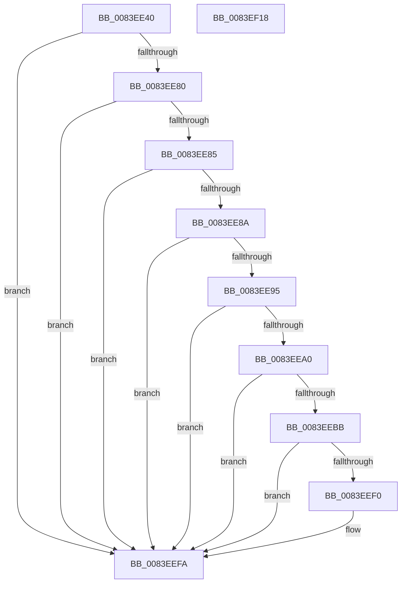

# RtlpMuiRegResizeStringPool

- RVA: `0x0083EE40`–`0x0083EF19` (길이 `217` bytes)
- VA: `0x000000014083EE40`
- 실행 섹션: `PAGE`
- PDB 이름 있음: `예`; PDB Function 태그: `아니요`
- unwind 정보 RVA: `0x0005E6B4`
- 디코드: `65`개 명령, `217/217` bytes 표시
- 미해석 바이트: `0` (있으면 어셈블리에 `.byte`로 보존)

> 이 문서는 커널 이미지의 기계어와 PDB 기호를 분석해 생성했습니다. 4번과 5번은 함수 원형과 자료형을 바이너리 사용 방식에서 추정한 C 해석이며 원본 소스 복구 결과는 아닙니다.

## 1. Dependencies

- 직접 호출 지점: **4**; 고유 호출 대상: **3**
- 직접 호출자로 확인된 함수: **1**
- RIP 상대 이미지 참조: **0**

### Outgoing calls
- `0x0083EEAE` → [RtlpMuiRegCreateStringPool](RtlpMuiRegCreateStringPool_function_0083DD6C.md) (function, `0x0083DD6C`)
- `0x0083EEC6` → [memcpy](../../text/6C/memcpy_function_006C6840.md) (function, `0x006C6840`)
- `0x0083EED6` → [memcpy](../../text/6C/memcpy_function_006C6840.md) (function, `0x006C6840`)
- `0x0083EEF5` → [ExFreePoolWithTag](../../poolcode/B8/ExFreePoolWithTag_function_00B82870.md) (function, `0x00B82870`)

### Direct callers
- [RtlpMuiRegGetOrAddString](RtlpMuiRegGetOrAddString_function_0083E830.md) at `0x0083E90B`

### Static image references
- 디코드된 RIP-relative 메모리 참조가 없습니다.

## 2. Other-region calls and transfers

- 다른 실행 섹션으로 향하는 call: **3**
  - `0x0083EEC6` → [memcpy](../../text/6C/memcpy_function_006C6840.md) (`PAGE` → `.text`)
  - `0x0083EED6` → [memcpy](../../text/6C/memcpy_function_006C6840.md) (`PAGE` → `.text`)
  - `0x0083EEF5` → [ExFreePoolWithTag](../../poolcode/B8/ExFreePoolWithTag_function_00B82870.md) (`PAGE` → `POOLCODE`)
- 별도 외부 분기/꼬리 이동을 확인하지 못했습니다.

## 3. Assembly (complete function range)

```asm
0083EE40  48 8B C4                        mov rax, rsp
0083EE43  48 89 58 08                     mov qword ptr [rax + 8], rbx
0083EE47  48 89 68 10                     mov qword ptr [rax + 0x10], rbp
0083EE4B  48 89 70 18                     mov qword ptr [rax + 0x18], rsi
0083EE4F  48 89 78 20                     mov qword ptr [rax + 0x20], rdi
0083EE53  41 56                           push r14
0083EE55  48 83 EC 20                     sub rsp, 0x20
0083EE59  33 FF                           xor edi, edi
0083EE5B  48 8B D9                        mov rbx, rcx
0083EE5E  66 B9 01 00                     mov cx, 1
0083EE62  45 8A F1                        mov r14b, r9b
0083EE65  66 3B D1                        cmp dx, cx
0083EE68  8D 47 04                        lea eax, [rdi + 4]
0083EE6B  66 0F 4D C2                     cmovge ax, dx
0083EE6F  66 44 3B C1                     cmp r8w, cx
0083EE73  8D 57 28                        lea edx, [rdi + 0x28]
0083EE76  66 41 0F 4D D0                  cmovge dx, r8w
0083EE7B  48 85 DB                        test rbx, rbx
0083EE7E  74 7A                           je 0x14083eefa
0083EE80  66 3B C1                        cmp ax, cx
0083EE83  7C 75                           jl 0x14083eefa
0083EE85  66 3B D1                        cmp dx, cx
0083EE88  7C 70                           jl 0x14083eefa
0083EE8A  0F BF C8                        movsx ecx, ax
0083EE8D  0F B7 43 06                     movzx eax, word ptr [rbx + 6]
0083EE91  3B C8                           cmp ecx, eax
0083EE93  7C 65                           jl 0x14083eefa
0083EE95  0F B7 43 0A                     movzx eax, word ptr [rbx + 0xa]
0083EE99  0F BF D2                        movsx edx, dx
0083EE9C  3B D0                           cmp edx, eax
0083EE9E  7C 5A                           jl 0x14083eefa
0083EEA0  0F B7 73 04                     movzx esi, word ptr [rbx + 4]
0083EEA4  0F B7 6B 08                     movzx ebp, word ptr [rbx + 8]
0083EEA8  48 03 F6                        add rsi, rsi
0083EEAB  48 03 ED                        add rbp, rbp
0083EEAE  E8 B9 EE FF FF                  call 0x14083dd6c
0083EEB3  48 8B F8                        mov rdi, rax
0083EEB6  48 85 C0                        test rax, rax
0083EEB9  74 3F                           je 0x14083eefa
0083EEBB  48 8B 53 10                     mov rdx, qword ptr [rbx + 0x10]
0083EEBF  4C 8B C6                        mov r8, rsi
0083EEC2  48 8B 48 10                     mov rcx, qword ptr [rax + 0x10]
0083EEC6  E8 75 79 E8 FF                  call 0x1406c6840
0083EECB  48 8B 53 18                     mov rdx, qword ptr [rbx + 0x18]
0083EECF  4C 8B C5                        mov r8, rbp
0083EED2  48 8B 4F 18                     mov rcx, qword ptr [rdi + 0x18]
0083EED6  E8 65 79 E8 FF                  call 0x1406c6840
0083EEDB  0F B7 4B 06                     movzx ecx, word ptr [rbx + 6]
0083EEDF  66 89 4F 06                     mov word ptr [rdi + 6], cx
0083EEE3  0F B7 4B 0A                     movzx ecx, word ptr [rbx + 0xa]
0083EEE7  66 89 4F 0A                     mov word ptr [rdi + 0xa], cx
0083EEEB  45 84 F6                        test r14b, r14b
0083EEEE  75 0A                           jne 0x14083eefa
0083EEF0  33 D2                           xor edx, edx
0083EEF2  48 8B CB                        mov rcx, rbx
0083EEF5  E8 76 39 34 00                  call 0x140b82870
0083EEFA  48 8B 5C 24 30                  mov rbx, qword ptr [rsp + 0x30]
0083EEFF  48 8B C7                        mov rax, rdi
0083EF02  48 8B 7C 24 48                  mov rdi, qword ptr [rsp + 0x48]
0083EF07  48 8B 6C 24 38                  mov rbp, qword ptr [rsp + 0x38]
0083EF0C  48 8B 74 24 40                  mov rsi, qword ptr [rsp + 0x40]
0083EF11  48 83 C4 20                     add rsp, 0x20
0083EF15  41 5E                           pop r14
0083EF17  C3                              ret
0083EF18  CC                              int3
```

## 4. C-style interpretation (structured pseudocode)

```c
__int64 __fastcall RtlpMuiRegResizeStringPool(__int64 a1, unsigned __int16 a2, unsigned __int16 a3, unsigned __int8 a4)
{
    __int64 result;
    __int64 v_rbp;
    __int64 v_rdi;
    __int64 v_rsi;
    __int64 v_rsp;
    unsigned __int64 v_stack_p10;
    unsigned __int64 v_stack_p18;
    unsigned __int64 v_stack_p20;
    unsigned __int64 v_stack_p8;

    *(unsigned __int64 *)(v_rsp + 8) = v_rbx;
    *(unsigned __int64 *)(v_rsp + 16) = v_rbp;
    *(unsigned __int64 *)(v_rsp + 24) = v_rsi;
    *(unsigned __int64 *)(v_rsp + 32) = v_rdi;
    v_rsp = (v_rsp) - (32);
    v_rdi = 0;
    result = v_rdi + 4;
    if (a2 >= 1) { result = a2; }
    a2 = v_rdi + 40;
    if (a3 >= 1) { a2 = a3; }
    if (a1 == 0) goto loc_0083EEFA;
    if (((unsigned __int16)(result)) < 1) goto loc_0083EEFA;
    if (a2 < 1) goto loc_0083EEFA;
    if (((unsigned int)((__int16)((unsigned __int16)(result)))) < ((unsigned int)(*(unsigned __int16 *)(a1 + 6)))) goto loc_0083EEFA;
    if (((unsigned int)((__int16)(a2))) < ((unsigned int)(*(unsigned __int16 *)(a1 + 10)))) goto loc_0083EEFA;
    v_rsi = (*(unsigned __int16 *)(a1 + 4)) + (*(unsigned __int16 *)(a1 + 4));
    v_rbp = (*(unsigned __int16 *)(a1 + 8)) + (*(unsigned __int16 *)(a1 + 8));
    result = RtlpMuiRegCreateStringPool((__int16)((unsigned __int16)(result)), (__int16)(a2), a3, a4);
    if (result == 0) goto loc_0083EEFA;
    result = memcpy(*(unsigned __int64 *)(result + 16), *(unsigned __int64 *)(a1 + 16), v_rsi, a4);
    result = memcpy(*(unsigned __int64 *)(result + 24), *(unsigned __int64 *)(a1 + 24), v_rbp, a4);
    *(unsigned __int16 *)(result + 6) = (unsigned __int16)(*(unsigned __int16 *)(a1 + 6));
    *(unsigned __int16 *)(result + 10) = (unsigned __int16)(*(unsigned __int16 *)(a1 + 10));
    if (a4 == 0) {
        a2 = 0;
        a1 = a1;
        result = ExFreePoolWithTag(a1, a2, v_rbp, a4);
    }
    v_rsp = (v_rsp) + (32);
    return result;
}
```

## 5. (Beta) C Style

```c
int64_t RtlpMuiRegResizeStringPool(int64_t Arg1, uint16_t Arg2, uint16_t Arg3, uint8_t Arg4)
{
    int64_t result;
    int64_t local_rbp;
    int64_t local_rdi;
    int64_t local_rsi;
    int64_t local_rsp;
    uint64_t v_stack_p10;
    uint64_t v_stack_p18;
    uint64_t v_stack_p20;
    uint64_t v_stack_p8;

    *(uint64_t *)(local_rsp + 0x8) = local_rbx;
    *(uint64_t *)(local_rsp + 0x10) = local_rbp;
    *(uint64_t *)(local_rsp + 0x18) = local_rsi;
    *(uint64_t *)(local_rsp + 0x20) = local_rdi;
    local_rsp = (local_rsp) - (32);
    local_rdi = 0;
    result = local_rdi + 4;
    if (Arg2 >= 1) { result = Arg2; }
    Arg2 = local_rdi + 40;
    if (Arg3 >= 1) { Arg2 = Arg3; }
    if (Arg1 == 0) goto loc_0083EEFA;
    if (((uint16_t)(result)) < 1) goto loc_0083EEFA;
    if (Arg2 < 1) goto loc_0083EEFA;
    if (((uint32_t)((int16_t)((uint16_t)(result)))) < ((uint32_t)(*(uint16_t *)(Arg1 + 0x6)))) goto loc_0083EEFA;
    if (((uint32_t)((int16_t)(Arg2))) < ((uint32_t)(*(uint16_t *)(Arg1 + 0xA)))) goto loc_0083EEFA;
    local_rsi = (*(uint16_t *)(Arg1 + 0x4)) + (*(uint16_t *)(Arg1 + 0x4));
    local_rbp = (*(uint16_t *)(Arg1 + 0x8)) + (*(uint16_t *)(Arg1 + 0x8));
    result = RtlpMuiRegCreateStringPool((int16_t)((uint16_t)(result)), (int16_t)(Arg2), Arg3, Arg4);
    if (result == 0) goto loc_0083EEFA;
    result = memcpy(*(uint64_t *)(result + 0x10), *(uint64_t *)(Arg1 + 0x10), local_rsi, Arg4);
    result = memcpy(*(uint64_t *)(result + 0x18), *(uint64_t *)(Arg1 + 0x18), local_rbp, Arg4);
    *(uint16_t *)(result + 0x6) = (uint16_t)(*(uint16_t *)(Arg1 + 0x6));
    *(uint16_t *)(result + 0xA) = (uint16_t)(*(uint16_t *)(Arg1 + 0xA));
    if (Arg4 == 0) {
        Arg2 = 0;
        Arg1 = Arg1;
        result = ExFreePoolWithTag(Arg1, Arg2, local_rbp, Arg4);
    }
    local_rsp = (local_rsp) + (32);
    return result;
}
```

## 6. Execution-region graph

[열기: 2D/3D 그래프와 함수 탐색 컨트롤 패널](../../../control-panel.html?section=page&rva=0x0083EE40&view=graph)

- 2D 그래프는 위에서 아래로 흐르고, 3D 그래프는 빈 공간을 드래그해 회전합니다. Shift+드래그는 이동, 휠은 확대·축소, 함수 노드 선택은 대상 보고서 이동입니다.

### Static fallback


