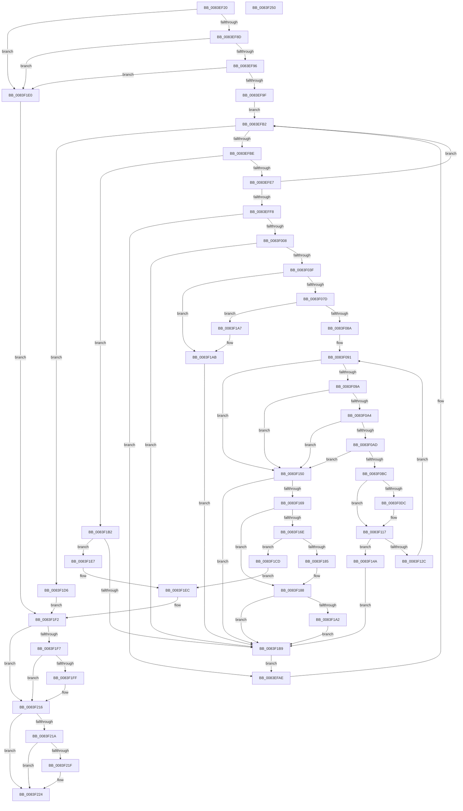

# RtlpPopulateLanguageConfigList

- RVA: `0x0083EF20`–`0x0083F251` (길이 `817` bytes)
- VA: `0x000000014083EF20`
- 실행 섹션: `PAGE`
- PDB 이름 있음: `예`; PDB Function 태그: `아니요`
- unwind 정보 RVA: `0x000DB580`
- 디코드: `225`개 명령, `817/817` bytes 표시
- 미해석 바이트: `0` (있으면 어셈블리에 `.byte`로 보존)

> 이 문서는 커널 이미지의 기계어와 PDB 기호를 분석해 생성했습니다. 4번과 5번은 함수 원형과 자료형을 바이너리 사용 방식에서 추정한 C 해석이며 원본 소스 복구 결과는 아닙니다.

## 1. Dependencies

- 직접 호출 지점: **9**; 고유 호출 대상: **7**
- 직접 호출자로 확인된 함수: **1**
- RIP 상대 이미지 참조: **1**

### Outgoing calls
- `0x0083EFD5` → [ZwEnumerateValueKey](../../text/6A/ZwEnumerateValueKey_function_006AD330.md) (function, `0x006AD330`)
- `0x0083F02D` → [RtlpMuiRegGetLanguageSpec](RtlpMuiRegGetLanguageSpec_function_0083E680.md) (function, `0x0083E680`)
- `0x0083F0D0` → [RtlpMuiRegGetLanguageSpec](RtlpMuiRegGetLanguageSpec_function_0083E680.md) (function, `0x0083E680`)
- `0x0083F121` → [RtlStringCbLengthW](../../text/45/RtlStringCbLengthW_function_004575EC.md) (function, `0x004575EC`)
- `0x0083F15B` → [RtlpMuiRegValidateConfigNode](../../text/6A/RtlpMuiRegValidateConfigNode_function_006A925C.md) (function, `0x006A925C`)
- `0x0083F171` → [RtlpMuiRegCreateLanguageConfigList](RtlpMuiRegCreateLanguageConfigList_function_0083DCD4.md) (function, `0x0083DCD4`)
- `0x0083F190` → [RtlpMuiRegConfigListAddLanguage](RtlpMuiRegConfigListAddLanguage_function_0083D8C0.md) (function, `0x0083D8C0`)
- `0x0083F202` → [RtlpMuiRegCreateLanguageConfigList](RtlpMuiRegCreateLanguageConfigList_function_0083DCD4.md) (function, `0x0083DCD4`)
- `0x0083F230` → [_security_check_cookie](../../text/6A/_security_check_cookie_function_006AC640.md) (function, `0x006AC640`)

### Direct callers
- [RtlpLoadLanguageConfigList](RtlpLoadLanguageConfigList_function_0083D450.md) at `0x0083D520`

### Static image references
- `0x0083EF40` → RVA `0x00E0A740` (`.data`; read)

## 2. Other-region calls and transfers

- 다른 실행 섹션으로 향하는 call: **4**
  - `0x0083EFD5` → [ZwEnumerateValueKey](../../text/6A/ZwEnumerateValueKey_function_006AD330.md) (`PAGE` → `.text`)
  - `0x0083F121` → [RtlStringCbLengthW](../../text/45/RtlStringCbLengthW_function_004575EC.md) (`PAGE` → `.text`)
  - `0x0083F15B` → [RtlpMuiRegValidateConfigNode](../../text/6A/RtlpMuiRegValidateConfigNode_function_006A925C.md) (`PAGE` → `.text`)
  - `0x0083F230` → [_security_check_cookie](../../text/6A/_security_check_cookie_function_006AC640.md) (`PAGE` → `.text`)
- 별도 외부 분기/꼬리 이동을 확인하지 못했습니다.

## 3. Assembly (complete function range)

```asm
0083EF20  48 89 5C 24 20                  mov qword ptr [rsp + 0x20], rbx
0083EF25  55                              push rbp
0083EF26  56                              push rsi
0083EF27  57                              push rdi
0083EF28  41 54                           push r12
0083EF2A  41 55                           push r13
0083EF2C  41 56                           push r14
0083EF2E  41 57                           push r15
0083EF30  48 81 EC C0 02 00 00            sub rsp, 0x2c0
0083EF37  48 8D 6C 24 50                  lea rbp, [rsp + 0x50]
0083EF3C  48 83 E5 E0                     and rbp, 0xffffffffffffffe0
0083EF40  48 8B 05 F9 B7 5C 00            mov rax, qword ptr [rip + 0x5cb7f9]
0083EF47  48 33 C4                        xor rax, rsp
0083EF4A  48 89 85 60 02 00 00            mov qword ptr [rbp + 0x260], rax
0083EF51  45 33 DB                        xor r11d, r11d
0083EF54  4C 89 45 18                     mov qword ptr [rbp + 0x18], r8
0083EF58  33 C0                           xor eax, eax
0083EF5A  48 89 4D 28                     mov qword ptr [rbp + 0x28], rcx
0083EF5E  66 44 89 5D 04                  mov word ptr [rbp + 4], r11w
0083EF63  4D 8B F8                        mov r15, r8
0083EF66  44 88 5D 00                     mov byte ptr [rbp], r11b
0083EF6A  4C 8B F2                        mov r14, rdx
0083EF6D  44 89 5D 20                     mov dword ptr [rbp + 0x20], r11d
0083EF71  45 8D 43 01                     lea r8d, [r11 + 1]
0083EF75  48 89 45 38                     mov qword ptr [rbp + 0x38], rax
0083EF79  41 8B FB                        mov edi, r11d
0083EF7C  89 45 40                        mov dword ptr [rbp + 0x40], eax
0083EF7F  BE 17 00 00 C0                  mov esi, 0xc0000017
0083EF84  48 85 C9                        test rcx, rcx
0083EF87  0F 84 53 02 00 00               je 0x14083f1e0
0083EF8D  48 85 D2                        test rdx, rdx
0083EF90  0F 84 4A 02 00 00               je 0x14083f1e0
0083EF96  4D 85 FF                        test r15, r15
0083EF99  0F 84 41 02 00 00               je 0x14083f1e0
0083EF9F  48 8B 3A                        mov rdi, qword ptr [rdx]
0083EFA2  41 8B DB                        mov ebx, r11d
0083EFA5  48 89 7D 10                     mov qword ptr [rbp + 0x10], rdi
0083EFA9  89 45 0C                        mov dword ptr [rbp + 0xc], eax
0083EFAC  EB 04                           jmp 0x14083efb2
0083EFAE  48 8B 4D 28                     mov rcx, qword ptr [rbp + 0x28]
0083EFB2  81 FB 1A 00 00 80               cmp ebx, 0x8000001a
0083EFB8  0F 84 18 02 00 00               je 0x14083f1d6
0083EFBE  48 8D 55 20                     lea rdx, [rbp + 0x20]
0083EFC2  48 89 54 24 28                  mov qword ptr [rsp + 0x28], rdx
0083EFC7  4C 8D 4D 60                     lea r9, [rbp + 0x60]
0083EFCB  8B D0                           mov edx, eax
0083EFCD  C7 44 24 20 00 02 00 00         mov dword ptr [rsp + 0x20], 0x200
0083EFD5  E8 56 E3 E6 FF                  call 0x1406ad330
0083EFDA  45 33 DB                        xor r11d, r11d
0083EFDD  8B D8                           mov ebx, eax
0083EFDF  85 C0                           test eax, eax
0083EFE1  0F 88 CB 01 00 00               js 0x14083f1b2
0083EFE7  83 7D 64 07                     cmp dword ptr [rbp + 0x64], 7
0083EFEB  45 8D 43 01                     lea r8d, [r11 + 1]
0083EFEF  8B 45 0C                        mov eax, dword ptr [rbp + 0xc]
0083EFF2  48 8B 4D 28                     mov rcx, qword ptr [rbp + 0x28]
0083EFF6  75 BA                           jne 0x14083efb2
0083EFF8  8B 4D 70                        mov ecx, dword ptr [rbp + 0x70]
0083EFFB  8D 41 18                        lea eax, [rcx + 0x18]
0083EFFE  3D 00 02 00 00                  cmp eax, 0x200
0083F003  8B 45 0C                        mov eax, dword ptr [rbp + 0xc]
0083F006  77 A6                           ja 0x14083efae
0083F008  8B F1                           mov esi, ecx
0083F00A  48 8D 45 04                     lea rax, [rbp + 4]
0083F00E  48 D1 EE                        shr rsi, 1
0083F011  4C 8D 45 00                     lea r8, [rbp]
0083F015  48 8D 55 74                     lea rdx, [rbp + 0x74]
0083F019  48 89 44 24 20                  mov qword ptr [rsp + 0x20], rax
0083F01E  49 8B CF                        mov rcx, r15
0083F021  44 0F B7 64 75 74               movzx r12d, word ptr [rbp + rsi*2 + 0x74]
0083F027  66 44 89 5C 75 74               mov word ptr [rbp + rsi*2 + 0x74], r11w
0083F02D  E8 4E F6 FF FF                  call 0x14083e680
0083F032  45 33 DB                        xor r11d, r11d
0083F035  8B D8                           mov ebx, eax
0083F037  85 C0                           test eax, eax
0083F039  0F 88 7A 01 00 00               js 0x14083f1b9
0083F03F  0F B7 45 04                     movzx eax, word ptr [rbp + 4]
0083F043  44 0F B6 6D 00                  movzx r13d, byte ptr [rbp]
0083F048  66 44 89 64 75 74               mov word ptr [rbp + rsi*2 + 0x74], r12w
0083F04E  48 8D 75 60                     lea rsi, [rbp + 0x60]
0083F052  66 41 C1 E5 0E                  shl r13w, 0xe
0083F057  66 89 45 38                     mov word ptr [rbp + 0x38], ax
0083F05B  8B 45 68                        mov eax, dword ptr [rbp + 0x68]
0083F05E  4C 89 5D 3C                     mov qword ptr [rbp + 0x3c], r11
0083F062  66 44 89 6D 3A                  mov word ptr [rbp + 0x3a], r13w
0083F067  4C 89 5D 30                     mov qword ptr [rbp + 0x30], r11
0083F06B  44 88 5D 01                     mov byte ptr [rbp + 1], r11b
0083F06F  66 44 89 5D 08                  mov word ptr [rbp + 8], r11w
0083F074  48 03 F0                        add rsi, rax
0083F077  0F 84 2E 01 00 00               je 0x14083f1ab
0083F07D  44 8B 7D 6C                     mov r15d, dword ptr [rbp + 0x6c]
0083F081  45 85 FF                        test r15d, r15d
0083F084  0F 84 1D 01 00 00               je 0x14083f1a7
0083F08A  45 03 FF                        add r15d, r15d
0083F08D  45 0F B7 E3                     movzx r12d, r11w
0083F091  48 85 F6                        test rsi, rsi
0083F094  0F 84 B6 00 00 00               je 0x14083f150
0083F09A  66 44 39 1E                     cmp word ptr [rsi], r11w
0083F09E  0F 84 AC 00 00 00               je 0x14083f150
0083F0A4  45 85 FF                        test r15d, r15d
0083F0A7  0F 8E A3 00 00 00               jle 0x14083f150
0083F0AD  BB 03 00 00 00                  mov ebx, 3
0083F0B2  66 44 3B E3                     cmp r12w, bx
0083F0B6  0F 83 94 00 00 00               jae 0x14083f150
0083F0BC  48 8B 4D 18                     mov rcx, qword ptr [rbp + 0x18]
0083F0C0  48 8D 45 08                     lea rax, [rbp + 8]
0083F0C4  4C 8D 45 01                     lea r8, [rbp + 1]
0083F0C8  48 89 44 24 20                  mov qword ptr [rsp + 0x20], rax
0083F0CD  48 8B D6                        mov rdx, rsi
0083F0D0  E8 AB F5 FF FF                  call 0x14083e680
0083F0D5  45 33 DB                        xor r11d, r11d
0083F0D8  85 C0                           test eax, eax
0083F0DA  78 3B                           js 0x14083f117
0083F0DC  8A 45 01                        mov al, byte ptr [rbp + 1]
0083F0DF  44 8B C3                        mov r8d, ebx
0083F0E2  22 C3                           and al, bl
0083F0E4  41 0F B7 CC                     movzx ecx, r12w
0083F0E8  03 C9                           add ecx, ecx
0083F0EA  0F B6 D0                        movzx edx, al
0083F0ED  0F B7 45 08                     movzx eax, word ptr [rbp + 8]
0083F0F1  66 41 D3 E0                     shl r8w, cl
0083F0F5  66 41 F7 D0                     not r8w
0083F0F9  66 D3 E2                        shl dx, cl
0083F0FC  66 45 23 C5                     and r8w, r13w
0083F100  41 0F B7 CC                     movzx ecx, r12w
0083F104  66 44 0B C2                     or r8w, dx
0083F108  66 44 89 45 3A                  mov word ptr [rbp + 0x3a], r8w
0083F10D  66 89 44 4D 3E                  mov word ptr [rbp + rcx*2 + 0x3e], ax
0083F112  44 0F B7 6D 3A                  movzx r13d, word ptr [rbp + 0x3a]
0083F117  49 63 D7                        movsxd rdx, r15d
0083F11A  4C 8D 45 30                     lea r8, [rbp + 0x30]
0083F11E  48 8B CE                        mov rcx, rsi
0083F121  E8 C6 84 C1 FF                  call 0x1404575ec
0083F126  8B D8                           mov ebx, eax
0083F128  85 C0                           test eax, eax
0083F12A  78 1E                           js 0x14083f14a
0083F12C  48 8B 4D 30                     mov rcx, qword ptr [rbp + 0x30]
0083F130  48 83 C6 02                     add rsi, 2
0083F134  B8 FE FF FF FF                  mov eax, 0xfffffffe
0083F139  48 03 F1                        add rsi, rcx
0083F13C  2B C1                           sub eax, ecx
0083F13E  44 03 F8                        add r15d, eax
0083F141  66 41 FF C4                     inc r12w
0083F145  E9 47 FF FF FF                  jmp 0x14083f091
0083F14A  4C 8B 7D 18                     mov r15, qword ptr [rbp + 0x18]
0083F14E  EB 69                           jmp 0x14083f1b9
0083F150  4C 8B 7D 18                     mov r15, qword ptr [rbp + 0x18]
0083F154  48 8D 55 38                     lea rdx, [rbp + 0x38]
0083F158  49 8B CF                        mov rcx, r15
0083F15B  E8 FC A0 E6 FF                  call 0x1406a925c
0083F160  45 33 DB                        xor r11d, r11d
0083F163  8B D8                           mov ebx, eax
0083F165  85 C0                           test eax, eax
0083F167  78 50                           js 0x14083f1b9
0083F169  48 85 FF                        test rdi, rdi
0083F16C  75 1A                           jne 0x14083f188
0083F16E  83 C9 FF                        or ecx, 0xffffffff
0083F171  E8 5E EB FF FF                  call 0x14083dcd4
0083F176  45 33 DB                        xor r11d, r11d
0083F179  48 89 45 10                     mov qword ptr [rbp + 0x10], rax
0083F17D  48 8B F8                        mov rdi, rax
0083F180  48 85 C0                        test rax, rax
0083F183  74 48                           je 0x14083f1cd
0083F185  49 89 06                        mov qword ptr [r14], rax
0083F188  48 8D 55 38                     lea rdx, [rbp + 0x38]
0083F18C  48 8D 4D 10                     lea rcx, [rbp + 0x10]
0083F190  E8 2B E7 FF FF                  call 0x14083d8c0
0083F195  48 8B 7D 10                     mov rdi, qword ptr [rbp + 0x10]
0083F199  45 33 DB                        xor r11d, r11d
0083F19C  8B D8                           mov ebx, eax
0083F19E  85 C0                           test eax, eax
0083F1A0  78 17                           js 0x14083f1b9
0083F1A2  49 89 3E                        mov qword ptr [r14], rdi
0083F1A5  EB 12                           jmp 0x14083f1b9
0083F1A7  4C 8B 7D 18                     mov r15, qword ptr [rbp + 0x18]
0083F1AB  BB 0D 00 00 C0                  mov ebx, 0xc000000d
0083F1B0  EB 07                           jmp 0x14083f1b9
0083F1B2  3D 1A 00 00 80                  cmp eax, 0x8000001a
0083F1B7  75 2E                           jne 0x14083f1e7
0083F1B9  8B 45 0C                        mov eax, dword ptr [rbp + 0xc]
0083F1BC  41 B8 01 00 00 00               mov r8d, 1
0083F1C2  41 03 C0                        add eax, r8d
0083F1C5  89 45 0C                        mov dword ptr [rbp + 0xc], eax
0083F1C8  E9 E1 FD FF FF                  jmp 0x14083efae
0083F1CD  BE 17 00 00 C0                  mov esi, 0xc0000017
0083F1D2  8B DE                           mov ebx, esi
0083F1D4  EB 16                           jmp 0x14083f1ec
0083F1D6  41 8B DB                        mov ebx, r11d
0083F1D9  BE 17 00 00 C0                  mov esi, 0xc0000017
0083F1DE  EB 12                           jmp 0x14083f1f2
0083F1E0  BB 0D 00 00 C0                  mov ebx, 0xc000000d
0083F1E5  EB 0B                           jmp 0x14083f1f2
0083F1E7  BE 17 00 00 C0                  mov esi, 0xc0000017
0083F1EC  41 B8 01 00 00 00               mov r8d, 1
0083F1F2  48 85 FF                        test rdi, rdi
0083F1F5  75 1F                           jne 0x14083f216
0083F1F7  81 FB 0D 00 00 C0               cmp ebx, 0xc000000d
0083F1FD  74 17                           je 0x14083f216
0083F1FF  41 8B C8                        mov ecx, r8d
0083F202  E8 CD EA FF FF                  call 0x14083dcd4
0083F207  45 33 DB                        xor r11d, r11d
0083F20A  49 89 06                        mov qword ptr [r14], rax
0083F20D  48 85 C0                        test rax, rax
0083F210  48 8B F8                        mov rdi, rax
0083F213  0F 44 DE                        cmove ebx, esi
0083F216  85 DB                           test ebx, ebx
0083F218  79 0A                           jns 0x14083f224
0083F21A  48 85 FF                        test rdi, rdi
0083F21D  74 05                           je 0x14083f224
0083F21F  66 44 89 5F 04                  mov word ptr [rdi + 4], r11w
0083F224  8B C3                           mov eax, ebx
0083F226  48 8B 8D 60 02 00 00            mov rcx, qword ptr [rbp + 0x260]
0083F22D  48 33 CC                        xor rcx, rsp
0083F230  E8 0B D4 E6 FF                  call 0x1406ac640
0083F235  48 8B 9C 24 18 03 00 00         mov rbx, qword ptr [rsp + 0x318]
0083F23D  48 81 C4 C0 02 00 00            add rsp, 0x2c0
0083F244  41 5F                           pop r15
0083F246  41 5E                           pop r14
0083F248  41 5D                           pop r13
0083F24A  41 5C                           pop r12
0083F24C  5F                              pop rdi
0083F24D  5E                              pop rsi
0083F24E  5D                              pop rbp
0083F24F  C3                              ret
0083F250  CC                              int3
```

## 4. C-style interpretation (structured pseudocode)

```c
__int64 __fastcall RtlpPopulateLanguageConfigList(__int64 a1, __int64 a2, __int64 a3)
{
    __int64 result;
    __int64 v_r11;
    __int64 v_r12;
    __int64 v_r13;
    __int64 v_r15;
    __int64 v_rbp;
    __int64 v_rbx;
    __int64 v_rdi;
    __int64 v_rsi;
    __int64 v_rsp;
    unsigned __int64 v_stack_m234;
    unsigned int v_stack_m238;
    unsigned int v_stack_m23C;
    unsigned int v_stack_m240;
    unsigned int v_stack_m244;
    unsigned __int64 v_stack_m248;
    unsigned int v_stack_m268;
    unsigned __int64 v_stack_m26C;
    unsigned __int16 v_stack_m26E;
    unsigned __int64 v_stack_m270;
    unsigned __int64 v_stack_m278;
    unsigned __int64 v_stack_m280;
    unsigned int v_stack_m288;
    unsigned __int64 v_stack_m290;
    unsigned __int64 v_stack_m298;
    unsigned int v_stack_m29C;
    unsigned __int16 v_stack_m2A0;
    unsigned __int16 v_stack_m2A4;
    unsigned __int8 v_stack_m2A7;
    unsigned __int64 v_stack_m2A8;
    unsigned __int64 v_stack_m2D0;
    unsigned int v_stack_m2D8;
    unsigned __int64 v_stack_m48;
    unsigned __int64 v_stack_p20;

    v_stack_p20 = v_rbx;
    v_rsp = (v_rsp) - (704);
    v_rbp = (v_stack_m2A8) & (-32);
    result = (*(unsigned __int64 *)(v_rip + 6076409)) ^ (v_rsp);
    v_stack_m48 = result;
    v_r11 = 0;
    v_stack_m290 = a3;
    result = 0;
    v_stack_m280 = a1;
    v_stack_m2A4 = 0;
    v_stack_m2A8 = 0;
    v_stack_m288 = 0;
    v_stack_m270 = 0;
    v_stack_m268 = 0;
    if (a1 == 0) goto loc_0083F1E0;
    if (a2 == 0) goto loc_0083F1E0;
    if (a3 == 0) goto loc_0083F1E0;
    v_stack_m298 = *(unsigned __int64 *)(a2);
    v_stack_m29C = 0;
    goto loc_0083EFB2;
loc_0083EFAE:
loc_0083EFB2:
    if (0 == 0x8000001AULL) goto loc_0083F1D6;
    v_stack_m2D0 = v_stack_m288;
    v_stack_m2D8 = 512;
    result = ZwEnumerateValueKey(v_stack_m280, 0, v_r11 + 1, v_stack_m248);
    v_r11 = 0;
    if (sign_flag) goto loc_0083F1B2;
    if (v_stack_m244 != 7) goto loc_0083EFB2;
    if (((unsigned int)((unsigned int)(v_stack_m238) + 24)) > 512) goto loc_0083EFAE;
    v_rsi = ((unsigned int)((unsigned int)((unsigned int)(v_stack_m238)))) >> (1);
    v_stack_m2D8 = v_stack_m2A4;
    *(unsigned __int16 *)(v_rbp + v_rsi * 2 + 116) = 0;
    result = RtlpMuiRegGetLanguageSpec(a3, v_stack_m234, v_stack_m2A8, v_stack_m248);
    v_r11 = 0;
    if (sign_flag) goto loc_0083F1B9;
    *(unsigned __int16 *)(v_rbp + v_rsi * 2 + 116) = (unsigned __int16)(*(unsigned __int16 *)(v_rbp + v_rsi * 2 + 116));
    v_r13 = (unsigned __int16)((v_stack_m2A8) << (14));
    v_stack_m270 = (unsigned __int16)(v_stack_m2A4);
    v_stack_m26C = 0;
    v_stack_m26E = (unsigned __int16)(v_r13);
    v_stack_m278 = 0;
    v_stack_m2A7 = 0;
    v_stack_m2A0 = 0;
    v_rsi = (v_stack_m248) + ((unsigned int)(v_stack_m240));
    if (condition_is_equal) goto loc_0083F1AB;
    if ((unsigned int)((unsigned int)(v_stack_m23C)) == 0) goto loc_0083F1A7;
    v_r15 = (unsigned int)(((unsigned int)(v_stack_m23C)) + ((unsigned int)((unsigned int)(v_stack_m23C))));
loc_0083F091:
    if (v_rsi == 0) goto loc_0083F150;
    if ((*(unsigned __int16 *)(v_rsi)) == 0) goto loc_0083F150;
    if (condition_is_less_or_equal) goto loc_0083F150;
    if (0 >= 3) goto loc_0083F150;
    v_stack_m2D8 = v_stack_m2A0;
    result = RtlpMuiRegGetLanguageSpec(v_stack_m290, v_rsi, v_stack_m2A7, v_stack_m248);
    v_r11 = 0;
    if (!(sign_flag)) {
        result = v_stack_m2A7;
        a3 = 3;
        result = (unsigned __int8)((result) & (3));
        a1 = 0;
        a1 = (unsigned int)((a1) + ((unsigned int)(a1)));
        a2 = (unsigned __int8)(result);
        result = v_stack_m2A0;
        a3 = (unsigned __int16)((a3) << ((unsigned __int8)(a1)));
        a3 = (unsigned __int16)(~(a3));
        a2 = (unsigned __int16)((a2) << ((unsigned __int8)(a1)));
        a3 = (unsigned __int16)((a3) & ((unsigned __int16)(v_r13)));
        a1 = 0;
        a3 = (unsigned __int16)((a3) | ((unsigned __int16)(a2)));
        v_stack_m26E = (unsigned __int16)(a3);
        *(unsigned __int16 *)(v_rbp + a1 * 2 + 62) = (unsigned __int16)(result);
        v_r13 = v_stack_m26E;
    }
    result = RtlStringCbLengthW(v_rsi, (int)((unsigned int)(v_r15)), v_stack_m278, v_stack_m248);
    if (sign_flag) goto loc_0083F14A;
    v_rsi = (v_rsi) + (2);
    v_rsi = (v_rsi) + (v_stack_m278);
    result = (unsigned int)(((unsigned int)(0xFFFFFFFEULL)) - ((unsigned int)(v_stack_m278)));
    v_r15 = (unsigned int)((v_r15) + ((unsigned int)(result)));
    v_r12 = (unsigned __int16)((0) + 1);
    goto loc_0083F091;
loc_0083F14A:
    goto loc_0083F1B9;
loc_0083F150:
    result = RtlpMuiRegValidateConfigNode(v_stack_m290, v_stack_m270, v_stack_m278, v_stack_m248);
    v_r11 = 0;
    if (sign_flag) goto loc_0083F1B9;
    if (*(unsigned __int64 *)(a2) != 0) goto loc_0083F188;
    a1 = (unsigned int)((v_stack_m290) | (0xFFFFFFFFULL));
    result = RtlpMuiRegCreateLanguageConfigList(a1, v_stack_m270, v_stack_m278, v_stack_m248);
    v_r11 = 0;
    v_stack_m298 = result;
    if (result == 0) goto loc_0083F1CD;
    *(unsigned __int64 *)(a2) = result;
loc_0083F188:
    result = RtlpMuiRegConfigListAddLanguage(v_stack_m298, v_stack_m270, v_stack_m278, v_stack_m248);
    v_r11 = 0;
    if (sign_flag) goto loc_0083F1B9;
    *(unsigned __int64 *)(a2) = v_stack_m298;
    goto loc_0083F1B9;
loc_0083F1A7:
loc_0083F1AB:
    goto loc_0083F1B9;
loc_0083F1B2:
    if (((unsigned int)(result)) != 0x8000001AULL) goto loc_0083F1E7;
loc_0083F1B9:
    result = (unsigned int)(((unsigned int)(v_stack_m29C)) + (1));
    v_stack_m29C = (unsigned int)(result);
    goto loc_0083EFAE;
loc_0083F1CD:
    goto loc_0083F1EC;
loc_0083F1D6:
    goto loc_0083F1F2;
loc_0083F1E0:
    goto loc_0083F1F2;
loc_0083F1E7:
loc_0083F1EC:
loc_0083F1F2:
    if (v_stack_m298 != 0) goto loc_0083F216;
    v_rbx = (unsigned int)(0xC000000DULL);
    v_rdi = v_stack_m298;
    if (((unsigned int)((unsigned int)(0xC000000DULL))) != 0xC000000DULL) {
        a1 = 1;
        result = RtlpMuiRegCreateLanguageConfigList(a1, v_stack_m270, 1, v_stack_m248);
        v_r11 = 0;
        *(unsigned __int64 *)(a2) = result;
        v_rdi = result;
        v_rbx = (unsigned int)(0xC000000DULL);
        if (result == 0) { v_rbx = (unsigned int)((unsigned int)(0xC0000017ULL)); }
    }
    if (!sign_flag) goto loc_0083F224;
    if (v_rdi != 0) {
        *(unsigned __int16 *)(v_rdi + 4) = 0;
    }
    a1 = (v_stack_m48) ^ (v_rsp);
    result = _security_check_cookie(a1, v_stack_m270, 1, v_stack_m248);
    v_rsp = (v_rsp) + (704);
    return result;
}
```

## 5. (Beta) C Style

```c
int64_t RtlpPopulateLanguageConfigList(int64_t Arg1, void *Arg2, int64_t Arg3)
{
    uint8_t *arg2 = (uint8_t *)Arg2;

    int64_t result;
    int64_t local_r11;
    int64_t local_r12;
    int64_t local_r13;
    int64_t local_r15;
    int64_t local_rbp;
    int64_t local_rbx;
    int64_t local_rdi;
    int64_t local_rsi;
    int64_t local_rsp;
    uint64_t v_stack_m234;
    uint32_t v_stack_m238;
    uint32_t v_stack_m23C;
    uint32_t v_stack_m240;
    uint32_t v_stack_m244;
    uint64_t v_stack_m248;
    uint32_t v_stack_m268;
    uint64_t v_stack_m26C;
    uint16_t v_stack_m26E;
    uint64_t v_stack_m270;
    uint64_t v_stack_m278;
    uint64_t v_stack_m280;
    uint32_t v_stack_m288;
    uint64_t v_stack_m290;
    uint64_t v_stack_m298;
    uint32_t v_stack_m29C;
    uint16_t v_stack_m2A0;
    uint16_t v_stack_m2A4;
    uint8_t v_stack_m2A7;
    uint64_t v_stack_m2A8;
    uint64_t v_stack_m2D0;
    uint32_t v_stack_m2D8;
    uint64_t v_stack_m48;
    uint64_t v_stack_p20;

    v_stack_p20 = local_rbx;
    local_rsp = (local_rsp) - (704);
    local_rbp = (v_stack_m2A8) & (-32);
    result = (*(uint64_t *)(v_rip + 0x5CB7F9)) ^ (local_rsp);
    v_stack_m48 = result;
    local_r11 = 0;
    v_stack_m290 = Arg3;
    result = 0;
    v_stack_m280 = Arg1;
    v_stack_m2A4 = 0;
    v_stack_m2A8 = 0;
    v_stack_m288 = 0;
    v_stack_m270 = 0;
    v_stack_m268 = 0;
    if (Arg1 == 0) goto loc_0083F1E0;
    if (Arg2 == NULL) goto loc_0083F1E0;
    if (Arg3 == 0) goto loc_0083F1E0;
    v_stack_m298 = *(uint64_t *)(arg2);
    v_stack_m29C = 0;
    goto loc_0083EFB2;
loc_0083EFAE:
loc_0083EFB2:
    if (0 == 0x8000001AULL) goto loc_0083F1D6;
    v_stack_m2D0 = v_stack_m288;
    v_stack_m2D8 = 512;
    result = ZwEnumerateValueKey(v_stack_m280, 0, local_r11 + 1, v_stack_m248);
    local_r11 = 0;
    if (sign_flag) goto loc_0083F1B2;
    if (v_stack_m244 != 7) goto loc_0083EFB2;
    if (((uint32_t)((uint32_t)(v_stack_m238) + 24)) > 512) goto loc_0083EFAE;
    local_rsi = ((uint32_t)((uint32_t)((uint32_t)(v_stack_m238)))) >> (1);
    v_stack_m2D8 = v_stack_m2A4;
    *(uint16_t *)(local_rbp + local_rsi * 2 + 0x74) = 0;
    result = RtlpMuiRegGetLanguageSpec(Arg3, v_stack_m234, v_stack_m2A8, v_stack_m248);
    local_r11 = 0;
    if (sign_flag) goto loc_0083F1B9;
    *(uint16_t *)(local_rbp + local_rsi * 2 + 0x74) = (uint16_t)(*(uint16_t *)(local_rbp + local_rsi * 2 + 0x74));
    local_r13 = (uint16_t)((v_stack_m2A8) << (14));
    v_stack_m270 = (uint16_t)(v_stack_m2A4);
    v_stack_m26C = 0;
    v_stack_m26E = (uint16_t)(local_r13);
    v_stack_m278 = 0;
    v_stack_m2A7 = 0;
    v_stack_m2A0 = 0;
    local_rsi = (v_stack_m248) + ((uint32_t)(v_stack_m240));
    if (condition_is_equal) goto loc_0083F1AB;
    if ((uint32_t)((uint32_t)(v_stack_m23C)) == 0) goto loc_0083F1A7;
    local_r15 = (uint32_t)(((uint32_t)(v_stack_m23C)) + ((uint32_t)((uint32_t)(v_stack_m23C))));
loc_0083F091:
    if (local_rsi == 0) goto loc_0083F150;
    if ((*(uint16_t *)(local_rsi)) == 0) goto loc_0083F150;
    if (condition_is_less_or_equal) goto loc_0083F150;
    if (0 >= 3) goto loc_0083F150;
    v_stack_m2D8 = v_stack_m2A0;
    result = RtlpMuiRegGetLanguageSpec(v_stack_m290, local_rsi, v_stack_m2A7, v_stack_m248);
    local_r11 = 0;
    if (!(sign_flag)) {
        result = v_stack_m2A7;
        Arg3 = 3;
        result = (uint8_t)((result) & (3));
        Arg1 = 0;
        Arg1 = (uint32_t)((Arg1) + ((uint32_t)(Arg1)));
        Arg2 = (uint8_t)(result);
        result = v_stack_m2A0;
        Arg3 = (uint16_t)((Arg3) << ((uint8_t)(Arg1)));
        Arg3 = (uint16_t)(~(Arg3));
        Arg2 = (uint16_t)((Arg2) << ((uint8_t)(Arg1)));
        Arg3 = (uint16_t)((Arg3) & ((uint16_t)(local_r13)));
        Arg1 = 0;
        Arg3 = (uint16_t)((Arg3) | ((uint16_t)(Arg2)));
        v_stack_m26E = (uint16_t)(Arg3);
        *(uint16_t *)(local_rbp + Arg1 * 2 + 0x3E) = (uint16_t)(result);
        local_r13 = v_stack_m26E;
    }
    result = RtlStringCbLengthW(local_rsi, (int32_t)((uint32_t)(local_r15)), v_stack_m278, v_stack_m248);
    if (sign_flag) goto loc_0083F14A;
    local_rsi = (local_rsi) + (2);
    local_rsi = (local_rsi) + (v_stack_m278);
    result = (uint32_t)(((uint32_t)(0xFFFFFFFEULL)) - ((uint32_t)(v_stack_m278)));
    local_r15 = (uint32_t)((local_r15) + ((uint32_t)(result)));
    local_r12 = (uint16_t)((0) + 1);
    goto loc_0083F091;
loc_0083F14A:
    goto loc_0083F1B9;
loc_0083F150:
    result = RtlpMuiRegValidateConfigNode(v_stack_m290, v_stack_m270, v_stack_m278, v_stack_m248);
    local_r11 = 0;
    if (sign_flag) goto loc_0083F1B9;
    if (*(uint64_t *)(arg2) != 0) goto loc_0083F188;
    Arg1 = (uint32_t)((v_stack_m290) | (0xFFFFFFFFULL));
    result = RtlpMuiRegCreateLanguageConfigList(Arg1, v_stack_m270, v_stack_m278, v_stack_m248);
    local_r11 = 0;
    v_stack_m298 = result;
    if (result == 0) goto loc_0083F1CD;
    *(uint64_t *)(arg2) = result;
loc_0083F188:
    result = RtlpMuiRegConfigListAddLanguage(v_stack_m298, v_stack_m270, v_stack_m278, v_stack_m248);
    local_r11 = 0;
    if (sign_flag) goto loc_0083F1B9;
    *(uint64_t *)(arg2) = v_stack_m298;
    goto loc_0083F1B9;
loc_0083F1A7:
loc_0083F1AB:
    goto loc_0083F1B9;
loc_0083F1B2:
    if (((uint32_t)(result)) != 0x8000001AULL) goto loc_0083F1E7;
loc_0083F1B9:
    result = (uint32_t)(((uint32_t)(v_stack_m29C)) + (1));
    v_stack_m29C = (uint32_t)(result);
    goto loc_0083EFAE;
loc_0083F1CD:
    goto loc_0083F1EC;
loc_0083F1D6:
    goto loc_0083F1F2;
loc_0083F1E0:
    goto loc_0083F1F2;
loc_0083F1E7:
loc_0083F1EC:
loc_0083F1F2:
    if (v_stack_m298 != 0) goto loc_0083F216;
    local_rbx = (uint32_t)(0xC000000DULL);
    local_rdi = v_stack_m298;
    if (((uint32_t)((uint32_t)(0xC000000DULL))) != 0xC000000DULL) {
        Arg1 = 1;
        result = RtlpMuiRegCreateLanguageConfigList(Arg1, v_stack_m270, 1, v_stack_m248);
        local_r11 = 0;
        *(uint64_t *)(arg2) = result;
        local_rdi = result;
        local_rbx = (uint32_t)(0xC000000DULL);
        if (result == 0) { local_rbx = (uint32_t)((uint32_t)(0xC0000017ULL)); }
    }
    if (!sign_flag) goto loc_0083F224;
    if (local_rdi != 0) {
        *(uint16_t *)(local_rdi + 0x4) = 0;
    }
    Arg1 = (v_stack_m48) ^ (local_rsp);
    result = _security_check_cookie(Arg1, v_stack_m270, 1, v_stack_m248);
    local_rsp = (local_rsp) + (704);
    return result;
}
```

### 관측된 메모리 오프셋

구조체 형식이 확인되지 않은 접근은 인자 기준의 오프셋으로만 기록했습니다.

| 기준 인자 | 오프셋 표현 | 폭 (bit) | 접근 |
|---|---:|---:|---|
| `Arg2` | `+ 0x0` | `64` | `W` |

## 6. Execution-region graph

[열기: 2D/3D 그래프와 함수 탐색 컨트롤 패널](../../../control-panel.html?section=page&rva=0x0083EF20&view=graph)

- 2D 그래프는 위에서 아래로 흐르고, 3D 그래프는 빈 공간을 드래그해 회전합니다. Shift+드래그는 이동, 휠은 확대·축소, 함수 노드 선택은 대상 보고서 이동입니다.

### Static fallback


