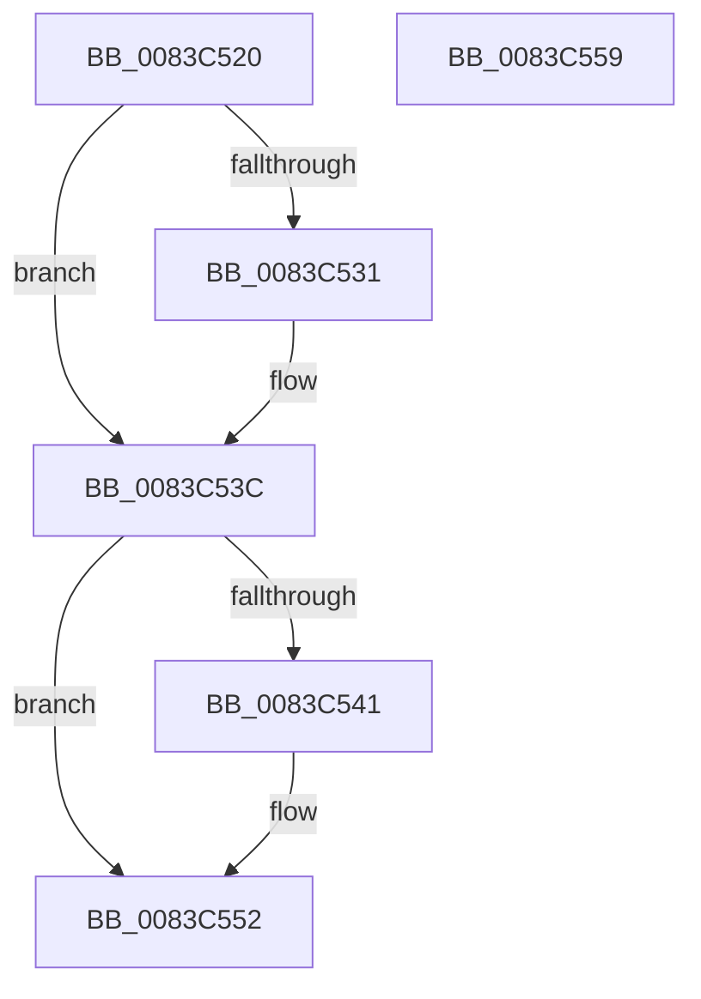

# SbpVmbusNotificationHandler

- RVA: `0x0083C520`–`0x0083C55A` (길이 `58` bytes)
- VA: `0x000000014083C520`
- 실행 섹션: `PAGE`
- PDB 이름 있음: `예`; PDB Function 태그: `아니요`
- unwind 정보 RVA: `0x0005C788`
- 디코드: `16`개 명령, `58/58` bytes 표시
- 미해석 바이트: `0` (있으면 어셈블리에 `.byte`로 보존)

> 이 문서는 커널 이미지의 기계어와 PDB 기호를 분석해 생성했습니다. 4번과 5번은 함수 원형과 자료형을 바이너리 사용 방식에서 추정한 C 해석이며 원본 소스 복구 결과는 아닙니다.

## 1. Dependencies

- 직접 호출 지점: **1**; 고유 호출 대상: **1**
- 직접 호출자로 확인된 함수: **0**
- RIP 상대 이미지 참조: **3**

### Outgoing calls
- `0x0083C54D` → [KeSetEvent](../../text/33/KeSetEvent_function_0033F310.md) (function, `0x0033F310`)

### Direct callers
- 이 함수 시작 RVA로 연결되는 직접 call은 확인되지 않았습니다. 간접 호출은 완전히 역산할 수 없습니다.

### Static image references
- `0x0083C528` → RVA `0x00013E30` (`.rdata`; read)
- `0x0083C535` → RVA `0x00013E38` (`.rdata`; read)
- `0x0083C544` → RVA `0x00EF0280` (`.data`; read)

## 2. Other-region calls and transfers

- 다른 실행 섹션으로 향하는 call: **1**
  - `0x0083C54D` → [KeSetEvent](../../text/33/KeSetEvent_function_0033F310.md) (`PAGE` → `.text`)
- 별도 외부 분기/꼬리 이동을 확인하지 못했습니다.

## 3. Assembly (complete function range)

```asm
0083C520  48 83 EC 28                     sub rsp, 0x28
0083C524  48 8B 41 04                     mov rax, qword ptr [rcx + 4]
0083C528  48 2B 05 01 79 7D FF            sub rax, qword ptr [rip - 0x8286ff]
0083C52F  75 0B                           jne 0x14083c53c
0083C531  48 8B 41 0C                     mov rax, qword ptr [rcx + 0xc]
0083C535  48 2B 05 FC 78 7D FF            sub rax, qword ptr [rip - 0x828704]
0083C53C  48 85 C0                        test rax, rax
0083C53F  75 11                           jne 0x14083c552
0083C541  45 33 C0                        xor r8d, r8d
0083C544  48 8D 0D 35 3D 6B 00            lea rcx, [rip + 0x6b3d35]
0083C54B  33 D2                           xor edx, edx
0083C54D  E8 BE 2D B0 FF                  call 0x14033f310
0083C552  33 C0                           xor eax, eax
0083C554  48 83 C4 28                     add rsp, 0x28
0083C558  C3                              ret
0083C559  CC                              int3
```

## 4. C-style interpretation (structured pseudocode)

```c
__int64 __fastcall SbpVmbusNotificationHandler(__int64 a1, int a2, int a3)
{
    __int64 result;
    __int64 v_rsp;

    v_rsp = (v_rsp) - (40);
    result = (*(unsigned __int64 *)(a1 + 4)) - (*(unsigned __int64 *)(v_rip - 8554239));
    if (!(condition_is_not_equal)) {
        result = *(unsigned __int64 *)(a1 + 12);
        result = (result) - (*(unsigned __int64 *)(v_rip - 8554244));
    }
    if (result == 0) {
        a3 = 0;
        a1 = v_rip + 7028021;
        a2 = 0;
        result = KeSetEvent(a1, a2, a3, a4);
    }
    result = 0;
    v_rsp = (v_rsp) + (40);
    return result;
}
```

## 5. (Beta) C Style

```c
int64_t SbpVmbusNotificationHandler(void *Arg1, int32_t Arg2, int32_t Arg3)
{
    uint8_t *arg1 = (uint8_t *)Arg1;

    int64_t result;
    int64_t local_rsp;

    local_rsp = (local_rsp) - (40);
    result = (*(uint64_t *)(arg1 + 0x4)) - (*(uint64_t *)(v_rip - 0x8286FF));
    if (!(condition_is_not_equal)) {
        result = *(uint64_t *)(arg1 + 0xC);
        result = (result) - (*(uint64_t *)(v_rip - 0x828704));
    }
    if (result == 0) {
        Arg3 = 0;
        Arg1 = v_rip + 7028021;
        Arg2 = 0;
        result = KeSetEvent(Arg1, Arg2, Arg3, a4);
    }
    result = 0;
    local_rsp = (local_rsp) + (40);
    return result;
}
```

### 관측된 메모리 오프셋

구조체 형식이 확인되지 않은 접근은 인자 기준의 오프셋으로만 기록했습니다.

| 기준 인자 | 오프셋 표현 | 폭 (bit) | 접근 |
|---|---:|---:|---|
| `Arg1` | `+ 0x4` | `64` | `R` |
| `Arg1` | `+ 0xC` | `64` | `R` |

## 6. Execution-region graph

[열기: 2D/3D 그래프와 함수 탐색 컨트롤 패널](../../../control-panel.html?section=page&rva=0x0083C520&view=graph)

- 2D 그래프는 위에서 아래로 흐르고, 3D 그래프는 빈 공간을 드래그해 회전합니다. Shift+드래그는 이동, 휠은 확대·축소, 함수 노드 선택은 대상 보고서 이동입니다.

### Static fallback


