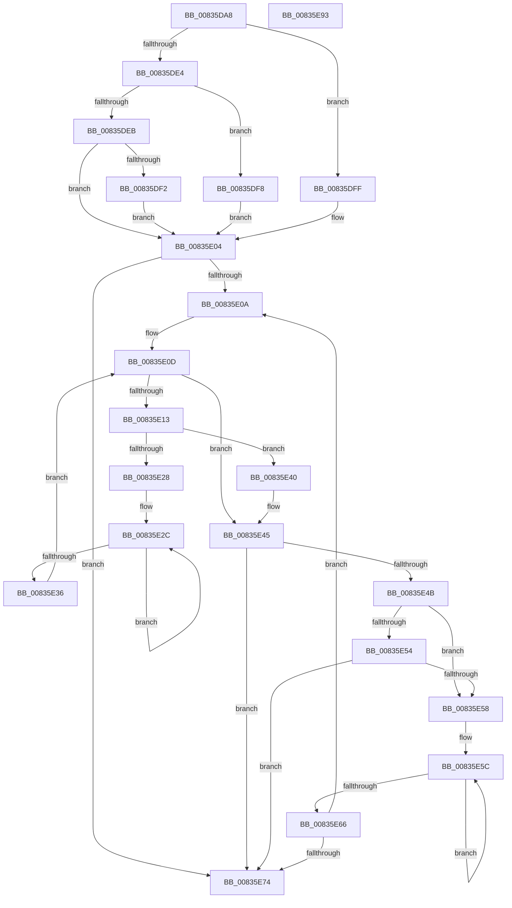

# StringListElementSubstringMatch

- RVA: `0x00835DA8`–`0x00835E94` (길이 `236` bytes)
- VA: `0x0000000140835DA8`
- 실행 섹션: `PAGE`
- PDB 이름 있음: `예`; PDB Function 태그: `아니요`
- unwind 정보 RVA: `0x00075C18`
- 디코드: `74`개 명령, `236/236` bytes 표시
- 미해석 바이트: `0` (있으면 어셈블리에 `.byte`로 보존)

> 이 문서는 커널 이미지의 기계어와 PDB 기호를 분석해 생성했습니다. 4번과 5번은 함수 원형과 자료형을 바이너리 사용 방식에서 추정한 C 해석이며 원본 소스 복구 결과는 아닙니다.

## 1. Dependencies

- 직접 호출 지점: **1**; 고유 호출 대상: **1**
- 직접 호출자로 확인된 함수: **1**
- RIP 상대 이미지 참조: **0**

### Outgoing calls
- `0x00835E1F` → [SubstringMatch](../A3/SubstringMatch_function_00A3408C.md) (function, `0x00A3408C`)

### Direct callers
- [PropertyEval](../9C/PropertyEval_function_009CB300.md) at `0x009CFDAE`

### Static image references
- 디코드된 RIP-relative 메모리 참조가 없습니다.

## 2. Other-region calls and transfers

- 다른 실행 섹션으로 향하는 call: **0**
- 별도 외부 분기/꼬리 이동을 확인하지 못했습니다.

## 3. Assembly (complete function range)

```asm
00835DA8  48 89 5C 24 08                  mov qword ptr [rsp + 8], rbx
00835DAD  48 89 6C 24 10                  mov qword ptr [rsp + 0x10], rbp
00835DB2  48 89 74 24 18                  mov qword ptr [rsp + 0x18], rsi
00835DB7  57                              push rdi
00835DB8  41 54                           push r12
00835DBA  41 55                           push r13
00835DBC  41 56                           push r14
00835DBE  41 57                           push r15
00835DC0  48 83 EC 20                     sub rsp, 0x20
00835DC4  8B 44 24 70                     mov eax, dword ptr [rsp + 0x70]
00835DC8  45 33 ED                        xor r13d, r13d
00835DCB  45 8B E1                        mov r12d, r9d
00835DCE  49 8B F8                        mov rdi, r8
00835DD1  44 8B F2                        mov r14d, edx
00835DD4  4C 8B F9                        mov r15, rcx
00835DD7  41 8B ED                        mov ebp, r13d
00835DDA  41 8B F5                        mov esi, r13d
00835DDD  3D 00 20 00 00                  cmp eax, 0x2000
00835DE2  74 1B                           je 0x140835dff
00835DE4  3D 00 30 00 00                  cmp eax, 0x3000
00835DE9  74 0D                           je 0x140835df8
00835DEB  3D 00 40 00 00                  cmp eax, 0x4000
00835DF0  75 12                           jne 0x140835e04
00835DF2  41 8D 75 0B                     lea esi, [r13 + 0xb]
00835DF6  EB 0C                           jmp 0x140835e04
00835DF8  BE 0A 00 00 00                  mov esi, 0xa
00835DFD  EB 05                           jmp 0x140835e04
00835DFF  BE 09 00 00 00                  mov esi, 9
00835E04  66 45 39 28                     cmp word ptr [r8], r13w
00835E08  74 6A                           je 0x140835e74
00835E0A  49 8B DF                        mov rbx, r15
00835E0D  66 44 39 2B                     cmp word ptr [rbx], r13w
00835E11  74 32                           je 0x140835e45
00835E13  44 8B CE                        mov r9d, esi
00835E16  45 8B C4                        mov r8d, r12d
00835E19  48 8B D7                        mov rdx, rdi
00835E1C  48 8B CB                        mov rcx, rbx
00835E1F  E8 68 E2 1F 00                  call 0x140a3408c
00835E24  85 C0                           test eax, eax
00835E26  75 18                           jne 0x140835e40
00835E28  48 83 C8 FF                     or rax, 0xffffffffffffffff
00835E2C  48 FF C0                        inc rax
00835E2F  66 44 39 2C 43                  cmp word ptr [rbx + rax*2], r13w
00835E34  75 F6                           jne 0x140835e2c
00835E36  48 8D 1C 43                     lea rbx, [rbx + rax*2]
00835E3A  48 83 C3 02                     add rbx, 2
00835E3E  EB CD                           jmp 0x140835e0d
00835E40  BD 01 00 00 00                  mov ebp, 1
00835E45  41 83 FE 12                     cmp r14d, 0x12
00835E49  74 29                           je 0x140835e74
00835E4B  41 81 FE 12 20 00 00            cmp r14d, 0x2012
00835E52  75 04                           jne 0x140835e58
00835E54  85 ED                           test ebp, ebp
00835E56  75 1C                           jne 0x140835e74
00835E58  48 83 C9 FF                     or rcx, 0xffffffffffffffff
00835E5C  48 FF C1                        inc rcx
00835E5F  66 44 39 2C 4F                  cmp word ptr [rdi + rcx*2], r13w
00835E64  75 F6                           jne 0x140835e5c
00835E66  48 8D 3C 4F                     lea rdi, [rdi + rcx*2]
00835E6A  48 83 C7 02                     add rdi, 2
00835E6E  66 44 39 2F                     cmp word ptr [rdi], r13w
00835E72  75 96                           jne 0x140835e0a
00835E74  48 8B 5C 24 50                  mov rbx, qword ptr [rsp + 0x50]
00835E79  8B C5                           mov eax, ebp
00835E7B  48 8B 6C 24 58                  mov rbp, qword ptr [rsp + 0x58]
00835E80  48 8B 74 24 60                  mov rsi, qword ptr [rsp + 0x60]
00835E85  48 83 C4 20                     add rsp, 0x20
00835E89  41 5F                           pop r15
00835E8B  41 5E                           pop r14
00835E8D  41 5D                           pop r13
00835E8F  41 5C                           pop r12
00835E91  5F                              pop rdi
00835E92  C3                              ret
00835E93  CC                              int3
```

## 4. C-style interpretation (structured pseudocode)

```c
__int64 __fastcall StringListElementSubstringMatch(__int64 a1, int a2, __int64 a3, int a4, unsigned int a5)
{
    __int64 result;
    __int64 v_r13;
    __int64 v_rbx;
    __int64 v_rdi;
    __int64 v_rsp;
    unsigned __int64 v_stack_p10;
    unsigned __int64 v_stack_p18;
    unsigned __int64 v_stack_p8;

    v_stack_p8 = v_rbx;
    v_stack_p10 = v_rbp;
    v_stack_p18 = v_rsi;
    v_rsp = (v_rsp) - (32);
    v_r13 = 0;
    if (((unsigned int)((unsigned int)(a5))) == 0x2000ULL) goto loc_00835DFF;
    if (((unsigned int)((unsigned int)(a5))) == 0x3000ULL) goto loc_00835DF8;
    if (((unsigned int)((unsigned int)(a5))) != 0x4000ULL) goto loc_00835E04;
    goto loc_00835E04;
loc_00835DF8:
    goto loc_00835E04;
loc_00835DFF:
loc_00835E04:
    if ((*(unsigned __int16 *)(a3)) == 0) goto loc_00835E74;
loc_00835E0A:
loc_00835E0D:
    if ((*(unsigned __int16 *)(a1)) == 0) goto loc_00835E45;
    result = SubstringMatch(a1, a3, (unsigned int)((unsigned int)((unsigned int)(a4))), 9);
    if ((unsigned int)(result) != 0) goto loc_00835E40;
    result = (result) | (-1);
loc_00835E2C:
    result = (result) + 1;
    if ((*(unsigned __int16 *)(a1 + result * 2)) != 0) goto loc_00835E2C;
    v_rbx = (a1 + result * 2) + (2);
    goto loc_00835E0D;
loc_00835E40:
loc_00835E45:
    if (((unsigned int)((unsigned int)(a2))) == 18) goto loc_00835E74;
    if (((unsigned int)((unsigned int)(a2))) != 0x2012ULL) goto loc_00835E58;
    if (1 != 0) goto loc_00835E74;
loc_00835E58:
    a1 = (a1) | (-1);
loc_00835E5C:
    a1 = (a1) + 1;
    if ((*(unsigned __int16 *)(a3 + a1 * 2)) != 0) goto loc_00835E5C;
    v_rdi = (a3 + a1 * 2) + (2);
    if ((*(unsigned __int16 *)(v_rdi)) != 0) goto loc_00835E0A;
loc_00835E74:
    v_rsp = (v_rsp) + (32);
    return 1;
}
```

## 5. (Beta) C Style

```c
int64_t StringListElementSubstringMatch(void *Arg1, int32_t Arg2, void *Arg3, int32_t Arg4, uint32_t Arg5)
{
    uint8_t *arg1 = (uint8_t *)Arg1;
    uint8_t *arg3 = (uint8_t *)Arg3;

    int64_t result;
    int64_t local_r13;
    int64_t local_rbx;
    int64_t local_rdi;
    int64_t local_rsp;
    uint64_t v_stack_p10;
    uint64_t v_stack_p18;
    uint64_t v_stack_p8;

    v_stack_p8 = local_rbx;
    v_stack_p10 = local_rbp;
    v_stack_p18 = local_rsi;
    local_rsp = (local_rsp) - (32);
    local_r13 = 0;
    if (((uint32_t)((uint32_t)(Arg5))) == 0x2000ULL) goto loc_00835DFF;
    if (((uint32_t)((uint32_t)(Arg5))) == 0x3000ULL) goto loc_00835DF8;
    if (((uint32_t)((uint32_t)(Arg5))) != 0x4000ULL) goto loc_00835E04;
    goto loc_00835E04;
loc_00835DF8:
    goto loc_00835E04;
loc_00835DFF:
loc_00835E04:
    if ((*(uint16_t *)(arg3)) == 0) goto loc_00835E74;
loc_00835E0A:
loc_00835E0D:
    if ((*(uint16_t *)(arg1)) == 0) goto loc_00835E45;
    result = SubstringMatch(Arg1, Arg3, (uint32_t)((uint32_t)((uint32_t)(Arg4))), 9);
    if ((uint32_t)(result) != 0) goto loc_00835E40;
    result = (result) | (-1);
loc_00835E2C:
    result = (result) + 1;
    if ((*(uint16_t *)(arg1 + result * 2)) != 0) goto loc_00835E2C;
    local_rbx = (Arg1 + result * 2) + (2);
    goto loc_00835E0D;
loc_00835E40:
loc_00835E45:
    if (((uint32_t)((uint32_t)(Arg2))) == 18) goto loc_00835E74;
    if (((uint32_t)((uint32_t)(Arg2))) != 0x2012ULL) goto loc_00835E58;
    if (1 != 0) goto loc_00835E74;
loc_00835E58:
    Arg1 = (Arg1) | (-1);
loc_00835E5C:
    Arg1 = (Arg1) + 1;
    if ((*(uint16_t *)(arg3 + arg1 * 2)) != 0) goto loc_00835E5C;
    local_rdi = (Arg3 + Arg1 * 2) + (2);
    if ((*(uint16_t *)(local_rdi)) != 0) goto loc_00835E0A;
loc_00835E74:
    local_rsp = (local_rsp) + (32);
    return 1;
}
```

### 관측된 메모리 오프셋

구조체 형식이 확인되지 않은 접근은 인자 기준의 오프셋으로만 기록했습니다.

| 기준 인자 | 오프셋 표현 | 폭 (bit) | 접근 |
|---|---:|---:|---|
| `Arg1` | `+ 0x0` | `16` | `R` |
| `Arg1` | `+ 0x0 + rax*2` | `16` | `R` |
| `Arg1` | `+ 0x0 + rax*2` | `64` | `R` |
| `Arg3` | `+ 0x0` | `16` | `R` |
| `Arg3` | `+ 0x0 + rcx*2` | `16` | `R` |
| `Arg3` | `+ 0x0 + rcx*2` | `64` | `R` |

## 6. Execution-region graph

[열기: 2D/3D 그래프와 함수 탐색 컨트롤 패널](../../../control-panel.html?section=page&rva=0x00835DA8&view=graph)

- 2D 그래프는 위에서 아래로 흐르고, 3D 그래프는 빈 공간을 드래그해 회전합니다. Shift+드래그는 이동, 휠은 확대·축소, 함수 노드 선택은 대상 보고서 이동입니다.

### Static fallback


