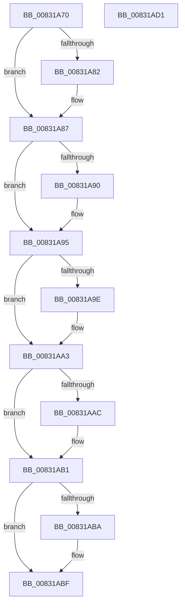

# SysCtxCloseMachine

- RVA: `0x00831A70`–`0x00831AD2` (길이 `98` bytes)
- VA: `0x0000000140831A70`
- 실행 섹션: `PAGE`
- PDB 이름 있음: `예`; PDB Function 태그: `아니요`
- unwind 정보 RVA: `0x0005CF00`
- 디코드: `31`개 명령, `98/98` bytes 표시
- 미해석 바이트: `0` (있으면 어셈블리에 `.byte`로 보존)

> 이 문서는 커널 이미지의 기계어와 PDB 기호를 분석해 생성했습니다. 4번과 5번은 함수 원형과 자료형을 바이너리 사용 방식에서 추정한 C 해석이며 원본 소스 복구 결과는 아닙니다.

## 1. Dependencies

- 직접 호출 지점: **6**; 고유 호출 대상: **2**
- 직접 호출자로 확인된 함수: **2**
- RIP 상대 이미지 참조: **0**

### Outgoing calls
- `0x00831A82` → [ZwClose](../../text/6A/ZwClose_function_006AD2B0.md) (function, `0x006AD2B0`)
- `0x00831A90` → [ZwClose](../../text/6A/ZwClose_function_006AD2B0.md) (function, `0x006AD2B0`)
- `0x00831A9E` → [ZwClose](../../text/6A/ZwClose_function_006AD2B0.md) (function, `0x006AD2B0`)
- `0x00831AAC` → [ZwClose](../../text/6A/ZwClose_function_006AD2B0.md) (function, `0x006AD2B0`)
- `0x00831ABA` → [ZwClose](../../text/6A/ZwClose_function_006AD2B0.md) (function, `0x006AD2B0`)
- `0x00831AC4` → [ExFreePoolWithTag](../../poolcode/B8/ExFreePoolWithTag_function_00B82870.md) (function, `0x00B82870`)

### Direct callers
- [PnpCtxCreateNode](../82/PnpCtxCreateNode_function_00828BCC.md) at `0x00828C45`
- [PnpCtxDestroyNode](../82/PnpCtxDestroyNode_function_00828D50.md) at `0x00828E32`

### Static image references
- 디코드된 RIP-relative 메모리 참조가 없습니다.

## 2. Other-region calls and transfers

- 다른 실행 섹션으로 향하는 call: **6**
  - `0x00831A82` → [ZwClose](../../text/6A/ZwClose_function_006AD2B0.md) (`PAGE` → `.text`)
  - `0x00831A90` → [ZwClose](../../text/6A/ZwClose_function_006AD2B0.md) (`PAGE` → `.text`)
  - `0x00831A9E` → [ZwClose](../../text/6A/ZwClose_function_006AD2B0.md) (`PAGE` → `.text`)
  - `0x00831AAC` → [ZwClose](../../text/6A/ZwClose_function_006AD2B0.md) (`PAGE` → `.text`)
  - `0x00831ABA` → [ZwClose](../../text/6A/ZwClose_function_006AD2B0.md) (`PAGE` → `.text`)
  - `0x00831AC4` → [ExFreePoolWithTag](../../poolcode/B8/ExFreePoolWithTag_function_00B82870.md) (`PAGE` → `POOLCODE`)
- 별도 외부 분기/꼬리 이동을 확인하지 못했습니다.

## 3. Assembly (complete function range)

```asm
00831A70  40 53                           push rbx
00831A72  48 83 EC 20                     sub rsp, 0x20
00831A76  48 8B D9                        mov rbx, rcx
00831A79  48 8B 49 08                     mov rcx, qword ptr [rcx + 8]
00831A7D  48 85 C9                        test rcx, rcx
00831A80  74 05                           je 0x140831a87
00831A82  E8 29 B8 E7 FF                  call 0x1406ad2b0
00831A87  48 8B 4B 18                     mov rcx, qword ptr [rbx + 0x18]
00831A8B  48 85 C9                        test rcx, rcx
00831A8E  74 05                           je 0x140831a95
00831A90  E8 1B B8 E7 FF                  call 0x1406ad2b0
00831A95  48 8B 4B 20                     mov rcx, qword ptr [rbx + 0x20]
00831A99  48 85 C9                        test rcx, rcx
00831A9C  74 05                           je 0x140831aa3
00831A9E  E8 0D B8 E7 FF                  call 0x1406ad2b0
00831AA3  48 8B 4B 30                     mov rcx, qword ptr [rbx + 0x30]
00831AA7  48 85 C9                        test rcx, rcx
00831AAA  74 05                           je 0x140831ab1
00831AAC  E8 FF B7 E7 FF                  call 0x1406ad2b0
00831AB1  48 8B 4B 28                     mov rcx, qword ptr [rbx + 0x28]
00831AB5  48 85 C9                        test rcx, rcx
00831AB8  74 05                           je 0x140831abf
00831ABA  E8 F1 B7 E7 FF                  call 0x1406ad2b0
00831ABF  33 D2                           xor edx, edx
00831AC1  48 8B CB                        mov rcx, rbx
00831AC4  E8 A7 0D 35 00                  call 0x140b82870
00831AC9  33 C0                           xor eax, eax
00831ACB  48 83 C4 20                     add rsp, 0x20
00831ACF  5B                              pop rbx
00831AD0  C3                              ret
00831AD1  CC                              int3
```

## 4. C-style interpretation (structured pseudocode)

```c
__int64 __fastcall SysCtxCloseMachine(__int64 a1, int a2)
{
    __int64 result;
    __int64 v_rsp;

    v_rsp = (v_rsp) - (32);
    if (*(unsigned __int64 *)(a1 + 8) != 0) {
        result = ZwClose(*(unsigned __int64 *)(a1 + 8), a2, a3, a4);
    }
    if (*(unsigned __int64 *)(a1 + 24) != 0) {
        result = ZwClose(*(unsigned __int64 *)(a1 + 24), a2, a3, a4);
    }
    if (*(unsigned __int64 *)(a1 + 32) != 0) {
        result = ZwClose(*(unsigned __int64 *)(a1 + 32), a2, a3, a4);
    }
    if (*(unsigned __int64 *)(a1 + 48) != 0) {
        result = ZwClose(*(unsigned __int64 *)(a1 + 48), a2, a3, a4);
    }
    if (*(unsigned __int64 *)(a1 + 40) != 0) {
        result = ZwClose(*(unsigned __int64 *)(a1 + 40), a2, a3, a4);
    }
    a2 = 0;
    result = ExFreePoolWithTag(a1, a2, a3, a4);
    result = 0;
    v_rsp = (v_rsp) + (32);
    return result;
}
```

## 5. (Beta) C Style

```c
int64_t SysCtxCloseMachine(void *Arg1, int32_t Arg2)
{
    uint8_t *arg1 = (uint8_t *)Arg1;

    int64_t result;
    int64_t local_rsp;

    local_rsp = (local_rsp) - (32);
    if (*(uint64_t *)(arg1 + 0x8) != 0) {
        result = ZwClose(*(uint64_t *)(arg1 + 0x8), Arg2, a3, a4);
    }
    if (*(uint64_t *)(arg1 + 0x18) != 0) {
        result = ZwClose(*(uint64_t *)(arg1 + 0x18), Arg2, a3, a4);
    }
    if (*(uint64_t *)(arg1 + 0x20) != 0) {
        result = ZwClose(*(uint64_t *)(arg1 + 0x20), Arg2, a3, a4);
    }
    if (*(uint64_t *)(arg1 + 0x30) != 0) {
        result = ZwClose(*(uint64_t *)(arg1 + 0x30), Arg2, a3, a4);
    }
    if (*(uint64_t *)(arg1 + 0x28) != 0) {
        result = ZwClose(*(uint64_t *)(arg1 + 0x28), Arg2, a3, a4);
    }
    Arg2 = 0;
    result = ExFreePoolWithTag(Arg1, Arg2, a3, a4);
    result = 0;
    local_rsp = (local_rsp) + (32);
    return result;
}
```

### 관측된 메모리 오프셋

구조체 형식이 확인되지 않은 접근은 인자 기준의 오프셋으로만 기록했습니다.

| 기준 인자 | 오프셋 표현 | 폭 (bit) | 접근 |
|---|---:|---:|---|
| `Arg1` | `+ 0x8` | `64` | `R` |
| `Arg1` | `+ 0x18` | `64` | `R` |
| `Arg1` | `+ 0x20` | `64` | `R` |
| `Arg1` | `+ 0x28` | `64` | `R` |
| `Arg1` | `+ 0x30` | `64` | `R` |

## 6. Execution-region graph

[열기: 2D/3D 그래프와 함수 탐색 컨트롤 패널](../../../control-panel.html?section=page&rva=0x00831A70&view=graph)

- 2D 그래프는 위에서 아래로 흐르고, 3D 그래프는 빈 공간을 드래그해 회전합니다. Shift+드래그는 이동, 휠은 확대·축소, 함수 노드 선택은 대상 보고서 이동입니다.

### Static fallback


