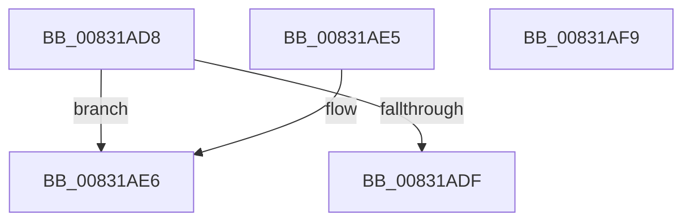

# SysCtxGetTransaction

- RVA: `0x00831AD8`–`0x00831AFA` (길이 `34` bytes)
- VA: `0x0000000140831AD8`
- 실행 섹션: `PAGE`
- PDB 이름 있음: `예`; PDB Function 태그: `아니요`
- unwind 정보 RVA: `0x000DB714`
- 디코드: `13`개 명령, `34/34` bytes 표시
- 미해석 바이트: `0` (있으면 어셈블리에 `.byte`로 보존)

> 이 문서는 커널 이미지의 기계어와 PDB 기호를 분석해 생성했습니다. 4번과 5번은 함수 원형과 자료형을 바이너리 사용 방식에서 추정한 C 해석이며 원본 소스 복구 결과는 아닙니다.

## 1. Dependencies

- 직접 호출 지점: **0**; 고유 호출 대상: **0**
- 직접 호출자로 확인된 함수: **1**
- RIP 상대 이미지 참조: **0**

### Outgoing calls
- 직접 디코드된 call 명령이 없습니다.

### Direct callers
- [PnpCtxRegisterMachineNode](../82/PnpCtxRegisterMachineNode_function_008292BC.md) at `0x00829350`

### Static image references
- 디코드된 RIP-relative 메모리 참조가 없습니다.

## 2. Other-region calls and transfers

- 다른 실행 섹션으로 향하는 call: **0**
- 별도 외부 분기/꼬리 이동을 확인하지 못했습니다.

## 3. Assembly (complete function range)

```asm
00831AD8  33 C0                           xor eax, eax
00831ADA  48 85 D2                        test rdx, rdx
00831ADD  75 07                           jne 0x140831ae6
00831ADF  B8 0D 00 00 C0                  mov eax, 0xc000000d
00831AE4  C3                              ret
00831AE5  CC                              int3
00831AE6  48 8B 49 08                     mov rcx, qword ptr [rcx + 8]
00831AEA  48 89 0A                        mov qword ptr [rdx], rcx
00831AED  48 85 C9                        test rcx, rcx
00831AF0  BA 03 00 19 C0                  mov edx, 0xc0190003
00831AF5  0F 44 C2                        cmove eax, edx
00831AF8  C3                              ret
00831AF9  CC                              int3
```

## 4. C-style interpretation (structured pseudocode)

```c
__int64 __fastcall SysCtxGetTransaction(__int64 a1, __int64 a2)
{
    __int64 result;

    result = 0;
    if (a2 != 0) goto loc_00831AE6;
    return (unsigned int)(0xC000000DULL);
loc_00831AE6:
    *(unsigned __int64 *)(a2) = *(unsigned __int64 *)(a1 + 8);
    result = (unsigned int)(0xC000000DULL);
    if (*(unsigned __int64 *)(a1 + 8) == 0) { result = (unsigned int)((unsigned int)(0xC0190003ULL)); }
    return result;
}
```

## 5. (Beta) C Style

```c
int64_t SysCtxGetTransaction(void *Arg1, int64_t Arg2)
{
    uint8_t *arg1 = (uint8_t *)Arg1;

    int64_t result;

    result = 0;
    if (Arg2 != 0) goto loc_00831AE6;
    return (uint32_t)(0xC000000DULL);
loc_00831AE6:
    *(uint64_t *)(Arg2) = *(uint64_t *)(arg1 + 0x8);
    result = (uint32_t)(0xC000000DULL);
    if (*(uint64_t *)(arg1 + 0x8) == 0) { result = (uint32_t)((uint32_t)(0xC0190003ULL)); }
    return result;
}
```

### 관측된 메모리 오프셋

구조체 형식이 확인되지 않은 접근은 인자 기준의 오프셋으로만 기록했습니다.

| 기준 인자 | 오프셋 표현 | 폭 (bit) | 접근 |
|---|---:|---:|---|
| `Arg1` | `+ 0x8` | `64` | `R` |

## 6. Execution-region graph

[열기: 2D/3D 그래프와 함수 탐색 컨트롤 패널](../../../control-panel.html?section=page&rva=0x00831AD8&view=graph)

- 2D 그래프는 위에서 아래로 흐르고, 3D 그래프는 빈 공간을 드래그해 회전합니다. Shift+드래그는 이동, 휠은 확대·축소, 함수 노드 선택은 대상 보고서 이동입니다.

### Static fallback


