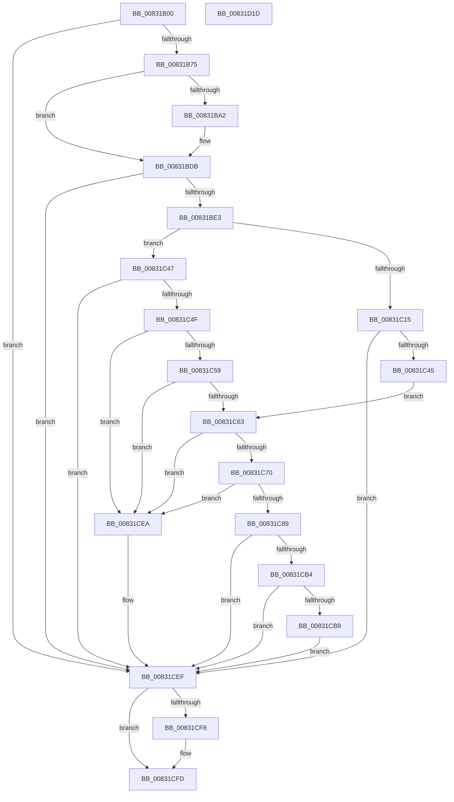

# SysCtxOpenControlSet

- RVA: `0x00831B00`–`0x00831D1E` (길이 `542` bytes)
- VA: `0x0000000140831B00`
- 실행 섹션: `PAGE`
- PDB 이름 있음: `예`; PDB Function 태그: `아니요`
- unwind 정보 RVA: `0x000DAAE4`
- 디코드: `139`개 명령, `542/542` bytes 표시
- 미해석 바이트: `0` (있으면 어셈블리에 `.byte`로 보존)

> 이 문서는 커널 이미지의 기계어와 PDB 기호를 분석해 생성했습니다. 4번과 5번은 함수 원형과 자료형을 바이너리 사용 방식에서 추정한 C 해석이며 원본 소스 복구 결과는 아닙니다.

## 1. Dependencies

- 직접 호출 지점: **10**; 고유 호출 대상: **7**
- 직접 호출자로 확인된 함수: **1**
- RIP 상대 이미지 참조: **5**

### Outgoing calls
- `0x00831B5F` → [_RegRtlOpenKeyTransacted](../8E/_RegRtlOpenKeyTransacted_function_008EF810.md) (function, `0x008EF810`)
- `0x00831B96` → [_RegRtlOpenKeyTransacted](../8E/_RegRtlOpenKeyTransacted_function_008EF810.md) (function, `0x008EF810`)
- `0x00831BD4` → [RegRtlCreateKeyTransacted](../93/RegRtlCreateKeyTransacted_function_0093207C.md) (function, `0x0093207C`)
- `0x00831C07` → [RegRtlQueryValue](../9D/RegRtlQueryValue_function_009DD310.md) (function, `0x009DD310`)
- `0x00831C36` → [RegRtlSetValue](../99/RegRtlSetValue_function_00991B28.md) (function, `0x00991B28`)
- `0x00831C80` → [RtlStringCchPrintfW](../../text/48/RtlStringCchPrintfW_function_00482D5C.md) (function, `0x00482D5C`)
- `0x00831CA6` → [_RegRtlOpenKeyTransacted](../8E/_RegRtlOpenKeyTransacted_function_008EF810.md) (function, `0x008EF810`)
- `0x00831CE1` → [RegRtlCreateKeyTransacted](../93/RegRtlCreateKeyTransacted_function_0093207C.md) (function, `0x0093207C`)
- `0x00831CF8` → [ZwClose](../../text/6A/ZwClose_function_006AD2B0.md) (function, `0x006AD2B0`)
- `0x00831D06` → [_security_check_cookie](../../text/6A/_security_check_cookie_function_006AC640.md) (function, `0x006AC640`)

### Direct callers
- [SysCtxOpenMachine](SysCtxOpenMachine_function_00831D24.md) at `0x00831F26`

### Static image references
- `0x00831B17` → RVA `0x00E0A740` (`.data`; read)
- `0x00831B30` → RVA `0x00042220` (`.rdata`; read)
- `0x00831B8C` → RVA `0x00042210` (`.rdata`; read)
- `0x00831C00` → RVA `0x00042268` (`.rdata`; read)
- `0x00831C70` → RVA `0x00042248` (`.rdata`; read)

## 2. Other-region calls and transfers

- 다른 실행 섹션으로 향하는 call: **3**
  - `0x00831C80` → [RtlStringCchPrintfW](../../text/48/RtlStringCchPrintfW_function_00482D5C.md) (`PAGE` → `.text`)
  - `0x00831CF8` → [ZwClose](../../text/6A/ZwClose_function_006AD2B0.md) (`PAGE` → `.text`)
  - `0x00831D06` → [_security_check_cookie](../../text/6A/_security_check_cookie_function_006AC640.md) (`PAGE` → `.text`)
- 별도 외부 분기/꼬리 이동을 확인하지 못했습니다.

## 3. Assembly (complete function range)

```asm
00831B00  40 55                           push rbp
00831B02  53                              push rbx
00831B03  56                              push rsi
00831B04  57                              push rdi
00831B05  41 55                           push r13
00831B07  41 56                           push r14
00831B09  41 57                           push r15
00831B0B  48 8D 6C 24 D9                  lea rbp, [rsp - 0x27]
00831B10  48 81 EC A0 00 00 00            sub rsp, 0xa0
00831B17  48 8B 05 22 8C 5D 00            mov rax, qword ptr [rip + 0x5d8c22]
00831B1E  48 33 C4                        xor rax, rsp
00831B21  48 89 45 17                     mov qword ptr [rbp + 0x17], rax
00831B25  49 83 21 00                     and qword ptr [r9], 0
00831B29  48 8B FA                        mov rdi, rdx
00831B2C  83 65 D7 00                     and dword ptr [rbp - 0x29], 0
00831B30  48 8D 15 E9 06 81 FF            lea rdx, [rip - 0x7ef917]
00831B37  48 83 65 EF 00                  and qword ptr [rbp - 0x11], 0
00831B3C  4D 8B F1                        mov r14, r9
00831B3F  83 65 E7 00                     and dword ptr [rbp - 0x19], 0
00831B43  49 8B F0                        mov rsi, r8
00831B46  4C 89 44 24 28                  mov qword ptr [rsp + 0x28], r8
00831B4B  48 8B CF                        mov rcx, rdi
00831B4E  4C 89 4C 24 20                  mov qword ptr [rsp + 0x20], r9
00831B53  45 33 C0                        xor r8d, r8d
00831B56  41 B9 00 00 00 02               mov r9d, 0x2000000
00831B5C  45 32 FF                        xor r15b, r15b
00831B5F  E8 AC DC 0B 00                  call 0x1408ef810
00831B64  41 BD 34 00 00 C0               mov r13d, 0xc0000034
00831B6A  8B D8                           mov ebx, eax
00831B6C  41 3B C5                        cmp eax, r13d
00831B6F  0F 85 7A 01 00 00               jne 0x140831cef
00831B75  48 8D 45 EF                     lea rax, [rbp - 0x11]
00831B79  48 89 74 24 28                  mov qword ptr [rsp + 0x28], rsi
00831B7E  41 B9 01 00 00 00               mov r9d, 1
00831B84  48 89 44 24 20                  mov qword ptr [rsp + 0x20], rax
00831B89  45 33 C0                        xor r8d, r8d
00831B8C  48 8D 15 7D 06 81 FF            lea rdx, [rip - 0x7ef983]
00831B93  48 8B CF                        mov rcx, rdi
00831B96  E8 75 DC 0B 00                  call 0x1408ef810
00831B9B  8B D8                           mov ebx, eax
00831B9D  41 3B C5                        cmp eax, r13d
00831BA0  75 39                           jne 0x140831bdb
00831BA2  48 89 74 24 40                  mov qword ptr [rsp + 0x40], rsi
00831BA7  48 8D 45 EF                     lea rax, [rbp - 0x11]
00831BAB  48 83 64 24 38 00               and qword ptr [rsp + 0x38], 0
00831BB1  48 8D 15 58 06 81 FF            lea rdx, [rip - 0x7ef9a8]
00831BB8  48 89 44 24 30                  mov qword ptr [rsp + 0x30], rax
00831BBD  41 B9 03 00 00 00               mov r9d, 3
00831BC3  44 88 7C 24 28                  mov byte ptr [rsp + 0x28], r15b
00831BC8  45 33 C0                        xor r8d, r8d
00831BCB  48 83 64 24 20 00               and qword ptr [rsp + 0x20], 0
00831BD1  48 8B CF                        mov rcx, rdi
00831BD4  E8 A3 04 10 00                  call 0x14093207c
00831BD9  8B D8                           mov ebx, eax
00831BDB  85 DB                           test ebx, ebx
00831BDD  0F 85 0C 01 00 00               jne 0x140831cef
00831BE3  48 8B 4D EF                     mov rcx, qword ptr [rbp - 0x11]
00831BE7  48 8D 45 EB                     lea rax, [rbp - 0x15]
00831BEB  44 8D 6B 04                     lea r13d, [rbx + 4]
00831BEF  48 89 44 24 20                  mov qword ptr [rsp + 0x20], rax
00831BF4  4C 8D 4D D7                     lea r9, [rbp - 0x29]
00831BF8  44 89 6D EB                     mov dword ptr [rbp - 0x15], r13d
00831BFC  4C 8D 45 E7                     lea r8, [rbp - 0x19]
00831C00  48 8D 15 61 06 81 FF            lea rdx, [rip - 0x7ef99f]
00831C07  E8 04 B7 1A 00                  call 0x1409dd310
00831C0C  8B D8                           mov ebx, eax
00831C0E  3D 34 00 00 C0                  cmp eax, 0xc0000034
00831C13  75 32                           jne 0x140831c47
00831C15  48 8B 4D EF                     mov rcx, qword ptr [rbp - 0x11]
00831C19  4C 8D 4D D7                     lea r9, [rbp - 0x29]
00831C1D  45 8B C5                        mov r8d, r13d
00831C20  C7 45 D7 01 00 00 00            mov dword ptr [rbp - 0x29], 1
00831C27  48 8D 15 3A 06 81 FF            lea rdx, [rip - 0x7ef9c6]
00831C2E  44 89 6C 24 20                  mov dword ptr [rsp + 0x20], r13d
00831C33  41 B7 01                        mov r15b, 1
00831C36  E8 ED FE 15 00                  call 0x140991b28
00831C3B  8B D8                           mov ebx, eax
00831C3D  85 C0                           test eax, eax
00831C3F  0F 85 AA 00 00 00               jne 0x140831cef
00831C45  EB 1C                           jmp 0x140831c63
00831C47  85 C0                           test eax, eax
00831C49  0F 85 A0 00 00 00               jne 0x140831cef
00831C4F  44 39 6D E7                     cmp dword ptr [rbp - 0x19], r13d
00831C53  0F 85 91 00 00 00               jne 0x140831cea
00831C59  44 39 6D EB                     cmp dword ptr [rbp - 0x15], r13d
00831C5D  0F 85 87 00 00 00               jne 0x140831cea
00831C63  44 8B 4D D7                     mov r9d, dword ptr [rbp - 0x29]
00831C67  41 81 F9 E7 03 00 00            cmp r9d, 0x3e7
00831C6E  77 7A                           ja 0x140831cea
00831C70  4C 8D 05 D1 05 81 FF            lea r8, [rip - 0x7efa2f]
00831C77  BA 0E 00 00 00                  mov edx, 0xe
00831C7C  48 8D 4D F7                     lea rcx, [rbp - 9]
00831C80  E8 D7 10 C5 FF                  call 0x140482d5c
00831C85  85 C0                           test eax, eax
00831C87  78 61                           js 0x140831cea
00831C89  41 BD 00 00 00 02               mov r13d, 0x2000000
00831C8F  48 89 74 24 28                  mov qword ptr [rsp + 0x28], rsi
00831C94  45 8B CD                        mov r9d, r13d
00831C97  4C 89 74 24 20                  mov qword ptr [rsp + 0x20], r14
00831C9C  45 33 C0                        xor r8d, r8d
00831C9F  48 8D 55 F7                     lea rdx, [rbp - 9]
00831CA3  48 8B CF                        mov rcx, rdi
00831CA6  E8 65 DB 0B 00                  call 0x1408ef810
00831CAB  8B D8                           mov ebx, eax
00831CAD  3D 34 00 00 C0                  cmp eax, 0xc0000034
00831CB2  75 3B                           jne 0x140831cef
00831CB4  45 84 FF                        test r15b, r15b
00831CB7  74 36                           je 0x140831cef
00831CB9  48 89 74 24 40                  mov qword ptr [rsp + 0x40], rsi
00831CBE  48 8D 55 F7                     lea rdx, [rbp - 9]
00831CC2  48 83 64 24 38 00               and qword ptr [rsp + 0x38], 0
00831CC8  45 8B CD                        mov r9d, r13d
00831CCB  4C 89 74 24 30                  mov qword ptr [rsp + 0x30], r14
00831CD0  45 33 C0                        xor r8d, r8d
00831CD3  C6 44 24 28 00                  mov byte ptr [rsp + 0x28], 0
00831CD8  48 8B CF                        mov rcx, rdi
00831CDB  48 83 64 24 20 00               and qword ptr [rsp + 0x20], 0
00831CE1  E8 96 03 10 00                  call 0x14093207c
00831CE6  8B D8                           mov ebx, eax
00831CE8  EB 05                           jmp 0x140831cef
00831CEA  BB 0D 00 00 C0                  mov ebx, 0xc000000d
00831CEF  48 8B 4D EF                     mov rcx, qword ptr [rbp - 0x11]
00831CF3  48 85 C9                        test rcx, rcx
00831CF6  74 05                           je 0x140831cfd
00831CF8  E8 B3 B5 E7 FF                  call 0x1406ad2b0
00831CFD  8B C3                           mov eax, ebx
00831CFF  48 8B 4D 17                     mov rcx, qword ptr [rbp + 0x17]
00831D03  48 33 CC                        xor rcx, rsp
00831D06  E8 35 A9 E7 FF                  call 0x1406ac640
00831D0B  48 81 C4 A0 00 00 00            add rsp, 0xa0
00831D12  41 5F                           pop r15
00831D14  41 5E                           pop r14
00831D16  41 5D                           pop r13
00831D18  5F                              pop rdi
00831D19  5E                              pop rsi
00831D1A  5B                              pop rbx
00831D1B  5D                              pop rbp
00831D1C  C3                              ret
00831D1D  CC                              int3
```

## 4. C-style interpretation (structured pseudocode)

```c
__int64 __fastcall SysCtxOpenControlSet(__int64 a1, __int64 a2, __int64 a3, __int64 a4)
{
    __int64 result;
    __int64 v_r15;
    __int64 v_rbx;
    __int64 v_rsp;
    unsigned __int64 v_stack_m48;
    unsigned __int64 v_stack_m5F;
    unsigned __int64 v_stack_m68;
    unsigned __int64 v_stack_m70;
    unsigned __int64 v_stack_m74;
    unsigned int v_stack_m78;
    unsigned int v_stack_m88;
    unsigned __int64 v_stack_m98;
    unsigned __int64 v_stack_mA0;
    unsigned __int64 v_stack_mA8;
    unsigned __int64 v_stack_mB0;
    unsigned __int64 v_stack_mB8;

    v_rsp = (v_rsp) - (160);
    result = (*(unsigned __int64 *)(v_rip + 6130722)) ^ (v_rsp);
    v_stack_m48 = result;
    v_stack_mB0 = a3;
    v_stack_mB8 = a4;
    a3 = 0;
    v_r15 = 0;
    result = _RegRtlOpenKeyTransacted(a2, v_rip - 8321303, a3, (unsigned int)(0x2000000ULL));
    if (((unsigned int)(result)) != ((unsigned int)((unsigned int)(0xC0000034ULL)))) goto loc_00831CEF;
    v_stack_mB0 = 0;
    v_stack_mB8 = v_stack_m70;
    a3 = 0;
    result = _RegRtlOpenKeyTransacted(a2, v_rip - 8321411, a3, 1);
    v_rbx = (unsigned int)((unsigned int)(result));
    if (((unsigned int)(result)) == ((unsigned int)((unsigned int)(0xC0000034ULL)))) {
        v_stack_m98 = 0;
        result = v_stack_m70;
        a2 = v_rip - 8321448;
        v_stack_mA8 = result;
        a4 = 3;
        v_stack_mB0 = 0;
        a3 = 0;
        a1 = a2;
        result = RegRtlCreateKeyTransacted(a1, a2, a3, a4);
        v_rbx = (unsigned int)(result);
    }
    if ((unsigned int)(v_rbx) != 0) goto loc_00831CEF;
    v_stack_mB8 = v_stack_m74;
    v_stack_m74 = (unsigned int)(v_rbx + 4);
    result = RegRtlQueryValue(v_stack_m70, v_rip - 8321439, v_stack_m78, v_stack_m88);
    if (((unsigned int)(result)) != 0xC0000034ULL) goto loc_00831C47;
    v_stack_m88 = 1;
    v_stack_mB8 = (unsigned int)(v_rbx + 4);
    result = RegRtlSetValue(v_stack_m70, v_rip - 8321478, (unsigned int)((unsigned int)(v_rbx + 4)), v_stack_m88);
    if ((unsigned int)(result) != 0) goto loc_00831CEF;
    goto loc_00831C63;
loc_00831C47:
    if ((unsigned int)(result) != 0) goto loc_00831CEF;
    if (v_stack_m78 != ((unsigned int)(v_rbx + 4))) goto loc_00831CEA;
    if (v_stack_m74 != ((unsigned int)(v_rbx + 4))) goto loc_00831CEA;
loc_00831C63:
    if (((unsigned int)((unsigned int)(v_stack_m88))) > 999) goto loc_00831CEA;
    result = RtlStringCchPrintfW(v_stack_m68, 14, v_rip - 8321583, (unsigned int)(v_stack_m88));
    if (sign_flag) goto loc_00831CEA;
    v_stack_mB0 = 0;
    v_stack_mB8 = a4;
    a3 = 0;
    result = _RegRtlOpenKeyTransacted(a2, v_stack_m68, a3, (unsigned int)((unsigned int)((unsigned int)(0x2000000ULL))));
    if (((unsigned int)(result)) != 0xC0000034ULL) goto loc_00831CEF;
    if (1 == 0) goto loc_00831CEF;
    v_stack_m98 = 0;
    v_stack_mA8 = a4;
    a3 = 0;
    v_stack_mB0 = 0;
    result = RegRtlCreateKeyTransacted(a2, v_stack_m68, a3, (unsigned int)((unsigned int)((unsigned int)(0x2000000ULL))));
    goto loc_00831CEF;
loc_00831CEA:
loc_00831CEF:
    if (v_stack_m70 != 0) {
        result = ZwClose(v_stack_m70, v_stack_m68, a3, (unsigned int)((unsigned int)((unsigned int)(0x2000000ULL))));
    }
    a1 = (v_stack_m48) ^ (v_rsp);
    result = _security_check_cookie(a1, v_stack_m68, a3, (unsigned int)((unsigned int)((unsigned int)(0x2000000ULL))));
    v_rsp = (v_rsp) + (160);
    return result;
}
```

## 5. (Beta) C Style

```c
int64_t SysCtxOpenControlSet(int64_t Arg1, int64_t Arg2, int64_t Arg3, void *Arg4)
{
    uint8_t *arg4 = (uint8_t *)Arg4;

    int64_t result;
    int64_t local_r15;
    int64_t local_rbx;
    int64_t local_rsp;
    uint64_t v_stack_m48;
    uint64_t v_stack_m5F;
    uint64_t v_stack_m68;
    uint64_t v_stack_m70;
    uint64_t v_stack_m74;
    uint32_t v_stack_m78;
    uint32_t v_stack_m88;
    uint64_t v_stack_m98;
    uint64_t v_stack_mA0;
    uint64_t v_stack_mA8;
    uint64_t v_stack_mB0;
    uint64_t v_stack_mB8;

    local_rsp = (local_rsp) - (160);
    result = (*(uint64_t *)(v_rip + 0x5D8C22)) ^ (local_rsp);
    v_stack_m48 = result;
    v_stack_mB0 = Arg3;
    v_stack_mB8 = Arg4;
    Arg3 = 0;
    local_r15 = 0;
    result = _RegRtlOpenKeyTransacted(Arg2, v_rip - 8321303, Arg3, (uint32_t)(0x2000000ULL));
    if (((uint32_t)(result)) != ((uint32_t)((uint32_t)(0xC0000034ULL)))) goto loc_00831CEF;
    v_stack_mB0 = 0;
    v_stack_mB8 = v_stack_m70;
    Arg3 = 0;
    result = _RegRtlOpenKeyTransacted(Arg2, v_rip - 8321411, Arg3, 1);
    local_rbx = (uint32_t)((uint32_t)(result));
    if (((uint32_t)(result)) == ((uint32_t)((uint32_t)(0xC0000034ULL)))) {
        v_stack_m98 = 0;
        result = v_stack_m70;
        Arg2 = v_rip - 8321448;
        v_stack_mA8 = result;
        Arg4 = 3;
        v_stack_mB0 = 0;
        Arg3 = 0;
        Arg1 = Arg2;
        result = RegRtlCreateKeyTransacted(Arg1, Arg2, Arg3, Arg4);
        local_rbx = (uint32_t)(result);
    }
    if ((uint32_t)(local_rbx) != 0) goto loc_00831CEF;
    v_stack_mB8 = v_stack_m74;
    v_stack_m74 = (uint32_t)(local_rbx + 4);
    result = RegRtlQueryValue(v_stack_m70, v_rip - 8321439, v_stack_m78, v_stack_m88);
    if (((uint32_t)(result)) != 0xC0000034ULL) goto loc_00831C47;
    v_stack_m88 = 1;
    v_stack_mB8 = (uint32_t)(local_rbx + 4);
    result = RegRtlSetValue(v_stack_m70, v_rip - 8321478, (uint32_t)((uint32_t)(local_rbx + 4)), v_stack_m88);
    if ((uint32_t)(result) != 0) goto loc_00831CEF;
    goto loc_00831C63;
loc_00831C47:
    if ((uint32_t)(result) != 0) goto loc_00831CEF;
    if (v_stack_m78 != ((uint32_t)(local_rbx + 4))) goto loc_00831CEA;
    if (v_stack_m74 != ((uint32_t)(local_rbx + 4))) goto loc_00831CEA;
loc_00831C63:
    if (((uint32_t)((uint32_t)(v_stack_m88))) > 999) goto loc_00831CEA;
    result = RtlStringCchPrintfW(v_stack_m68, 14, v_rip - 8321583, (uint32_t)(v_stack_m88));
    if (sign_flag) goto loc_00831CEA;
    v_stack_mB0 = 0;
    v_stack_mB8 = Arg4;
    Arg3 = 0;
    result = _RegRtlOpenKeyTransacted(Arg2, v_stack_m68, Arg3, (uint32_t)((uint32_t)((uint32_t)(0x2000000ULL))));
    if (((uint32_t)(result)) != 0xC0000034ULL) goto loc_00831CEF;
    if (1 == 0) goto loc_00831CEF;
    v_stack_m98 = 0;
    v_stack_mA8 = Arg4;
    Arg3 = 0;
    v_stack_mB0 = 0;
    result = RegRtlCreateKeyTransacted(Arg2, v_stack_m68, Arg3, (uint32_t)((uint32_t)((uint32_t)(0x2000000ULL))));
    goto loc_00831CEF;
loc_00831CEA:
loc_00831CEF:
    if (v_stack_m70 != 0) {
        result = ZwClose(v_stack_m70, v_stack_m68, Arg3, (uint32_t)((uint32_t)((uint32_t)(0x2000000ULL))));
    }
    Arg1 = (v_stack_m48) ^ (local_rsp);
    result = _security_check_cookie(Arg1, v_stack_m68, Arg3, (uint32_t)((uint32_t)((uint32_t)(0x2000000ULL))));
    local_rsp = (local_rsp) + (160);
    return result;
}
```

### 관측된 메모리 오프셋

구조체 형식이 확인되지 않은 접근은 인자 기준의 오프셋으로만 기록했습니다.

| 기준 인자 | 오프셋 표현 | 폭 (bit) | 접근 |
|---|---:|---:|---|
| `Arg4` | `+ 0x0` | `64` | `R/W` |

## 6. Execution-region graph

[열기: 2D/3D 그래프와 함수 탐색 컨트롤 패널](../../../control-panel.html?section=page&rva=0x00831B00&view=graph)

- 2D 그래프는 위에서 아래로 흐르고, 3D 그래프는 빈 공간을 드래그해 회전합니다. Shift+드래그는 이동, 휠은 확대·축소, 함수 노드 선택은 대상 보고서 이동입니다.

### Static fallback


