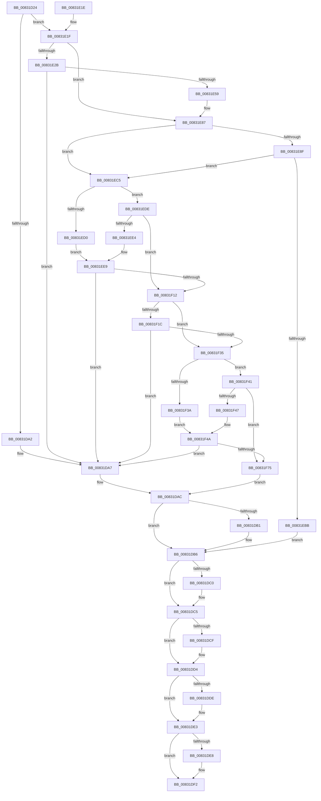

# SysCtxOpenMachine

- RVA: `0x00831D24`–`0x00831FC4` (길이 `672` bytes)
- VA: `0x0000000140831D24`
- 실행 섹션: `PAGE`
- PDB 이름 있음: `예`; PDB Function 태그: `아니요`
- unwind 정보 RVA: `0x000DAB08`
- 디코드: `174`개 명령, `672/672` bytes 표시
- 미해석 바이트: `0` (있으면 어셈블리에 `.byte`로 보존)

> 이 문서는 커널 이미지의 기계어와 PDB 기호를 분석해 생성했습니다. 4번과 5번은 함수 원형과 자료형을 바이너리 사용 방식에서 추정한 C 해석이며 원본 소스 복구 결과는 아닙니다.

## 1. Dependencies

- 직접 호출 지점: **13**; 고유 호출 대상: **9**
- 직접 호출자로 확인된 함수: **1**
- RIP 상대 이미지 참조: **2**

### Outgoing calls
- `0x00831D95` → [ExAllocatePool2](../../poolcode/B8/ExAllocatePool2_function_00B820F0.md) (function, `0x00B820F0`)
- `0x00831DB1` → [ZwClose](../../text/6A/ZwClose_function_006AD2B0.md) (function, `0x006AD2B0`)
- `0x00831DC0` → [ZwClose](../../text/6A/ZwClose_function_006AD2B0.md) (function, `0x006AD2B0`)
- `0x00831DCF` → [ZwClose](../../text/6A/ZwClose_function_006AD2B0.md) (function, `0x006AD2B0`)
- `0x00831DDE` → [ZwClose](../../text/6A/ZwClose_function_006AD2B0.md) (function, `0x006AD2B0`)
- `0x00831DED` → [ExFreePoolWithTag](../../poolcode/B8/ExFreePoolWithTag_function_00B82870.md) (function, `0x00B82870`)
- `0x00831DFE` → [_security_check_cookie](../../text/6A/_security_check_cookie_function_006AC640.md) (function, `0x006AC640`)
- `0x00831E38` → [memset](../../text/6C/memset_function_006C6C40.md) (function, `0x006C6C40`)
- `0x00831E4A` → [RtlGetVersion](../A1/RtlGetVersion_function_00A19110.md) (function, `0x00A19110`)
- `0x00831EB0` → [ZwDuplicateObject](../../text/6A/ZwDuplicateObject_function_006AD850.md) (function, `0x006AD850`)
- `0x00831F03` → [_RegRtlOpenKeyTransacted](../8E/_RegRtlOpenKeyTransacted_function_008EF810.md) (function, `0x008EF810`)
- `0x00831F26` → [SysCtxOpenControlSet](SysCtxOpenControlSet_function_00831B00.md) (function, `0x00831B00`)
- `0x00831F66` → [_RegRtlOpenKeyTransacted](../8E/_RegRtlOpenKeyTransacted_function_008EF810.md) (function, `0x008EF810`)

### Direct callers
- [PnpCtxCreateNode](../82/PnpCtxCreateNode_function_00828BCC.md) at `0x00828C9A`

### Static image references
- `0x00831D43` → RVA `0x00E0A740` (`.data`; read)
- `0x00831ED0` → RVA `0x00028470` (`.rdata`; read)

## 2. Other-region calls and transfers

- 다른 실행 섹션으로 향하는 call: **9**
  - `0x00831D95` → [ExAllocatePool2](../../poolcode/B8/ExAllocatePool2_function_00B820F0.md) (`PAGE` → `POOLCODE`)
  - `0x00831DB1` → [ZwClose](../../text/6A/ZwClose_function_006AD2B0.md) (`PAGE` → `.text`)
  - `0x00831DC0` → [ZwClose](../../text/6A/ZwClose_function_006AD2B0.md) (`PAGE` → `.text`)
  - `0x00831DCF` → [ZwClose](../../text/6A/ZwClose_function_006AD2B0.md) (`PAGE` → `.text`)
  - `0x00831DDE` → [ZwClose](../../text/6A/ZwClose_function_006AD2B0.md) (`PAGE` → `.text`)
  - `0x00831DED` → [ExFreePoolWithTag](../../poolcode/B8/ExFreePoolWithTag_function_00B82870.md) (`PAGE` → `POOLCODE`)
  - `0x00831DFE` → [_security_check_cookie](../../text/6A/_security_check_cookie_function_006AC640.md) (`PAGE` → `.text`)
  - `0x00831E38` → [memset](../../text/6C/memset_function_006C6C40.md) (`PAGE` → `.text`)
  - `0x00831EB0` → [ZwDuplicateObject](../../text/6A/ZwDuplicateObject_function_006AD850.md) (`PAGE` → `.text`)
- 별도 외부 분기/꼬리 이동을 확인하지 못했습니다.

## 3. Assembly (complete function range)

```asm
00831D24  48 89 5C 24 08                  mov qword ptr [rsp + 8], rbx
00831D29  55                              push rbp
00831D2A  56                              push rsi
00831D2B  57                              push rdi
00831D2C  41 54                           push r12
00831D2E  41 55                           push r13
00831D30  41 56                           push r14
00831D32  41 57                           push r15
00831D34  48 8D AC 24 70 FF FF FF         lea rbp, [rsp - 0x90]
00831D3C  48 81 EC 90 01 00 00            sub rsp, 0x190
00831D43  48 8B 05 F6 89 5D 00            mov rax, qword ptr [rip + 0x5d89f6]
00831D4A  48 33 C4                        xor rax, rsp
00831D4D  48 89 85 80 00 00 00            mov qword ptr [rbp + 0x80], rax
00831D54  4C 8B A5 00 01 00 00            mov r12, qword ptr [rbp + 0x100]
00831D5B  45 33 ED                        xor r13d, r13d
00831D5E  4C 8B BD F0 00 00 00            mov r15, qword ptr [rbp + 0xf0]
00831D65  48 8B F2                        mov rsi, rdx
00831D68  B9 00 01 00 00                  mov ecx, 0x100
00831D6D  4C 89 6C 24 48                  mov qword ptr [rsp + 0x48], r13
00831D72  41 B8 50 4E 50 53               mov r8d, 0x53504e50
00831D78  4C 89 6C 24 50                  mov qword ptr [rsp + 0x50], r13
00831D7D  41 8D 55 38                     lea edx, [r13 + 0x38]
00831D81  4C 89 6C 24 58                  mov qword ptr [rsp + 0x58], r13
00831D86  4D 8B F1                        mov r14, r9
00831D89  4C 89 6C 24 40                  mov qword ptr [rsp + 0x40], r13
00831D8E  41 8B DD                        mov ebx, r13d
00831D91  4D 89 2C 24                     mov qword ptr [r12], r13
00831D95  E8 56 03 35 00                  call 0x140b820f0
00831D9A  48 8B F8                        mov rdi, rax
00831D9D  48 85 C0                        test rax, rax
00831DA0  75 7D                           jne 0x140831e1f
00831DA2  BB 17 00 00 C0                  mov ebx, 0xc0000017
00831DA7  48 8B 4C 24 40                  mov rcx, qword ptr [rsp + 0x40]
00831DAC  48 85 C9                        test rcx, rcx
00831DAF  74 05                           je 0x140831db6
00831DB1  E8 FA B4 E7 FF                  call 0x1406ad2b0
00831DB6  48 8B 4C 24 48                  mov rcx, qword ptr [rsp + 0x48]
00831DBB  48 85 C9                        test rcx, rcx
00831DBE  74 05                           je 0x140831dc5
00831DC0  E8 EB B4 E7 FF                  call 0x1406ad2b0
00831DC5  48 8B 4C 24 58                  mov rcx, qword ptr [rsp + 0x58]
00831DCA  48 85 C9                        test rcx, rcx
00831DCD  74 05                           je 0x140831dd4
00831DCF  E8 DC B4 E7 FF                  call 0x1406ad2b0
00831DD4  48 8B 4C 24 50                  mov rcx, qword ptr [rsp + 0x50]
00831DD9  48 85 C9                        test rcx, rcx
00831DDC  74 05                           je 0x140831de3
00831DDE  E8 CD B4 E7 FF                  call 0x1406ad2b0
00831DE3  48 85 FF                        test rdi, rdi
00831DE6  74 0A                           je 0x140831df2
00831DE8  33 D2                           xor edx, edx
00831DEA  48 8B CF                        mov rcx, rdi
00831DED  E8 7E 0A 35 00                  call 0x140b82870
00831DF2  8B C3                           mov eax, ebx
00831DF4  48 8B 8D 80 00 00 00            mov rcx, qword ptr [rbp + 0x80]
00831DFB  48 33 CC                        xor rcx, rsp
00831DFE  E8 3D A8 E7 FF                  call 0x1406ac640
00831E03  48 8B 9C 24 D0 01 00 00         mov rbx, qword ptr [rsp + 0x1d0]
00831E0B  48 81 C4 90 01 00 00            add rsp, 0x190
00831E12  41 5F                           pop r15
00831E14  41 5E                           pop r14
00831E16  41 5D                           pop r13
00831E18  41 5C                           pop r12
00831E1A  5F                              pop rdi
00831E1B  5E                              pop rsi
00831E1C  5D                              pop rbp
00831E1D  C3                              ret
00831E1E  CC                              int3
00831E1F  44 8B 85 F8 00 00 00            mov r8d, dword ptr [rbp + 0xf8]
00831E26  45 85 C0                        test r8d, r8d
00831E29  75 5C                           jne 0x140831e87
00831E2B  33 D2                           xor edx, edx
00831E2D  48 8D 4C 24 64                  lea rcx, [rsp + 0x64]
00831E32  41 B8 18 01 00 00               mov r8d, 0x118
00831E38  E8 03 4E E9 FF                  call 0x1406c6c40
00831E3D  48 8D 4C 24 60                  lea rcx, [rsp + 0x60]
00831E42  C7 44 24 60 1C 01 00 00         mov dword ptr [rsp + 0x60], 0x11c
00831E4A  E8 C1 72 1E 00                  call 0x140a19110
00831E4F  8B D8                           mov ebx, eax
00831E51  85 C0                           test eax, eax
00831E53  0F 88 4E FF FF FF               js 0x140831da7
00831E59  0F B6 4C 24 64                  movzx ecx, byte ptr [rsp + 0x64]
00831E5E  0F B6 45 76                     movzx eax, byte ptr [rbp + 0x76]
00831E62  66 C1 E1 08                     shl cx, 8
00831E66  44 0F B7 C1                     movzx r8d, cx
00831E6A  0F B6 4C 24 68                  movzx ecx, byte ptr [rsp + 0x68]
00831E6F  44 0B C1                        or r8d, ecx
00831E72  0F B6 4D 74                     movzx ecx, byte ptr [rbp + 0x74]
00831E76  66 C1 E1 08                     shl cx, 8
00831E7A  41 C1 E0 10                     shl r8d, 0x10
00831E7E  0F B7 D1                        movzx edx, cx
00831E81  44 0B C2                        or r8d, edx
00831E84  44 0B C0                        or r8d, eax
00831E87  44 89 07                        mov dword ptr [rdi], r8d
00831E8A  4D 85 FF                        test r15, r15
00831E8D  74 36                           je 0x140831ec5
00831E8F  49 83 C8 FF                     or r8, 0xffffffffffffffff
00831E93  C7 44 24 30 02 00 00 00         mov dword ptr [rsp + 0x30], 2
00831E9B  49 0B C8                        or rcx, r8
00831E9E  44 89 6C 24 28                  mov dword ptr [rsp + 0x28], r13d
00831EA3  4C 8D 4C 24 40                  lea r9, [rsp + 0x40]
00831EA8  44 89 6C 24 20                  mov dword ptr [rsp + 0x20], r13d
00831EAD  49 8B D7                        mov rdx, r15
00831EB0  E8 9B B9 E7 FF                  call 0x1406ad850
00831EB5  8B D8                           mov ebx, eax
00831EB7  85 C0                           test eax, eax
00831EB9  79 0A                           jns 0x140831ec5
00831EBB  4C 89 6C 24 40                  mov qword ptr [rsp + 0x40], r13
00831EC0  E9 F1 FE FF FF                  jmp 0x140831db6
00831EC5  41 BF 00 00 00 02               mov r15d, 0x2000000
00831ECB  48 85 F6                        test rsi, rsi
00831ECE  75 0E                           jne 0x140831ede
00831ED0  48 8D 15 99 65 7F FF            lea rdx, [rip - 0x809a67]
00831ED7  B9 02 00 00 80                  mov ecx, 0x80000002
00831EDC  EB 0B                           jmp 0x140831ee9
00831EDE  48 83 FE FF                     cmp rsi, -1
00831EE2  74 2E                           je 0x140831f12
00831EE4  33 D2                           xor edx, edx
00831EE6  48 8B CE                        mov rcx, rsi
00831EE9  48 8B 44 24 40                  mov rax, qword ptr [rsp + 0x40]
00831EEE  45 8B CF                        mov r9d, r15d
00831EF1  48 89 44 24 28                  mov qword ptr [rsp + 0x28], rax
00831EF6  45 33 C0                        xor r8d, r8d
00831EF9  48 8D 44 24 48                  lea rax, [rsp + 0x48]
00831EFE  48 89 44 24 20                  mov qword ptr [rsp + 0x20], rax
00831F03  E8 08 D9 0B 00                  call 0x1408ef810
00831F08  8B D8                           mov ebx, eax
00831F0A  85 C0                           test eax, eax
00831F0C  0F 85 95 FE FF FF               jne 0x140831da7
00831F12  48 8B 54 24 48                  mov rdx, qword ptr [rsp + 0x48]
00831F17  48 85 D2                        test rdx, rdx
00831F1A  74 19                           je 0x140831f35
00831F1C  4C 8B 44 24 40                  mov r8, qword ptr [rsp + 0x40]
00831F21  4C 8D 4C 24 58                  lea r9, [rsp + 0x58]
00831F26  E8 D5 FB FF FF                  call 0x140831b00
00831F2B  8B D8                           mov ebx, eax
00831F2D  85 C0                           test eax, eax
00831F2F  0F 85 72 FE FF FF               jne 0x140831da7
00831F35  4D 85 F6                        test r14, r14
00831F38  75 07                           jne 0x140831f41
00831F3A  B9 03 00 00 80                  mov ecx, 0x80000003
00831F3F  EB 09                           jmp 0x140831f4a
00831F41  49 83 FE FF                     cmp r14, -1
00831F45  74 2E                           je 0x140831f75
00831F47  49 8B CE                        mov rcx, r14
00831F4A  48 8B 44 24 40                  mov rax, qword ptr [rsp + 0x40]
00831F4F  45 8B CF                        mov r9d, r15d
00831F52  48 89 44 24 28                  mov qword ptr [rsp + 0x28], rax
00831F57  45 33 C0                        xor r8d, r8d
00831F5A  48 8D 44 24 50                  lea rax, [rsp + 0x50]
00831F5F  33 D2                           xor edx, edx
00831F61  48 89 44 24 20                  mov qword ptr [rsp + 0x20], rax
00831F66  E8 A5 D8 0B 00                  call 0x1408ef810
00831F6B  8B D8                           mov ebx, eax
00831F6D  85 C0                           test eax, eax
00831F6F  0F 85 32 FE FF FF               jne 0x140831da7
00831F75  C6 47 10 01                     mov byte ptr [rdi + 0x10], 1
00831F79  49 8B CD                        mov rcx, r13
00831F7C  48 8B 44 24 40                  mov rax, qword ptr [rsp + 0x40]
00831F81  48 89 47 08                     mov qword ptr [rdi + 8], rax
00831F85  48 8B 44 24 48                  mov rax, qword ptr [rsp + 0x48]
00831F8A  48 89 47 18                     mov qword ptr [rdi + 0x18], rax
00831F8E  4C 89 6F 20                     mov qword ptr [rdi + 0x20], r13
00831F92  48 8B 44 24 58                  mov rax, qword ptr [rsp + 0x58]
00831F97  48 89 47 30                     mov qword ptr [rdi + 0x30], rax
00831F9B  48 8B 44 24 50                  mov rax, qword ptr [rsp + 0x50]
00831FA0  48 89 47 28                     mov qword ptr [rdi + 0x28], rax
00831FA4  49 89 3C 24                     mov qword ptr [r12], rdi
00831FA8  49 8B FD                        mov rdi, r13
00831FAB  48 89 4C 24 40                  mov qword ptr [rsp + 0x40], rcx
00831FB0  4C 89 6C 24 48                  mov qword ptr [rsp + 0x48], r13
00831FB5  4C 89 6C 24 58                  mov qword ptr [rsp + 0x58], r13
00831FBA  4C 89 6C 24 50                  mov qword ptr [rsp + 0x50], r13
00831FBF  E9 E8 FD FF FF                  jmp 0x140831dac
```

## 4. C-style interpretation (structured pseudocode)

```c
__int64 __fastcall SysCtxOpenMachine(__int64 a1, __int64 a2, __int64 a3, __int64 a4, __int64 a5, unsigned int a6, __int64 a7)
{
    __int64 result;
    __int64 v_r13;
    __int64 v_rsp;
    unsigned __int64 v_stack_m170;
    unsigned __int64 v_stack_m178;
    unsigned __int64 v_stack_m180;
    unsigned __int64 v_stack_m188;
    unsigned __int64 v_stack_m48;
    unsigned __int8 v_stack_m52;
    unsigned __int8 v_stack_m54;
    unsigned __int64 v_stack_mC8;
    unsigned int v_stack_p20;
    unsigned int v_stack_p28;
    unsigned int v_stack_p30;
    unsigned __int64 v_stack_p40;
    unsigned __int64 v_stack_p48;
    unsigned __int64 v_stack_p50;
    unsigned __int64 v_stack_p58;
    unsigned __int64 v_stack_p60;
    unsigned __int64 v_stack_p64;
    unsigned __int8 v_stack_p68;
    unsigned __int64 v_stack_p8;

    v_stack_p8 = v_rbx;
    v_rsp = (v_rsp) - (400);
    result = (*(unsigned __int64 *)(v_rip + 6130166)) ^ (v_rsp);
    v_stack_m48 = result;
    v_r13 = 0;
    v_stack_m180 = 0;
    v_stack_m178 = 0;
    v_stack_m170 = 0;
    v_stack_m188 = 0;
    *(unsigned __int64 *)(a7) = 0;
    result = ExAllocatePool2(256, v_r13 + 56, (unsigned int)(0x53504E50ULL), a4);
    if (result != 0) goto loc_00831E1F;
loc_00831DA7:
loc_00831DAC:
    if (v_stack_m188 != 0) {
        result = ZwClose(v_stack_m188, v_r13 + 56, (unsigned int)(0x53504E50ULL), a4);
    }
    if (v_stack_m180 != 0) {
        result = ZwClose(v_stack_m180, v_r13 + 56, (unsigned int)(0x53504E50ULL), a4);
    }
    if (v_stack_m170 != 0) {
        result = ZwClose(v_stack_m170, v_r13 + 56, (unsigned int)(0x53504E50ULL), a4);
    }
    if (v_stack_m178 != 0) {
        result = ZwClose(v_stack_m178, v_r13 + 56, (unsigned int)(0x53504E50ULL), a4);
    }
    if (result != 0) {
        a2 = 0;
        a1 = result;
        result = ExFreePoolWithTag(a1, a2, (unsigned int)(0x53504E50ULL), a4);
    }
    a1 = (v_stack_m48) ^ (v_rsp);
    result = _security_check_cookie(a1, a2, (unsigned int)(0x53504E50ULL), a4);
    v_rsp = (v_rsp) + (400);
    return result;
loc_00831E1F:
    if ((unsigned int)((unsigned int)(a6)) != 0) goto loc_00831E87;
    a2 = 0;
    result = memset(v_stack_p64, a2, 280, a4);
    v_stack_p60 = 284;
    result = RtlGetVersion(v_stack_p60, a2, 280, a4);
    if (sign_flag) goto loc_00831DA7;
    a1 = (unsigned __int16)((v_stack_p64) << (8));
    a3 = (unsigned int)(((unsigned __int16)(a1)) | ((unsigned int)(v_stack_p68)));
    a1 = (unsigned __int16)((v_stack_m54) << (8));
    a3 = (unsigned int)((a3) << (16));
    a3 = (unsigned int)((a3) | ((unsigned int)((unsigned __int16)(a1))));
    a3 = (unsigned int)((a3) | ((unsigned int)(v_stack_m52)));
loc_00831E87:
    *(unsigned int *)(result) = (unsigned int)(a3);
    if (a5 == 0) goto loc_00831EC5;
    a3 = (a3) | (-1);
    v_stack_p30 = 2;
    a1 = (a1) | (a3);
    v_stack_p28 = 0;
    v_stack_p20 = 0;
    result = ZwDuplicateObject(a1, a5, a3, v_stack_p40);
    if (!sign_flag) goto loc_00831EC5;
    v_stack_p40 = 0;
    goto loc_00831DB6;
loc_00831EC5:
    if (0 != 0) goto loc_00831EDE;
    goto loc_00831EE9;
loc_00831EDE:
    if (0 == -1) goto loc_00831F12;
    a2 = 0;
loc_00831EE9:
    v_stack_p28 = v_stack_p40;
    a3 = 0;
    v_stack_p20 = v_stack_p48;
    result = _RegRtlOpenKeyTransacted(0, a2, a3, (unsigned int)((unsigned int)((unsigned int)(0x2000000ULL))));
    if ((unsigned int)(result) != 0) goto loc_00831DA7;
loc_00831F12:
    if (v_stack_p48 == 0) goto loc_00831F35;
    result = SysCtxOpenControlSet(0, v_stack_p48, v_stack_p40, v_stack_p58);
    if ((unsigned int)(result) != 0) goto loc_00831DA7;
loc_00831F35:
    if (a4 != 0) goto loc_00831F41;
    goto loc_00831F4A;
loc_00831F41:
    if (a4 == -1) goto loc_00831F75;
loc_00831F4A:
    v_stack_p28 = v_stack_p40;
    a3 = 0;
    a2 = 0;
    v_stack_p20 = v_stack_p50;
    result = _RegRtlOpenKeyTransacted(a4, a2, a3, (unsigned int)((unsigned int)((unsigned int)(0x2000000ULL))));
    if ((unsigned int)(result) != 0) goto loc_00831DA7;
loc_00831F75:
    *(unsigned __int8 *)(result + 16) = 1;
    *(unsigned __int64 *)(result + 8) = v_stack_p40;
    *(unsigned __int64 *)(result + 24) = v_stack_p48;
    *(unsigned __int64 *)(result + 32) = 0;
    *(unsigned __int64 *)(result + 48) = v_stack_p58;
    *(unsigned __int64 *)(result + 40) = v_stack_p50;
    *(unsigned __int64 *)(a7) = result;
    v_stack_p40 = 0;
    v_stack_p48 = 0;
    v_stack_p58 = 0;
    v_stack_p50 = 0;
    goto loc_00831DAC;
}
```

## 5. (Beta) C Style

```c
int64_t SysCtxOpenMachine(int64_t Arg1, int64_t Arg2, int64_t Arg3, int64_t Arg4, int64_t Arg5, uint32_t Arg6, void *Arg7)
{
    uint8_t *arg7 = (uint8_t *)Arg7;

    int64_t result;
    int64_t local_r13;
    int64_t local_rsp;
    uint64_t v_stack_m170;
    uint64_t v_stack_m178;
    uint64_t v_stack_m180;
    uint64_t v_stack_m188;
    uint64_t v_stack_m48;
    uint8_t v_stack_m52;
    uint8_t v_stack_m54;
    uint64_t v_stack_mC8;
    uint32_t v_stack_p20;
    uint32_t v_stack_p28;
    uint32_t v_stack_p30;
    uint64_t v_stack_p40;
    uint64_t v_stack_p48;
    uint64_t v_stack_p50;
    uint64_t v_stack_p58;
    uint64_t v_stack_p60;
    uint64_t v_stack_p64;
    uint8_t v_stack_p68;
    uint64_t v_stack_p8;

    v_stack_p8 = local_rbx;
    local_rsp = (local_rsp) - (400);
    result = (*(uint64_t *)(v_rip + 0x5D89F6)) ^ (local_rsp);
    v_stack_m48 = result;
    local_r13 = 0;
    v_stack_m180 = 0;
    v_stack_m178 = 0;
    v_stack_m170 = 0;
    v_stack_m188 = 0;
    *(uint64_t *)(arg7) = 0;
    result = ExAllocatePool2(256, local_r13 + 56, (uint32_t)(0x53504E50ULL), Arg4);
    if (result != 0) goto loc_00831E1F;
loc_00831DA7:
loc_00831DAC:
    if (v_stack_m188 != 0) {
        result = ZwClose(v_stack_m188, local_r13 + 56, (uint32_t)(0x53504E50ULL), Arg4);
    }
    if (v_stack_m180 != 0) {
        result = ZwClose(v_stack_m180, local_r13 + 56, (uint32_t)(0x53504E50ULL), Arg4);
    }
    if (v_stack_m170 != 0) {
        result = ZwClose(v_stack_m170, local_r13 + 56, (uint32_t)(0x53504E50ULL), Arg4);
    }
    if (v_stack_m178 != 0) {
        result = ZwClose(v_stack_m178, local_r13 + 56, (uint32_t)(0x53504E50ULL), Arg4);
    }
    if (result != 0) {
        Arg2 = 0;
        Arg1 = result;
        result = ExFreePoolWithTag(Arg1, Arg2, (uint32_t)(0x53504E50ULL), Arg4);
    }
    Arg1 = (v_stack_m48) ^ (local_rsp);
    result = _security_check_cookie(Arg1, Arg2, (uint32_t)(0x53504E50ULL), Arg4);
    local_rsp = (local_rsp) + (400);
    return result;
loc_00831E1F:
    if ((uint32_t)((uint32_t)(Arg6)) != 0) goto loc_00831E87;
    Arg2 = 0;
    result = memset(v_stack_p64, Arg2, 280, Arg4);
    v_stack_p60 = 284;
    result = RtlGetVersion(v_stack_p60, Arg2, 280, Arg4);
    if (sign_flag) goto loc_00831DA7;
    Arg1 = (uint16_t)((v_stack_p64) << (8));
    Arg3 = (uint32_t)(((uint16_t)(Arg1)) | ((uint32_t)(v_stack_p68)));
    Arg1 = (uint16_t)((v_stack_m54) << (8));
    Arg3 = (uint32_t)((Arg3) << (16));
    Arg3 = (uint32_t)((Arg3) | ((uint32_t)((uint16_t)(Arg1))));
    Arg3 = (uint32_t)((Arg3) | ((uint32_t)(v_stack_m52)));
loc_00831E87:
    *(uint32_t *)(result) = (uint32_t)(Arg3);
    if (Arg5 == 0) goto loc_00831EC5;
    Arg3 = (Arg3) | (-1);
    v_stack_p30 = 2;
    Arg1 = (Arg1) | (Arg3);
    v_stack_p28 = 0;
    v_stack_p20 = 0;
    result = ZwDuplicateObject(Arg1, Arg5, Arg3, v_stack_p40);
    if (!sign_flag) goto loc_00831EC5;
    v_stack_p40 = 0;
    goto loc_00831DB6;
loc_00831EC5:
    if (0 != 0) goto loc_00831EDE;
    goto loc_00831EE9;
loc_00831EDE:
    if (0 == -1) goto loc_00831F12;
    Arg2 = 0;
loc_00831EE9:
    v_stack_p28 = v_stack_p40;
    Arg3 = 0;
    v_stack_p20 = v_stack_p48;
    result = _RegRtlOpenKeyTransacted(0, Arg2, Arg3, (uint32_t)((uint32_t)((uint32_t)(0x2000000ULL))));
    if ((uint32_t)(result) != 0) goto loc_00831DA7;
loc_00831F12:
    if (v_stack_p48 == 0) goto loc_00831F35;
    result = SysCtxOpenControlSet(0, v_stack_p48, v_stack_p40, v_stack_p58);
    if ((uint32_t)(result) != 0) goto loc_00831DA7;
loc_00831F35:
    if (Arg4 != 0) goto loc_00831F41;
    goto loc_00831F4A;
loc_00831F41:
    if (Arg4 == -1) goto loc_00831F75;
loc_00831F4A:
    v_stack_p28 = v_stack_p40;
    Arg3 = 0;
    Arg2 = 0;
    v_stack_p20 = v_stack_p50;
    result = _RegRtlOpenKeyTransacted(Arg4, Arg2, Arg3, (uint32_t)((uint32_t)((uint32_t)(0x2000000ULL))));
    if ((uint32_t)(result) != 0) goto loc_00831DA7;
loc_00831F75:
    *(uint8_t *)(result + 0x10) = 1;
    *(uint64_t *)(result + 0x8) = v_stack_p40;
    *(uint64_t *)(result + 0x18) = v_stack_p48;
    *(uint64_t *)(result + 0x20) = 0;
    *(uint64_t *)(result + 0x30) = v_stack_p58;
    *(uint64_t *)(result + 0x28) = v_stack_p50;
    *(uint64_t *)(arg7) = result;
    v_stack_p40 = 0;
    v_stack_p48 = 0;
    v_stack_p58 = 0;
    v_stack_p50 = 0;
    goto loc_00831DAC;
}
```

### 관측된 메모리 오프셋

구조체 형식이 확인되지 않은 접근은 인자 기준의 오프셋으로만 기록했습니다.

| 기준 인자 | 오프셋 표현 | 폭 (bit) | 접근 |
|---|---:|---:|---|
| `Arg7` | `+ 0x0` | `64` | `W` |

## 6. Execution-region graph

[열기: 2D/3D 그래프와 함수 탐색 컨트롤 패널](../../../control-panel.html?section=page&rva=0x00831D24&view=graph)

- 2D 그래프는 위에서 아래로 흐르고, 3D 그래프는 빈 공간을 드래그해 회전합니다. Shift+드래그는 이동, 휠은 확대·축소, 함수 노드 선택은 대상 보고서 이동입니다.

### Static fallback


