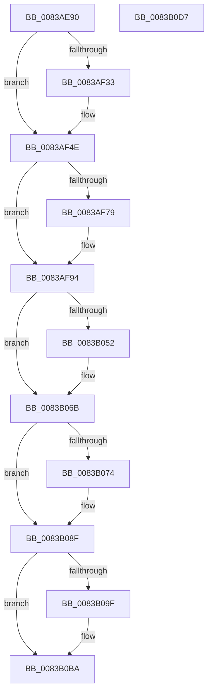

# VRegSetup

- RVA: `0x0083AE90`–`0x0083B0D8` (길이 `584` bytes)
- VA: `0x000000014083AE90`
- 실행 섹션: `PAGE`
- PDB 이름 있음: `예`; PDB Function 태그: `아니요`
- unwind 정보 RVA: `0x000BCBD0`
- 디코드: `134`개 명령, `584/584` bytes 표시
- 미해석 바이트: `0` (있으면 어셈블리에 `.byte`로 보존)

> 이 문서는 커널 이미지의 기계어와 PDB 기호를 분석해 생성했습니다. 4번과 5번은 함수 원형과 자료형을 바이너리 사용 방식에서 추정한 C 해석이며 원본 소스 복구 결과는 아닙니다.

## 1. Dependencies

- 직접 호출 지점: **16**; 고유 호출 대상: **11**
- 직접 호출자로 확인된 함수: **0**
- RIP 상대 이미지 참조: **16**

### Outgoing calls
- `0x0083AECD` → [TraceLoggingRegisterEx_EtwRegister_EtwSetInformation](../92/TraceLoggingRegisterEx_EtwRegister_EtwSetInformation_function_009208A0.md) (function, `0x009208A0`)
- `0x0083AEED` → [RtlpQueryRegistryValues](../8C/RtlpQueryRegistryValues_function_008C9050.md) (function, `0x008C9050`)
- `0x0083AEFD` → [RtlInitUnicodeString](../../text/42/RtlInitUnicodeString_function_0042A780.md) (function, `0x0042A780`)
- `0x0083AF2A` → [IoCreateDevice](../9A/IoCreateDevice_function_009A4B00.md) (function, `0x009A4B00`)
- `0x0083AF48` → [KeBugCheckEx](../../text/4F/KeBugCheckEx_function_004FD660.md) (function, `0x004FD660`)
- `0x0083AF70` → [ObSetSecurityObjectByPointer](../8B/ObSetSecurityObjectByPointer_function_008BAD20.md) (function, `0x008BAD20`)
- `0x0083AF8E` → [KeBugCheckEx](../../text/4F/KeBugCheckEx_function_004FD660.md) (function, `0x004FD660`)
- `0x0083AFD6` → [RtlInitUnicodeString](../../text/42/RtlInitUnicodeString_function_0042A780.md) (function, `0x0042A780`)
- `0x0083AFE9` → [memset](../../text/6C/memset_function_006C6C40.md) (function, `0x006C6C40`)
- `0x0083B049` → [ObCreateObjectTypeEx](../AB/ObCreateObjectTypeEx_function_00AB46D0.md) (function, `0x00AB46D0`)
- `0x0083B065` → [KeBugCheckEx](../../text/4F/KeBugCheckEx_function_004FD660.md) (function, `0x004FD660`)
- `0x0083B06B` → [VrpInitializeLoadedDifferencingHives](VrpInitializeLoadedDifferencingHives_function_0083BAA0.md) (function, `0x0083BAA0`)
- `0x0083B089` → [KeBugCheckEx](../../text/4F/KeBugCheckEx_function_004FD660.md) (function, `0x004FD660`)
- `0x0083B096` → [PspStorageAllocSlot](../78/PspStorageAllocSlot_function_00789B68.md) (function, `0x00789B68`)
- `0x0083B0B4` → [KeBugCheckEx](../../text/4F/KeBugCheckEx_function_004FD660.md) (function, `0x004FD660`)
- `0x0083B0C1` → [_security_check_cookie](../../text/6A/_security_check_cookie_function_006AC640.md) (function, `0x006AC640`)

### Direct callers
- 이 함수 시작 RVA로 연결되는 직접 call은 확인되지 않았습니다. 간접 호출은 완전히 역산할 수 없습니다.

### Static image references
- `0x0083AEA2` → RVA `0x00E0A740` (`.data`; read)
- `0x0083AEB9` → RVA `0x00E0A630` (`.data`; read)
- `0x0083AEDA` → RVA `0x00E0A5C0` (`.data`; read)
- `0x0083AEE6` → RVA `0x00B0E070` (` ?? ::NNGAKEGL::`string'`; read)
- `0x0083AEF2` → RVA `0x00B0E100` (` ?? ::NNGAKEGL::`string'`; read)
- `0x0083AF02` → RVA `0x00EF0028` (`.data`; read)
- `0x0083AF55` → RVA `0x00E0F128` (`.data`; read)
- `0x0083AF5C` → RVA `0x00EF02C0` (`.data`; read/write)
- `0x0083AF69` → RVA `0x00EF0010` (`.data`; write)
- `0x0083AF9B` → RVA `0x00B0E0C0` (` ?? ::NNGAKEGL::`string'`; read)
- `0x0083AFAB` → RVA `0x0083B0E0` (`VrpRegistryUnload`; read)
- `0x0083AFB6` → RVA `0x00A69960` (`VrpRegistryDispatch`; read)
- `0x0083AFC8` → RVA `0x00934C50` (`VrpIoctlDeviceDispatch`; read)
- `0x0083B024` → RVA `0x00AB7330` (`VrpJobContextDelete`; read)
- `0x0083B02F` → RVA `0x00EF0018` (`.data`; read)
- `0x0083B08F` → RVA `0x00EF02B8` (`.data`; read)

## 2. Other-region calls and transfers

- 다른 실행 섹션으로 향하는 call: **9**
  - `0x0083AEFD` → [RtlInitUnicodeString](../../text/42/RtlInitUnicodeString_function_0042A780.md) (`PAGE` → `.text`)
  - `0x0083AF48` → [KeBugCheckEx](../../text/4F/KeBugCheckEx_function_004FD660.md) (`PAGE` → `.text`)
  - `0x0083AF8E` → [KeBugCheckEx](../../text/4F/KeBugCheckEx_function_004FD660.md) (`PAGE` → `.text`)
  - `0x0083AFD6` → [RtlInitUnicodeString](../../text/42/RtlInitUnicodeString_function_0042A780.md) (`PAGE` → `.text`)
  - `0x0083AFE9` → [memset](../../text/6C/memset_function_006C6C40.md) (`PAGE` → `.text`)
  - `0x0083B065` → [KeBugCheckEx](../../text/4F/KeBugCheckEx_function_004FD660.md) (`PAGE` → `.text`)
  - `0x0083B089` → [KeBugCheckEx](../../text/4F/KeBugCheckEx_function_004FD660.md) (`PAGE` → `.text`)
  - `0x0083B0B4` → [KeBugCheckEx](../../text/4F/KeBugCheckEx_function_004FD660.md) (`PAGE` → `.text`)
  - `0x0083B0C1` → [_security_check_cookie](../../text/6A/_security_check_cookie_function_006AC640.md) (`PAGE` → `.text`)
- 별도 외부 분기/꼬리 이동을 확인하지 못했습니다.

## 3. Assembly (complete function range)

```asm
0083AE90  48 89 5C 24 10                  mov qword ptr [rsp + 0x10], rbx
0083AE95  55                              push rbp
0083AE96  48 8D 6C 24 A9                  lea rbp, [rsp - 0x57]
0083AE9B  48 81 EC F0 00 00 00            sub rsp, 0xf0
0083AEA2  48 8B 05 97 F8 5C 00            mov rax, qword ptr [rip + 0x5cf897]
0083AEA9  48 33 C4                        xor rax, rsp
0083AEAC  48 89 45 47                     mov qword ptr [rbp + 0x47], rax
0083AEB0  48 8B D9                        mov rbx, rcx
0083AEB3  0F 57 C0                        xorps xmm0, xmm0
0083AEB6  0F 57 C9                        xorps xmm1, xmm1
0083AEB9  48 8D 0D 70 F7 5C 00            lea rcx, [rip + 0x5cf770]
0083AEC0  45 33 C0                        xor r8d, r8d
0083AEC3  33 D2                           xor edx, edx
0083AEC5  0F 11 45 A7                     movups xmmword ptr [rbp - 0x59], xmm0
0083AEC9  0F 11 4D B7                     movups xmmword ptr [rbp - 0x49], xmm1
0083AECD  E8 CE 59 0E 00                  call 0x1409208a0
0083AED2  45 33 C9                        xor r9d, r9d
0083AED5  C6 44 24 28 01                  mov byte ptr [rsp + 0x28], 1
0083AEDA  4C 8D 05 DF F6 5C 00            lea r8, [rip + 0x5cf6df]
0083AEE1  B9 02 00 00 80                  mov ecx, 0x80000002
0083AEE6  48 8D 15 83 31 2D 00            lea rdx, [rip + 0x2d3183]
0083AEED  E8 5E E1 08 00                  call 0x1408c9050
0083AEF2  48 8D 15 07 32 2D 00            lea rdx, [rip + 0x2d3207]
0083AEF9  48 8D 4D A7                     lea rcx, [rbp - 0x59]
0083AEFD  E8 7E F8 BE FF                  call 0x14042a780
0083AF02  48 8D 05 1F 51 6B 00            lea rax, [rip + 0x6b511f]
0083AF09  41 B9 22 00 00 00               mov r9d, 0x22
0083AF0F  48 89 44 24 30                  mov qword ptr [rsp + 0x30], rax
0083AF14  4C 8D 45 A7                     lea r8, [rbp - 0x59]
0083AF18  C6 44 24 28 00                  mov byte ptr [rsp + 0x28], 0
0083AF1D  33 D2                           xor edx, edx
0083AF1F  48 8B CB                        mov rcx, rbx
0083AF22  C7 44 24 20 00 01 00 00         mov dword ptr [rsp + 0x20], 0x100
0083AF2A  E8 D1 9B 16 00                  call 0x1409a4b00
0083AF2F  85 C0                           test eax, eax
0083AF31  79 1B                           jns 0x14083af4e
0083AF33  48 83 64 24 20 00               and qword ptr [rsp + 0x20], 0
0083AF39  BA 1E 00 00 00                  mov edx, 0x1e
0083AF3E  4C 63 C0                        movsxd r8, eax
0083AF41  8D 4A 33                        lea ecx, [rdx + 0x33]
0083AF44  44 8D 4A E3                     lea r9d, [rdx - 0x1d]
0083AF48  E8 13 27 CC FF                  call 0x1404fd660
0083AF4D  CC                              int3
0083AF4E  48 8B 0D D3 50 6B 00            mov rcx, qword ptr [rip + 0x6b50d3]
0083AF55  4C 8D 05 CC 41 5D 00            lea r8, [rip + 0x5d41cc]
0083AF5C  48 83 25 5C 53 6B 00 00         and qword ptr [rip + 0x6b535c], 0
0083AF64  BA 0C 00 00 00                  mov edx, 0xc
0083AF69  48 89 1D A0 50 6B 00            mov qword ptr [rip + 0x6b50a0], rbx
0083AF70  E8 AB FD 07 00                  call 0x1408bad20
0083AF75  85 C0                           test eax, eax
0083AF77  79 1B                           jns 0x14083af94
0083AF79  48 83 64 24 20 00               and qword ptr [rsp + 0x20], 0
0083AF7F  BA 1E 00 00 00                  mov edx, 0x1e
0083AF84  4C 63 C0                        movsxd r8, eax
0083AF87  8D 4A 33                        lea ecx, [rdx + 0x33]
0083AF8A  44 8D 4A E4                     lea r9d, [rdx - 0x1c]
0083AF8E  E8 CD 26 CC FF                  call 0x1404fd660
0083AF93  CC                              int3
0083AF94  48 8B 05 8D 50 6B 00            mov rax, qword ptr [rip + 0x6b508d]
0083AF9B  48 8D 15 1E 31 2D 00            lea rdx, [rip + 0x2d311e]
0083AFA2  48 8D 4D B7                     lea rcx, [rbp - 0x49]
0083AFA6  0F BA 70 30 07                  btr dword ptr [rax + 0x30], 7
0083AFAB  48 8D 05 2E 01 00 00            lea rax, [rip + 0x12e]
0083AFB2  48 89 43 68                     mov qword ptr [rbx + 0x68], rax
0083AFB6  48 8D 05 A3 E9 22 00            lea rax, [rip + 0x22e9a3]
0083AFBD  48 89 43 70                     mov qword ptr [rbx + 0x70], rax
0083AFC1  48 89 83 80 00 00 00            mov qword ptr [rbx + 0x80], rax
0083AFC8  48 8D 05 81 9C 0F 00            lea rax, [rip + 0xf9c81]
0083AFCF  48 89 83 E0 00 00 00            mov qword ptr [rbx + 0xe0], rax
0083AFD6  E8 A5 F7 BE FF                  call 0x14042a780
0083AFDB  BB 78 00 00 00                  mov ebx, 0x78
0083AFE0  48 8D 4D C7                     lea rcx, [rbp - 0x39]
0083AFE4  44 8B C3                        mov r8d, ebx
0083AFE7  33 D2                           xor edx, edx
0083AFE9  E8 52 BC E8 FF                  call 0x1406c6c40
0083AFEE  80 4D C9 04                     or byte ptr [rbp - 0x37], 4
0083AFF2  48 8D 55 C7                     lea rdx, [rbp - 0x39]
0083AFF6  B8 00 00 02 00                  mov eax, 0x20000
0083AFFB  66 89 5D C7                     mov word ptr [rbp - 0x39], bx
0083AFFF  89 45 D3                        mov dword ptr [rbp - 0x2d], eax
0083B002  48 8D 4D B7                     lea rcx, [rbp - 0x49]
0083B006  89 45 D7                        mov dword ptr [rbp - 0x29], eax
0083B009  45 33 C9                        xor r9d, r9d
0083B00C  89 45 DB                        mov dword ptr [rbp - 0x25], eax
0083B00F  45 33 C0                        xor r8d, r8d
0083B012  B8 00 00 0F 00                  mov eax, 0xf0000
0083B017  C7 45 CF 00 01 00 00            mov dword ptr [rbp - 0x31], 0x100
0083B01E  89 45 DF                        mov dword ptr [rbp - 0x21], eax
0083B021  89 45 E3                        mov dword ptr [rbp - 0x1d], eax
0083B024  48 8D 05 05 C3 27 00            lea rax, [rip + 0x27c305]
0083B02B  48 89 45 0F                     mov qword ptr [rbp + 0xf], rax
0083B02F  48 8D 05 E2 4F 6B 00            lea rax, [rip + 0x6b4fe2]
0083B036  48 89 44 24 20                  mov qword ptr [rsp + 0x20], rax
0083B03B  C7 45 EB 01 00 00 00            mov dword ptr [rbp - 0x15], 1
0083B042  C7 45 EF 60 00 00 00            mov dword ptr [rbp - 0x11], 0x60
0083B049  E8 82 96 27 00                  call 0x140ab46d0
0083B04E  85 C0                           test eax, eax
0083B050  79 19                           jns 0x14083b06b
0083B052  48 83 64 24 20 00               and qword ptr [rsp + 0x20], 0
0083B058  8D 53 A6                        lea edx, [rbx - 0x5a]
0083B05B  4C 63 C0                        movsxd r8, eax
0083B05E  8D 4B D9                        lea ecx, [rbx - 0x27]
0083B061  44 8D 4B 8C                     lea r9d, [rbx - 0x74]
0083B065  E8 F6 25 CC FF                  call 0x1404fd660
0083B06A  CC                              int3
0083B06B  E8 30 0A 00 00                  call 0x14083baa0
0083B070  85 C0                           test eax, eax
0083B072  79 1B                           jns 0x14083b08f
0083B074  48 83 64 24 20 00               and qword ptr [rsp + 0x20], 0
0083B07A  BA 1E 00 00 00                  mov edx, 0x1e
0083B07F  4C 63 C0                        movsxd r8, eax
0083B082  8D 4A 33                        lea ecx, [rdx + 0x33]
0083B085  44 8D 4A E7                     lea r9d, [rdx - 0x19]
0083B089  E8 D2 25 CC FF                  call 0x1404fd660
0083B08E  CC                              int3
0083B08F  48 8D 0D 22 52 6B 00            lea rcx, [rip + 0x6b5222]
0083B096  E8 CD EA F4 FF                  call 0x140789b68
0083B09B  85 C0                           test eax, eax
0083B09D  79 1B                           jns 0x14083b0ba
0083B09F  48 83 64 24 20 00               and qword ptr [rsp + 0x20], 0
0083B0A5  BA 1E 00 00 00                  mov edx, 0x1e
0083B0AA  4C 63 C0                        movsxd r8, eax
0083B0AD  8D 4A 33                        lea ecx, [rdx + 0x33]
0083B0B0  44 8D 4A E8                     lea r9d, [rdx - 0x18]
0083B0B4  E8 A7 25 CC FF                  call 0x1404fd660
0083B0B9  CC                              int3
0083B0BA  48 8B 4D 47                     mov rcx, qword ptr [rbp + 0x47]
0083B0BE  48 33 CC                        xor rcx, rsp
0083B0C1  E8 7A 15 E7 FF                  call 0x1406ac640
0083B0C6  48 8B 9C 24 08 01 00 00         mov rbx, qword ptr [rsp + 0x108]
0083B0CE  48 81 C4 F0 00 00 00            add rsp, 0xf0
0083B0D5  5D                              pop rbp
0083B0D6  C3                              ret
0083B0D7  CC                              int3
```

## 4. C-style interpretation (structured pseudocode)

```c
__int64 __fastcall VRegSetup(__int64 a1, int a2, int a3, int a4)
{
    __int64 result;
    __int64 v_rsp;
    unsigned __int64 v_stack_m18;
    unsigned __int64 v_stack_m50;
    unsigned __int64 v_stack_m5F;
    unsigned int v_stack_m70;
    unsigned int v_stack_m74;
    unsigned int v_stack_m7C;
    unsigned int v_stack_m80;
    unsigned int v_stack_m84;
    unsigned int v_stack_m88;
    unsigned int v_stack_m8C;
    unsigned int v_stack_m90;
    unsigned __int8 v_stack_m96;
    unsigned __int64 v_stack_m98;
    unsigned __int64 v_stack_mA8;
    unsigned __int64 v_stack_mB8;
    unsigned __int64 v_stack_mC8;
    unsigned __int8 v_stack_mD0;
    unsigned int v_stack_mD8;
    unsigned __int64 v_stack_p10;

    v_stack_p10 = v_rbx;
    v_rsp = (v_rsp) - (240);
    result = (*(unsigned __int64 *)(v_rip + 6092951)) ^ (v_rsp);
    v_stack_m18 = result;
    a3 = 0;
    a2 = 0;
    v_stack_mB8 = v_xmm0;
    v_stack_mA8 = v_xmm1;
    result = TraceLoggingRegisterEx_EtwRegister_EtwSetInformation(v_rip + 6092656, a2, a3, a4);
    a4 = 0;
    v_stack_mD0 = 1;
    result = RtlpQueryRegistryValues((unsigned int)(0x80000002ULL), v_rip + 2961795, v_rip + 6092511, a4);
    result = RtlInitUnicodeString(v_stack_mB8, v_rip + 2961927, v_rip + 6092511, a4);
    v_stack_mC8 = v_rip + 7033119;
    v_stack_mD0 = 0;
    a2 = 0;
    v_stack_mD8 = 256;
    result = IoCreateDevice(a1, a2, v_stack_mB8, 34);
    if (sign_flag) {
        a2 = 30;
        a3 = (int)((unsigned int)(result));
        a1 = a2 + 51;
        a4 = a2 - 29;
        result = KeBugCheckEx(a1, a2, a3, a4);
    }
    *(unsigned __int64 *)(v_rip + 7032992) = a1;
    result = ObSetSecurityObjectByPointer(*(unsigned __int64 *)(v_rip + 7033043), 12, v_rip + 6111692, a4);
    if (sign_flag) {
        a2 = 30;
        a3 = (int)((unsigned int)(result));
        a1 = a2 + 51;
        a4 = a2 - 28;
        result = KeBugCheckEx(a1, a2, a3, a4);
    }
    *(unsigned __int64 *)(a1 + 104) = v_rip + 302;
    *(unsigned __int64 *)(a1 + 112) = v_rip + 2288035;
    *(unsigned __int64 *)(a1 + 128) = v_rip + 2288035;
    *(unsigned __int64 *)(a1 + 224) = v_rip + 1023105;
    result = RtlInitUnicodeString(v_stack_mA8, v_rip + 2961694, a3, a4);
    a2 = 0;
    result = memset(v_stack_m98, a2, 120, a4);
    v_stack_m98 = 120;
    v_stack_m8C = (unsigned int)((unsigned int)(0x20000ULL));
    v_stack_m88 = (unsigned int)((unsigned int)(0x20000ULL));
    a4 = 0;
    v_stack_m84 = (unsigned int)((unsigned int)(0x20000ULL));
    a3 = 0;
    v_stack_m90 = 256;
    v_stack_m80 = (unsigned int)((unsigned int)(0xF0000ULL));
    v_stack_m7C = (unsigned int)((unsigned int)(0xF0000ULL));
    v_stack_m50 = v_rip + 2605829;
    v_stack_mD8 = v_rip + 7032802;
    v_stack_m74 = 1;
    v_stack_m70 = 96;
    result = ObCreateObjectTypeEx(v_stack_mA8, v_stack_m98, a3, a4);
    if (sign_flag) {
        a2 = 120 - 90;
        a3 = (int)((unsigned int)(result));
        a1 = 120 - 39;
        a4 = 120 - 116;
        result = KeBugCheckEx(a1, a2, a3, a4);
    }
    result = VrpInitializeLoadedDifferencingHives(a1, a2, a3, a4);
    if (sign_flag) {
        a2 = 30;
        a3 = (int)((unsigned int)(result));
        a1 = a2 + 51;
        a4 = a2 - 25;
        result = KeBugCheckEx(a1, a2, a3, a4);
    }
    result = PspStorageAllocSlot(v_rip + 7033378, a2, a3, a4);
    if (sign_flag) {
        a2 = 30;
        a3 = (int)((unsigned int)(result));
        a1 = a2 + 51;
        a4 = a2 - 24;
        result = KeBugCheckEx(a1, a2, a3, a4);
    }
    a1 = (v_stack_m18) ^ (v_rsp);
    result = _security_check_cookie(a1, a2, a3, a4);
    v_rsp = (v_rsp) + (240);
    return result;
}
```

## 5. (Beta) C Style

```c
int64_t VRegSetup(void *Arg1, int32_t Arg2, int32_t Arg3, int32_t Arg4)
{
    uint8_t *arg1 = (uint8_t *)Arg1;

    int64_t result;
    int64_t local_rsp;
    uint64_t v_stack_m18;
    uint64_t v_stack_m50;
    uint64_t v_stack_m5F;
    uint32_t v_stack_m70;
    uint32_t v_stack_m74;
    uint32_t v_stack_m7C;
    uint32_t v_stack_m80;
    uint32_t v_stack_m84;
    uint32_t v_stack_m88;
    uint32_t v_stack_m8C;
    uint32_t v_stack_m90;
    uint8_t v_stack_m96;
    uint64_t v_stack_m98;
    uint64_t v_stack_mA8;
    uint64_t v_stack_mB8;
    uint64_t v_stack_mC8;
    uint8_t v_stack_mD0;
    uint32_t v_stack_mD8;
    uint64_t v_stack_p10;

    v_stack_p10 = local_rbx;
    local_rsp = (local_rsp) - (240);
    result = (*(uint64_t *)(v_rip + 0x5CF897)) ^ (local_rsp);
    v_stack_m18 = result;
    Arg3 = 0;
    Arg2 = 0;
    v_stack_mB8 = v_xmm0;
    v_stack_mA8 = v_xmm1;
    result = TraceLoggingRegisterEx_EtwRegister_EtwSetInformation(v_rip + 6092656, Arg2, Arg3, Arg4);
    Arg4 = 0;
    v_stack_mD0 = 1;
    result = RtlpQueryRegistryValues((uint32_t)(0x80000002ULL), v_rip + 2961795, v_rip + 6092511, Arg4);
    result = RtlInitUnicodeString(v_stack_mB8, v_rip + 2961927, v_rip + 6092511, Arg4);
    v_stack_mC8 = v_rip + 7033119;
    v_stack_mD0 = 0;
    Arg2 = 0;
    v_stack_mD8 = 256;
    result = IoCreateDevice(Arg1, Arg2, v_stack_mB8, 34);
    if (sign_flag) {
        Arg2 = 30;
        Arg3 = (int32_t)((uint32_t)(result));
        Arg1 = Arg2 + 51;
        Arg4 = Arg2 - 29;
        result = KeBugCheckEx(Arg1, Arg2, Arg3, Arg4);
    }
    *(void **)(v_rip + 0x6B50A0) = Arg1;
    result = ObSetSecurityObjectByPointer(*(uint64_t *)(v_rip + 0x6B50D3), 12, v_rip + 6111692, Arg4);
    if (sign_flag) {
        Arg2 = 30;
        Arg3 = (int32_t)((uint32_t)(result));
        Arg1 = Arg2 + 51;
        Arg4 = Arg2 - 28;
        result = KeBugCheckEx(Arg1, Arg2, Arg3, Arg4);
    }
    *(uint64_t *)(arg1 + 0x68) = v_rip + 302;
    *(uint64_t *)(arg1 + 0x70) = v_rip + 2288035;
    *(uint64_t *)(arg1 + 0x80) = v_rip + 2288035;
    *(uint64_t *)(arg1 + 0xE0) = v_rip + 1023105;
    result = RtlInitUnicodeString(v_stack_mA8, v_rip + 2961694, Arg3, Arg4);
    Arg2 = 0;
    result = memset(v_stack_m98, Arg2, 120, Arg4);
    v_stack_m98 = 120;
    v_stack_m8C = (uint32_t)((uint32_t)(0x20000ULL));
    v_stack_m88 = (uint32_t)((uint32_t)(0x20000ULL));
    Arg4 = 0;
    v_stack_m84 = (uint32_t)((uint32_t)(0x20000ULL));
    Arg3 = 0;
    v_stack_m90 = 256;
    v_stack_m80 = (uint32_t)((uint32_t)(0xF0000ULL));
    v_stack_m7C = (uint32_t)((uint32_t)(0xF0000ULL));
    v_stack_m50 = v_rip + 2605829;
    v_stack_mD8 = v_rip + 7032802;
    v_stack_m74 = 1;
    v_stack_m70 = 96;
    result = ObCreateObjectTypeEx(v_stack_mA8, v_stack_m98, Arg3, Arg4);
    if (sign_flag) {
        Arg2 = 120 - 90;
        Arg3 = (int32_t)((uint32_t)(result));
        Arg1 = 120 - 39;
        Arg4 = 120 - 116;
        result = KeBugCheckEx(Arg1, Arg2, Arg3, Arg4);
    }
    result = VrpInitializeLoadedDifferencingHives(Arg1, Arg2, Arg3, Arg4);
    if (sign_flag) {
        Arg2 = 30;
        Arg3 = (int32_t)((uint32_t)(result));
        Arg1 = Arg2 + 51;
        Arg4 = Arg2 - 25;
        result = KeBugCheckEx(Arg1, Arg2, Arg3, Arg4);
    }
    result = PspStorageAllocSlot(v_rip + 7033378, Arg2, Arg3, Arg4);
    if (sign_flag) {
        Arg2 = 30;
        Arg3 = (int32_t)((uint32_t)(result));
        Arg1 = Arg2 + 51;
        Arg4 = Arg2 - 24;
        result = KeBugCheckEx(Arg1, Arg2, Arg3, Arg4);
    }
    Arg1 = (v_stack_m18) ^ (local_rsp);
    result = _security_check_cookie(Arg1, Arg2, Arg3, Arg4);
    local_rsp = (local_rsp) + (240);
    return result;
}
```

### 관측된 메모리 오프셋

구조체 형식이 확인되지 않은 접근은 인자 기준의 오프셋으로만 기록했습니다.

| 기준 인자 | 오프셋 표현 | 폭 (bit) | 접근 |
|---|---:|---:|---|
| `Arg1` | `+ 0x68` | `64` | `W` |
| `Arg1` | `+ 0x70` | `64` | `W` |
| `Arg1` | `+ 0x80` | `64` | `W` |
| `Arg1` | `+ 0xE0` | `64` | `W` |

## 6. Execution-region graph

[열기: 2D/3D 그래프와 함수 탐색 컨트롤 패널](../../../control-panel.html?section=page&rva=0x0083AE90&view=graph)

- 2D 그래프는 위에서 아래로 흐르고, 3D 그래프는 빈 공간을 드래그해 회전합니다. Shift+드래그는 이동, 휠은 확대·축소, 함수 노드 선택은 대상 보고서 이동입니다.

### Static fallback


