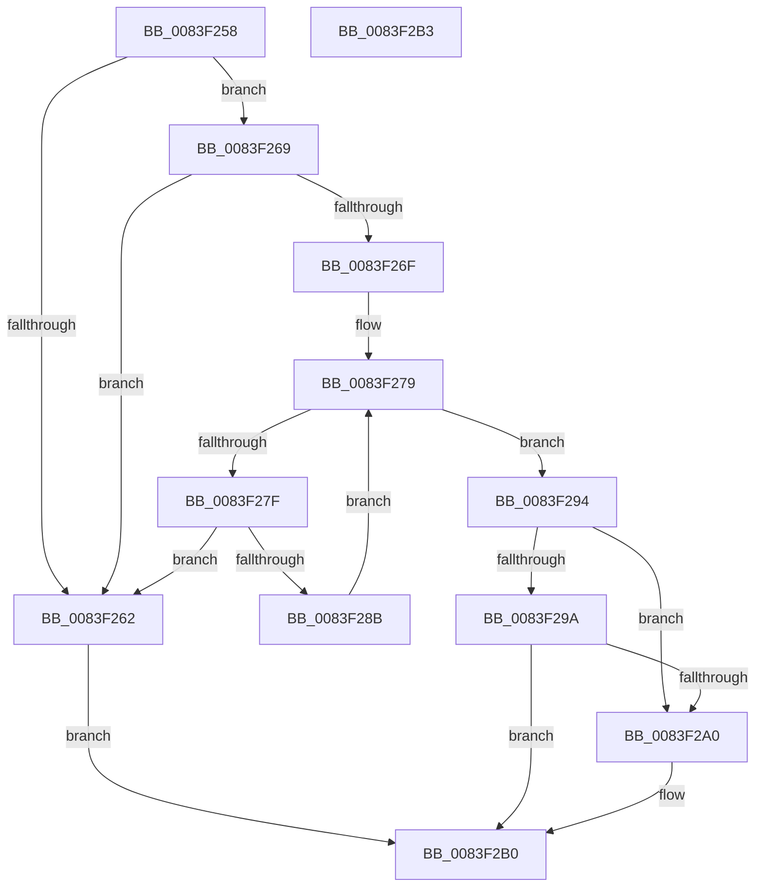

# ValidateRegistrLangType

- RVA: `0x0083F258`–`0x0083F2B4` (길이 `92` bytes)
- VA: `0x000000014083F258`
- 실행 섹션: `PAGE`
- PDB 이름 있음: `예`; PDB Function 태그: `아니요`
- unwind 정보 RVA: `0x000DB714`
- 디코드: `32`개 명령, `92/92` bytes 표시
- 미해석 바이트: `0` (있으면 어셈블리에 `.byte`로 보존)

> 이 문서는 커널 이미지의 기계어와 PDB 기호를 분석해 생성했습니다. 4번과 5번은 함수 원형과 자료형을 바이너리 사용 방식에서 추정한 C 해석이며 원본 소스 복구 결과는 아닙니다.

## 1. Dependencies

- 직접 호출 지점: **0**; 고유 호출 대상: **0**
- 직접 호출자로 확인된 함수: **1**
- RIP 상대 이미지 참조: **1**

### Outgoing calls
- 직접 디코드된 call 명령이 없습니다.

### Direct callers
- [RtlpMuiRegLoadInstalledFromKey](../../text/6A/RtlpMuiRegLoadInstalledFromKey_function_006A9450.md) at `0x006A9598`

### Static image references
- `0x0083F272` → RVA `0x00042BD8` (`.rdata`; read)

## 2. Other-region calls and transfers

- 다른 실행 섹션으로 향하는 call: **0**
- 별도 외부 분기/꼬리 이동을 확인하지 못했습니다.

## 3. Assembly (complete function range)

```asm
0083F258  33 D2                           xor edx, edx
0083F25A  44 8B C1                        mov r8d, ecx
0083F25D  F6 C1 18                        test cl, 0x18
0083F260  75 07                           jne 0x14083f269
0083F262  BA 0D 00 00 C0                  mov edx, 0xc000000d
0083F267  EB 47                           jmp 0x14083f2b0
0083F269  41 F6 C0 07                     test r8b, 7
0083F26D  74 F3                           je 0x14083f262
0083F26F  44 8B CA                        mov r9d, edx
0083F272  4C 8D 15 5F 39 80 FF            lea r10, [rip - 0x7fc6a1]
0083F279  41 83 F9 08                     cmp r9d, 8
0083F27D  7D 15                           jge 0x14083f294
0083F27F  41 8B 0A                        mov ecx, dword ptr [r10]
0083F282  8B C1                           mov eax, ecx
0083F284  41 23 C0                        and eax, r8d
0083F287  3B C8                           cmp ecx, eax
0083F289  74 D7                           je 0x14083f262
0083F28B  41 FF C1                        inc r9d
0083F28E  49 83 C2 04                     add r10, 4
0083F292  EB E5                           jmp 0x14083f279
0083F294  41 F6 C0 01                     test r8b, 1
0083F298  75 06                           jne 0x14083f2a0
0083F29A  41 F6 C0 02                     test r8b, 2
0083F29E  74 10                           je 0x14083f2b0
0083F2A0  8B CA                           mov ecx, edx
0083F2A2  41 F6 C0 10                     test r8b, 0x10
0083F2A6  BA 0D 00 00 C0                  mov edx, 0xc000000d
0083F2AB  0F 44 CA                        cmove ecx, edx
0083F2AE  8B D1                           mov edx, ecx
0083F2B0  8B C2                           mov eax, edx
0083F2B2  C3                              ret
0083F2B3  CC                              int3
```

## 4. C-style interpretation (structured pseudocode)

```c
__int64 __fastcall ValidateRegistrLangType(int a1, int a2)
{
    __int64 result;
    __int64 v_r10;

    a2 = 0;
    if ((((unsigned __int8)(a1)) & (24)) != 0) goto loc_0083F269;
loc_0083F262:
    goto loc_0083F2B0;
loc_0083F269:
    if ((((unsigned __int8)((unsigned int)(a1))) & (7)) == 0) goto loc_0083F262;
loc_0083F279:
    if (((unsigned int)((unsigned int)((unsigned int)((unsigned int)(0xC000000DULL))))) >= 8) goto loc_0083F294;
    result = (unsigned int)(((unsigned int)((unsigned int)((unsigned int)(*(unsigned int *)(v_rip - 8373921))))) & ((unsigned int)((unsigned int)(a1))));
    if (((unsigned int)((unsigned int)(*(unsigned int *)(v_rip - 8373921)))) == ((unsigned int)(result))) goto loc_0083F262;
    a4 = (unsigned int)(((unsigned int)((unsigned int)((unsigned int)(0xC000000DULL)))) + 1);
    v_r10 = (v_rip - 8373921) + (4);
    goto loc_0083F279;
loc_0083F294:
    if ((((unsigned __int8)((unsigned int)(a1))) & (1)) != 0) goto loc_0083F2A0;
    if ((((unsigned __int8)((unsigned int)(a1))) & (2)) != 0) {
        a1 = (unsigned int)((unsigned int)(0xC000000DULL));
        a2 = 0xC000000DULL;
        if ((((unsigned __int8)((unsigned int)(a1))) & (16)) == 0) { a1 = a2; }
        a2 = a1;
    }
    return (unsigned int)(a2);
}
```

## 5. (Beta) C Style

```c
int64_t ValidateRegistrLangType(int32_t Arg1, int32_t Arg2)
{
    int64_t result;
    int64_t local_r10;

    Arg2 = 0;
    if ((((uint8_t)(Arg1)) & (24)) != 0) goto loc_0083F269;
loc_0083F262:
    goto loc_0083F2B0;
loc_0083F269:
    if ((((uint8_t)((uint32_t)(Arg1))) & (7)) == 0) goto loc_0083F262;
loc_0083F279:
    if (((uint32_t)((uint32_t)((uint32_t)((uint32_t)(0xC000000DULL))))) >= 8) goto loc_0083F294;
    result = (uint32_t)(((uint32_t)((uint32_t)((uint32_t)(*(uint32_t *)(v_rip - 0x7FC6A1))))) & ((uint32_t)((uint32_t)(Arg1))));
    if (((uint32_t)((uint32_t)(*(uint32_t *)(v_rip - 0x7FC6A1)))) == ((uint32_t)(result))) goto loc_0083F262;
    a4 = (uint32_t)(((uint32_t)((uint32_t)((uint32_t)(0xC000000DULL)))) + 1);
    local_r10 = (v_rip - 8373921) + (4);
    goto loc_0083F279;
loc_0083F294:
    if ((((uint8_t)((uint32_t)(Arg1))) & (1)) != 0) goto loc_0083F2A0;
    if ((((uint8_t)((uint32_t)(Arg1))) & (2)) != 0) {
        Arg1 = (uint32_t)((uint32_t)(0xC000000DULL));
        Arg2 = 0xC000000DULL;
        if ((((uint8_t)((uint32_t)(Arg1))) & (16)) == 0) { Arg1 = Arg2; }
        Arg2 = Arg1;
    }
    return (uint32_t)(Arg2);
}
```

## 6. Execution-region graph

[열기: 2D/3D 그래프와 함수 탐색 컨트롤 패널](../../../control-panel.html?section=page&rva=0x0083F258&view=graph)

- 2D 그래프는 위에서 아래로 흐르고, 3D 그래프는 빈 공간을 드래그해 회전합니다. Shift+드래그는 이동, 휠은 확대·축소, 함수 노드 선택은 대상 보고서 이동입니다.

### Static fallback


